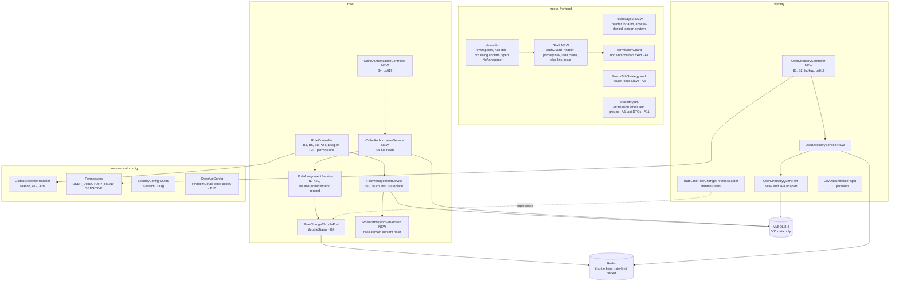
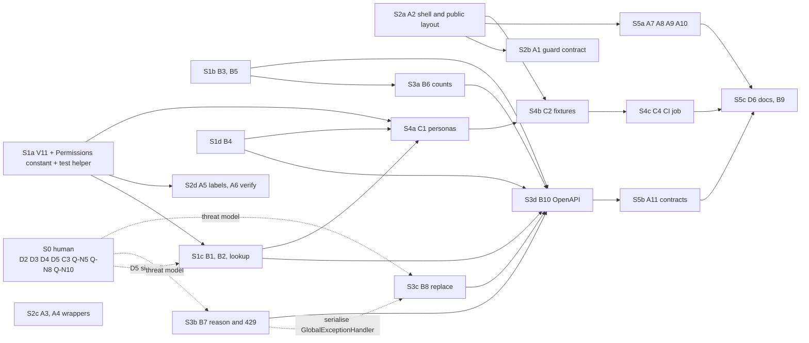
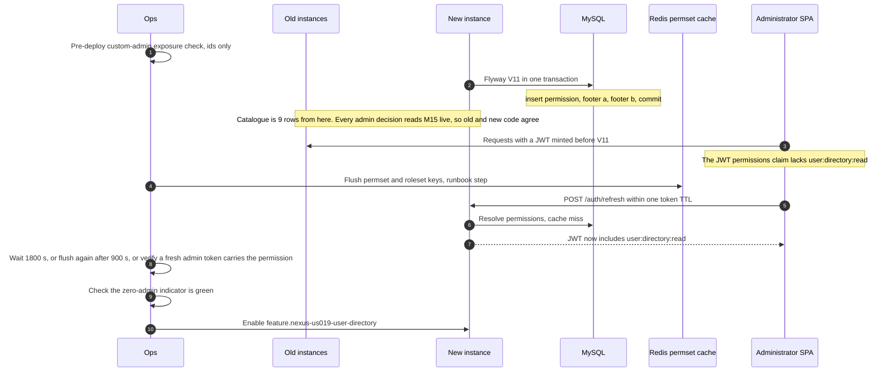
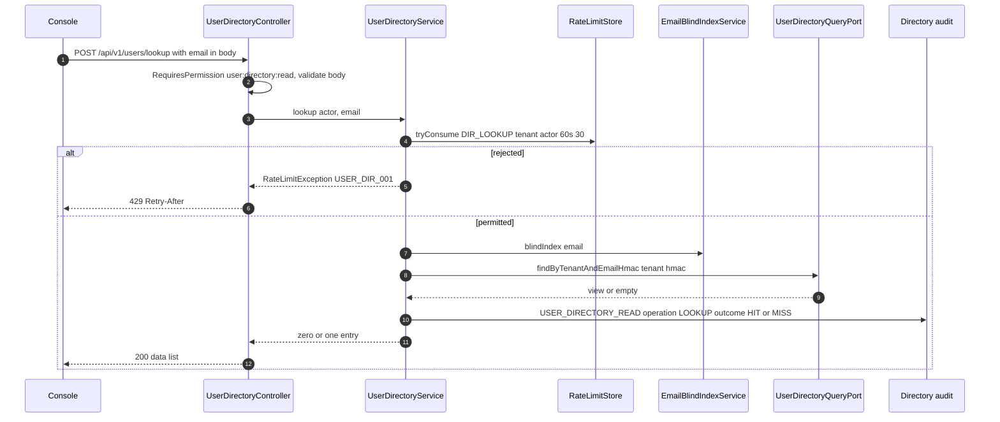
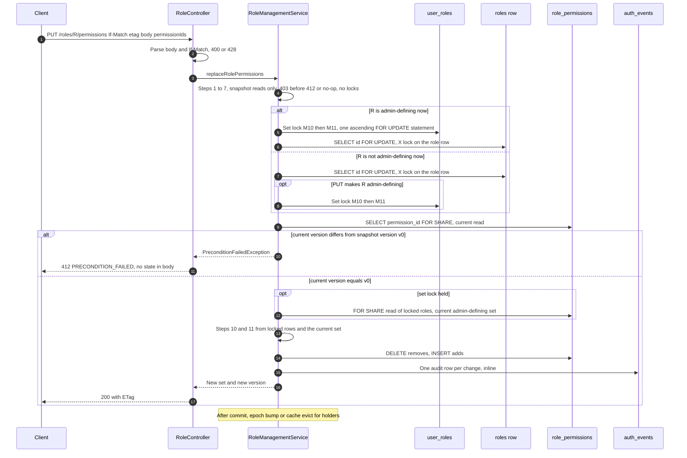
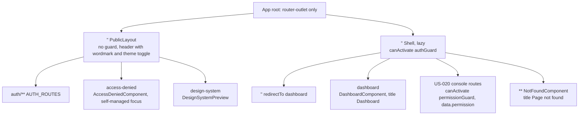

# US-019 — Solution Design: Prerequisites for the RBAC Access Management UI

**Epic:** EPIC-002 (RBAC Foundation)
**Phase:** 3 (Solution Design), Gate 2 Step A
**Author:** Principal Architect
**Status:** Revision 1 (2026-10-19), threat-model required changes RC-55 to RC-63 folded in (`03b-threat-model.md` §6, §9.1), and the delta-review changes RC-64 to RC-67 (`03b-threat-model.md` §10). Approved at Gate 2.

**Gate 2:** approved 2026-10-19 by the story owner, Md Nisar Ahmed. The approval includes accepting RES-47 (the two bits the B7 `reason` discloses) and RES-26, as recorded in `03b-threat-model.md`. Still open for people and not blocking the design: D5 confirmation that the PII-grant rule stays ON (RES-51), Ops alert thresholds and RES-6 retention sign-off, and the US-020 acceptance of RES-53 (retry `RBAC_012` once).

> **Revision 1 (2026-10-19) — threat model RC-55..RC-63**
> - **RC-55** (T-T22, High): step 9 compares the locked version to the snapshot version `v0`; `If-Match` takes exactly one strong tag; soundness paragraph rewritten; IT case (g), two-tag unit test; ADR-0027 states the ETag is not a secret (§0 #15–16, §10.3, §10.5, §10.8).
> - **RC-56** (T-E48): queued assign and attach recorded in the proof table; assign and attach re-classify after insert with retryable 409 `RBAC_012`; committed-state detector that pages; ADR-0021 Revision 3 corrects R1-1; harness cases (§2.2, §10.4, §10.8, §10.9).
> - **RC-57** (T-E49): admin-defining classification under the set lock from a current read, for B8, revoke and softDelete; RES-28 restated as single-actor (§10.3, §10.4, §10.9).
> - **RC-58** (T-I20): 403 before 412 and before the no-op; live `role:read` required; 412/428 bodies carry no state (§10.3, §10.5).
> - **RC-59** (T-I21): body, media-type, method and missing-header handlers that never log the message; malformed-body log scan; 1 KiB lookup cap (§2.2, §4.2, §4.7, §10.7).
> - **RC-60** (T-E50): delegation recorded in ADR-0026; administrator-only grant of `user:directory:read` (default, D5 confirms); delegation WARN (§4.8).
> - **RC-61** (T-R16): row-volume alert; batch cross-tenant count and WARN; per-actor directory ceiling (§4.2, §4.5, §17).
> - **RC-62** (T-T23): `@angular/*` ≥ 22.2.0, clean production audit, ESLint HTML-sink ban (§12.4).
> - **RC-63(a)–(l)**: attach row corrected (T-T24) and the low-severity tasks, in the sections each names.
> - Architect decisions (◆) are in "Revision 1 decisions for Gate 2" at the end of §0.

**Inputs (binding, not reopened):**
- `01-requirements.md` §13a, **Gate 1 decisions (2026-10-19)**: `user:directory:read` gates B1/B2 and `user:read` is unchanged; `isSensitive` is a static set in `Permissions`; B7 ships with an allow-list and throttling becomes a real 429 + `Retry-After`; `ETag`/`If-Match` on the permission replace (428 missing, 412 stale, 409 business only); the set lock is taken when the before or after state of the role is admin-defining (to be confirmed by the threat model); B4 is an `rbac` controller under the us019 flag; A1 = `authGuard` on a shell parent, `permissionGuard` on children; A11 = hand-written DTOs + contract test; C4 = Playwright against a compose backend, skips count as failures; S0–S5 split; Q12(b) keep `app.html`'s header for public pages, the shell has its own; Q-N1 to Q-N4, Q-N6, Q-N7 take the requirements' recommendations.
- `02-impact.md` (verified impact). This document **builds on it and does not repeat its file inventories**. "Impact §x" points there. Its corrections to the requirements and discovery (soft-deleted roles already 404, role-creation port exists, locked/pending reachable through the domain, throttle scope, flag-off is distinguishable by `code`) are adopted.
- `docs/story/2-rbac/US-019.md`, `US-020.md`; ADRs 0003, 0004, 0006, 0014–0016, 0018, 0021–0025; `docs/features/US-018/03-design.md` (§2.1 administrator, §5.3 set lock, §11.1 RC-46 lock order, §9 epoch and cache).

**Code verified** on `feature/US-019` (base `main` @ `2962b0e`) for every claim marked with a file reference. Two facts found during this design that the impact did not record:
1. `UserRolesPrivilegeIT.should_allowLockingRead_when_selectingActiveAssignmentForUpdateAsNexusApp` (`UserRolesPrivilegeIT.java:133-151`) proves, as `nexus_app`, that a **column-scoped** `UPDATE (revoked_at)` grant is enough for `SELECT … FOR UPDATE` on `user_roles`. The same rule should hold for `roles`, whose grant is column-scoped `UPDATE (name, description, deleted_at)` (`02-grants-post-schema.sql:39`). §10.4 still requires a `roles` IT.
2. The compose `frontend` nginx throttles the whole `/api/v1/auth/` prefix at 10 r/min per IP with burst 10 (`nexus-frontend/nginx.conf:9`, `:35-42`), so `POST /auth/refresh` is throttled there too. Every SPA cold start refreshes, so an e2e suite driven through that nginx would hit 429s. This shapes C4 (§13.4).

**No PII.** People are referred to by role. Dev-seed credentials and persona addresses are not repeated here.

**New ADRs proposed with this design** (status "Proposed"; accepted ADRs are not edited):

| ADR | Covers | Relationship |
|---|---|---|
| `0026-user-directory-permission-and-pii-transport.md` | `user:directory:read`, the POST lookup, directory audit and throttle, `isSensitive` semantics, PII-permission delegation (RC-60) | Draft of the ADR-0006 addendum D5 must sign; ADR-0013 D1 naming (three-token name, as ADR-0021 D1 allowed) |
| `0027-role-permission-set-optimistic-concurrency.md` | B8 content ETag, role-row lock, lock order | Extends ADR-0018 D5–D7 and US-018 RC-46 with one new verb; deviates from the skill's "`@Version` for optimistic locking" (§10.2 states why) |
| ADR-0021, **Revision 3** (it is still Proposed, so it may be revised) | B7 caller-facing `reason` and its wire values; B8 as a grant-like operation (follow-on rule) | Revision note, not a new ADR |

---

## 0. Decisions for Gate 2 approval

Each line is a decision this design makes. Gate 2 may override any of them. Section numbers point to the reasoning.

1. **V11** seeds `user:directory:read` (id `019f6839-1808-7000-8000-000000000009`) with the mandatory B7 footer, **A-V9 variant**, bound to exactly that id. It is data only: no DDL, no grant. It is the only migration in this story (§3).
2. **Administrator set preserved by V11:** footer (a) completes every live full-catalogue role and footer (b) re-syncs every system `TENANT_ADMIN`. No role is promoted and no administrator is demoted. `MEMBER` does not receive the permission. **Ops ordering is mandatory:** V11 deploys, then the permission cache is flushed, then us019 is enabled only after 1,800 s, a second flush 900 s after the first, or a verified fresh administrator token carrying the permission (RC-63(d), §3.3).
3. **Test fixtures cannot silently stop building an administrator:** a DB-derived `RbacTestCatalogue` helper, a literal-scan test with an allow-list, and an `assertAdministrator` fixture check (§3.5).
4. **Directory email lookup is `POST /api/v1/users/lookup` with the email in the body.** `GET /api/v1/users?email=` is rejected with 400 so the email never enters a URL, an access log or browser history. This departs from the story's `GET ?email=`; D5 must accept it (§4.3).
5. **Directory responses** carry exactly `userId, email, status, emailVerified, createdAt`. Missing and cross-tenant ids give a byte-identical 404 `USER_NOT_FOUND`, which is deliberately distinct from flag-off 404 `RESOURCE_NOT_FOUND` (§4.2).
6. **Directory reads are audited** (`USER_DIRECTORY_READ`, ids and counts only; no email, no blind index). **Lookups are throttled** at 30 per 60 s per (tenant, actor) with 429 `USER_DIR_001` + `Retry-After`, and every directory operation shares a per-actor ceiling (429 `USER_DIR_002`). The design states that the throttle does not stop enumeration by a permission holder, who can list the directory anyway; a row-volume alert per actor detects it (§4.5, §17).
7. **Paging types are not moved.** Identity gets three small local types; a contract test pins the identical wire shape. The 33-file move to `common` becomes a separate refactor (§4.6).
8. **B3** `GET /api/v1/roles/{roleId}` reuses `resolveRoleInTenant`; it has no ETag (§5).
9. **B4** `GET /api/v1/users/me/authorization` is an `rbac` controller under us019 and `@AuthenticatedEndpoint` with an `Authentication` parameter only. It makes four live reads in one read-only transaction, gets `isAdministrator` from `RoleAssignmentService.isCallerAdministrator` (the one predicate), and uses no cache, no JWT claim and no audit row (§6).
10. **B5** `Permissions.SENSITIVE` and `Permissions.NON_SENSITIVE` partition `Permissions.ALL`. A test fails when a catalogue name is unclassified. Membership is a Security decision with a proposed default (§7).
11. **B6** `memberCount` = active assignments of the live role in the caller's tenant (user status ignored); `permissionCount` = attached permissions. Two grouped queries per page. All four `RoleResponse` producers carry both fields, so `RoleResponse` keeps one shape (§8).
12. **B7** `RBAC_001` gains an always-present `reason` ∈ {`GRANT_EXCEEDS_CALLER`, `SELF_ASSIGNMENT`, `ADMINISTRATOR_REQUIRED`, `UNSPECIFIED`}, decoupled from `DenialReason` names. Cross-tenant (already a 404), malformed authentication, missing tenant and plain permission absence all map to `UNSPECIFIED`. There is no flag (§9).
13. **B7 throttle:** `RoleChangeThrottlePort.isThrottled` becomes `throttleStatus` returning `ThrottleStatus(throttled, retryAfterSeconds)`, implemented by both adapters (Redis `PTTL`, memory map). A blocked request is **429 `RBAC_011` + `Retry-After`**; no audit row, unchanged (§9.3).
14. **B8 ETag** is a strong content hash of the role id and its sorted permission ids. There is **no version column and no V12**. It is served on `GET /roles/{roleId}/permissions` and on the PUT's 200 (§10.2).
15. **B8 serialisation:** an X lock on the role row (`SELECT … FOR UPDATE` on `roles`), then a **current** read of `role_permissions` (`FOR SHARE`), whose version must **equal the snapshot version `v0`** that every earlier decision used (RC-55). Under the set lock, which roles are admin-defining is derived from a current read too (RC-57). Lock order follows the role's **current** class, as RC-46 does: admin-defining means set lock, then role row; otherwise role row, then the set lock only when the PUT promotes the role. Locks are taken only after snapshot authorization has passed (§10.3, §10.4).
16. **B8 semantics:** an empty set is legal on a custom role; unknown id gives 404 `PERMISSION_NOT_FOUND`; duplicates and more than 100 ids give 400; every 403 (including live `role:read`) comes before the 412 and before the no-op, so a no-op is an **authorised** 200 with no audit, no lock and no bump; success is 200 with the new set and the new `ETag`; `If-Match` must be **exactly one strong tag**, anything else gives 428; 412 and 428 bodies carry no state (RC-55, RC-58, §10.5).
17. **B8 audit:** one existing `ROLE_PERMISSION_GRANTED`/`REVOKED` row per change, inline (ADR-0024), with metadata `operation=REPLACE` and a server-generated `replaceId` (UUIDv7), which is the grouping key; the client-controllable correlation id is not relied on (RC-63(f)). No new event type (§10.6).
18. **CORS:** add `If-Match` to allowed headers and `ETag` to exposed headers. New `PreconditionFailedException` (412 `PRECONDITION_FAILED`) and `PreconditionRequiredException` (428 `PRECONDITION_REQUIRED`) in `common.domain`, with handlers; plus handlers for unreadable bodies, unsupported media types and methods, and missing headers that never log the exception message (RC-59, §10.7).
19. **B10:** one `@ProblemResponses` annotation plus an `OperationCustomizer` emits the `ProblemDetail` schema and an `x-nexus-error-codes` extension. A test fails when a code thrown in production code is undocumented (§11.1).
20. **A11:** recorded responses live at repo-root `contracts/api/*.json`. A backend `@JsonTest` (no Docker) generates and verifies them from real DTOs, and a frontend Vitest test pins its hand-written interfaces' key sets to them (§11.2).
21. **Frontend route tree:** `app.html` becomes an outlet only. A `PublicLayout` route carries today's header for `auth`, `access-denied` and `design-system`. A lazy `Shell` route at `''` carries `authGuard` and holds `dashboard`, the redirect from `''`, US-020's console routes (each with `permissionGuard`) and the signed-in `**` Not Found (§12.1).
22. **A1:** the contract spec rejects any `canActivate` array that contains both guards, and requires an `authGuard` ancestor for every `permissionGuard`. A real-Router test with a refresh delayed by 500 ms proves the cold-start path and that exactly one `POST /refresh` is sent (§12.2).
23. **A3:** nine wrappers, `NxDialog.confirmTyped`, `NxAnnouncer`, and an ESLint `no-restricted-imports` rule for `@angular/material` and `@angular/cdk` outside `shared/ui`. Unit-level axe uses `axe-core` (already in the dependency tree) through a shared helper; colour contrast is checked by Playwright on `/design-system` in both themes (§12.4).
24. **A9:** role names come from `AuthStore` (the JWT, read at sign-in; no HTTP call on the page). The contact target is a nullable `AppConfig.supportContact`; with `null` the link is hidden. The value is a PM decision (Q-N5) (§12.8).
25. **A10:** `returnUrl` is set only by `authGuard` and accepted only through one pure `safeReturnUrl` function; anything else falls back to `/dashboard` (§12.9).
26. **C1:** personas are seeded in the bootstrap tenant. The second tenant is **fixture-only data** with fixed dev ids: it cannot sign in, because login always uses the default tenant. The seed logs counts, not emails (§13.1).
27. **C2/C4:** one API login per (worker, persona) into a worker-scoped `BrowserContext` (its cookie jar follows refresh-token rotation). CI runs the compose backend as `nexus_app` plus the Angular dev server, not the nginx container. Skips and zero executed tests fail the job. Login and refresh limits are raised by environment variables in that CI job only (§13.2–§13.4).
28. **Flags:** one new flag `feature.nexus-us019-user-directory.enabled` (B1, B2, lookup, B4). B3, B5, B6 and B8 ride us015. B7, V11 and the frontend have no flag (§15).
29. **`RBAC_010` under concurrency (RC-56):** assign (non-admin-defining path) and attach re-classify R with a current `FOR SHARE` read after their insert and roll back with retryable 409 `RBAC_012` when R has become admin-defining; a committed-state detector pages when an admin-defining role has a holder assigned by a non-administrator (§10.9).
30. **PII-permission delegation (RC-60):** granting `user:directory:read` (attach, or assign of a role carrying it) requires an administrator; a non-administrator grant that succeeds anyway emits WARN `RBAC_PII_PERMISSION_DELEGATED` (§4.8). Default ON pending D5.
31. **Frontend dependency hygiene (RC-62):** `@angular/*` ≥ 22.2.0 and a clean production `npm audit` before the S2c directives merge; ESLint bans HTML sinks (§12.4).

### Revision 1 decisions for Gate 2

The threat model asked for four Architect decisions (◆).

| # | Decision | Chosen | Reason | Where |
|---|---|---|---|---|
| RC-56.5 | Land assign and attach re-classification (US-018 code) in S3c, or defer | **Land in S3c**, together with the detector | B8 makes the race deterministic; the fix is one indexed current read per assign and attach and a rollback on a rare branch; deferring would leave RES-26 at High | §10.9 |
| RC-57.2 | Apply the current-read re-derivation to `revoke`'s administrator requirement and lockout and to `softDeleteRole`'s admin-defining path | **Adopted** | It closes the B8-then-revoke path to zero administrators at the cost of one `FOR SHARE` read under a lock already held; RES-28 then remains only for detach ∥ detach (Low) | §10.9 |
| RC-58.4 | B8 requires live `role:read` as well as `role:write` | **Adopted** | The 200 returns the representation and the editor must GET it for the ETag anyway, so no legitimate client loses anything; it removes the last 412-versus-200 composition signal for callers who cannot read roles | §10.3, §10.5 |
| RC-60.3 | Administrator-only grant of `user:directory:read` | **Needs a human (D5). Default chosen: ON** | PII minimisation: delegation to a self-registered second account is the RES-26 shape with personal data; the rule is cheap (keyed by permission id, evaluated with A2/A3) and D5 can switch it off, leaving the detective WARN | §4.8, ADR-0026 |

### Resolution of the impact analysis's open design questions (Q-D1 to Q-D28)

| Q | Decision | Reason (one line) | Where |
|---|---|---|---|
| Q-D1 | **Needs a human (Security, D5).** Default sensitive set: `tenant:write`, `user:write`, `role:write`, `user:role:assign`, `user:directory:read`, `audit:read` | Each one confers control over identities, authorization or the tenant, or reads PII or the admin roster (RES-37) | §7 |
| Q-D2 | The "user manager" persona holds `user:directory:read`; the "role manager" does not. Under the RC-60.3 default the user manager can use the permission but cannot pass it on | US-020 needs one non-admin directory reader and one non-reader to test the gate both ways | §13.1 |
| Q-D3 | `POST /api/v1/users/lookup` with the email in the body; `?email=` gives 400 | No proxy, browser or APM URL sink can capture a body; redaction would depend on log formats we do not control (prod ingress) | §4.3 |
| Q-D4 | `USER_NOT_FOUND`, deliberately distinct from `RESOURCE_NOT_FOUND` | Flag state is not secret, and US-020 F6 needs to tell "feature off" from "no such user" | §4.2 |
| Q-D5 | Order by `id` ascending (UUIDv7, about creation order); no index; no default status filter, so `DISABLED` is listed | `idx_users_tenant_id_status` orders by id within a status; an admin must see disabled users who still hold roles | §4.2, §16 |
| Q-D6 | `ids` is comma-separated, 1–100 canonical UUIDs, de-duplicated; malformed or 101+ gives 400 with no value echoed; it cannot be combined with `status`/`page`/`size` (400); the response uses the same envelope | One response shape per endpoint; reject, don't clamp (`PageParams` precedent) | §4.2 |
| Q-D7 | `links` echo `status` (an enum) and never an email; lookup is unpaged | No PII in any link | §4.2 |
| Q-D8 | Bucket `DIR_LOOKUP:{tenantId}:{actorUserId}`, 30 per 60 s, on the existing `RateLimitStore` (fails open, as that store does); audit `USER_DIRECTORY_READ` on all four operations, metadata `operation`, `resultCount`, and for lookups `outcome` (`HIT` or `MISS`); no email and no HMAC | Detection needs counts, not identifiers; a stored HMAC is a long-lived pseudonymous identifier with no purpose here | §4.5 |
| Q-D9 | Identity-local paging types (three files), no move | Smallest blast radius; identity's links differ (filter echo); the move is a refactor with no behaviour change, ticketed separately | §4.6 |
| Q-D10 | Zero roles: 200 `{roles: [], permissions: [], isAdministrator: false}`. Reads: a new `UserRoleQueryPort.findActiveRoles`, the existing `findActivePermissionNames`, and M13 + M15 through `RoleAssignmentService.isCallerAdministrator` | Reuses the one predicate; one read-only transaction gives one snapshot | §6 |
| Q-D11 | All four `RoleResponse` producers (create, list, PATCH, B3) carry counts; create returns 0 and 0 without a query | One shape per DTO (api-design "Forbidden") | §8 |
| Q-D12 | Projection `RoleCounts(roleId, memberCount, permissionCount)` built from two grouped queries; a holder is an active assignment of a live role, user status ignored | No cross-context SQL join to `users` (`rbac → identity` is forbidden) | §8 |
| Q-D13 | Decoupled wire values: `NOT_TENANT_ADMIN` → `ADMINISTRATOR_REQUIRED`; the final allow-list is the three named in §9.2 plus `UNSPECIFIED` | Do not freeze a stale enum name on the wire | §9.2 |
| Q-D14 | `ThrottleStatus throttleStatus(UUID tenantId, UUID actorUserId)`; code `RBAC_011`; fail-safe returns `NOT_THROTTLED` | One atomic read gives both answers; the port contract still never permits anything | §9.3 |
| Q-D15 | No flag for B7 | An additive field plus one status change, gated by the threat model before merge; a flag here would only double the test matrix | §9.4 |
| Q-D16 | Content hash, no version column | No migration, no grant change; it cannot drift after migrations or out-of-band SQL, which a version column can (§10.2) | §10.2 |
| Q-D17 | On `GET /roles/{roleId}/permissions` (the representation PUT replaces) and the PUT's 200; strong; not on B3 | HTTP semantics: the validator belongs to the replaced resource | §10.2 |
| Q-D18 | Role-row X lock via `SELECT … FOR UPDATE`, then a `FOR SHARE` current read of `role_permissions`; RC-46 order by current class; `RolesPrivilegeIT` proves the privilege as `nexus_app`; fallback is a no-op guarded `UPDATE` | Serialises PUTs and makes the compare a current read; no new grant | §10.3, §10.4 |
| Q-D19 | Q5 confirmed by the threat model with RC-55 and RC-57. Attach waits on B8's role row (FK parent check) and detach on its current read, so B8 never loses their update; queued assign and attach re-classify after insert (RC-56); RES-45 extends to B8; RES-28 remains only for detach ∥ detach (Low, single-actor-triggerable, detected) | Locking detach would add a verb to the lock family for a detected, recoverable case (US-018 row 19 reasoning) | §10.4, §10.9 |
| Q-D20 | Empty set legal on a custom role; unknown id gives 404 `PERMISSION_NOT_FOUND`; duplicates give 400; at most 100 ids (bean validation); 200 with the new set and `ETag` | Matches attach's 404; strictness surfaces client bugs; 200 lets the editor continue without a re-GET | §10.5 |
| Q-D21 | Per-change rows only, metadata `operation=REPLACE`; rows share the correlation id `RequestContext` already carries | No new event type for reviewers to learn; the grouping key already exists | §10.6 |
| Q-D22 | A public layout route; `app.html` becomes an outlet only | Structural, not a URL condition that drifts | §12.1 |
| Q-D23 | The shell owns the `/v1/users/me` priming `httpResource` | Every signed-in page needs the proactive refresh, not only the dashboard | §12.3 |
| Q-D24 | `axe-core` as an explicit devDependency, pinned to the version `@axe-core/playwright` already brings (MPL-2.0); helper in `shared/testing` | No wrapper library; jsdom cannot compute contrast, so Playwright covers it | §12.4 |
| Q-D25 | `contracts/api/` at the repo root, generated and verified by a backend `@JsonTest`; frontend checks key sets | A neutral directory, so neither build reads the other's source tree; no Docker needed | §11.2 |
| Q-D26 | Fixture-only second tenant; no second backend instance | Login is single-tenant (`LoginController.java:69`); a second instance adds CI cost for no US-020 need | §13.1 |
| Q-D27 | One API login per (worker, persona) into a worker-scoped context; CI-only env overrides for login and refresh limits | Shared `storageState` trips reuse detection (`RefreshTokenUseCase.java:47-53`); per-test login trips the limits | §13.2 |
| Q-D28 | Compose `mysql`, `redis`, `flyway-migrate` and `backend` (as `nexus_app`, on 1000) plus Playwright's `webServer` dev server; the compose `frontend` (nginx) is not used | nginx throttles refresh at 10 r/min per IP; the dev server also exercises CORS for `If-Match`/`ETag` | §13.4 |

---

## 1. Architecture overview and delivery order

### 1.1 Components touched



**Hexagonal conformance (ADR-0002).** `rbac` imports nothing from `identity`. B4 lives in `rbac` and reads only `rbac` ports. B1/B2 live in `identity` and depend on `common.security.Permissions` only. B7's identity-side adapter keeps implementing an `rbac.application.port.out` port, which is the established direction (`RateLimitRoleChangeThrottleAdapter.java:62-67`). New `common` additions are neutral types (two exceptions, a problem-response annotation), never context logic, which keeps within `HexagonalArchitectureTest.java:154-157`'s warning.

### 1.2 Slices, dependencies and exit gates



| Slice | Contents | Exit gate (must be green; "Docker" means `./mvnw verify` with Testcontainers) |
|---|---|---|
| **S0** | D2, D3, D4 text, D5 (ADR-0006 addendum, drafted from ADR-0026), C3 sign-off, Q-N5, Q-N8, Q-N10 | Signed records. D5 and the Gate 2 threat model block S1c's merge; the threat model blocks S3b and S3c |
| **S1a** | V11; `Permissions.USER_DIRECTORY_READ`; `permission.ts` member; `RbacTestCatalogue` and the literal scan; migrate the 20 literal-id test files; RC-63(d) runbook ordering written | Docker: `RbacSchemaMigrationIT` V11 cases, `PermissionMigrationFooterScannerTest` unchanged and green, `PermissionsCatalogueIT`, the V11 semantic IT (§3.4); frontend gates |
| **S1b** | B3, B5 | Docker: `CrossTenantNotFoundEquivalenceIT` extended, `PermissionsCatalogueIT` sensitive partition; `-DskipITs` gates |
| **S1c** | B1, B2, lookup, us019 flag, RC-59 handlers, RC-60 delegation rule and WARN, RC-61 detection | Docker: `UserDirectoryIT` (two tenants, exact field set, hit/miss/cross-tenant byte equality with `traceId` and `instance` normalised, batch cross-tenant WARN), log scan including malformed bodies, `UserDirectoryFeatureFlagTest`, `EndpointClassificationWebTest` all-flags sweep. **Merge needs D5 (incl. RES-49, RES-51) and Ops sign-off of RES-6 retention for the new WARN markers** |
| **S1d** | B4 | Docker: `CallerAuthorizationIT` (revoked before refresh; admin-equivalent custom role); ArchUnit green |
| **S2a–d** | A2, then A1; A3, A4, A5, A6; RC-62 | `npm run test:ci`, `lint`, `format:check`, `build` (budgets); unit axe per wrapper. **S2c does not merge until `@angular/*` ≥ 22.2.0, `npm audit --omit=dev` has no high or critical finding, and the HTML-sink ESLint ban is in** |
| **S3a** | B6 | Docker: query-count IT (two statements per page) |
| **S3b** | B7, RC-63(l) | Docker: throttle ITs (429 + `Retry-After`, both adapters), allow-list unit tests, opaque-path tests; `ACCESS_DENIED` carries no `reason`; SPA spec: no auto-retry of `RBAC_011`. RES-47 acceptance recorded at Gate 2 |
| **S3c** | B8, CORS, 412/428, RC-56 (assign/attach re-classification, detector), RC-57 (B8, revoke, softDelete current classification), RC-59 body handler | Docker: `RolePermissionReplaceIT`, `RolePermissionReplaceConcurrencyIT` cases (a)–(g) (B8 ∥ attach in both arrival orders as `nexus_app`, no 1213 outside RES-45), `RolesPrivilegeIT` and `RolePermissionsPrivilegeIT` new cases as `nexus_app` with `SHOW GRANTS` unchanged, harness C with the B8 threads and the RC-56.7 and RC-57.4 cases; the RC-64 attach ∥ attach harness and `AssignRoleContentionIT` (RC-67(a)), both as `nexus_app`; `SecurityConfigWebTest` |
| **S3d** | B10 | `OpenApiErrorCatalogueTest` (test profile, no Docker) |
| **S4a** | C1, RC-63(g) | `DevDataInitializerTest` (idempotent, profile guard incl. `dev,prod`), `DevPersonaSeedIT` (Docker) |
| **S4b–c** | C2, C4 | The new CI job green with executed count > 0 and 0 skips; PII scan clean over backend log, Playwright report and traces (addresses and their blind indexes); RC-63(g) and RC-63(h) in |
| **S5a** | A7, A8, A9, A10 | Frontend gates; adversarial `safeReturnUrl` table |
| **S5b** | A11 | `ApiContractFixturesTest` (backend), `api-contract.spec.ts` (frontend) |
| **S5c** | D6, B9 | Doc review; no code |

**Parallelism.** S2 runs entirely in parallel with S1 and S3 (A5 needs only the permission's name). S1b, S1d and S1a run in parallel; S1c waits for V11 and D5. S3b and S3c both edit `GlobalExceptionHandler`, so their merges are serialised (impact §9.3). B8 does not need B3, because the ETag lives on the existing permissions GET.

---

## 2. Cross-cutting design

### 2.1 "Administrator" after V11

The definition does not change (ADR-0021 D3, `RbacAdministrators.java:28-59`): a role is admin-defining iff it carries every row of the live `permissions` table, and a user is an administrator iff they actively hold such a role. What changes is the catalogue: from V11's commit it has **nine** rows. Every decision reads the catalogue live (M15), so the threshold moves for every running instance at once, old code included, and without a flag. §3 designs for this.

New call sites in this story use the one predicate only: B4 (`isCallerAdministrator`), B8 (`isAdminDefining` for before and after classification, and the administrator requirement from the set lock's rows), C1 (by enumerating the catalogue).

### 2.2 Error code registry (this story)

Every error is an RFC 9457 `ProblemDetail` from `GlobalExceptionHandler`, with `code` and `traceId`.

| Code | Status | Raised by | New? |
|---|---|---|---|
| `RBAC_001` | 403 | Every RBAC denial; **gains `reason`** (B7, §9.2) | existing, extended |
| `RBAC_002`–`RBAC_010` | 409 | Unchanged. B8 can raise `RBAC_003` (system role) and `RBAC_010` (promotion with non-admin-assigned holders) | existing |
| `RBAC_011` | **429** + `Retry-After` | A throttled actor's assign or revoke on an admin-defining or self target (B7, replaces the throttled 403) | **new** |
| `RBAC_012` | **409**, retryable | Assign or attach found, after its insert, that the role became admin-defining while it waited (RC-56); B8 when the role row is gone at lock time is still 404 | **new** |
| `PRECONDITION_FAILED` | **412** | B8: the `If-Match` tag is not the snapshot version, or the locked state differs from the snapshot. Body carries no ETag, ids or count | **new** |
| `PRECONDITION_REQUIRED` | **428** | B8: `If-Match` absent, `*`, a list, weak-only, empty or unparseable. Body carries no state | **new** |
| `USER_DIR_001` | **429** + `Retry-After` | Directory lookup throttled | **new** |
| `USER_DIR_002` | **429** + `Retry-After` | Per-actor directory ceiling across all operations (RC-61.3) | **new** |
| `UNSUPPORTED_MEDIA_TYPE` | **415** | Any endpoint; `HttpMediaTypeNotSupportedException` (RC-59) | **new** |
| `METHOD_NOT_ALLOWED` | **405** | Any endpoint; `HttpRequestMethodNotSupportedException` (RC-59) | **new** |
| `USER_NOT_FOUND` | 404 | B1 by-id: missing or other tenant, byte-identical | existing code, new use |
| `ROLE_NOT_FOUND` | 404 | B3, B8: missing, deleted or other tenant | existing |
| `PERMISSION_NOT_FOUND` | 404 | B8: an id that is not in the catalogue | existing |
| `RESOURCE_NOT_FOUND` | 404 | Flag off (no handler) | existing |
| `VALIDATION_FAILED` | 400 | Paging (incl. `page × size > 10,000`), `ids`, `status`, `email` on GET, lookup body (incl. over 1 KiB), B8 body; **new uses:** unreadable body ("Request body is not valid JSON.") and missing required header (RC-59) | existing |
| `AUTH_003` / `AUTH_005` | 401 / 503 | Unchanged (US-018) | existing |
| `INTERNAL_ERROR` | 500 | Atomic audit failure (B8), email decryption failure (B1) | existing |

`RBAC_011` and `RBAC_012` are free (`RBAC_001`–`RBAC_010` are taken, verified by grep). `RBAC_012` is distinct from `RBAC_010` because its remedy differs: retry, not "revoke holders first". `PRECONDITION_*` are generic codes in `common.domain`, like `VALIDATION_FAILED`, because 412 and 428 are protocol outcomes, not RBAC rules. `USER_DIR_001` follows identity's `AUTH_<AREA>_NNN` style (`ResendVerificationUseCase.java:31`). No `detail` text names an id, an email or a permission.

**Retry and idempotency.** No server-side retry is added. B8 is a PUT and therefore idempotent; with `If-Match` a replay after success returns 412 (the ETag moved), and the client re-reads. The lookup POST is safe and read-only; POST is used only to keep PII out of URLs. No `Idempotency-Key` (api-design "target"), and nothing here prevents adding one later.

### 2.3 Observability conventions

US-018 §2.3 carries forward: no `tenantId`, `userId` or email in any metric tag; ids only in logs; every WARN or ERROR has a stable, grep-able event name. Two rules are new:
- **No email, and no email blind index, in any log, metric, audit metadata, exception message or trace attribute.** This is enforced by a log-scan IT (§4.7) and a CI log scan of the e2e backend (§13.4).
- `IDENTITY_DIRECTORY_CROSS_TENANT_TARGET`, `RBAC_PII_PERMISSION_DELEGATED` and `RBAC_ADMIN_DEFINING_ROLE_HAS_NON_ADMIN_ASSIGNED_HOLDER` join the WARN markers retained for at least 1 year (US-018 RC-19 precondition, RES-6). Ops sign-off is a merge-checklist item on S1c and S3c.
- **Protocol and body-parse exceptions never log `getMessage()` or the cause** (RC-59): Jackson parse errors quote request tokens, which can be an email's local part.

### 2.4 Corrections to earlier documents (recorded here; fixed in S5c/D6 or by the owners)

- **US-020 G3** ("last-write-wins, with no ETag", `US-020.md:120`) is superseded by Gate 1 Q4. The editor sends `If-Match` and handles 412 by re-reading.
- **US-020 C1, `:139-140`**: the users routes gate on `user:directory:read`, not `user:read`.
- **US-020 C5** ("`memberCount` 1 on an admin-defining role = last administrator") is wrong. The lockout counts distinct holders across **all** admin-defining roles (ADR-0021 D6), and B6 can only tell "this role has one holder". C5 must rely on the server's 409 `RBAC_002`, or call no-op-safe endpoints, and must not claim "last administrator" from B6.
- **US-020 carry-forward, 409 `RBAC_012` (RC-67(b), RES-53):** on `RBAC_012` the console retries **exactly once** with a fresh request; on a second `RBAC_012` it shows the error; it never loops. The retry may legitimately end in a 403, because the set-lock path then applies A2 to the now admin-defining role.
- **Story B8** "admin-only sensitive" refers to the retired dangerous-permission gate (requirements K1). Grant-subset replaces it.
- **Story B1** `GET ?email=` is replaced by the POST lookup (decision 4).
- **`RoleController.java:236-238`** says "There is no `If-Match`… last write wins" about PATCH. That stays true for PATCH; the B8 Javadoc must not borrow it.

---

## 3. S1a — V11 and the `user:directory:read` permission (DB design)

### 3.1 Migration

`V11__rbac_user_directory_read_permission.sql`. The version number is confirmed at merge; Flyway rejects out-of-order versions (US-018 §12.1).

| Statement | Content |
|---|---|
| Insert | `permissions (id, name, description)`: `UUID_TO_BIN('019f6839-1808-7000-8000-000000000009')`, `'user:directory:read'`, "Read the tenant user directory, including email addresses". The literal continues V5/V6's sequence (`V5:108-114`, `V6:15`) |
| Footer (a), A-V9 | Template `db/templates/permission-migration-footer.sql:58-82`, placeholder bound to exactly that one id, `r.deleted_at IS NULL` |
| Footer (b) | Template `:84-96`, verbatim |

Data only, three DML statements, as in V6. Additive. No DDL, no index, no grant (ADR-0003, ADR-0014 D6). **Transactionality:** Flyway's default runs a migration in a transaction, and MySQL DML is transactional, so a crash between the insert and footer (a) rolls back **[ASSUMPTION AS-3, not verified in this repo's config; V6 has the same shape and shipped]**.

### 3.2 Who receives the permission

| Role population | Gets `user:directory:read`? | Why |
|---|---|---|
| System `TENANT_ADMIN` (bootstrap tenant) | Yes, footer (b) | Every system `TENANT_ADMIN` holds the whole catalogue (ADR-0021 D1) |
| Live custom role holding all eight pre-V11 permissions | Yes, footer (a) | Stays admin-defining; its holders stay administrators |
| Soft-deleted role | No | Filtered by `deleted_at IS NULL`; it has no active holders anyway |
| Custom role holding seven of eight, or a union-holder's roles | No | (a) completes only roles that were already complete: **no promotion** |
| System `MEMBER` | **No** | R1 is closed by design (Gate 1 Q1) |
| Anyone else | Only by an explicit attach by a holder (A3), or an assign of a role carrying it (A2) | Grant-subset: before an attach, only administrators hold it |

### 3.3 The administrator set across the deploy, and the ops step



- **Authorization decisions are unaffected by the lag**: every administrator decision reads the DB (M13/M15). Only JWT-gated `@RequiresPermission(USER_DIRECTORY_READ)` checks see the stale claim.
- **If us019 is enabled too early**, an administrator whose token predates the flush gets 403 `RBAC_001` on B1, and the SPA's interceptor redirects them to `/access-denied`. The ordering rule prevents that, and it costs nothing because us019 is a new flag. Without the flush the worst case is cache TTL plus token TTL, about 30 minutes (impact §3.2). **A single flush does not shorten it reliably** (T-I23, RC-63(d)): a mint that read the stale set before the flush can write it back after the flush (US-018 L-4), so that administrator can lack the permission for up to 1,800 s. The runbook therefore enables us019 only after one of: (i) 1,800 s after the flush; (ii) a second flush 900 s after the first; (iii) an administrator's freshly refreshed token is verified to carry `user:directory:read`. It fails safe either way (RES-52, Low).
- **No epoch bump** is needed: the change only adds a permission, and a token that lacks it is fail-safe (ADR-0022 D3).
- **Custom admin-equivalent roles** stay administrators through footer (a). A role an administrator **creates after V11** must carry nine permissions to be admin-defining. The runbook, C1 and the tests enumerate the catalogue instead of listing ids.
- **Grant-subset spill-over** (impact §3.2 item 6): after V11 a "role manager" without `user:directory:read` can no longer detach from, PATCH or DELETE any role that carries it (role-subset). This is intended; D3 copy and US-020 affordances must explain it.
- **A concurrent attach during the migration** that completes a role's eight permissions after footer (a)'s scan leaves that role at eight of nine. It fails closed (no unintended promotion). Noted for the threat model.

### 3.4 Migration tests (Docker)

- `RbacSchemaMigrationIT`: counts 8 → 9, system-role pairs 9 → 10, the names list; a V11 footer re-execution test copied from V6's (`:339-472`).
- **V11 semantic IT (RC-48.2):** before V11, seed (i) a full-catalogue custom role with a holder, (ii) a seven-of-eight custom role, (iii) a soft-deleted full-catalogue role. After V11: (i) gains the permission and its holder is still an administrator per `RbacAdministrators`; (ii) and (iii) gain nothing; `RbacZeroActiveAdminsHealthIndicator` is green before and after.
- `PermissionMigrationFooterScannerTest` passes on V11 **unmodified**.
- `PermissionsCatalogueIT`: `Permissions.ALL` equals the table (9).

### 3.5 Fixtures that hand-list permission ids

Twenty test files carry 44 seeded-id literals (`019f6839-180[0-7]`, verified by grep). A fixture that builds "an administrator" from eight literals silently stops being one at V11. Three controls, landing in S1a:

1. **`RbacTestCatalogue`** (test sources): `allPermissionIds(JdbcTemplate)` and `createAdministratorRole(tenantId, name)`, which attaches **every row of `permissions`**, read at call time. Fixtures that mean "administrator" use it.
2. **`SeededPermissionLiteralScanTest`** (unit, no Docker): fails when a test source file outside an allow-list contains a `019f6839-18` permission literal. The allow-list is the migration ITs (`RbacSchemaMigrationIT`, the V11 semantic IT), `db/footer-fixtures/**`, and the privilege ITs that address one specific permission. Any other test uses `RbacSeededPermissionIds` or the helper.
3. **`assertAdministrator(userId, tenantId)`** fixture check: every fixture that intends an administrator asserts it with `RbacAdministrators` over live reads after seeding, so a fixture that stops producing an administrator fails at the fixture, not as a confusing 403 later.

The 20 files are migrated in the V11 commit. A file whose fixture deliberately builds a non-administrator keeps its literals only through `RbacSeededPermissionIds` constants.

### 3.6 Frontend and constant

`Permissions.USER_DIRECTORY_READ = "user:directory:read"`, added to `ALL`. Javadoc `:7` becomes "V5 seeds seven, V6 and V11 add one each". `permission.ts` gains the union member, its `PERMISSIONS` entry and its label (§12.6). `RbacSeededPermissionIds` gains `USER_DIRECTORY_READ` (the V11 literal), because the RC-60 delegation rule checks it by id (§4.8); the literal-scan allow-list (§3.5) already covers that class.

---

## 4. S1c — B1/B2 user directory (identity)

### 4.1 Components

| Layer | Type | Responsibility |
|---|---|---|
| `identity.interfaces.rest` | `UserDirectoryController` | `@RestController`, `@RequestMapping("/api/v1/users")`, `@ConditionalOnProperty("feature.nexus-us019-user-directory.enabled")`. Every handler `@RequiresPermission(USER_DIRECTORY_READ)`, public and non-final. Path and query values are `String`s parsed after validation (house style D15) |
| `identity.interfaces.rest` | `DirectoryPageRequest` (package-private) | Parses `page`/`size` exactly as `PageParams` does (default 20, max 100, 400 not clamp), plus `status` and `ids` |
| `identity.interfaces.rest.dto` | `UserDirectoryEntryResponse`, `UserDirectoryPageResponse`, `UserLookupRequest`, `UserLookupResponse`, `DirectoryPageMetadata`, `DirectoryPageLinks` | Records |
| `identity.application` | `UserDirectoryService` | `@Transactional(readOnly = true)` reads; actor and tenant from the controller; blind index through `EmailBlindIndexService.blindIndex` only (ADR-0006); throttle; audit; logs |
| `identity.application.port.out` | `UserDirectoryQueryPort` | `findPageByTenant(tenantId, status, page, size)`, `findByTenantAndIds(tenantId, ids)`, `findByTenantAndId(tenantId, userId)`, `existsById(userId)` (the inherited JPA method, so no `UNSCOPED_ALLOWLIST` change, RC-63(j)), `countByIdIn(ids)` (unscoped, count only, RC-61.2), `findByTenantAndEmailHmac(tenantId, hmac)`. Returns `DirectoryUserView` projections (`identity.domain` record: id, email plaintext, status, emailVerifiedAt, createdAt). This is a new identity port, distinct from `rbac`'s `UserDirectoryPort` |
| `identity.infrastructure.persistence` | `JpaUserDirectoryQueryAdapter` + `JpaUserRepository` methods | Each tenant-scoped method carries `TenantId` in its name or `@Param("tenantId")` (`TenantIsolationArchitectureTest`). Never inherited `findById` for a user-facing read. Decrypts `email_cipher` through the existing converter; **never maps `email_hmac`, `password_hash`, counters or `locked_until` into the view** |

Constructor injection, at most four collaborators per class (`UserDirectoryService`: query port, blind-index service, `RateLimitStore`, directory audit port). Metrics come through `MeterRegistry` on the controller side, or the service is split if a fifth is needed.

### 4.2 API contracts

All paths under `/api/v1`, flag us019, permission `user:directory:read`, tenant from the JWT only.

```
GET /users?status={PENDING|ACTIVE|LOCKED|DISABLED}&page={int>=0}&size={1..100}
GET /users?ids={uuid},{uuid},...                    (1..100, no other filter)
GET /users/{userId}
POST /users/lookup        body: { "email": string }
```

| Operation | Success | Errors |
|---|---|---|
| List | 200 `UserDirectoryPageResponse` | 400 `VALIDATION_FAILED` (`page`, `size`, `page × size > 10,000` (RC-63(c), bounds deep OFFSET), `status`, or `email` present: "use POST /api/v1/users/lookup"); 401; 403 `RBAC_001`; 429 `USER_DIR_002` |
| Batch | 200 `UserDirectoryPageResponse` with `page = {size: n, number: 0, totalElements: n, totalPages: n > 0 ? 1 : 0}` and `links = {next: null, prev: null}` | 400 (`ids` empty, malformed, more than 100, or combined with `status`/`page`/`size`); 401; 403 |
| By id | 200 `UserDirectoryEntryResponse` | 400 (malformed UUID); 401; 403; 404 `USER_NOT_FOUND` (missing **or other tenant**, byte-identical body) |
| Lookup | 200 `UserLookupResponse` `{ data: [entry] }` or `{ data: [] }` (miss and other-tenant hit are byte-identical) | 400 (`email` blank, longer than 320, or not well formed; body not valid JSON; body over **1 KiB**, rejected from `Content-Length` or a bounded read before parsing (RC-59.3): no message ever echoes the value); 401; 403; 415 (not `application/json`); 429 `USER_DIR_001` or `USER_DIR_002` + `Retry-After` |
| Flag off | — | 404 `RESOURCE_NOT_FOUND` on every route above |

**Element shape** (`UserDirectoryEntryResponse`), exactly:

| Field | Type | Source |
|---|---|---|
| `userId` | string (UUID) | `users.id` |
| `email` | string | decrypted `email_cipher` |
| `status` | `"PENDING" \| "ACTIVE" \| "LOCKED" \| "DISABLED"` | `users.status`, stored value (a `LOCKED` user whose lock has expired stays `LOCKED` until their next login runs `unlockIfExpired`; documented) |
| `emailVerified` | boolean | `email_verified_at IS NOT NULL` |
| `createdAt` | string, ISO-8601 UTC | `users.created_at` |

**Page envelope:** `{ data, page: { size, number, totalElements, totalPages }, links: { next, prev } }`, identical in shape to the RBAC envelopes (`PageMetadata`, `PageLinks`). Links are relative (`/api/v1/users?status=ACTIVE&page=1&size=20`); `status` is echoed when present; **no email is ever in a link**.

**Ordering:** `ORDER BY id` (UUIDv7, about creation order). With a status filter, `idx_users_tenant_id_status` serves the order because InnoDB secondary indexes carry the primary key **[INFERENCE, EXPLAIN in the IT]**. Without one, MySQL filesorts the tenant's users, which is accepted at today's volumes (§16).

**`ids` mode:** de-duplicated; ids of other tenants are silently omitted (`WHERE id IN (:ids) AND tenant_id = :tenantId`, primary-key driven); ordered by id. **Cross-tenant parity (RC-61.2):** one extra PK-driven statement, `countByIdIn(ids)` (unscoped, count only), runs on every batch; when its count exceeds `returnedCount`, WARN `IDENTITY_DIRECTORY_CROSS_TENANT_TARGET {tenantId, actorUserId, operation=BATCH, omittedCount}` and `nexus.identity.directory.cross_tenant_miss` are emitted. The response never depends on it, and every batch runs the same statements, so NF-S2 holds. It needs an `UNSCOPED_ALLOWLIST` entry in `TenantIsolationArchitectureTest`, signed off by Security on three conditions, each enforced: count only; called only by `JpaUserDirectoryQueryAdapter` (an ArchUnit containment rule, as for `existsSuccessfulBreakGlassGrantWithChangeRef`); never feeds the response. The INFO log carries `requestedCount` and `returnedCount`.

**By id:** `findByTenantAndId(tenantId, userId)`. If it is empty, `existsById(userId)` runs **on every miss**. If the id exists, it is a cross-tenant id: WARN `IDENTITY_DIRECTORY_CROSS_TENANT_TARGET {tenantId, actorUserId, operation=GET}` (the WARN carries no target id, matching `RBAC_CROSS_TENANT_TARGET`; `ApiRequestLoggingFilter` does log the request path, which contains the id, under the same correlation id, so the id is recoverable from logs. Ids are not PII; RC-63(j)) and `nexus.identity.directory.cross_tenant_miss`. Both branches run the same two statements, so a genuine miss and a cross-tenant miss are the same timing class (NF-S2).

**Caching:** none. Responses carry Spring Security's default `Cache-Control: no-cache, no-store, max-age=0, must-revalidate`; a test asserts it is not overridden on directory routes.

**Route coexistence.** `/users/me` (us003), `/users/{userId}/roles` (us012), `/users/{userId}/effective-permissions` (us015) and `/users/me/authorization` (B4) share the prefix. Spring prefers the literal `/me` over `/{userId}` **[REPORTED framework behaviour]**. An `EndpointClassificationWebTest` case with all flags on proves `GET /users/me` still reaches `UserProfileController`. With us003 off and us019 on, `/users/me` reaches B1's by-id handler and returns 403 or 400, never data; that is accepted and tested.

### 4.3 Email lookup transport (Q-D3)

| Option | Sinks that see the email | Controls needed | Verdict |
|---|---|---|---|
| `GET /users?email=` with redaction | nginx `access_log` (default combined format logs the request line, impact §4.1), any ingress or CDN in prod (not in repo), browser history if a UI ever puts it in a route, APM URL capture, `PageLinks` | A custom `log_format` at every proxy layer, a filter rule, an APM rule, a UI rule. Each one is a place to forget | Rejected |
| **`POST /users/lookup`, email in the body** | None of the above: `ApiRequestLoggingFilter` logs the URI only (`ApiRequestLoggingFilter.java:32`, `:80`, `:90-91`); proxies do not log bodies by default | Body never logged (already true); validation messages never echo it | **Chosen** |

POST for a read is a known pattern for PII-bearing queries. It is documented in OpenAPI as "safe and read-only; POST only to keep personal data out of URLs". The CSRF exposure is nil because authentication is a bearer header, not a cookie. GET with `email` present returns 400, so a client written to the story's text fails loudly instead of leaking.

### 4.4 Lookup flow and timing posture



- **Cross-tenant:** the query is `WHERE tenant_id = ? AND email_hmac = ?` (`uq_users_tenant_id_email_hmac`), so another tenant's user is simply a miss. Miss and other-tenant hit are **byte-identical** (asserted).
- **Found versus not found** within the tenant is the endpoint's purpose for an authorized caller. ADR-0006 SEC-T10's constant-time requirement targets unauthenticated endpoints. Here both branches do the same HMAC, the same indexed lookup and the same audit write; a hit adds one AES-GCM decryption (microseconds) and a longer body. This is stated, not hidden.
- **Normalisation** is `EmailBlindIndexService`'s (trim, NFC, `Locale.ROOT` lowercase). It is never re-implemented, and the tests cover case, whitespace and NFC variants.

### 4.5 Abuse controls (Q-N1, Q-D8)

- **Throttle:** lookups only, 30 per 60 s per (tenant, actor), bucket `DIR_LOOKUP:{tenantId}:{actorUserId}` on the existing `RateLimitStore` (memory or Redis per `store-type`). Config `nexus.identity.directory.lookup.max-attempts: 30` and `window-seconds: 60`. **Failure mode: open**, because `RedisRateLimitStore` fails open (`RedisRateLimitStore.java:71-77`, ADR-0016) and the authorization gate is the permission, not the throttle. Recorded per ADR-0016's per-capability table.
- **Per-actor directory ceiling (RC-61.3):** every directory operation (list, batch, by-id, lookup) also consumes bucket `DIR_ALL:{tenantId}:{actorUserId}`, 600 per 60 s (config `nexus.identity.directory.ceiling.max-attempts` / `window-seconds`), giving 429 `USER_DIR_002` + `Retry-After`. It bounds line-rate paging by a stolen token without affecting a human, and fails open like the lookup bucket.
- **Log volume (RC-63(c)):** `USER_DIR_001` and `USER_DIR_002` exceptions are `selfReported()` (§9.3), so the handler logs them at DEBUG; the service emits at most one WARN `IDENTITY_DIRECTORY_THROTTLED {tenantId, actorUserId, bucket}` per window, decided by the first rejection the store reports.
- **Honest limit:** a `user:directory:read` holder can list every user with email through the list endpoint, so the throttles bound automated volume and give a signal; they **do not prevent enumeration by a holder** (RES-49, escalated to D5). The controls against misuse are the permission (administrators only by default, and delegation restricted by §4.8), the audit trail and the alerts in §17, including the row-volume alert per actor across all four operations (RC-61.1).
- **Emails are self-asserted** until verified (RC-63(e)): anonymous registration lets anyone create a PENDING row with any address, including look-alikes; NFC does not fold confusables. Carried to D5 and US-020: the console shows `status` and `emailVerified` beside every email and marks PENDING rows; CSV export (US-020 E3) prefixes cells starting with `=`, `+`, `-`, `@`, tab or CR and is audited; US-020/Epic 3 decides whether assigning roles to PENDING users is refused.
- **Audit:** one `USER_DIRECTORY_READ` row per request on all four operations (new `AuthEventType`; `event_type` is `VARCHAR(64)`, no migration). It is written through the existing best-effort path (`SecureEventService.recordEvent`, `REQUIRES_NEW`, retry buffer, ADR-0011) because the read transaction is read-only. Metadata: `operation` (`LIST|BATCH|GET|LOOKUP`), `resultCount`, `statusFilter` (enum or null) and, for lookups, `outcome` (`HIT|MISS`), with `resolvedUserId` on a hit (an id the caller has just been shown). **Never** the email, the blind index or the `ids` list. An audit write failure does not fail the read, and is counted (`nexus.identity.directory.audit_write_failed`). D5 may require fail-closed; that would need a writable transaction and is a one-line change of propagation.
- **Throttled lookup:** no audit row (bounded write volume, US-018 RC-33 reasoning); counter `nexus.identity.directory.requests{operation=lookup, outcome=throttled}`.

### 4.6 Paging types (Q-N9, Q-D9)

| Option | Files touched | Coupling | Verdict |
|---|---|---|---|
| (a) Move `PageParams`, `PageMetadata`, `PageLinks`, `PageResult` to `common` | 33 (20 main, 13 test), every RBAC list endpoint, US-018 C2/C3 code | Neutral `common` helper | Deferred to its own refactor ticket (no behaviour change; `./mvnw verify`) |
| (b) **Identity-local copies** | 3 new files in `identity.interfaces.rest` (+ a `DirectoryPage<T>` record in `identity.domain`) | None | **Chosen** |
| (c) Import `rbac.interfaces.rest.dto` from identity | 0 (but `PageParams` is package-private and `PageLinks` drops filters) | Two contexts' web layers coupled | Rejected |

The duplication is about 80 lines, and identity's links differ on purpose (status echo, never email). **Guard:** `PagingEnvelopeShapeTest` serializes an RBAC page and a directory page and asserts the same JSON key structure, so the two cannot drift silently.

### 4.7 Tests (S1c)

- `UserDirectoryIT` (Docker): two tenants; list returns only the caller's tenant; exact field set (the JSON key set equals the five names; no `tenantId`, `emailHmac`, `passwordHash`, `failedAttemptCount`, `lockedUntil`); by-id cross-tenant equals missing (status, body bytes apart from `traceId`); lookup hit, miss and other-tenant hit (byte equality); `size=101` gives 400; 101 ids gives 400; `?email=` gives 400; DISABLED listed; decryption of a tampered cipher gives 500 with no partial page.
- Byte-equality assertions normalise both `traceId` and `instance` (Spring fills `instance` with the request path, which differs per id; RC-63(j)). Batch with a foreign id emits the BATCH cross-tenant WARN with `omittedCount` and an unchanged response; `page × size > 10,000` gives 400.
- **Log-scan IT:** with `OutputCaptureExtension`, run a lookup with a sentinel email, a list and a by-id read, **and the malformed requests of RC-59.2**: `{"email": <sentinel unquoted>}`, `{"email": ["<sentinel>"]}`, a truncated body, and `Content-Type: text/plain`, plus a body over 1 KiB. Each must give 400 or 415, and neither the sentinel, its local part, its blind index, nor any seeded email may appear in the captured output.
- `UserDirectoryCeilingIT`: the 601st directory request in a window gives 429 `USER_DIR_002`; one WARN per window.
- `UserDirectoryLookupThrottleIT`: the 31st lookup in a window gives 429 with `Retry-After` ≥ 1; no audit row for it.
- `UserDirectoryFeatureFlagTest` (pattern `RbacRoleManagementFeatureFlagTest`): flag off gives 404 `RESOURCE_NOT_FOUND` on all routes.
- `EndpointClassificationWebTest`: us019 added to the all-flags context; the four new handlers are classified; the `/users/me` precedence case.
- Unit: `DirectoryPageRequestTest` (bounds, `ids` parsing, combination rules); `UserDirectoryServiceTest` (audit metadata contains no email: an `ArgumentCaptor` asserts the metadata key set).

### 4.8 Delegation of `user:directory:read` (RC-60, T-E50)

**The property.** Under A2/A3, any holder of `user:directory:read` together with `user:role:assign` (assign a role carrying it) or `role:write` (attach it to a role they may edit) could grant tenant-wide email access onward, to anyone in the tenant except themselves (A4), including a self-registered second account; that access would survive revocation of the delegator's own account (the RES-26 shape with personal data). The C1 "User Manager" persona is exactly such a delegator. ADR-0026 §7 and the D5 record state this (RC-60.1).

**Preventive rule (◆ RC-60.3, default ON pending D5).** A request that would grant `user:directory:read` requires the caller to be an administrator (ADR-0021 D3):
- `attachPermission` and B8 when the permission is among the added ids (matched by its seeded id, added to `RbacSeededPermissionIds` as `USER_DIRECTORY_READ`);
- `assign` when the target role's permission ids (M14, already read for classification) contain it.

It is keyed by permission id, never by `isSensitive`, and uses the same M13 read (per role, `RbacAdministrators.isAdministrator`; on set-lock paths from the locked rows). **It runs after A2/A3 (RC-66.1)**, so only a caller who already holds every permission being granted (and therefore knows the role carries `user:directory:read`) can see `ADMINISTRATOR_REQUIRED`; a non-holder gets A2/A3's `GRANT_EXCEEDS_CALLER`, and the denial reveals no named permission. A denial is 403 `RBAC_001`, `DenialReason.NOT_TENANT_ADMIN` (wire `ADMINISTRATOR_REQUIRED`), WARN `RBAC_PII_PERMISSION_GRANT_DENIED` (ids only). **Denial posture per verb (RC-66.2):** on attach and B8, no audit row (Decision 7); on assign, the assign posture: a `ROLE_ASSIGNMENT_DENIED` row and throttle accounting (`recordThrottleDenialAndMaybeWarn`), exactly as A4 and A2 denials. **Assign's post-insert re-read (§10.9) re-evaluates the rule (RC-66.3):** if R gained `user:directory:read` while the assign waited and the caller is not an administrator, the assign rolls back with 409 `RBAC_012`, and the retry meets the rule. Config `nexus.rbac.pii-grant-requires-administrator: true`, so D5 can switch it off without a code change; **with `false`, startup logs WARN `RBAC_PII_GRANT_RULE_DISABLED`, and a prod-profile test pins `true` until D5 rules (RC-66.4).**

**Detective (RC-60.2, always on).** When a grant of the permission by a non-administrator **succeeds** (the rule switched off, or a future path), emit after commit WARN `RBAC_PII_PERMISSION_DELEGATED {tenantId, actorUserId, roleId, targetUserId|null}` (ids only, ≥ 1-year retention, RES-6) and `nexus.rbac.pii_permission_delegated` (no tags; ticket).

**Tests:** attach, B8 add and assign of a role carrying the permission by a non-administrator holder give 403 `ADMINISTRATOR_REQUIRED` with the rule on; a non-holder of the permission gets `GRANT_EXCEEDS_CALLER`, never `ADMINISTRATOR_REQUIRED`; an assign denial writes one `ROLE_ASSIGNMENT_DENIED` row and counts towards the throttle; an assign that waited while the role gained the permission gets 409 `RBAC_012`; the switch set to `false` logs the startup WARN, and the `prod` profile resolves `true`; with the rule off they succeed and emit the WARN and counter exactly once; an administrator's grant emits nothing. The "User Manager" persona can read the directory but cannot delegate it.

---

## 5. S1b — B3 single-role read

- `GET /api/v1/roles/{roleId}`, `@RequiresPermission(ROLE_READ)`, us015, on `RoleController`. Returns `RoleResponse` (with B6's counts once S3a lands).
- `RoleManagementService.getRole(actor, roleId)`, `@Transactional(readOnly = true)`, calls the existing private `resolveRoleInTenant` (`RoleManagementService.java:521-543`): 404 `ROLE_NOT_FOUND` for missing, deleted (`JpaRoleRepository.java:51`) and other-tenant ids, with the existing WARN and `permission_denied{reason=CROSS_TENANT_TARGET}` on cross-tenant.
- **No ETag on B3** (Q-D17). Responses: 200, 400 (malformed UUID), 401, 403 `RBAC_001`, 404 `ROLE_NOT_FOUND`.
- Tests: `RoleControllerTest` (200 shape; 400; 403); `CrossTenantNotFoundEquivalenceIT` extended with B3 (byte equality: missing, deleted, other tenant); `RbacRoleManagementFeatureFlagTest` gains the handler.

---

## 6. S1d — B4 caller authorization profile

### 6.1 Contract

```
GET /api/v1/users/me/authorization        (authenticated; us019; no parameters)
200 { "userId": "…", "roles": [ { "roleId": "…", "name": "…" } ], "permissions": [ "role:read", … ], "isAdministrator": true }
401 (no or invalid bearer)   404 RESOURCE_NOT_FOUND (flag off)   503 AUTH_005 (US-018 degraded-closed)
```

- `roles`: the caller's active assignments of **live** roles in the caller's tenant, sorted by name, then id. `permissions`: distinct names granted by those roles, sorted. A role with zero permissions appears in `roles` and contributes nothing.
- `isAdministrator`: true iff **one** of those roles is admin-defining (per role, never the union; ADR-0021 D3). It means exactly what every server decision means by "administrator".
- Zero roles: `{ roles: [], permissions: [], isAdministrator: false }`.

### 6.2 Components and rules

| Component | Rules |
|---|---|
| `rbac.interfaces.rest.CallerAuthorizationController` | `@ConditionalOnProperty(us019)`; `@GetMapping("/api/v1/users/me/authorization")`; `@AuthenticatedEndpoint`; the **only** parameter is `Authentication` (ArchUnit `authenticated_endpoints_take_no_uuid_identifier`, `HexagonalArchitectureTest.java:424-440`, forbids path, query, header, cookie, servlet-request and implicit bindings). `RbacControllerSupport.resolveActor(authentication, …)` builds the actor and fails closed on a malformed principal or tenant. No `RequestContext` is needed (no audit). The first `rbac` controller on a flag other than us012/us015 (Gate 1 Q6) |
| `rbac.application.CallerAuthorizationService` | `@Transactional(readOnly = true)`, so the four reads share one REPEATABLE READ snapshot and cannot disagree. Reads: (1) new `UserRoleQueryPort.findActiveRoles(userId, tenantId)` (`RoleRef(roleId, name)`, live roles, active assignments, tenant predicate); (2) existing `findActivePermissionNames` (`UserRoleQueryPort.java:22`); (3)+(4) `RoleAssignmentService.isCallerAdministrator(userRoleAssignmentPort, actor)` (`RoleAssignmentService.java:451-457`: M13 + M15 + `RbacAdministrators.isAdministrator`). It is static and package-private in the same package, so the predicate is **reused, not copied** |

```java
@GetMapping("/api/v1/users/me/authorization") @AuthenticatedEndpoint
public CallerAuthorizationResponse authorization(Authentication authentication);
```

**Must not:** read `RoleResolutionService` or `PermissionCachePort` (cached); read JWT claims beyond the principal and tenant; accept any identifier; return other users' data, role composition (permission ids per role), `assignedBy`, catalogue size, tenant id, or the per-role admin-defining flag (not requested; B7's `ADMINISTRATOR_REQUIRED` covers the rare self-demotion case in the UI). **No audit row** (a read of own data, AS8). **No cache.** **No throttle:** four indexed reads, called once per console open (NF-F1), the same posture as every authenticated GET.

**Freshness.** The response reflects a revocation the moment it commits, independently of the token (story scenario 12). The UI's `AuthStore` (JWT) can disagree for up to one token TTL; US-020 G6 handles that.

### 6.3 Tests

`CallerAuthorizationIT` (Docker): revoke a role and call with the old token: the role and its permissions are gone; a custom role holding the full catalogue gives `isAdministrator=true`; two partial roles covering the catalogue give `false` (union-holder); a soft-deleted role is absent; another tenant's data never appears. `CallerAuthorizationServiceTest` (Mockito: the predicate is called with M13 and M15, and no cache port is a collaborator). ArchUnit rules green; a flag test.

---

## 7. S1b — B5 `isSensitive`

- `PermissionResponse(String id, String name, String description, boolean isSensitive)`. The serialized key is `isSensitive` (same record-accessor rule as `isSystemRole`, `RoleResponse.java:9-13`). The one mapper `PermissionController.toResponse` sets it, so all three endpoints carry it: the catalogue, a role's permissions, and attach's 201 (impact §4.4). B8's 200 inherits it.
- **Definition (written into ADR-0026 and the DoD):** a permission is **sensitive** iff holding it confers control over identities, role assignments, role definitions or the tenant, or read access to personal data or to the audit trail. This extends US-020 A4's badge text ("grants administrative control over users, roles or the tenant") with PII and audit read access; D3 copy must match.
- `Permissions.SENSITIVE` and `Permissions.NON_SENSITIVE` (immutable sets). **Proposed default (Q-D1, Security decides):**

| Sensitive | Non-sensitive |
|---|---|
| `tenant:write`, `user:write`, `role:write`, `user:role:assign`, `user:directory:read`, `audit:read` | `tenant:read`, `user:read`, `role:read` |

- **Guard tests.** `PermissionsCatalogueTest` (unit): `SENSITIVE ∪ NON_SENSITIVE == ALL` and `SENSITIVE ∩ NON_SENSITIVE == ∅`, so a new catalogue constant that is not classified fails the build. `PermissionsCatalogueIT` (Docker): `ALL` equals the table (existing). `PermissionControllerTest`: the flag equals `SENSITIVE.contains(name)` for every row.
- It is UX only. No server rule reads `isSensitive`; grant-subset governs (the RC-60 rule is keyed by permission id, §4.8). **ArchUnit (RC-63(k)):** in `src/main`, `Permissions.SENSITIVE` and `Permissions.NON_SENSITIVE` are referenced only by the `PermissionResponse` mapper.

---

## 8. S3a — B6 role counts

- `RoleResponse` gains `long memberCount` and `int permissionCount` (additive).
- **Definitions:** `memberCount` = rows of `user_roles` with `revoked_at IS NULL`, for a **live** role, in the caller's tenant. `uq_user_role_active` makes that the number of distinct active holders. The user's status is ignored (a `LOCKED` or `DISABLED` holder still counts), because excluding them would need a join from `rbac` to `users` (forbidden direction, impact §5.1). `permissionCount` = rows of `role_permissions` for the role.
- **Projection:** `rbac.domain.RoleCounts(UUID roleId, long memberCount, int permissionCount)`. Two new port methods on `RoleManagementPort`: `countActiveHoldersByRole(tenantId, roleIds)` and `countPermissionsByRole(tenantId, roleIds)`. Each is **one grouped statement per page** (`GROUP BY role_id`, `role_id IN (:pageIds)`): the first is driven by `fk_user_roles_role_tenant (role_id, tenant_id)` with a tenant predicate, and the second joins `roles` for the tenant predicate (`RolePermission` has no `tenantId`, so `TenantIsolationArchitectureTest` cannot police it; a code-review checklist item). `RoleView` stays unchanged.
- **Producers:** list (two statements per page, never per role, NF-F2), B3 and PATCH (two statements), create (0 and 0, no statement).
- **Disclosure (Q-N7, recommendation adopted, D5 confirms):** counts are visible to `role:read` holders. `memberCount = 1` on a role with `permissionCount` equal to the catalogue size tells a reader that this admin-defining role has one holder. It does **not** reveal "the last administrator" (§2.4). Recorded as a residual for the threat model.
- **Tests:** `RoleCountsIT` (Docker) asserts exactly two count statements for a 100-role page (Hibernate statistics); revoked assignments are excluded; a soft-deleted role's assignments do not count; tenant isolation. `RoleControllerTest` covers the shapes of all four producers.

---

## 9. S3b — B7 caller-facing denial reason and real 429

### 9.1 Scope

`GlobalExceptionHandler.handleInsufficientPermission` (`GlobalExceptionHandler.java:161-178`) is shared, so B7 applies to every `RBAC_001`: us012, us015 and the evaluator's `PERMISSION_ABSENT` path. `requiredPermission` is unchanged: always the endpoint permission (ADR-0021 D4).

### 9.2 Wire values (decoupled)

A new `common.security.CallerFacingDenialReason` enum maps internal `DenialReason` values to wire values. The handler writes `reason` from this mapping and **always** writes it, so the body has one shape.

| Internal `DenialReason` | Wire `reason` | Why |
|---|---|---|
| `GRANT_EXCEEDS_CALLER` | `GRANT_EXCEEDS_CALLER` | In-tenant rule; the UI can say "you can only grant what you hold" |
| `SELF_ASSIGNMENT` | `SELF_ASSIGNMENT` | In-tenant rule |
| `NOT_TENANT_ADMIN` | `ADMINISTRATOR_REQUIRED` | The enum name is stale since ADR-0021 D3 (no name test); the wire value says what is true |
| `PERMISSION_ABSENT` | `UNSPECIFIED` | `requiredPermission` already says it; the L-1 live re-check also lands here |
| `MALFORMED_AUTHENTICATION` | `UNSPECIFIED` | Opaque (story) |
| `MISSING_TENANT` | `UNSPECIFIED` | Opaque (story) |
| `CROSS_TENANT_TARGET` | `UNSPECIFIED` | Unreachable on 403 since US-018 B1 (it is a 404); mapped defensively |

A mapping test is exhaustive over `DenialReason.values()`, so a new enum value without a mapping fails the build. Metrics and logs keep the internal names (`permission_denied{reason}` is unchanged), so no dashboard breaks.

**Disclosures for the threat model.** `GRANT_EXCEEDS_CALLER` tells a caller without `role:read` that a role holds something they lack (one bit of composition; still never *which*). `ADMINISTRATOR_REQUIRED` on revoke tells the caller the target role is admin-defining (the RES-33 bit). Note that detach, PATCH and DELETE report their administrator-through-another-role failure as `GRANT_EXCEEDS_CALLER` today (`RoleManagementService.java:653`); B8 inherits the same reason. Both need explicit acceptance at Gate 2 (RES-47, Low; threat model T-I22). **RES-33 restated (RC-63(l)):** the throttle's admin-defining-or-self bit is no longer implied by a blocked 403; it is explicit on every target through the 429 `RBAC_011` once an actor is throttled (five audited denials first). **Scope (RC-63(l)):** `CallerFacingDenialReason` is applied only in `handleInsufficientPermission` (`RBAC_001`); the `ACCESS_DENIED` handler never carries a `reason`.

### 9.3 Throttle as 429

**Port change** (`RoleChangeThrottlePort.java:35`):

```java
record ThrottleStatus(boolean throttled, long retryAfterSeconds) { static final ThrottleStatus NOT_THROTTLED = …; }
ThrottleStatus throttleStatus(UUID tenantId, UUID actorUserId);   // replaces boolean isThrottled(...)
```

The contract is unchanged: it MUST fail safe and MUST NOT throw; an unavailable store returns `NOT_THROTTLED`.

| Adapter | Retry-after source |
|---|---|
| `RedisRoleChangeThrottleAdapter` | One `PTTL` on the throttled-until marker (`keys.throttleUntil`), which the record script already sets with `PX retryMs` (`RedisRoleChangeThrottleAdapter.java:56-58`). `-2` means not throttled; `-1` (no expiry, should not occur) means throttled for `window-seconds`; otherwise `ceil(pttl / 1000)`, at least 1. One atomic command answers both questions |
| `RateLimitRoleChangeThrottleAdapter` | The local `throttledUntil` map value (`:118-126`): `ceil((until - now) / 1 s)`, at least 1; evict-on-read behaviour unchanged |

**Service:** `RoleAssignmentService.evaluateThrottle` (`:624-646`) throws `RoleChangeThrottledException` (`rbac.domain`, extends `RateLimitException`, code `RBAC_011`, message "Too many denied role changes; try again later") instead of `InsufficientPermissionException(…, NOT_TENANT_ADMIN)` at `:643`. The block scope is unchanged: admin-defining or self targets only. Still no audit row; `nexus.rbac.denial_throttled{operation}` still counts.

**Log volume.** `handleRateLimit` WARNs per 429 except for `RefreshThrottledException` (`GlobalExceptionHandler.java:93-101`). A WARN per throttled request would reopen the volume problem US-018 RC-33.1 closed. `RateLimitException` therefore gains a `selfReported()` accessor (default `false`); `RefreshThrottledException` and `RoleChangeThrottledException` return `true`, and the handler logs those at DEBUG. That removes the `instanceof` on a context type from `common.web`. The once-per-window WARN `RBAC_DENIAL_THROTTLE_ENGAGED` already exists.

**Wire-visible change:** a throttled assign or revoke goes from 403 to 429 `RBAC_011` + `Retry-After`. The CORS `exposedHeaders` already include `Retry-After` (`SecurityConfig.java:213`). The frontend interceptor already treats 429 separately and does not redirect to `/access-denied`.

### 9.4 Flag (Q-D15)

None. The change is additive (`reason`) plus one status change on one branch. Merge is gated by the threat model; rollback is a revert. A flag would double the matrix of every `RBAC_001` test for no safety gain.

### 9.5 Tests

`GlobalExceptionHandlerTest`: `reason` for each mapping; always present; `requiredPermission` unchanged. `CallerFacingDenialReasonTest`: exhaustive mapping. `RoleAssignmentServiceTest` and throttle ITs: throttled admin-defining or self target gives 429 `RBAC_011` with `Retry-After` within `[1, window]`, no audit row, counter incremented, at most one WARN per window. `RedisRoleChangeThrottleAdapterIT`: `PTTL` path, including Redis down (fail safe). Opaque paths: malformed principal and missing tenant give `reason=UNSPECIFIED`. `ACCESS_DENIED` bodies have no `reason` key. Frontend: `api-error.interceptor.spec.ts` asserts that a 429 `RBAC_011` is surfaced as an `AppError` with `retryAfterSeconds` and is **never auto-retried** (RC-63(l)).

---

## 10. S3c — B8 atomic role-permission replace

### 10.1 The problem

`roles` and `role_permissions` have no version column (`RoleManagementPort.java:112-118`); `roles.updated_at` changes only on a `roles` row update. Under REPEATABLE READ, two PUTs carrying the same valid `If-Match` both read the same snapshot and both pass a compare-then-write. An ETag is therefore only sound if the comparison happens on a **current** read **under a lock** that serialises replaces on the role.

### 10.2 ETag source (Q-D16, Q-D17)

| Option | Migration and grants | Correct after out-of-band writes | Lock needed | Verdict |
|---|---|---|---|---|
| Version column on `roles` + conditional `UPDATE … WHERE version = ?` | V12 DDL; `UPDATE (…, version)` in the three grant artifacts; `RbacDbPrivilegeHealthIndicator` and two privilege ITs change; attach and detach must also bump it | **No.** A permission migration's footer or an operator's SQL changes the set without bumping the version, so an old ETag still matches and a PUT silently undoes the footer (for example, removing `user:directory:read` from an admin role) | The conditional UPDATE is the lock | Rejected |
| **Content hash of the set, compared on a locked current read** | None | **Yes.** The ETag *is* the state | Role-row X lock plus current read | **Chosen** |
| Drop ETag, last-write-wins (story G3) | None | n/a | No | Contradicts Gate 1 Q4 |

**Definition** (`rbac.domain.RolePermissionSetVersion`, pure and unit-tested):

```java
static String of(UUID roleId, Collection<UUID> permissionIds);   // "rp1-" + base64url(SHA-256(roleId ‖ ascending permission ids)), unpadded
```

It is a **strong** validator over the permission set; the role id is in the input so ETags are not interchangeable between roles. **It is computable by anyone who knows the ids: a concurrency validator, not a capability or a secret** (RC-55.5, ADR-0027). No authorization decision depends on knowing it, and the server never trusts the client's tag beyond "equals the authorised snapshot" (§10.3). The representation's descriptive fields (names, descriptions, `isSensitive`) are deploy-time constants and are deliberately not hashed. The OpenAPI text says the ETag validates the set, which is what `If-Match` protects. It is served as the `ETag` header on `GET /roles/{roleId}/permissions` and on the PUT's 200. `If-None-Match`/304 is **not** supported (responses are `no-store`); this is stated in the API docs.

The skill says "`@Version` for optimistic locking". This design deviates because neither table is an entity that is loaded and saved (writes are targeted statements, `RoleManagementPort.java:21-24`), and a version column cannot see migration writes. ADR-0027 records the deviation.

### 10.3 Algorithm

`RoleManagementService.replaceRolePermissions(actor, roleId, targetIds, ifMatchTag, ctx)`, `@Transactional`. `ifMatchTag` is the **single** strong entity-tag the controller accepted (RC-55.2).

| Step | Action | Outcome on failure |
|---|---|---|
| 1 | `resolveRoleInTenant` | 404 `ROLE_NOT_FOUND` (+ cross-tenant WARN) |
| 2 | `requireMutableRole` | 409 `RBAC_003` |
| 3 | M15 catalogue `C`; every target id must be in it | 404 `PERMISSION_NOT_FOUND` |
| 4 | M14 snapshot `S0`; `v0 = version(roleId, S0)`. No comparison yet | — |
| 5 | `adds = T − S0`, `removes = S0 − T`; `before = isAdminDefining(S0, C)`, `after = isAdminDefining(T, C)`; demotion iff `before` and `removes ≠ ∅`; promotion iff `!before` and `after` | — |
| 6 | **Snapshot authorization, always, before any state is revealed** (RC-58.1), one M13 read `H`: L-1 live `role:write` (`RbacSeededPermissionIds.ROLE_WRITE`) **and live `role:read`** (◆ RC-58.4); A3 `adds ⊆ ∪H`; the PII grant rule when `adds` contains `user:directory:read` (§4.8); role-subset when `removes ≠ ∅` (`S0 ⊆ ∪H`, and on demotion administrator through a role other than R, as `requireRoleSubset` does) | 403 `RBAC_001` (`PERMISSION_ABSENT` / `GRANT_EXCEEDS_CALLER` / `ADMINISTRATOR_REQUIRED`); WARN, no audit (Decision 7) |
| 7 | `ifMatchTag = v0`? If not, 412. Then, if `adds` and `removes` are both empty, **200 no-op** (authorised by step 6): no lock, no audit, no bump | 412 (no state in the body), lock-free |
| 8 | **Locks** by the role's *current* class (§10.4): `before` gives set lock, then role row; otherwise role row, then the set lock iff promotion | 404 `ROLE_NOT_FOUND` if the role row is gone |
| 9 | **Current read** `S1` = `role_permissions` of R `FOR SHARE`; `v1 = version(roleId, S1)`; **if `v1 ≠ v0` → 412** (a concurrent writer won). `v0` is the snapshot version that steps 5–7 used; membership of `v1` in anything the client sent is never sufficient (RC-55.1) | 412 (no state in the body) |
| 10 | If the set lock is held: re-derive which locked roles are admin-defining **now**, from `SELECT role_id, permission_id FROM role_permissions WHERE role_id IN (:lockedRoleIds) FOR SHARE` against `C` (RC-57.1; an uncommitted detach on another role is waited for, then seen). On a demotion, the caller must hold a locked `user_roles` row of a role other than R that is admin-defining **in this current read** (RC-25.1 + RC-57.1) | 403 `RBAC_001` `GRANT_EXCEEDS_CALLER` |
| 11 | On promotion: the RBAC_010 provenance check over R's active holders (rows the set lock holds), "is an administrator" judged against step 10's current admin-defining set | 409 `RBAC_010` |
| 12 | Delete `removes` (one bulk statement; affected rows must equal the size of `removes`, else `IllegalStateException`, 500), insert `adds` | — |
| 13 | Audit inline: one `ROLE_PERMISSION_GRANTED` per add and one `ROLE_PERMISSION_REVOKED` per remove (ADR-0024 Group A, throws on failure); metadata `operation=REPLACE` and a server-generated `replaceId` (UUIDv7, RC-63(f)) | 500 `INTERNAL_ERROR`, full rollback |
| 14 | After commit: if `removes ≠ ∅`, `invalidateHolders` once (the epoch bump also evicts the old-epoch cache entry); else if `adds ≠ ∅`, evict holders once; attach signals (rows 13 and 14) computed once for the added set; on a demotion, WARN `RBAC_ROLE_CEASED_ADMIN_DEFINING {tenantId, roleId, holderCount}` and `nexus.rbac.role_ceased_admin_defining` (ticket, RC-63(f)); the committed-state detector (§10.9); the PII delegation WARN when applicable (§4.8); INFO `RBAC_PERMISSION_SET_REPLACED` | Same failure semantics as detach/attach (bounded replay queue) |
| 15 | Return `T` and `v2 = version(roleId, T)` | 200 + `ETag` |

**Why the step 9 check makes steps 5–7 valid under the lock (rewritten, RC-55.3):** step 9 tests `v1 = v0`, where `v0` is the version of the very snapshot `S0` from which adds, removes, `before`, `after`, the lock path and the step 6 authorization were computed. SHA-256 collision resistance then gives `S1 = S0`: the locked, current state is the state that was classified and authorised, so no decision rests on a state the server did not check. The client's tag enters only at step 7, where it must equal `v0` too; a client therefore cannot make the server accept a state other than the one it authorised by sending several tags (the header takes exactly one, §10.5). The caller's own holdings `H` can still change concurrently. That is **RES-27, restated for B8 (RC-63(b))**: the window runs from the transaction's first consistent read to the end of the role-row wait, which another B8, a PATCH, a DELETE or a slow attach can extend up to `innodb_lock_wait_timeout` (50 s default), not milliseconds. The stake is non-admin-defining roles only, because on the set-lock path the administrator answer comes from locked rows and a current read (step 10); Low. The optional per-transaction `SET SESSION innodb_lock_wait_timeout` is **not adopted**: a session variable outlives the transaction on a pooled connection and would leak to the next borrower.

**Locks only after authorization.** Steps 1–7 lock nothing, so an unauthorized caller never takes the role-row lock or the set lock. That is ADR-0018's follow-on rule ("a lock taken before an authorization decision must be bounded") honoured by construction, which is why B8 needs no throttle.

### 10.4 Lock order and proof (Q-D18, Q-D19)



**The order rule is RC-46's, extended by one verb:** a request on role R takes locks in the order fixed by R's **current** class. Admin-defining: set lock (`user_roles`) first, then the role row. Not admin-defining: role row first, then `user_roles`. B8 adds one thing: after the role row, it may take the set lock (promotion), and in every case it ends with `role_permissions`. **B8 never requests a lock on `user_roles` or `roles` while holding a `role_permissions` lock**, and no existing verb holds a `role_permissions` lock while waiting on `user_roles` or `roles`.

| Concurrent operation | Its lock order (US-018 §11.1, code) | Against B8 | Cycle? |
|---|---|---|---|
| assign to R, R admin-defining | set lock, then role row S (`INSERT … SELECT`) | B8: set lock, then role row X | No: both start with the set lock, a single ascending statement (ADR-0018 D5) |
| assign to R, R not admin-defining | role row S, then `user_roles` insert | B8: role row X first | No: both start with R's row |
| assign to another admin role A | set lock, then role row A S | B8 promoting R: role row R, then set lock | No: assign never waits on R's row; B8 waits on the set lock, assign completes |
| revoke (any class) | set lock if admin-defining, then `user_roles` UPDATE; no role row | B8 may wait on `user_roles` rows | No: revoke requests nothing B8 holds |
| softDelete R, admin-defining | set lock, role row X, `user_roles(R)` FOR UPDATE (already held) | set lock, role row X | No: same first lock |
| softDelete R, not admin-defining | role row X, then `user_roles(R)` FOR UPDATE | role row X first | No: same first lock |
| PATCH R | role row X (UPDATE), then audit insert | … role row X | No: PATCH requests nothing after the row |
| attach to R (corrected, T-T24, RC-63(a); RC-64) | **`roles` R X (`lockRoleRow`) first**, then the `role_permissions` insert (its `fk_role_permissions_role` parent check takes S on the row attach already holds X on), then (RC-56.3) a current `FOR SHARE` read of R's `role_permissions`; audit insert | role row X, then `role_permissions` FOR SHARE | No: both start at R's row, so they serialise there (B8 then attach, or attach then B8, which then sees the attach and returns 412). Attach never holds a `role_permissions` record while waiting on `roles`, so the T-T24 FK-order question no longer carries the proof. **Proven by the concurrency IT, B8 ∥ attach in both arrival orders, as `nexus_app`, asserting no 1213 outside RES-45** |
| attach ∥ attach on R (RC-64) | `roles` R X, then insert, then current read | — | No: the second queues on R's row and its current read sees the first's committed row. Harness: two non-completing attaches, 50 iterations, as `nexus_app`, both succeed, no 1213 |
| attach queued behind a **B8 promotion** or a B8 that leaves R one short (RC-56.1) | as above; its A3 and "completes the catalogue" classification come from a snapshot taken **before** the wait | B8 commits first | No cycle. **Semantic gap:** without RC-56.3 the attach commits on its pre-wait classification and can complete the catalogue with no `RBAC_010` check. With RC-56.3, its post-insert current read sees the completion and rolls back with 409 `RBAC_012` (§10.9) |
| assign queued behind a **B8 promotion** of R (RC-56.1) | role row S (`INSERT … SELECT`), which waits on B8's role-row X, then `user_roles` insert; A2 and classification from the pre-wait snapshot | B8 commits first | No cycle. **Semantic gap:** without RC-56.2 the assign gives an admin-defining R to a holder chosen by a possibly non-administrator assigner, after B8's `RBAC_010` check. With RC-56.2, its post-insert current read sees R is admin-defining and rolls back with 409 `RBAC_012`; the retry takes the set-lock path (A4, A2, `RBAC_010` scope) (§10.9) |
| detach from R | `role_permissions` delete (record X; no FK parent check on delete), audit | role row X, then `role_permissions` FOR SHARE | No: detach holds one record and requests no lock B8 holds. If detach deleted first, B8's current read waits for its commit and then sees it (412). If B8 read first, the delete waits for B8's commit |
| revoke, softDelete after RC-57.2 | set lock, then a `FOR SHARE` read of `role_permissions` for the locked role ids, then their writes | — | No: each new `FOR SHARE` comes after the requester's `user_roles` or `roles` locks, and no `role_permissions` writer waits on `user_roles` or `roles` while holding a record (the T-T24 condition) |
| B8 on R, concurrently | identical order | — | No: serialised on the first lock |
| B8 on R2 | role row R2 and/or set lock | — | No: different role rows; set-lock statements are ascending |
| break-glass grant | set lock (as assign) | — | No |

**What attach and detach get.** They are not ETag-aware. Attach waits on B8's role row through its FK parent check; detach is serialised by the current read's record locks. So **B8 never overwrites a concurrent attach or detach that it did not see**: either it sees the write and returns 412, or the write lands after B8 commits, and then RC-56's post-insert re-classification and the committed-state detector (§10.9) cover the classification it committed on. The next editor's PUT gets 412.

**Residuals (recorded; corrected per RC-57.3):**
- **RES-45, extended (Low).** Lock order is chosen from a non-locking classification. A concurrent attach or detach that flips R's class between B8's step 5 and another request's classification can put the two in different orders, and InnoDB then kills one with 1213 (a 500). Integrity holds. If the flip committed before B8's step 4, B8 returns 412 lock-free. After RC-64, attach ∥ attach no longer deadlocks (attaches queue on the role row); only a flip-driven 1213 remains. Revisit if the 1213 rate is non-zero.
- **RES-28, re-scoped (corrected).** The earlier text here ("racing a detach … a single B8 can never reach zero on its own") named the wrong bound. **One administrator sending two concurrent demotions** (PUT R − x and PUT R2 − y, each authorised through the other role) reached zero administrators deterministically, because the set lock serialised the two but each classified the other role from its pre-lock M10' read; a B8 demotion followed by a queued revoke of the last other administrator did the same. **With RC-57.1 (step 10) and ◆ RC-57.2 (adopted, §10.9), all three set-lock verbs classify the locked roles from a current read under the lock, so these paths are closed**, and B8 against an uncommitted detach waits and then sees it. RES-28 **remains only for detach ∥ detach** (detach takes no set lock): one actor can trigger it with two requests, so it is **single-actor-triggerable, not race-only** (the same correction applies to US-018's RES-28 text). Low; the zero-admin health indicator pages; break-glass recovers it where a system `TENANT_ADMIN` exists (RES-41 otherwise).

**`nexus_app` privileges (what an IT must prove).** `nexus_app` holds `SELECT, INSERT` plus column-scoped `UPDATE (name, description, deleted_at)` on `roles`, and `SELECT, INSERT, DELETE` on `role_permissions` (`02-grants-post-schema.sql:32-33`, `:39`). MySQL requires `SELECT` plus one of `UPDATE`, `DELETE` or `LOCK TABLES` for a locking read. **No grant changes**, and the following are proven by connecting **as `nexus_app`** (never the Testcontainers superuser, the US-016 D5 trap):

| IT | Statement | Assert |
|---|---|---|
| `RolesPrivilegeIT` (new case) | `SELECT id FROM roles WHERE id = ? AND tenant_id = ? AND deleted_at IS NULL FOR UPDATE` | Succeeds; a second `nexus_app` connection running the same statement blocks until the first commits (short `innodb_lock_wait_timeout`) |
| `RolePermissionsPrivilegeIT` (new case) | `SELECT permission_id FROM role_permissions WHERE role_id = ? FOR SHARE` | Succeeds (DELETE is held) |
| `RolePermissionsPrivilegeIT` (new case, RC-57.1) | `SELECT role_id, permission_id FROM role_permissions WHERE role_id IN (…) FOR SHARE` | Succeeds |
| both | `SHOW GRANTS FOR 'nexus_app'` | Unchanged |

The `user_roles` precedent (`UserRolesPrivilegeIT.java:133-151`) shows a column-scoped `UPDATE` is accepted, so the first row is expected to pass. **Fallback, if it does not:** take the role-row X lock with a guarded no-op `UPDATE roles SET name = name WHERE id = ? AND tenant_id = ? AND deleted_at IS NULL` (needs only `UPDATE (name)`; InnoDB X-locks the matched row; MySQL does not fire `ON UPDATE` for an unchanged row). Its IT must then also assert `updated_at` is unchanged and that the matched-row count is 1 under the configured driver (Connector/J reports found rows by default; `application.yml:23` sets no `useAffectedRows`).

**Port methods** (`RoleManagementPort`):

```java
boolean lockRoleRow(UUID roleId, UUID tenantId);          // false = gone (deleted or missing) -> 404
Set<UUID> lockPermissionIdsForRole(UUID roleId);          // FOR SHARE current read, native
// UserRoleAssignmentPort, shared with revoke and softDelete (RC-57):
List<RolePermissionRef> lockRolePermissionsForRoles(Collection<UUID> roleIds);   // FOR SHARE, native
int detachPermissions(UUID roleId, Collection<UUID> permissionIds);
void attachPermissions(UUID roleId, Collection<UUID> permissionIds);
```

The set lock reuses `RoleAssignmentService.resolveAdminDefiningRoleIds` and `buildAscendingLockSet` through the existing `acquireSetLockBeforeRoleRow` helper, refactored to return the locked holders so steps 10 and 11 can use them, followed by `lockRolePermissionsForRoles` over the locked role ids for step 10's current classification. **MC-A** (no locks on M13–M15, M10') is untouched: the three new locking statements are new methods, named `lock…`. A deleted role found at `lockRoleRow` (a concurrent DELETE committed) gives 404 `ROLE_NOT_FOUND`.

### 10.5 API contract

```
PUT /api/v1/roles/{roleId}/permissions          @RequiresPermission(ROLE_WRITE), us015; live role:read and role:write (step 6)
If-Match: "rp1-…"                               required, exactly one strong entity-tag
Content-Type: application/json
{ "permissionIds": [ "uuid", … ] }              @NotNull, @Size(max = 100), each canonical UUID, no duplicates

200  PermissionListResponse { data: PermissionResponse[] }   ETag: "rp1-…"
```

| Status | `code` | When |
|---|---|---|
| 200 | — | Applied, or an authorised no-op (same body and ETag as a GET) |
| 400 | `VALIDATION_FAILED` | Malformed path UUID; body missing or not valid JSON (RC-59 handler, message never logged); `permissionIds` null, more than 100, a malformed element (`details.field = permissionIds[i]`), or duplicates |
| 401 | `AUTH_003` | — |
| 403 | `RBAC_001` (`reason` per §9.2) | No `role:write`; L-1 (live `role:write`); no live `role:read` (◆ RC-58.4); A3 on adds; PII grant rule (§4.8); role-subset on removes; administrator-through-another-role on demotion (snapshot, then locked rows and current classification) |
| 415 | `UNSUPPORTED_MEDIA_TYPE` | Not `application/json` |
| 404 | `ROLE_NOT_FOUND` / `PERMISSION_NOT_FOUND` | Role missing, deleted or other tenant; an id that is not in the catalogue |
| 409 | `RBAC_003` / `RBAC_010` | System role; promotion while a holder was assigned by a non-administrator |
| 412 | `PRECONDITION_FAILED` | The `If-Match` tag is not the snapshot version `v0`, or the locked current state differs from `v0`. **The body carries no ETag, no permission ids and no count** (RC-58.2) |
| 428 | `PRECONDITION_REQUIRED` | `If-Match` absent, `*`, a list of more than one tag, weak-only, empty or unparseable (RC-55.2). **The body carries no state** |
| 500 | `INTERNAL_ERROR` | Audit write failed (rolled back); 1213 deadlock victim (RES-45) |

**Order of checks (RC-58.1):** 400, then 428 (no DB access), then 404 role, then 409 `RBAC_003`, then 404 permission, **then 403 (step 6: L-1, live `role:read`, A3 on adds, PII grant rule, role-subset on removes, the administrator rule on demotion)**, then 412 (snapshot, step 7), then the no-op 200, then the locks, 412 (current, step 9), 403 (locked rows and current classification, step 10), 409 `RBAC_010`. A caller who is not authorised for the replace therefore learns nothing about R's state (no 412-versus-200 oracle), and a no-op is authorised. A 403 precedes the 409 `RBAC_010`, as in attach.

**Empty set:** legal on a custom role (grants nothing, ADR-0021 D2). On an admin-defining role it is a demotion and needs the administrator-through-another-role rule.

**`If-Match` parsing** is in the controller (`IfMatchHeader.parse(String raw)`, `interfaces.rest`): it accepts **exactly one** strong entity-tag and returns it. A list of more than one tag, `*`, a weak-only value, an empty or an unparseable header raises `PreconditionRequiredException` (RC-55.2). RFC 9110 permits a list; this API narrows it on purpose, because the editor never needs one and a list would let a client offer the versions of several states. `@RequestHeader(name = "If-Match", required = false) String`: the header stays optional at binding so that its absence is a 428 decided in code (RC-59 maps `MissingRequestHeaderException` to 400 elsewhere, which would be the wrong status here). `@RequestHeader` is allowed here; the ArchUnit ban applies only to `@AuthenticatedEndpoint` handlers.

**ETag on GET:** `listRolePermissions` returns `RolePermissionSet(roleId, List<PermissionView>, String version)`; the controller sets the header. The version is computed from the same read as the body.

### 10.6 Audit (Q-D21)

One existing Group A event per change (`recordRolePermissionGranted`/`Revoked`), inline, in the same transaction (ADR-0024). `RoleAuditEvent`'s metadata gains `operation=REPLACE` and a **server-generated `replaceId`** (UUIDv7, one per PUT), which is the grouping key reviewers use (RC-63(f)). The rows also share the request's correlation id (`RequestContext`, `RbacControllerSupport.java:97-99`), but that id is client-controllable (`X-Correlation-Id`), so it is not relied on for grouping. A no-op writes nothing. A denied PUT writes nothing (attach/detach posture, Decision 7).

### 10.7 CORS and handlers

- `SecurityConfig.corsConfigurationSource`: `allowedHeaders` adds `If-Match` (`:209`); `exposedHeaders` adds `ETag` (`:213`). This matters in dev only (cross-origin `:2000` to `:1000`, `environment.development.ts:42`); prod is same-origin. `SecurityConfigWebTest` asserts both lists.
- `common.domain.PreconditionFailedException` and `PreconditionRequiredException` (extend `DomainException`), and two `@ExceptionHandler`s built with the existing `problem(…)` helper. DEBUG logging; counter `nexus.rbac.permission_replace{outcome=precondition_failed|precondition_required}` is incremented in the service and controller, not the handler (keeps `common.web` context-free). The 412 and 428 bodies contain only the standard problem fields (`type`, `title`, `status`, `detail`, `instance`, `code`, `traceId`); no ETag, ids or counts (RC-58.2).
- **Protocol and body handlers (RC-59.1)** in `GlobalExceptionHandler`, each logging `errorType` and `errorCode` only, **never `getMessage()` or the cause**:
  - `HttpMessageNotReadableException` → 400 `VALIDATION_FAILED`, detail "Request body is not valid JSON.";
  - `HttpMediaTypeNotSupportedException` → 415 `UNSUPPORTED_MEDIA_TYPE`;
  - `HttpRequestMethodNotSupportedException` → 405 `METHOD_NOT_ALLOWED` (with the `Allow` header Spring computes);
  - `MissingRequestHeaderException` → 400 `VALIDATION_FAILED` (the field is the header name, never its value).

  They apply platform-wide, which also turns today's 500s for malformed attach and assign bodies into 400s (the workaround at `AttachPermissionRequest.java:11-12` stays harmless). `GlobalExceptionHandlerTest` asserts the statuses and, with `OutputCaptureExtension`, that a parse error's token never reaches the log.

### 10.8 Tests (S3c)

- `RolePermissionReplaceIT` (Docker): one item violates grant-subset, so the whole request is 403 and no `role_permissions` or `auth_events` row changes (story scenario 14); no-op is 200 with no audit rows and no epoch bump (Redis key unchanged); empty set on a custom role; 412 with an old ETag, and its body has no ETag, ids or count; 428 without, with `*`, with two tags, and with a weak-only tag; **RC-58.3:** a `role:write` holder who lacks one of R's permissions gets 403 for every combination of body and `If-Match` that removes something, never 412 or 200; a caller whose live M13 lacks `role:write` (or `role:read`) gets 403 on a no-op; unknown id gives 404; system role gives 409; demotion by an administrator through another role succeeds and bumps holders once; promotion with a non-admin-assigned holder gives 409 `RBAC_010`; audit failure (US-018 TS-5 trigger) gives 500 and no change; the GET `ETag` equals the PUT's returned ETag.
- `RolePermissionReplaceConcurrencyIT` (Docker), 50 iterations each, **never a 500** except where it is RES-45: (a) two PUTs with the same `If-Match`: exactly one 200 and one 412; (b) PUT versus attach: the final state is one of the two serial orders; (c) PUT versus detach; (d) PUT promoting R versus softDelete of R; (e) PUT demoting R versus assign to R; (f) PUT versus revoke of a holder of R; **(g) (RC-55.4)** a PUT with `If-Match: v(S0)` while an attach commits between the snapshot and the lock gives 412, with no `role_permissions` or `auth_events` change. Case (b) runs B8 ∥ attach in **both arrival orders, as `nexus_app`**, asserting no 1213 outside RES-45 (RC-63(a), T-T24).
- **RC-64 harness:** two non-completing attaches on one role, 50 iterations, as `nexus_app`: both succeed, no 1213.
- **`AssignRoleContentionIT` (RC-67(a), T-D29), as `nexus_app`:** assign ∥ attach, assign ∥ detach and assign ∥ B8 on the same R: no 1213, and the added wait below 50 ms p95 at dev volume.
- **Harness C** (the set-lock exit gate) re-run with a B8 demotion thread and a B8 promotion thread added, plus **RC-56.7:** attach p ∥ attach q on a role two permissions short with a non-administrator-assigned holder (they now queue: exactly one completes the catalogue, the other gets `RBAC_010` or 409 `RBAC_012`; never both succeed and never a 1213); B8 (+q) then a queued attach of p (409 `RBAC_012`); an assign queued behind a B8 promotion (409 `RBAC_012`; never a non-administrator-assigned holder on an admin-defining R); and **RC-57.4:** two B8 demotions by one caller holding R and R2 (exactly one succeeds; zero administrators never reached); a B8 demotion ∥ a revoke of the last other administrator (the lockout holds).
- The privilege ITs in §10.4.
- Unit: `RolePermissionSetVersionTest` (order independence, role id included, stable vectors); `IfMatchHeaderTest` (exactly one strong tag; **two tags rejected with 428**, RC-55.4); `RoleManagementServiceTest` asserting step 9 compares `v1` to `v0` (a stub returning a different but client-offered version gives 412); `RoleManagementServiceTest` for each step's denial (Mockito: unstubbed M13 means deny, US-018 §15.1).
- Lock-hold re-baseline: the existing `nexus.rbac.privileged_revoke_lock_hold` timer gains `operation="replace"`.

### 10.9 Changes to US-018 code paths for B8's safety (RC-56, RC-57)

These change shipped US-018 verbs, because B8 makes their races deterministic. They land in **S3c** (◆ RC-56.5 and ◆ RC-57.2, §0).

**Assign, non-admin-defining path (RC-56.2).** After the conditional `INSERT … SELECT` (which may have waited on a B8's role-row lock), `assign` runs a current read `SELECT permission_id FROM role_permissions WHERE role_id = ? FOR SHARE` and compares with M15. If R is now admin-defining, or (RC-66.3) R now carries `user:directory:read` and the caller is not an administrator while the PII rule is on, it throws `RoleClassificationChangedException` (409 `RBAC_012`, detail "The role changed while your request was waiting. Try again."), which rolls back the insert; no audit row is written (the success audit is inline and is never reached). On retry the set-lock path applies, with A4, A2 and the administrator answer from locked rows. Cost: one indexed current read per non-admin-defining assign. Lock order: the read comes after the role-row S and the `user_roles` insert, and no `role_permissions` writer waits on `roles` or `user_roles` while holding a record (T-T24 condition), so no cycle.

**Attach (RC-56.3, serialised by RC-64).** Attach first takes R's role-row X lock with `lockRoleRow` (the statement B8 uses; covered by the `RolesPrivilegeIT` case), **before** its INSERT; then it inserts; then it runs the same current read of R's `role_permissions` (now including the new row). If the committed state plus this row completes the catalogue while the snapshot said it did not (`becameAdminDefining` was false), it throws the same 409 `RBAC_012`; on retry the snapshot sees the completion and `RBAC_010` (D8) applies. **Concurrent attaches on one role queue on the role row instead of deadlocking**, whether or not they complete the catalogue, and the second's current read sees the first's committed row. (Revision 1 ran the current read without the row lock, so *every* pair of concurrent attaches on R deadlocked, a 500 on a shipped verb, T-D28; the earlier "only catalogue-completing attaches" scope was wrong.) **Lock order (RC-64.2):** attach takes `roles` R X, then `role_permissions`, exactly B8's non-admin path and RC-46's order for a non-admin-defining role. Set-lock verbs (`user_roles` X, then `roles` S or X) wait on attach's row, and attach requests no `user_roles` lock, so no cycle. Assign (`roles` R S) and attach (`roles` R X) serialise on the row; detach (record X on `role_permissions`, no `roles` lock) interleaves with attach's current read without a cycle, because detach waits on nothing attach holds. The cost is that attaches on one role are serial, which is acceptable for a rare, admin-driven verb.

**Committed-state detector (RC-56.4).** In the existing after-commit read-only transaction (`readAfterCommit`), after attach, B8 and assign: if R is admin-defining **now** and has an active holder whose `assigned_by` is not currently an administrator, emit WARN `RBAC_ADMIN_DEFINING_ROLE_HAS_NON_ADMIN_ASSIGNED_HOLDER {tenantId, roleId, holderCount, nonAdminAssignedCount}` (ids and counts only) and `nexus.rbac.admin_defining_role_non_admin_assigned_holder` (no tags, **no tenant tag**). **Pages.** It reuses the reads of row 13's provenance signal (`findActiveHoldersForRole`, the tenant's administrator user set), so it adds no statement on attach; on assign it runs only when the assigned role is admin-defining after commit. It is the backstop for any path the preventive checks miss.

**Revoke and softDelete classify under the lock (◆ RC-57.2).** After the set lock, `revoke`'s administrator requirement (`requireAdministratorFromSetLock`) and its lockout (`wouldLeaveTenantWithoutAdministrator`), and `softDeleteRole`'s admin-defining path, take the admin-defining set from `lockRolePermissionsForRoles(lockedRoleIds)` (current, `FOR SHARE`) instead of the pre-lock M10' result. This closes "B8 demotes R, then a queued revoke of the last other administrator counts R's holders as administrators". The break-glass grant, which also takes the set lock, adopts the same read so that one rule holds for every set-lock verb (ADR-0021 Revision 3 follow-on rule).

**Tests:** `RoleAssignmentServiceTest` and `RoleManagementServiceTest` (409 `RBAC_012` on a stubbed post-insert completion; no audit call); the RC-56.7 and RC-57.4 harness cases (§10.8); a detector unit test (WARN and counter on a forced state, nothing for administrator-assigned holders); `LastAdminLockoutIT` outcome scenarios unchanged.

---

## 11. B10 OpenAPI errors and A11 typed contract

### 11.1 B10 (S3d)

- `common.web.ProblemResponses` / `ProblemResponse(int status, String[] codes, String description)`: a repeatable annotation on handlers. `config.OpenApiConfig` registers (a) a `ProblemDetail` schema component (`type`, `title`, `status`, `detail`, `instance`, `code`, `traceId`, `details[]`, `requiredPermission`, `reason`) and (b) an `OperationCustomizer` that turns each `@ProblemResponse` into an `ApiResponse` with `application/problem+json` content referencing the schema, plus an `x-nexus-error-codes` extension listing the codes. Existing prose `@ApiResponse`s on RBAC handlers are replaced on the touched controllers.
- **Test:** `OpenApiErrorCatalogueTest` (`@SpringBootTest`, test profile, all flags on, no Docker; springdoc is disabled only in prod, `application-prod.yml:20-24`) reads `/v3/api-docs` and asserts: (1) every RBAC and directory operation has the `ProblemDetail` schema on every 4xx/5xx response; (2) every code literal found in `rbac` and `identity` directory production sources (a source scan for `"RBAC_0\d\d"`, `"USER_DIR_\d\d\d"`, the `*_NOT_FOUND` codes and `PRECONDITION_*`) is documented on at least one operation. A new code that is thrown but not documented fails the build.

### 11.2 A11 (S5b)

- **Types:** `nexus-frontend/src/app/shared/types/api/rbac.ts` (`RoleResponse`, `RoleListResponse`, `PermissionResponse`, `PermissionListResponse`, `PageMetadata`, `PageLinks`, `CallerAuthorizationResponse`, `ReplaceRolePermissionsRequest`, `RbacDenialReason`) and `user-directory.ts` (`UserDirectoryEntry`, `UserDirectoryPage`, `UserLookupRequest`, `UserLookupResponse`, `UserStatus`). `AppError` gains optional `reason?: RbacDenialReason` and `retryAfterSeconds?: number`, filled by `api-error.interceptor` from the problem body and the `Retry-After` header. **`RBAC_012` (RC-67(b))** is in the contract fixtures (a recorded 409 problem body) and in the typed code list `RbacErrorCode`; the interceptor maps it to a plain `AppError` and does **not** redirect or retry it.
- **Recorded responses:** `contracts/api/*.json` at the repo root, one per DTO, including the permission catalogue. They are written and verified by `ApiContractFixturesTest` (backend, `@JsonTest`, no Docker): it builds canonical instances of the real response records, serializes them with the application's `ObjectMapper`, and compares with the committed files. A difference fails the test; `-Dcontracts.update=true` rewrites them for review.
- **Frontend check:** `api-contract.spec.ts` (Vitest) imports each fixture and asserts that its key set equals a typed key list declared `satisfies Record<keyof RoleResponse, true>` (and so on), so a field added or removed on either side fails a test.
- **CI:** both workflows add `contracts/**` to their path filters.
- No PII in fixtures (`example.test` addresses, fixed UUIDs).

---

## 12. Frontend design (S2, S5)

### 12.1 Route tree



- **Order matters:** the public layout's children come first, so the router backtracks to the shell only when `auth`, `access-denied` and `design-system` do not match **[REPORTED framework behaviour for an empty-path componentful parent; proven by the real-Router test in §12.2]**.
- **Unknown URLs** fall into the shell's `**`, so a signed-out visitor is sent to `/auth/login` (with `returnUrl`) and sees Not Found after signing in. No top-level wildcard is needed.
- **Access Denied stays outside the shell and under no route that carries `data.permission`**, which is the constraint in `app.routes.ts:143-148`. Its parent, the public layout, has no guard and no `data`. `e2e/access-denied.spec.ts` stays unchanged.
- `/` now redirects to `/dashboard` (today the wordmark's `routerLink="/"` matches nothing).

### 12.2 A1 guard composition (S2b)

- `permissionGuard` code is unchanged. Its doc comment (`permission.guard.ts:14-26`) is rewritten: guards in one `canActivate` array run **concurrently** (`combineLatest` in `prioritizedGuardValue`), route **levels** run in sequence, so `authGuard` must sit on an **ancestor**; same-array composition is forbidden. The `'roles:read'` example becomes a real `Permission`.
- `permission-guard-contract.spec.ts`: `checkGuardArray` **rejects** any array containing both `authGuard` and `permissionGuard`, and a new walk asserts that every route using `permissionGuard` has an ancestor with `authGuard`. Cases at `:175` and `:267-287` are rewritten to the ancestor shape.
- **Real-Router cold-start test** (`cold-start-routing.spec.ts`): `provideRouter(routes)` with the real shell route and a test child carrying `permissionGuard` with `data.permission: 'role:read'`; `HttpTestingController` answers `POST /api/v1/auth/refresh` after 500 ms of fake time. Cases: entitled lands on the route; unentitled lands on `/access-denied`; refresh failure lands on `/auth/login?returnUrl=…`; and **exactly one** `POST /refresh` is observed in the entitled case, including the shell's priming request (R5).

### 12.3 A2 shell (S2a)

| Unit | Kind | Responsibility and API |
|---|---|---|
| `core/layout/shell/shell.ts` | Smart, lazy (`loadComponent`) | Injects `AuthStore`, `AuthService`, `Router`, `NxToast`. Signals: `navOpen = signal(false)`; `navItems = computed(() => NAV_ITEMS.filter(i => i.permission === null \|\| authStore.permissions().includes(i.permission)))`. Owns the `/v1/users/me` priming `httpResource` (moved from the dashboard, Q-D23), logout (moved from the dashboard) and the skip link. Template: `header`, `nav`, `<main id="main-content" tabindex="-1">` around `router-outlet` |
| `core/layout/shell-header/shell-header.ts` | Dumb | Inputs `productName`, `userLabel`, `navOpen`; outputs `toggleNav`, `logout`. Contains the menu button (`aria-expanded`, `aria-controls="primary-nav"`, visible below 960 px by CSS), the theme toggle, and the user menu (`nx-menu`, item `data-testid="logout-button"`) |
| `core/layout/primary-nav/primary-nav.ts` | Dumb | Input `items: readonly NavItem[]`; `<nav id="primary-nav" aria-label="Primary">`, `routerLinkActive` with `ariaCurrentWhenActive="page"` |
| `core/layout/theme-toggle/theme-toggle.ts` | Dumb, shared | Extracted from `app.html` so both layouts render the same control |
| `core/layout/public-layout/public-layout.ts` | Layout | Today's `app.html` header plus `router-outlet`; no `main` (pages own theirs) |
| `core/layout/nav.config.ts` | Config | `NavItem { id, label, path, icon, permission: Permission \| null }`; `NAV_ITEMS` holds Dashboard today; US-020 appends Access management |

- **Responsive:** below 960 px the nav list is hidden by CSS and the menu button toggles it (no CDK `BreakpointObserver`, so no Material or CDK import outside `shared/ui`).
- **Skip link:** the first focusable element; a click handler focuses `#main-content` and calls `preventDefault()`, so the router never sees a fragment navigation.
- **Landmarks:** exactly one `header`, `nav` and `main` per signed-in page. The dashboard's root changes from `<main>` to `<section data-testid="dashboard-root">`, keeping its test id and its `h1`.
- **Test ids:** `logout-button` keeps its id on the menu item. `e2e/auth/logout.spec.ts` and `session-refresh.spec.ts` gain an "open user menu" step in the same commit (R14). `dashboard.component.spec.ts`, `app.spec.ts` and `app.routes.spec.ts` update in the same commit.
- **Nav test:** `nav.config.spec.ts` asserts every item's path resolves to a route and that its `permission` equals that route's `data.permission`.
- **Budgets:** the shell is lazy (initial bundle 500 kB warn); each component style is within 4 kB (`angular.json:42-51`).

### 12.4 A3/A4 design-system additions (S2c)

All are standalone with OnPush by default (no `standalone`/`changeDetection` in decorators), use `input()`/`output()`, have `data-testid` on the root interactive element, use tokens only, have a spec, a preview card in `design-system.html`, a barrel export, and a unit axe pass.

| Selector / API | Wraps | Inputs | Outputs | Accessibility contract |
|---|---|---|---|---|
| `nx-checkbox` (CVA) | `MatCheckbox` | `label` (required), `indeterminate`, `disabled`, `disabledReason`, `required`, `testId` | `changed: boolean` | Tri-state per APG: `aria-checked="mixed"` when indeterminate. With `disabledReason`, uses Material's `disabledInteractive` (focusable, `aria-disabled`) and links visible reason text through `aria-describedby` (NF-X3) |
| `nx-tabs` | `MatTabNav`, `MatTabLink`, `MatTabNavPanel` | `tabs: { label, path, testId? }[]` (required), `ariaLabel` (required) | — | Routable: `routerLinkActive` drives the active tab; content is projected into the tab panel |
| `nx-breadcrumb` | token-native | `items: { label, path? }[]` | — | `<nav aria-label="Breadcrumb"><ol>`; the last item is text with `aria-current="page"` |
| `nx-chip` | `MatChipSet`, `MatChip` | `label`, `variant` (`BadgeVariant`), `removable` | `removed` | The remove button has `aria-label="Remove {label}"`; colour is never the only signal |
| `[nxTooltip]` (directive) | `MatTooltip` | `nxTooltip`, `nxTooltipPosition` | — | Supplementary only; never the sole carrier of a disabled reason (NF-X3); keyboard focus shows it |
| `nx-menu` | `MatMenu`, `MatMenuTrigger` | `items: { id, label, icon?, danger?, disabled?, disabledReason? }[]`, `triggerLabel` (required), `triggerIcon` (default `more_vert`) | `selected: string` | Icon trigger has `aria-label`; arrow-key navigation from Material; `danger` uses an icon plus text, not colour alone |
| `nx-skeleton` | token-native | `variant: 'text' \| 'rect' \| 'circle'`, `lines`, `width` | — | `aria-hidden="true"`; the consumer sets `aria-busy` on the region; no shimmer under `prefers-reduced-motion` |
| `nx-search-field` (CVA) | `MatFormField`, `MatInput` | `label` (required), `placeholder`, `mode: 'debounced' \| 'submit'` (default `debounced`), `debounceMs` (300), `minLength` | `search: string` (trimmed, distinct), `cleared` | `type="search"` in `role="search"`; clear button `aria-label="Clear search"`; Escape clears. **The US-020 email lookup must use `mode="submit"`:** debounced keystrokes would each be a throttled, audited lookup |
| `nx-page-header` | token-native | `title` (required), `description` | — | Renders the page's single `h1` (`tabindex="-1"`, the focus target of §12.7); slots `[slot=breadcrumb]`, `[slot=actions]` |
| `NxDialog.confirmTyped(data)` | `MatDialog` + `NxInput` | `TypedConfirmData { title, message, expectedText, confirmLabel, cancelLabel? }` | `MatDialogRef<…, boolean>` | Danger variant; the input has a visible label ("Type {expectedText} to confirm"); confirm stays `aria-disabled` until the trimmed value equals `expectedText` exactly; initial focus is the input |
| `NxAnnouncer` (service) | CDK `LiveAnnouncer` | `announce(message, politeness = 'polite')`, `clear()` | — | Polite by default |
| `NxTable` (A4) | existing | new: `stickyHeader` (false), `caption`, `captionVisuallyHidden`; `CellType` adds `'custom'`; cell templates via a content-projected `<ng-template nxTableCell="key" let-row>` directive (`NxTableCellDef`) | — | `<caption>`; the sticky header sits in its own scroll container with `scroll-padding-top`, so a focused row is never hidden under it (WCAG 2.4.11). Existing inputs and outputs unchanged; the only consumer is the preview |

- **ADR-0004 enforcement:** an ESLint `no-restricted-imports` rule forbids `@angular/material/*` and `@angular/cdk/*` outside `src/app/shared/ui/**` (impact: ESLint does not enforce it today). One config change; existing code complies.
- **Dependency and sink hygiene (RC-62, T-T23, OWASP A06).** The production graph today carries `@angular/*` 22.0.4 advisories (GHSA-hh8m-fm6v-7cvg, sanitization bypass via directive host bindings; GHSA-p297-fm68-3q8c; GHSA-ff3f-86qr-9cv3, SSR-only). These wrappers add the directives and bindings US-020 will feed attacker-chosen directory emails and free-text descriptions. Therefore, in S2 and **before the S2c directives merge**: (1) upgrade `@angular/*` to ≥ 22.2.0 and re-run `npm audit --omit=dev`, which must report no high or critical finding; (2) record the toolchain-only criticals (`@angular/build`, `tar`, `piscina`, `proxy-addr`) with the Frontend Tech Lead as owner and a review date; (3) add an ESLint rule (`no-restricted-syntax` on template and TS AST) forbidding `[innerHTML]`, `[outerHTML]`, `bypassSecurityTrust*` and `nativeElement.innerHTML` in `src/app/**`, with an empty allow-list. Interpolation stays the only way to render directory or description text.
- **Unit axe (Q-D24):** `axe-core` becomes an explicit devDependency at the version `@axe-core/playwright` already resolves. `shared/testing/axe.ts` exports `expectNoAxeViolations(fixture, options?)`, which runs tags `wcag2a`, `wcag2aa`, `wcag21aa`, `wcag22aa` and fails on any **critical or serious** violation. `color-contrast` is disabled in jsdom (no layout engine). **Contrast** is covered by `e2e/design-system.a11y.spec.ts`, which runs axe on `/design-system` with `colorScheme: 'light'` and `'dark'`.
- **Manual WCAG 2.2 checks** (axe cannot fully cover them): 2.4.11 focus not obscured (sticky header, shell header), 2.5.8 target size (icon buttons are at least 24 px from tokens). A checklist goes in the PR template for S2.

### 12.5 A6 verify (S2d)

No code change expected. `api-error.interceptor.spec.ts` must cover both branches: an `RBAC_001` 403 without the token navigates to `/access-denied` with no query params; with `SKIP_ACCESS_DENIED_REDIRECT` it does not navigate. Add whichever branch is missing.

### 12.6 A5 labels and grouping (S2d)

- `permission.ts`: `PERMISSION_LABELS: Readonly<Record<Permission, string>>` (compile-time complete over the union); `type PermissionResource = 'tenant' | 'user' | 'role' | 'audit'`; `permissionResource(p)` returns the segment before the first `:` (US-020 A3 parse rule; `user:role:assign` and `user:directory:read` group under `user`); `PERMISSION_GROUP_LABELS: Readonly<Record<PermissionResource, string>>`. Label copy comes from D3; placeholders are the backend descriptions.
- **Backend completeness test** (`permission-catalogue.spec.ts`): reads `contracts/api/permission-catalogue.json` (A11). Every backend name must be in `PERMISSIONS` and have a label and a group, and vice versa. Until S5b lands, the fixture is committed by hand and then taken over by `ApiContractFixturesTest`.

### 12.7 A7 Not Found and A8 titles and focus (S5a)

- `shared/pages/not-found/not-found.component.ts`: `nx-page-header` with title "Page not found", a link "Go to dashboard", route `title: 'Page not found'`. It is rendered inside the shell.
- `core/routing/nexus-title-strategy.ts`: `NexusTitleStrategy extends TitleStrategy`; `updateTitle(snapshot)` sets `"{title} · Nexus"`, or `"Nexus"` when the route has no title. Provided in `app.config.ts`. Every route declares `title`; `app.routes.spec.ts` asserts it.
- `core/routing/route-focus.ts`: started with `provideAppInitializer`. On every `NavigationEnd` **after the first**, after render, it focuses the routed page's `h1`, else `#main-content`. It skips routes with `data.selfManagedFocus: true`; `access-denied` sets it, because that component already focuses its own `h1` (`access-denied.component.ts:71-72`).

### 12.8 A9 Access Denied (S5a)

- `AppConfig.supportContact: { readonly label: string; readonly href: string } | null`. A startup check accepts only `href` starting with `mailto:` or `https://`; anything else is logged and treated as `null`. Both environment files default to `null`, so the link is hidden. **No placeholder ships**; the `TODO(PM)` `mailto:` is removed. The value is Q-N5 (PM).
- Role names: when signed in, `AuthStore.currentUser()?.roles`, rendered as a list "Your roles: …" with the caption "as of when you signed in". This keeps the page free of HTTP calls (its security note, `access-denied.component.ts:25-26`) and renders signed out. Live names (B4) are a PM option under Q-N5; this design does not take it because the page is the landing of 403 loops and must stay inert.
- The page still never shows `requiredPermission` or `reason`.

### 12.9 A10 `returnUrl` (S5a)

- `authGuard`'s failure branch returns `createUrlTree(['/auth/login'], { queryParams: { returnUrl: state.url } })`. `permissionGuard` still reflects nothing (`permission.guard.ts:71-74`).
- `core/routing/safe-return-url.ts`: `safeReturnUrl(raw: string | null): string`, a pure function. **It performs no decoding of its own** (`queryParamMap` has already decoded once; a second decode would validate one string and navigate another, RC-63(i)), and it returns exactly the string it validated. It accepts only a value that starts with `/`, whose second character is not `/` or `\`, that contains no `\`, no control characters and no `:` before the first `?` or `#`, that does not start with `/auth/`, and whose `new URL(value, location.origin).origin` equals `location.origin`. Anything else returns `/dashboard`.
- `LoginFormComponent` navigates with `router.navigateByUrl(safeReturnUrl(route.snapshot.queryParamMap.get('returnUrl')))`.
- **Adversarial table** (unit): `//evil.example`, `/\evil.example`, `\\evil`, `https://evil.example`, `javascript:alert(1)`, `%2F%2Fevil.example`, `/%5Cevil`, `%252F%252Fevil.example` (double-encoded, RC-63(i)), `/auth/login?returnUrl=…` (loop), `/dashboard\u0000`, an empty string and `null` all fall back; `/dashboard?tab=x#y` is accepted.
- **Route hygiene (RC-63(i)):** a contract spec pins `PublicLayout`'s children to exactly `{auth, access-denied, design-system}`, so no unguarded route is added by accident; D6 states that **no route performs a mutation on activation** (a `returnUrl` could otherwise trigger an action after login). **The shell does not carry `canActivateChild` (RC-65, T-S14).** Revision 1 added `canActivateChild: [authGuard]`, and the claim that §12.2's single-refresh test covered it was wrong: after a session expires, a child navigation would make `authGuard` call `AuthService.refresh()` directly while the interceptor's own de-duplicated refresh (`refreshInFlight`) could start in the same tick. With rotation and no grace window the second POST is a reuse, so the family is revoked, the user is logged out and a false `TOKEN_REFRESH_REUSE` theft signal fires. The option was optional and gives only a nicer redirect target (both behaviours fail closed), so it is dropped rather than extracting a shared refresh service. `authGuard` runs only on the shell's `canActivate`, at cold start, before any child renders a request, which is the path the single-refresh test proves. A mid-session expiry stays the interceptor's job (proactive and reactive refresh, one in flight). A spec in `app.routes.spec.ts` asserts that no route declares `canActivateChild` with `authGuard`.

### 12.10 503 `AUTH_005`

- The `authInterceptor` refreshes only on 401 (`auth.interceptor.ts:188`), so a 503 never triggers a refresh or a logout. Unchanged.
- `api-error.interceptor` maps `AUTH_005` to an `AppError` with `retryAfterSeconds` from `Retry-After`. A new `core/http/service-availability-notifier.ts` shows **one** `NxToast.warning` ("Nexus is temporarily unavailable. Try again in N seconds.") per `Retry-After` window, deduplicated, and never navigates. Spec: two 503s within the window give one toast; no navigation.

---

## 13. Environments and tests (S4)

### 13.1 C1 dev personas

**Profile:** `dev & !break-glass & !prod` (RC-63(g): `SPRING_PROFILES_ACTIVE=dev,prod` would otherwise seed known-password administrators). At startup the runner logs WARN `DEV_SEED_ACTIVE {profiles}`, so a shared environment running `dev` is visible. The `test` profile never seeds; ITs build their own data (Q-N2).

**Structure** (the constructor already has six collaborators, so it splits to stay at four or fewer):

| Class (`identity.infrastructure.seed`) | Collaborators |
|---|---|
| `DevDataInitializer` (`ApplicationRunner`, `@Transactional`, all-or-nothing) | `DevUserSeeder`, `DevRbacSeeder`, the default tenant id |
| `DevUserSeeder` | `UserRegistrationPort`, `EmailBlindIndexService`, `PasswordHasherPort`, `UuidGenerator` |
| `DevRbacSeeder` | `RoleManagementPort` (`createRole`, `attachPermission`, `findAllPermissions`), `UserRoleAssignmentPort` (`findRoleIdByName`, `hasActiveAssignment`, `assign`) |

All three carry `@Profile("dev & !break-glass & !prod")`. They write through ports and skip grant-subset and A6 audit, as the existing `assign` call does (stated in the Javadoc, dev only). **Persona assignments use `assigned_by` = the existing seeded administrator, never self** (RC-63(g)): a self-reference mimics the break-glass signature (US-018 RC-37.5) and would make US-020's promotion e2e hit `RBAC_010`. The existing seed user's own `TENANT_ADMIN` assignment keeps its current self-reference (it is the root of the chain).

**Personas, bootstrap tenant:**

| Persona | Roles and permissions | State |
|---|---|---|
| Existing e2e admin | `TENANT_ADMIN` | ACTIVE |
| Second administrator | `TENANT_ADMIN` | ACTIVE |
| Member | `MEMBER` (`user:read`) | ACTIVE |
| Role manager | custom "Role Manager": `role:read`, `role:write` | ACTIVE |
| User manager | custom "User Manager": `user:read`, `user:role:assign`, `user:directory:read` (Q-D2) | ACTIVE |
| Locked user | `MEMBER` | `lockAccount(far future)`, so `unlockIfExpired` (`User.java:182`) never reverts it during a run |
| Pending user | none | `PENDING` (constructor), never verified |

**Second tenant (Q-D26), fixture-only:**
- A fixed dev-only tenant id and a fixed user id (constants in `DevUserSeeder`, mirrored in the e2e fixture constants and listed in DEVELOPMENT_GUIDE).
- Its administrator is a **custom** role holding **every catalogue row, enumerated at seed time** (never a literal list), because V5 seeds system roles only for the bootstrap tenant and `createRole` makes custom roles only.
- **What it can be used for:** cross-tenant negative tests from the bootstrap tenant: `GET /users/{secondTenantUserId}` gives 404 `USER_NOT_FOUND`; `?ids=` silently omits it; lookups of its email give an empty page; role ids give 404. **What it cannot be used for:** signing in. Login resolves the tenant from `nexus.identity.default-tenant-id` (`LoginController.java:69`), so its users can never authenticate on this instance; a second backend with another default tenant is out of scope. It has no system `TENANT_ADMIN`, so footer (b) never reaches it and break-glass cannot recover it (RES-41); footer (a) keeps its admin role complete across later migrations.

**Idempotency:** users by blind-index lookup, roles by `findRoleIdByName`, assignments by `hasActiveAssignment`, permissions attached only when missing. A re-run creates nothing. A partial seed rolls back as one transaction and completes on the next start.

**Logging:** INFO `DEV_SEED_COMPLETED {created, skipped}` only. **No email at any level** (fixes `DevDataInitializer.java:100`) and no password. Credentials are documented in DEVELOPMENT_GUIDE as dev-only.

**Tests:** `DevDataInitializerTest` (unit: idempotent on re-run; every persona's roles; the admin role is built from `findAllPermissions`); `DevSeedProfileGuardTest` (contexts with `prod`, `dev,break-glass` and `dev,prod`: no seeder beans, R17, RC-63(g)); `DevPersonaSeedIT` (Docker, `dev` profile): every persona exists, the second-tenant administrator is an administrator per `RbacAdministrators`, `RbacZeroActiveAdminsHealthIndicator` is green, and the captured log contains no seeded email.

### 13.2 C2 Playwright fixtures

| File | Responsibility |
|---|---|
| `e2e/fixtures/personas.ts` | `PersonaKey` union and the dev persona table (addresses from the dev seed; dev-only; not repeated in docs). Fixed second-tenant ids |
| `e2e/fixtures/test.ts` | `test.extend` with a **worker-scoped** `personaContext(key)` fixture: on first use per (worker, persona), create a `BrowserContext`, log in with `context.request.post('{apiBase}/api/v1/auth/login')`, so the refresh cookie lands in **that context's jar**, and reuse the context for every test of that persona in the worker. Each test opens a new page in it and closes the page at the end. Contexts close at worker teardown |
| `e2e/fixtures/axe.ts` | `expectNoSeriousA11yViolations(page, { include?, disableRules? })`: `AxeBuilder` with `wcag2a`, `wcag2aa`, `wcag21aa`, `wcag22aa`; fails on critical or serious; attaches the JSON result on failure |
| `e2e/fixtures/backend.ts` | `requireBackend()`: probes `{apiBase}/actuator/health`. If `E2E_REQUIRE_BACKEND=1` it **throws**; otherwise it skips (local convenience only) |

- **Why per worker and not a `storageState` file:** refresh tokens rotate with reuse detection and no grace window (`RefreshTokenUseCase.java:47-53`). Every SPA cold start refreshes (`auth.guard.ts:27`), so a saved `storageState` is valid for exactly one page load, and two workers replaying one file revoke the family. A worker-scoped context's jar follows each rotation, and tests within a worker run sequentially, so no two refreshes race on one family.
- **Login budget:** logins = workers × personas used, made lazily. Backend limits (`application.yml:256-262`: 10 per minute per IP, 5 per 15 minutes per email, 30 refreshes per minute per family) are raised **only in the CI job** by environment variables (§13.4); they are never changed in a profile file.
- **Data hygiene:** specs that mutate RBAC state create their own roles with a per-worker unique name and never edit seeded personas, so parallel workers do not interfere. **No test opens two pages in one persona context at the same time** (two cold starts would refresh one family concurrently; RC-63(h)).
- **Traces and artifacts (RC-63(h)):** `trace: 'on-first-retry'` records API request bodies (persona passwords, lookup sentinels). The CI job keeps traces but scans them (§13.4) and uploads them with retention ≤ 7 days.
- `apiBase` comes from `E2E_API_BASE_URL` (default `http://localhost:1000`), replacing the hardcoded URLs in new specs. Existing `e2e/auth/*` specs are not rewritten in this story.
- Specs live under `e2e/access-management/`. US-019 adds the shell suite there: nav entries per persona (story scenario 5), skip link and landmarks, axe for each persona's dashboard, the cold-start deep link (scenarios 1–3), Not Found, and the `returnUrl` round trip.

### 13.3 C3 flag plan (S0 human, S5c doc)

`docs/features/US-019/flag-rollout-plan.md` (written in S5c, signed by a named Ops owner in S0):

| Flag | dev | test | CI e2e | staging | prod |
|---|---|---|---|---|---|
| us012 role assignment | true (`application-dev.yml:53-54`) | true | true | **Ops to confirm** | **Ops to confirm**; the repo sets none (`application-prod.yml`), so the base `false` applies unless an env override exists |
| us015 role management | true | true | true | Ops to confirm | Ops to confirm |
| us019 user directory (new) | true | true | true | after V11 + flush + 900 s | after D5 sign-off, the threat model, V11 + flush + 900 s, staging soak |

**Rule:** the US-020 console is never released where us012, us015 or us019 is off. US-020 F6 handles a disabled backend in the UI. The plan records the date each prod value was confirmed (R9).

### 13.4 C4 CI job (Q-D28)

A new workflow `.github/workflows/e2e-full-stack.yml` on PRs that touch `nexus-backend/**`, `nexus-frontend/**`, `contracts/**`, `docker-compose.yml` or the workflow itself:

1. `docker compose --profile full up -d --build mysql redis flyway-migrate backend`. Only these four services: the compose `frontend` (nginx) is **not** started, because its `/api/v1/auth/` zone throttles every cold-start refresh at 10 r/min per IP (`nginx.conf:9`, `:35-42`). The backend runs **as `nexus_app`** (`docker-compose.yml:110`) under `dev`, so real grants are exercised (B8's locking reads included). The raised limits (`NEXUS_SECURITY_RATELIMIT_IPMAXATTEMPTS`, `…_USERMAXATTEMPTS`, `…_REFRESHFAMILYMAXATTEMPTS`) live in a **CI-only compose override file**, `docker-compose.e2e.yml`, referenced only by this workflow (`-f docker-compose.yml -f docker-compose.e2e.yml`); `docker-compose.yml`'s `backend` passes no such variables, and its defaults equal `application.yml`. A unit test asserts that no `application*.yml` raises these limits above the base values (RC-63(h)).
2. Wait for `http://localhost:1000/actuator/health` to report UP (5-minute timeout); otherwise fail.
3. `npm ci`, install the Playwright browser. Playwright's existing `webServer` (`npm start`, the dev server on 2000, cross-origin to 1000) serves the SPA. That exercises CORS for `If-Match` and `ETag`, which prod's same-origin setup never does.
4. `E2E_REQUIRE_BACKEND=1 npx playwright test e2e/access-management e2e/auth --reporter=json,github`.
5. `node e2e/tools/assert-executed.mjs`: fails if any test under the required directories is `skipped`, or if fewer than the expected minimum executed (R6).
6. **PII scan (RC-63(h)):** the backend log, the Playwright report and the traces must contain none of the dev persona addresses **and none of their blind indexes** (computed in the step with the dev HMAC key, which is public in `application-dev.yml`); otherwise fail.
7. Upload the Playwright report, traces and the backend log, with **retention ≤ 7 days**.

**Workflow hardening (RC-63(h)):** trigger `on: pull_request` (never `pull_request_target`, which would run fork code with a write token), `permissions: contents: read`, no secrets.

Making the job a **required status check** is an Ops action (Q9), recorded in the C3 plan. The existing `e2e` job in `frontend-ci.yml` stays as a frontend-only smoke; it is not the gate for backend-dependent specs.

---

## 14. Group D (S0, S5c)

- **D6** (`docs/DEVELOPMENT_GUIDE.md`): the shell and public layout; the guard composition rule (correcting `:149` and `:158-163`); typed permissions and labels; the 403 opt-out; `If-Match` handling; the personas table (dev only) and the Playwright fixtures; the `safeReturnUrl` rule; "never put an email in a URL". It also updates `features/dashboard/README.md` (test ids).
- **D4:** recomputed from config (impact §2). API-driven changes reach a user on their next request (detach, revoke: epoch bump) or within one token TTL (attach, assign: eviction). The worst case is about 30 minutes only for out-of-band changes such as migrations without a flush. A proposal for D3: "Changes usually take effect within a few minutes, and always within 30 minutes or as soon as the person signs in again."
- **D5:** the ADR-0006 addendum (drafted from ADR-0026), and acceptance of: POST lookup, throttle fail-open, best-effort directory audit (RES-50), the enumeration-by-holder statement (RES-49), `memberCount` (RES-48), the sensitive set, **PII-permission delegation (RC-60.1; RES-51) and the administrator-only grant rule (◆ RC-60.3, default ON)**, and **emails are self-asserted until verified** (RC-63(e)), with the US-020 carry-forwards of §4.5.
- **D6 addition (RC-63(i)):** no route performs a mutation on activation.
- **D3 addition (RC-67(b)):** copy for 409 `RBAC_012` ("This role changed while your change was being saved. We tried again…" / final-failure text) and for 405/415.
- **Release note (RC-67(c)):** platform-wide, unflagged, from S1c/S3c: malformed JSON bodies and missing required headers return 400 `VALIDATION_FAILED`, unsupported methods 405 `METHOD_NOT_ALLOWED`, unsupported media types 415 `UNSUPPORTED_MEDIA_TYPE`, all previously 500 `INTERNAL_ERROR`; throttled assign/revoke returns 429 `RBAC_011` instead of 403; assign and attach can return the new retryable 409 `RBAC_012`.
- **B9:** correct `docs/features/US-018/STATUS.md`. A doc fix; ownership confirmed in S0.

---

## 15. Feature flag strategy

| Item | Flag | Default | Off behaviour | Why |
|---|---|---|---|---|
| B1, B2, lookup | `feature.nexus-us019-user-directory.enabled` | `false` in `application.yml`; `true` in `application-dev.yml` and `application-test.yml`; prod file unchanged | 404 `RESOURCE_NOT_FOUND` | New PII surface; D5 gates it |
| B4 | same | same | 404 | Gate 1 Q6: the console needs B1 and B4 together |
| B3, B5, B6, B8 | `feature.nexus-us015-rbac-role-management.enabled` (existing) | `false` | B3/B8 404; B5/B6 fields absent because the endpoints are absent | Gate 1 |
| B7 | none | — | — | §9.4 |
| V11 | none (migrations are unconditional) | — | — | §3.3 ordering rule instead |
| Frontend (shell, guards, wrappers) | none | — | Ships with the build; rollback is a revert | A flag that hides the shell would need two layouts in every test |

**Flag cleanup (G10):** us019 is removed in the story that takes the console GA in prod, together with us012 and us015; a ticket is opened in S5c.

---

## 16. Performance, caching and capacity

No RPS or latency target exists (G1). The proposed targets for confirmation are p95 under 200 ms at dev volume for B1, B3 and B4. None of these paths is a hot path.

| Path | Statements | Index | Note |
|---|---|---|---|
| B1 list, status filter | page + `COUNT(*)` | `idx_users_tenant_id_status` (PK carried, so ordered by id) | EXPLAIN asserted in the IT |
| B1 list, no filter | page + count | the same index for `tenant_id`, then filesort | Accepted. **Trigger to add** a `(tenant_id, id)`-ordered path in a later migration: any tenant above 10,000 users, or p95 above target |
| B1 page decryption | at most 100 AES-GCM decryptions | — | Microseconds each |
| B2 | one PK-driven `IN` | PK | — |
| Lookup | one unique-index probe; throttle; audit | `uq_users_tenant_id_email_hmac` | Audit on a second connection (`REQUIRES_NEW`), bounded by the throttle |
| Every directory request (RC-63(c)) | + one audit insert on a **second pooled connection** (`REQUIRES_NEW`); batch + one `countByIdIn` | — | Capacity: each directory request holds two pool connections briefly; bounded by the per-actor ceiling (600/min) and `page × size ≤ 10,000` (no deep OFFSET) |
| B3 | one projection read | PK | — |
| B4 | four indexed reads, one snapshot | existing | Once per console open |
| B6 | two grouped reads per page | `fk_user_roles_role_tenant`, `pk_role_permissions` | Query-count IT |
| B8 | about 4 snapshot reads, up to 3 locking statements, at most 2×9 writes plus as many audit inserts; post-commit O(holders) | PKs, set-lock indexes | Lock hold on the set-lock path is re-baselined (`operation="replace"`) |

**Caching:** no new cache and no Redis addition except the lookup bucket family `{prefix}:identity:ratelimit:DIR_LOOKUP:*` in the existing `RateLimitStore`. B4 and the directory are never cached. The permission-cache **flush after V11** is an ops step (§3.3). ETags are computed per request, never stored.

---

## 17. Observability plan

**Metrics** (Micrometer; no `tenantId`, `userId` or email tags):

| Metric | Type | Tags |
|---|---|---|
| `nexus.identity.directory.requests` | counter | `operation` (`list`, `batch`, `get`, `lookup`), `outcome` (`ok`, `not_found`, `invalid`, `throttled`) |
| `nexus.identity.directory.duration` | timer | `operation` |
| `nexus.identity.directory.lookup_result` | counter | `result` (`hit`, `miss`) |
| `nexus.identity.directory.cross_tenant_miss` | counter | — |
| `nexus.identity.directory.audit_write_failed` | counter | — |
| `nexus.rbac.caller_authorization.reads` | counter | `isAdministrator` |
| `nexus.rbac.permission_replace` | counter | `outcome` (`applied`, `noop`, `precondition_failed`, `precondition_required`, `denied`, `conflict`, `error`), `lockPath` (`role_row`, `set_lock`) |
| `nexus.rbac.permission_replace.changes` | distribution summary | — |
| `nexus.rbac.privileged_revoke_lock_hold` (existing) | timer | adds `operation="replace"` |
| `nexus.rbac.admin_defining_role_non_admin_assigned_holder` (RC-56.4) | counter | none (no tenant tag) |
| `nexus.rbac.pii_permission_delegated` (RC-60.2) | counter | none |
| `nexus.rbac.role_ceased_admin_defining` (RC-63(f)) | counter | none |
| `nexus.rbac.role_classification_changed` (RC-56.2–3, 409 `RBAC_012`) | counter | `operation` (`assign`, `attach`) |
| `nexus.rbac.denial_throttled` (existing) | counter | now counts 429s |
| `nexus.rbac.permission_denied` (existing) | counter | unchanged (internal reason names) |

**Logs** (structured, ids only; `correlationId`, `tenantId`, `actorUserId` on each):
- `IDENTITY_DIRECTORY_READ` (INFO): `operation`, `resultCount`, `statusFilter`, `requestedCount` and `returnedCount` for batch. Never an email, a blind index or the id list.
- `IDENTITY_DIRECTORY_CROSS_TENANT_TARGET` (WARN, retained ≥ 1 year), with `operation` `GET` or `BATCH` (+ `omittedCount`, RC-61.2).
- `IDENTITY_DIRECTORY_THROTTLED` (WARN, at most once per window per bucket, RC-63(c)).
- `RBAC_ADMIN_DEFINING_ROLE_HAS_NON_ADMIN_ASSIGNED_HOLDER` (WARN, pages, ≥ 1 year; RC-56.4), `RBAC_PII_PERMISSION_DELEGATED` (WARN, ≥ 1 year; RC-60.2), `RBAC_PII_PERMISSION_GRANT_DENIED` (WARN; RC-60.3), `RBAC_ROLE_CEASED_ADMIN_DEFINING` (WARN; RC-63(f)), `DEV_SEED_ACTIVE` (WARN, dev only; RC-63(g)).
- `RBAC_PERMISSION_SET_REPLACED` (INFO, after commit): `roleId`, `addedPermissionIds`, `removedPermissionIds`, `lockPath`.
- `RBAC_PERMISSION_REPLACE_PRECONDITION_FAILED` (DEBUG): `roleId`, `stage` (`snapshot` or `locked`).
- Existing markers reused: `RBAC_ROLE_SUBSET_DENIED`, `RBAC_ATTACH_EXCEEDS_CALLER`, `RBAC_ATTACH_PROVENANCE_REFUSED`, `RBAC_DENIAL_THROTTLE_ENGAGED`, `RBAC_CROSS_TENANT_TARGET`.
- `DEV_SEED_COMPLETED` (INFO, dev only): counts.

**Audit events:** B8, existing `ROLE_PERMISSION_GRANTED`/`REVOKED` (atomic, `operation=REPLACE`); directory, new `USER_DIRECTORY_READ` (best-effort, no PII); B4, none; B7, unchanged (throttled requests write none); the lookup throttle, none.

**Traces:** the existing correlation id (`X-Correlation-Id`) is the trace key; no new tracing infrastructure.

**Alerts:**

| Alert | Condition | Severity |
|---|---|---|
| Directory cross-tenant probing | `IDENTITY_DIRECTORY_CROSS_TENANT_TARGET` rate above `max(5 × 7-day baseline, 20 per 15 min)` (the US-018 RC-50(c) floor) | Ticket |
| Directory lookup volume | log-derived lookups per (tenant, actor) above 200 per hour | Ticket (enumeration signal; tenant is not a metric tag) |
| **Directory row volume (RC-61.1)** | log-derived sum of `resultCount` per (tenant, actor) across LIST, BATCH, GET and LOOKUP: above 1,000 rows per hour | Ticket |
| **Directory row volume, high (RC-61.1)** | above 10,000 rows per hour, or above the tenant's user count within a day | Page (thresholds for Ops to confirm) |
| Admin-defining role with a non-administrator-assigned holder (RC-56.4) | counter > 0 | **Page** |
| PII permission delegated by a non-administrator (RC-60.2) | counter > 0 | Ticket |
| Role ceased to be admin-defining (RC-63(f)) | counter > 0 | Ticket |
| Directory audit loss | `audit_write_failed` > 0 for 5 minutes | Ticket |
| B8 contention | `permission_replace{outcome=precondition_failed}` above 20% of attempts for 15 minutes | Ticket (UX problem, not security) |
| B8 errors | `permission_replace{outcome=error}` > 0 | Page (includes audit failure and 1213 victims, RES-45) |
| RBAC throttle | existing alerts on `denial_throttled` | unchanged |

**Dashboard sketch ("Access management"):** row 1, directory requests by operation and outcome, p95 duration, lookup hit/miss ratio; row 2, B4 reads and p95; row 3, B8 outcomes, lock path split, lock-hold p95 for `replace`; row 4, `permission_denied` by reason, 429 `RBAC_011` count, cross-tenant misses (RBAC and directory); row 5, zero-admin indicator status.

---

## 18. Rollout plan

| Step | Content | Deploy style | Pre-deploy | Exit criterion |
|---|---|---|---|---|
| 1 | S1a (V11) | Rolling; V11 runs on the first new instance; old instances agree because M15 is live | Custom-admin exposure check (ids) | V11 applied; **permission cache flushed**; zero-admin indicator green; semantic IT green |
| 2 | S1b, S1d, S3a | Rolling; behind us015/us019 (off in prod) | — | ITs green |
| 3 | S1c | Rolling; flag off | D5 signed; threat model passed | `UserDirectoryIT` and log scan green |
| 4 | S3b (B7) | Rolling; **unflagged**, so live on deploy | Threat model passed; RES-47 accepted at Gate 2 | 429 visible in metrics only for throttled actors; no change in `RBAC_001` volume |
| 5 | S3c (B8, plus the RC-56/RC-57 changes to assign, attach, revoke and softDelete, which are **unflagged** and live on deploy under us012/us015) | Rolling; us015 | Threat model passed; the §1.2 S3c gate | Concurrency and privilege ITs green as `nexus_app`; harness C green |
| 6 | S2, S5a (frontend) | With the build; no flag | — | e2e (C4) green |
| 7 | us019 on in staging | Config | Step 1 done and one of the RC-63(d) conditions met (1,800 s after the flush, a second flush 900 s after the first, or a verified fresh administrator token) | Persona e2e green against staging; dashboards live |
| 8 | us019 on in prod | Config, instant (boolean flags cannot do a percentage rollout; Q-N8 open) | C3 plan signed; D5 signed | 24 h watch: no cross-tenant alert, no audit loss, B8 error rate 0 |

**Rollback:** us019 off (B1, B2, lookup, B4); us015 off (B3, B5, B6, B8); B7 and the frontend by reverting the deploy. **V11 is not rolled back:** removing a permission would demote every administrator (the footer has no inverse). If V11 must be neutralised, nothing grants or uses the permission until us019 is on, so leaving it in place is safe.

---

## 19. Testing strategy summary

- **Gates** (CLAUDE.md §4): every backend task runs `./mvnw verify -DskipITs`; every slice that touches persistence, migrations or a `*IT` runs `./mvnw verify` with Docker before merge (S1a, S1b, S1c, S1d, S3a, S3b, S3c, S4a). Frontend tasks run `npm run test:ci`, `npm run lint && npm run format:check`, and `npm run build` before the PR.
- **Must pass unmodified:** `CrossTenantPermissionIT`, `UserRolesAppendOnlyIT`, `UserRolesPrivilegeIT`, `PermissionMigrationFooterScannerTest`, `LastAdminLockoutIT` outcomes, the four `permission.guard.spec.ts` fail-open tests (RES-39), `e2e/access-denied.spec.ts`. `CrossTenantNotFoundEquivalenceIT`, `RolesPrivilegeIT` and `RolePermissionsPrivilegeIT` are extended, not changed.
- **Mechanical controls introduced:** the seeded-literal scan (§3.5); the sensitive partition test (§7); the exhaustive reason mapping (§9.2); the OpenAPI error catalogue test (§11.1); the contract fixtures on both sides (§11.2); the guard-composition contract (§12.2); the nav-config consistency test (§12.3); the ESLint Material/CDK import rule (§12.4); the paging shape test (§4.6); the two PII log scans (§4.7, §13.4, both extended to malformed bodies and blind indexes); the executed-tests check (§13.4). **Revision 1 adds:** the ArchUnit containment of `countByIdIn` and of the `SENSITIVE`/`NON_SENSITIVE` references (§4.2, §7); the ESLint HTML-sink ban and the production `npm audit` gate (§12.4); the `PublicLayout` children pin and the no-`canActivateChild` route spec (§12.9); the rate-limit-in-profile test (§13.4); the committed-state detector (§10.9).
- **Test naming:** `should_<expected>_when_<condition>` (backend); one logical assertion per test.

---

## 20. Security-relevant design decisions (input to the threat model)

| # | Decision | Section | What the reviewer should check |
|---|---|---|---|
| SD-1 | `user:directory:read` gates the directory; `MEMBER` never receives it; V11 gives it only to administrators | §3.2 | R1 closure; delegation by attach is possible for any holder (A3) |
| SD-2 | V11 preserves the administrator set; ops flush and ordering before us019 | §3.3 | No promotion path; the concurrent-attach-during-migration edge |
| SD-3 | Email lookup is a POST body; `?email=` is rejected | §4.3 | No other email sink (logs, links, errors, audit, metrics) |
| SD-4 | Directory fields are an exact allow-list; no HMAC, hash, counters or tenant id | §4.2 | The contract test and the adapter's mapping |
| SD-5 | Cross-tenant and missing ids are the same 404 with the same statements; cross-tenant lookup is a plain miss | §4.2, §4.4 | Byte and timing-class equality |
| SD-6 | Lookup throttle and per-actor directory ceiling fail open; they do not prevent enumeration by a holder; a row-volume alert detects it (RC-61) | §4.5, §17 | Acceptance by D5 (RES-49) |
| SD-7 | Directory audit is best-effort and holds no email or HMAC | §4.5 | Whether D5 requires fail-closed |
| SD-8 | B4 is authenticated-only, takes no identifier, reads live, reuses the one predicate, writes no audit | §6 | Leakage beyond own data; reliance on `isCallerAdministrator` |
| SD-9 | `isSensitive` is UX only; the set is a human decision | §7 | That no server rule starts depending on it |
| SD-10 | `memberCount` visible under `role:read` | §8 | The single-holder disclosure; US-020 C5's wrong reading |
| SD-11 | `reason` allow-list with decoupled values; opaque cases are `UNSPECIFIED`; unflagged | §9.2, §9.4 | The `GRANT_EXCEEDS_CALLER` and `ADMINISTRATOR_REQUIRED` bits |
| SD-12 | Throttled assign/revoke become 429 `RBAC_011` with `Retry-After`; still no audit; throttle remains fail-safe | §9.3 | The RES-33 bit is now explicit; `Retry-After` reveals the window |
| SD-13 | B8 authorizes on a snapshot before any lock **and before any 412 or no-op 200** (RC-58), with live `role:read` and `role:write`; locks only for authorized callers | §10.3, §10.5 | ADR-0018's bounded-lock rule; no composition oracle |
| SD-14 | B8 ETag is a content hash (computable, not a secret); the locked current state must **equal the authorised snapshot version `v0`**; `If-Match` takes exactly one strong tag (RC-55) | §10.2, §10.3, §10.5 | Soundness under REPEATABLE READ; no version column to drift |
| SD-15 | B8 lock order follows RC-46 by current class; promotion takes the set lock after the role row; attach waits on the role row through its FK check (T-T24) | §10.4 | The proof table; the FK-order IT; RES-45 extension; RES-28 now detach ∥ detach only |
| SD-16 | `SELECT … FOR UPDATE` on `roles` under a column-scoped grant, proven as `nexus_app`; no grant change | §10.4 | The IT and the fallback |
| SD-17 | Under the set lock, B8, revoke and softDelete take both the administrator answer (locked rows) and the admin-defining set (current `FOR SHARE` read) from current state; promotion runs RBAC_010 on locked holders (RC-57) | §10.3, §10.9 | RC-25.1 conformance; single-actor zero-admin closed |
| SD-18 | B8 audit is atomic (ADR-0024); a no-op writes nothing; denials write nothing | §10.6 | Evidence for SOC 2 |
| SD-19 | `If-Match` `*`, lists, weak-only and empty values are refused (428); 412/428 bodies carry no state | §10.5 | Blind-overwrite prevention; no state leak |
| SD-20 | CORS adds only `If-Match` (request) and `ETag` (exposed) | §10.7 | No wider header policy |
| SD-21 | `returnUrl` only from `authGuard`, only through `safeReturnUrl` | §12.9 | Open redirect (NF-S6) |
| SD-22 | Access Denied stays inert (no HTTP call) and shows JWT role names only | §12.8 | `supportContact` scheme check |
| SD-23 | The frontend stays UX only; every gate is server-side | §12 | No client decision trusted |
| SD-24 | Dev personas exist only under `dev & !break-glass`; no email in logs; the second tenant cannot sign in | §13.1 | Profile guard test |
| SD-25 | CI raises login and refresh limits by environment variables in one job only | §13.4 | That no profile file carries them |
| SD-26 | Seeded-id literals are banned from tests outside an allow-list | §3.5 | Fixture integrity after catalogue growth |
| SD-27 | Attach takes R's role-row X before its insert, so attaches queue (RC-64); assign and attach re-classify R with a current read after insert (409 `RBAC_012`, retry once); a committed-state detector pages on a non-administrator-assigned holder of an admin-defining role (RC-56) | §10.9 | `RBAC_010` holds under concurrency (RES-26) |
| SD-28 | Granting `user:directory:read` requires an administrator (default ON, D5 decides); non-administrator grants that succeed are WARNed (RC-60) | §4.8 | RES-51 |
| SD-29 | Body-parse, media-type, method and missing-header exceptions are 400/415/405, never logged with their message; 1 KiB lookup body cap (RC-59) | §10.7, §4.2 | No email token in logs |
| SD-30 | Batch cross-tenant count via an unscoped count-only method, contained by ArchUnit and never feeding the response (RC-61.2) | §4.2 | `UNSCOPED_ALLOWLIST` entry |
| SD-31 | `@angular/*` ≥ 22.2.0, clean production audit, HTML-sink ESLint ban (RC-62) | §12.4 | OWASP A06; US-020 XSS surface |
| SD-32 | Seeders excluded under `prod`; persona `assigned_by` never self; CI rate-limit overrides only in a CI-only compose file; CI job on `pull_request`, read-only, scans artifacts for emails and blind indexes (RC-63(g), (h)) | §13 | Dev credentials outside dev; CI artifact PII |
| SD-33 | `safeReturnUrl` does not decode again; `PublicLayout` children pinned (RC-63(i)); **no `canActivateChild: [authGuard]`**, so `authGuard` never refreshes mid-session alongside the interceptor (RC-65) | §12.9 | Open redirect; unguarded routes; refresh-token reuse |

---

## 21. Assumptions

| # | Assumption | Effect if wrong |
|---|---|---|
| AS-1 | MySQL 8.4 accepts `SELECT … FOR UPDATE` on `roles` with only column-scoped `UPDATE` (as it does for `user_roles`) | Use the guarded no-op `UPDATE` fallback (§10.4) |
| AS-2 | InnoDB `FOR SHARE` on `role_permissions` by `role_id` blocks concurrent inserts and deletes in that range under REPEATABLE READ (next-key locks) | The concurrency IT fails; attach/detach would then need the role-row lock too |
| AS-3 | Flyway runs V11 in one transaction (the default for DML on MySQL) | A crash mid-migration could demote custom administrators until repaired; `flyway repair` and a re-run |
| AS-4 | Spring MVC prefers literal `/users/me` over `/users/{userId}`; Angular's router backtracks from an empty-path componentful parent whose children do not match | The classification sweep or the routing test fails, and the route tree changes |
| AS-5 | Connector/J reports found rows (no `useAffectedRows`) | Matters only for the fallback lock statement |
| AS-6 | No tenant has more than about 10,000 users today | The unfiltered directory list needs an index sooner |
| AS-7 | The Angular dev server is an acceptable SPA host for the CI e2e job (the prod nginx build is not under test there) | A separate smoke against the nginx image would be needed |
| AS-8 | The default sensitive set (§7) and the "user manager" holding `user:directory:read` (§13.1) are acceptable until D5 rules | Change a constant or a seed row |
| AS-9 | `axe-core` is MPL-2.0 and already resolved transitively by `@axe-core/playwright` **[INFERENCE; license from upstream]** | Licence check in S2 |
| AS-10 | Users have no soft delete (`UserStatus` has `PENDING, ACTIVE, LOCKED, DISABLED`) | B1 would need a filter |
| AS-11 | InnoDB runs `fk_role_permissions_role`'s parent check (S on the `roles` row) before the clustered-index insert of a `role_permissions` row (T-T24) | No longer load-bearing: since RC-64 attach takes R's row X explicitly before inserting, so it never holds a `role_permissions` record while waiting on `roles` |
| AS-12 | Jackson 3 parse errors quote request tokens as Jackson 2 does (T-I21 inference) | None: RC-59's handlers never log the message either way |

---

## 22. Needs a human decision

| Item | Owner | Default in this design |
|---|---|---|
| D5: POST lookup, throttle fail-open, best-effort audit, the enumeration-by-holder statement, `memberCount`, email display to holders | Security/Privacy | As designed; B1 does not merge without it |
| Q-D1 sensitive set | Security | §7 table |
| RES-45 and RES-28 extensions to B8; the B7 disclosure bits (RES-47) | Security (Gate 2) | Low; detected; not accepted here |
| ◆ RC-60.3 administrator-only grant of `user:directory:read`; RES-51 | D5 (Platform Security Owner + DPO) | **ON** (`nexus.rbac.pii-grant-requires-administrator: true`) |
| RES-26 confirmation that the B8 path and the attach race are covered (RC-56) | Platform Security Owner (Gate 2) | Covered in S3c (§10.9) |
| RC-61.1 row-volume alert thresholds; RES-6 retention for the new WARN markers | Ops | 1,000 rows/h ticket, 10,000 rows/h or tenant size per day page |
| RC-62.2 toolchain-only npm criticals | Frontend Tech Lead | Recorded with a review date |
| Q-N5 support contact and live versus JWT role names on Access Denied | PM | `null` (hidden link); JWT names |
| C3 prod and staging flag values; making the e2e job a required check (Q9) | Ops | Unknown in repo |
| Q-N8 percentage rollout | Ops | Boolean, instant flip |
| Q-N10 legal basis and retention for displayed emails | Legal/DPO | — |
| D2, D3 (UX designs and copy) | UX, PM | Benchmark defaults in requirements §14 |

---

## Amendments after implementation (2026-10-22)

The approved text above is unchanged. These entries record where the shipped code differs from it, found during implementation, review and test audit. Each cites the evidence; the approved sections are to be read with these corrections.

| # | Section | As approved | As shipped | Evidence |
|---|---|---|---|---|
| 1 | §12.1 route tree | `'' redirectTo dashboard` is a child of the shell | The home redirect is the **first** route in `app.routes.ts`, before both empty-path parents. For an empty URL the router accepts the public layout and never backtracks to the shell, so a redirect inside the shell never fired | `app.routes.ts`; T-010 notes; cold-start spec asserts `/` |
| 2 | §17 metrics | `permission_replace` outcome `applied` | The success label is `replaced`. Alert rules use `replaced`. `nexus.rbac.permission_replace.changes` and the `RBAC_PERMISSION_REPLACE_PRECONDITION_FAILED` marker were not shipped (a 412 or 428 is a DEBUG line whose event is the error code). `RBAC_PERMISSION_SET_REPLACED` carries `replaceId`, `addedCount`, `removedCount`, `lockPath` and `replacedBy` (counts, not id lists) | `RoleManagementService` (`OUTCOME_REPLACED`); `RoleManagementServiceTest`; 08-test-audit gap 5; pending P-19, P-26 |
| 3 | §4.5, §17 directory audit | One audit row per request | One `USER_DIRECTORY_READ` row per **successful** read. A by-id miss writes no row (WARN and `cross_tenant_miss` cover the foreign case). Pending a decision (P-18) | `UserDirectoryService.get`; `UserDirectoryIT.should_notAudit_when_aByIdReadFindsNoUser`; S1-6 |
| 4 | §4.2, §4.3 lookup | The lookup contract answers 400 for a bad body and 415 for a wrong media type, with the permission check as method security | The mapping declares no `consumes` (it did before the review fix). That condition is matched while the handler is looked up, before any interceptor, so a wrong `Content-Type` would answer 415 ahead of 403. New `LookupAuthorizationFirst` (a `HandlerInterceptor` on the lookup path) runs the `user:directory:read` check before the body is read; the body converter still answers 415 for a permitted caller. `@RequiresPermission` stays the authoritative check. The contract still advertises `application/json` (`OpenApiErrorCatalogueTest`) | `99d2db2`; review R2-2 |
| 5 | §4.1 transaction placement | `UserDirectoryService` has `@Transactional(readOnly = true)` reads | The transaction is on the query-port adapter (`JpaUserDirectoryQueryAdapter`), so the read ends before the `REQUIRES_NEW` audit write needs a second pooled connection | `19b5352`; `UserDirectoryConnectionPoolIT` (failed before, passes after); R2-1 |
| 6 | §10.9 attach | Attach takes the role-row lock, inserts and re-reads the permission set; the `RBAC_010` holder check for a catalogue-completing attach runs on the pre-lock snapshot | When the attach completes the catalogue it takes the set lock after the role-row lock (promotion order, RC-46) and judges the holders from locked reads; the pre-lock check stays as a fast fail. A plain re-read under REPEATABLE READ would not see a concurrent assign | `2ca17e7`; `AttachProvenanceRaceIT`; R1-1, S1-1 |
| 7 | §10.9 assign | RC-57.2 lists revoke, soft delete and break-glass as classifying under the set lock; assign's set-lock path is not listed and used the pre-lock read | Right after the set lock, assign classifies the locked roles from a current `FOR SHARE` read (`classifyLockedRolesNow`), as revoke and break-glass do (RC-57.2), and uses it for A4 and the PII administrator answer | `fdb18ae`; `SelfAssignDemotionRaceIT`; R1-2, S1-2 |
| 8 | §12.10 `authGuard` | A 503 `AUTH_005` shows a toast and never navigates | `authGuard` returns `false` (navigation cancelled) when the cold-start refresh fails with `AUTH_005` or a network error; any other refresh failure redirects to login with `returnUrl`. What the user sees after a cancelled deep link is open (P-20) | `eb051f0`; `auth.guard.spec.ts`; R3-2 |
| 9 | §11.2 fixtures, §3.5 | Fixtures use fixed UUIDs | The recorded `contracts/api/*.json` fixtures use synthetic ids (`0190a000-...`) that differ from the ids seeded by migrations (for example `019f6839-1808-7000-8000-000000000009`). They pin shapes, not seed data. `AppError.reason` stayed `string`, not `RbacDenialReason` (P-17) | `contracts/api`; `ApiContractFixturesTest` |

Also recorded: the dev persona assignments record the seeded E2E administrator as `assigned_by` (never the persona itself, RC-63(g)); the E2E administrator's own `TENANT_ADMIN` assignment keeps its self-reference as the root of that chain.
