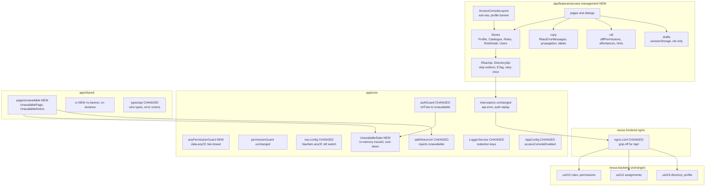
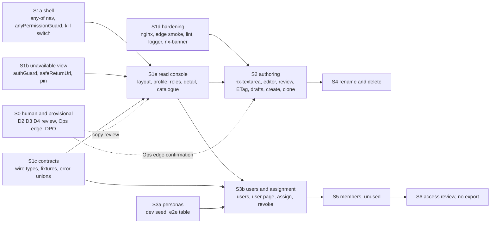
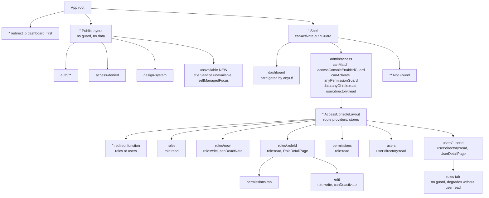
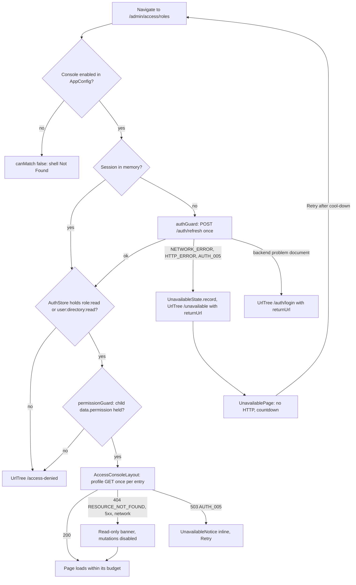
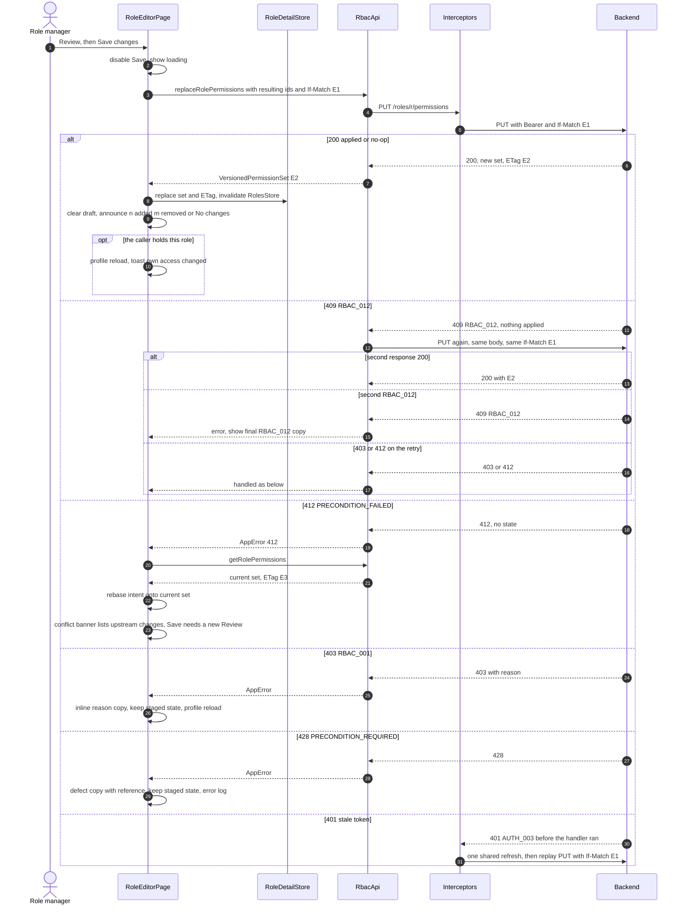
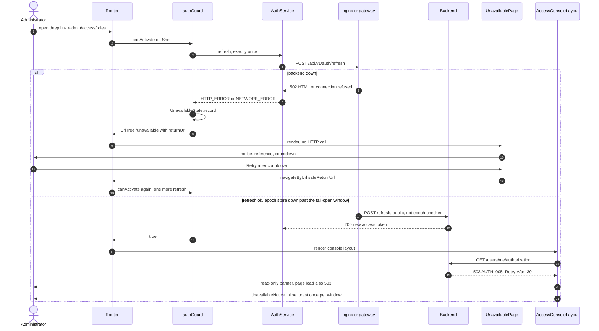
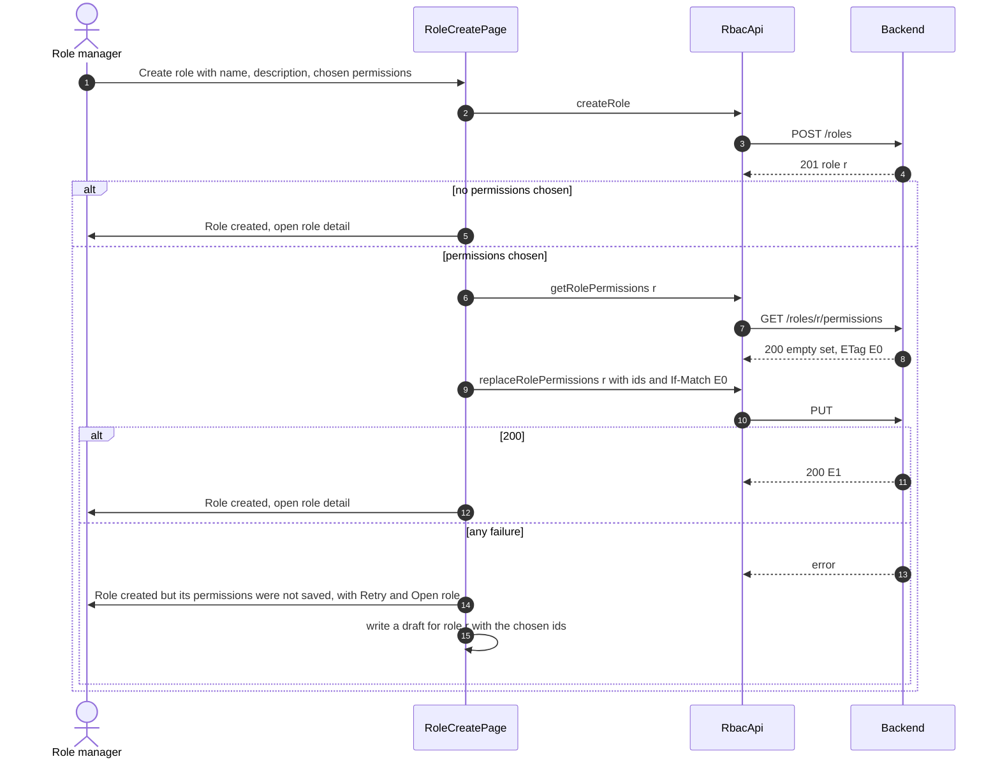
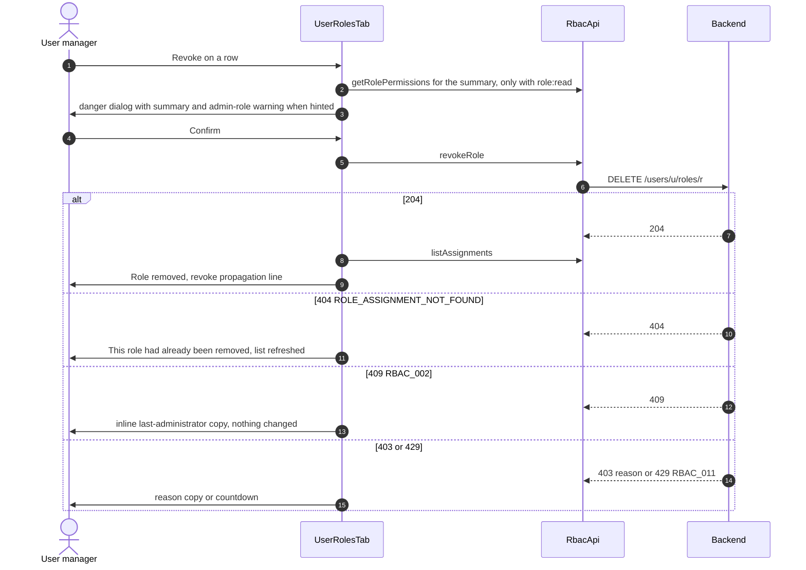

# US-020 — Solution Design: RBAC Access Management console

**Epic:** EPIC-002 (RBAC Foundation)
**Phase:** 3 (Solution Design), Gate 2 Step A
**Author:** Principal Architect
**Status:** Draft 2 (revised for RC-68..RC-77), 2026-10-23. Draft 1 went to the Gate 2 threat model (`03b-threat-model.md`, verdict: conditional pass); this draft is for Gate 2 review.

**Gate 2:** approved 2026-10-23 by Md Nisar Ahmed (human items H-1 to H-6, UX/PM approval of the provisional D2/D3, and P-11 remain open)

**Delta-review items D-1 to D-6** (`03b-threat-model.md` §12, all Low, none blocks Gate 2). They are **binding on the named slice's merge gate** and are carried into `04-tasks.md`; where they conflict with the sections below, §12 of the threat model wins until this document is next revised:
- **D-1 (S3b, §15.3, F-5):** hidden-character detection matches `[\p{Cf}\p{Default_Ignorable_Code_Point}\p{Zs}\p{Zl}\p{Zp}]` except U+0020, with test cases for Hangul fillers, variation selectors and non-ASCII spaces.
- **D-2 (S1b, §4.7, §19.1):** `safeReturnUrl` stays pure and parses with `new DefaultUrlSerializer().parse(raw)` (not `router.parseUrl`); read the first segment of the primary outlet; reject `.` and `..` segments. Table rows: `/auth;x=1/login`, `/(unavailable)`, `/x/../unavailable`, `/%2e%2e/unavailable` give `/dashboard`; `/%2575navailable` is returned unchanged.
- **D-3 (S1d, §19.6, H-4):** the smoke script enforces its own rules: after login read its own profile and abort (logging out first) if it is an administrator or holds anything beyond `role:read` and `role:write`; refuse `--negative-control` unless in CI or against a local base URL; log out on every exit path; the credential lives in the Ops secret store with an alert on any write by this identity.
- **D-4 (S3b, §8.3, §19.1):** if the catalogue total is unknown, the PENDING block treats every role as admin-looking (fail closed). The "block off" switch used in tests is a code constant or function parameter, never runtime input.
- **D-5 (S3b, §12.10):** the self-revoke variant is chosen by user-id equality, never by email.
- **D-6 (S2, §10, §14.2):** §10 gains the RC-74 rules (reject a future save time; clear storage in logout's cleanup step even when the request fails); §14.2 gains the string "Not restored because you can't grant them".

**Revision 1 (threat model `03b-threat-model.md` §6, §7, §9).** No Gate 1 decision is reopened.

| RC | Threat | Sections changed |
|---|---|---|
| RC-68 | T-S15 hidden characters in emails | §6.1 (`UserText` email mode), §12.7, §12.8, §12.9, §12.10 (identity line in dialogs), §14.2, §15.3, §19.1, §19.3, §21 SD-7, §23 (F-5) |
| RC-69 | T-E55 PENDING targets | §8.3 (PENDING rows), §12.9, §14.2, §23 (H-2 decided, F-4), §20.2 item 10 |
| RC-70 | T-T26 return URL | §0.1 item 9, §4.7, §19.1, §21 SD-5 |
| RC-71 | T-R19 lost refresh response | §4.5, §17 (triage step), §19.1, ADR-0028 |
| RC-72 | T-R20 edge smoke | §17 (alert note), §19.6, §20.2 item 3, §23 (H-4) |
| RC-73 | T-I27 global error logging | §1.2 (S1e), §19.1 |
| RC-74 | T-I28, T-E56 draft hygiene | §1.2 (S2), §19.1 |
| RC-75 | T-D31 unavailable cool-down | §1.2 (S1b), §4.5, §19.1 |
| RC-76 | T-E57 `canMatch` wording | §1.2 (S1a), §18, §19.1, ADR-0028 |
| RC-77 | T-E58 persona exposure | §1.2 (S3a), §19.4, §20.2 |

**Inputs (binding, not reopened):**
- `01-requirements.md` §12a, **Gate 1 decisions (2026-10-23)**, Q1 to Q29, with the amendments the story owner delegated for this design (§0.2): Q12 personas corrected; Q4 placement of the "unavailable, retry" view; impact risk 1 (ETag weakened by the proxy) designed here.
- `02-impact.md` (verified impact, DQ-1 to DQ-28). This document **builds on it and does not repeat its file inventories**. "Impact §x" points there. Every DQ is resolved in §0.3.
- `00-discovery.md`; `docs/story/2-rbac/US-020.md`; `docs/features/US-019/03-design.md` (shell, guards, wrappers, fixtures, personas; "US-019 §x"); ADR-0004, ADR-0027; skills `api-design`, `angular-standards` (`nexus-frontend/ANGULAR_STANDARDS.md`), `design-system`.

**Code verified** on `feature/US-020` (base `main` @ `adda702`) on 2026-10-23 for every claim with a file reference. Paths under `nexus-backend/src/main/java/com/example/nexus/` are written `…/`; paths under `nexus-frontend/src/app/` are written `app/…`. Re-verification found four facts that change the requirements or the impact (§0.4).

**No PII.** People are referred to by role. Persona addresses and dev credentials are not repeated.

**Provisional artefacts.** §12 (page and dialog specs, the D2 deliverable), §13 (accessibility annotations) and §14 (the D3 content deck) are **PROVISIONAL: not UX/PM approved** (Gate 1 Q2). Build may proceed on them. All copy lives in one module, so approved text replaces it without code changes elsewhere.

**New ADRs proposed with this design** (status "Proposed"; accepted ADRs are not edited):

| ADR | Covers | Relationship |
|---|---|---|
| `0028-frontend-authorization-affordances.md` | The live profile drives mutating affordances; the JWT (`AuthStore`) drives nav and guards; the server is final. Any-of nav and the new any-of guard (fail-closed). The console never starts a session refresh of its own (RC-65) | Extends `PROJECT.md` Key Constraints ("frontend gating is UX only") and US-019 §12.2 |
| `0029-edge-must-preserve-strong-etags.md` | Nothing between the browser and the backend may compress or otherwise transform `/api/` responses in a way that weakens or strips `ETag`, or strips `If-Match`. `gzip off` for `/api/` in `nginx.conf`; the edge smoke check; the Ops obligation for any CDN or load balancer | Deployment constraint for ADR-0027 (accepted, so not edited) |

---

## 0. Decisions for Gate 2 approval

### 0.1 Decisions

Each line is a decision this design makes. Gate 2 may override any of them. Section numbers point to the reasoning.

1. **Frontend only.** No production backend change, no Flyway migration, no API change. Backend test and dev-seed code changes only: `ApiContractFixturesTest` (new fixtures) and the dev seeders (new personas) (§3, §7.4, §19.4).
2. **Routes:** `/admin/access` is a componentless shell child with `canActivate: [anyPermissionGuard]`, `data.anyOf = ['role:read', 'user:directory:read']` and `canMatch: [accessConsoleEnabledGuard]`. It lazily loads `ACCESS_MANAGEMENT_ROUTES`, whose `''` child is the `AccessConsoleLayout`. Every page route below it carries `permissionGuard` with its own `data.permission`. The empty path redirects, through a function, to the first area the user may open (§4).
3. **Tabs are child routes** (routable `NxTabs`), not `?tab=`: `roles/:roleId/permissions` (S1), `roles/:roleId/members` (S5), `users/:userId/roles` (S3), `users/:userId/effective` (S6). Edit mode is the route `roles/:roleId/edit` with `permissionGuard` (`role:write`) and `canDeactivate: [unsavedChangesGuard]` (§4.2).
4. **New `anyPermissionGuard`** in `core/guards`: it reads `data.anyOf`, and **fails closed** (denies) on a missing, empty or non-catalogue value. It is contract-tested like `permissionGuard` and composes only under an `authGuard` ancestor (§4.3).
5. **`NavItem.permission` becomes `anyOf: readonly Permission[] | null`.** `visibleNavItems` tests `some`. The nav spec pins `anyOf` to the target route's `data.anyOf`, or to `[data.permission]`. `NAV_ITEMS` gains "Access management". The dashboard card uses the same constant (§4.4).
6. **Kill switch:** `AppConfig.accessConsoleEnabled` (build-time). It is `false` in `environment.ts` (production) until the release checklist passes, and `true` in development. When it is false, the nav item and dashboard card are hidden **and** `canMatch` rejects the console route, so deep links fall through to Not Found (§18).
7. **Unavailable view (Q4, amended):** a new route `/unavailable` under `PublicLayout`, outside the shell. `authGuard` returns a `UrlTree` to it when the cold-start refresh fails with `NETWORK_ERROR`, `HTTP_ERROR` (a response that is not a problem document, so an intermediary answered) or `AUTH_005`. The view makes no HTTP call on render. The `traceId` is held in memory, never in the URL. Retry is user-initiated after a cool-down and re-enters through the shell exactly once. The public-route pin goes from 3 to 4 paths. **Flagged for the threat model** (§4.5, §21 SD-2).
8. **Mid-session 503 `AUTH_005`:** a console page load renders the same `UnavailableNotice` inline. An action keeps the existing toast and shows an inline "nothing was changed" line (§4.5, §12.0).
9. **`safeReturnUrl`** also rejects values whose first path segment, as the router parses it, is `unavailable` (as well as `auth`) (§4.7, RC-70).
10. **Affordances** come from a route-scoped `AuthorizationProfileStore` over `GET /users/me/authorization`. It is loaded once per console entry and re-read after own-access events and after any 403 on an action it predicted allowed. Nav and guards keep `AuthStore`. If the profile cannot be read, the console is read-only under a banner (Q8) (§6.3).
11. **The console never calls `AuthService.refresh()`.** After a self-revoke it re-reads the profile. That request returns 401 on the stale epoch, so the interceptor's shared refresh runs once and replays it. This replaces FR-G6/FR-C6 "refresh the session", which would reintroduce RC-65's double refresh (§6.3, §0.2).
12. **State:** API clients are stateless `@Service()` singletons returning `Observable`s. Stores are `@Injectable()` route-level providers that own `signal`s with a `LoadState<T>` union. Components are OnPush, smart pages over dumb presenters (§6).
13. **Request budgets per page** are fixed in §6.5 and enforced by unit tests that count requests.
14. **Roles fetch-all (Q5):** `size=100`. Page 0 is fetched first, then the remaining pages in parallel, with a hard bound of 20 pages and a visible notice. Search, filter and sort run client-side with a stable partition (system first, server order within each group) (§6.4).
15. **Catalogue:** one `GET /permissions?size=100` per console session, typed as the new `PermissionPageResponse`, reset when the user changes (§6.4).
16. **ETag:** read from `GET /roles/{id}/permissions` with `observe: 'response'` and classified as strong, weak or missing. A weak or missing tag puts the editor into "saving unavailable" before the user stages anything. `If-Match` echoes the strong value verbatim. 412 means re-read and rebase, never resubmit. 428 is a client or edge defect (§7.1).
17. **Retry-once for `RBAC_012`** (Q14) lives in `RbacApi` for `POST /users/{id}/roles` and `PUT /roles/{id}/permissions`. It sends one fresh request with the same body and `If-Match`, and never retries on any other code. For the PUT this is defensive only: the shipped replace path cannot return `RBAC_012` (§7.2, §0.4).
18. **`diffPermissions`** and the affordance rules are pure functions over permission ids. Staged edits are stored as an intent (`add`, `remove`) relative to a base set, which makes the 412 rebase and draft restore one operation (§8).
19. **One copy module** (`features/access-management/copy/`) holds every console string, including `RbacErrorMessages` (exhaustive over `ConsoleErrorCode`, with `RBAC_001` keyed by `reason`), the propagation constant keyed by action (Q3), and the permission and group labels, moved there from `shared/types/permission.ts` (§9).
20. **The console renders copy-module text, never `AppError.message`.** The exception is `details[].message` for a field this design has no copy for (§9.2).
21. **Drafts:** `sessionStorage` key `nexus.session.access-draft.v1.<userId>.<roleId>`, holding permission ids, the base ETag and a timestamp only. Drafts are validated on read, expire after 12 h, and are offered for restore only after the current set is re-read and only to the same user. They are purged on explicit logout through a generic `nexus.session.` prefix sweep in `AuthService.logout`, **not** on `clearSession`, so a draft survives a session expiry (FR-G4) (§10).
22. **User-authored text** (role names, descriptions, emails) renders only through interpolation, inside `<bdi>` (inline) or `dir="auto"` blocks with `unicode-bidi: isolate`. It never appears in `document.title`, toasts or log contexts. Static route titles only (§15.3).
23. **Lint and logging hardening:** ESLint bans importing `DomSanitizer` in `src/app/features/**`. `LoggerService` redacts keys matching `email|query|search|description` as well as today's set (§15).
24. **nginx:** `gzip off;` inside `location /api/`. Verified by a static config test in `frontend-ci` and by a non-mutating edge smoke job that runs nginx with the real backend (§15.4, §19.6). Production edge confirmation is an Ops item (§23).
25. **Design system:** add `nx-banner` and `nx-textarea` to `shared/ui`. Dialogs use `NxDialog.openTemplate` with host-owned state (no `mat-dialog-*` directives in feature templates, because Material imports are banned there), and `NxDialog.confirmTyped` for typed confirmations (§15.1, §15.2).
26. **Forms:** Reactive Forms over the `NxInput`/`nx-textarea` CVAs, matching the existing feature forms (`features/auth/login-form/login-form.component.ts:2`), rather than Signal Forms (§24).
27. **Last administrator (Q16):** no up-front block. The revoke dialog warns when the role is hinted admin-defining (`permissionCount === catalogue.totalElements`, Q17) and handles 409 `RBAC_002` inline. `memberCount` is never used as a predictor (§12.10).
28. **Personas (Q12, amended):** role-reader user manager (`role:read`, `user:read`, `user:role:assign`, `user:directory:read`, not an administrator); auditor (`role:read`, `audit:read`, used in S5 and S6); two ACTIVE assignment targets that nobody signs in as. Existing personas are unchanged (§19.4).
29. **E2E PII:** trace off for every spec that renders directory data; emails asserted by test id and count, never by text; `enterAddress` for lookups; no allow-list change in `scan-pii.mjs`. Mutation specs touch only per-worker roles and the dedicated targets (§19.3).
30. **Observability:** client logs carry ids, codes, `correlationId` and `traceId` only. No analytics (Q29). One new alert on an existing backend counter (`permission_replace{outcome="precondition_required"}`) (§17).

### 0.2 Amendments to Gate 1 decisions (delegated to this design)

| Gate 1 item | As approved | Amended to | Why | Flag |
|---|---|---|---|---|
| **Q4** placement | "Full-page view inside the signed-in layout"; guard navigates to it on a cold-start 503 `AUTH_005` or network error | Route `/unavailable` under `PublicLayout` (unguarded, outside the shell). The guard navigates to it on `NETWORK_ERROR`, `HTTP_ERROR` or `AUTH_005`. Mid-session page loads render the same notice inline inside the shell | A child of the shell re-runs the failing `authGuard`. `canActivateChild` is banned (RC-65, `app.routes.spec.ts:123-135`), and a second refresh from the view would be a refresh-token reuse that logs the user out. The refresh endpoint cannot return `AUTH_005` (§0.4 #1), so `HTTP_ERROR` covers the real cold-start case (a gateway 502/503/504, or nginx's HTML 429) | **Threat model:** public-route pin widened (RC-63(i)); guard classification change |
| **Q4** public-route spec | `app.routes.spec.ts:101, 118-121` pins `PublicLayout` children to exactly `{auth, access-denied, design-system}` | Pinned to exactly `{auth, access-denied, design-system, unavailable}`. The view route has `data: { selfManagedFocus: true }` only, no guard, and makes no HTTP call; a new spec asserts the component injects no `HttpClient` | Deliberate, reviewed widening of the allow-list | **Threat model** sign-off required |
| **Q12** personas | Auditor `audit:read` (optionally directory); role-reader user manager `role:read`, `user:read`, `user:role:assign` | Role-reader user manager also holds `user:directory:read`; auditor also holds `role:read`; plus two assignment-target users nobody signs in as | Without the directory permission the user manager cannot open any Users route (Q6); without `role:read` the auditor cannot reach role detail, where Members lives (impact re-trace) | — |
| FR-G6, FR-C6 "refresh the session" | The console refreshes the session after an own-access change | The console re-reads the profile. The epoch bump makes that read 401, and the interceptor's single shared refresh renews the session. The console never calls `AuthService.refresh()` | A console-initiated refresh can race the interceptor's `refreshInFlight`, which is RC-65's reuse and logout | ADR-0028 |
| FR-G1 "search text in query params" | Search text in query params everywhere | Role and catalogue search text, filters, page and status are in query params. **The email lookup text never enters the URL** (memory only) | NFR-S4 and US-019 SD-3: no email in a URL, history or access log | — |
| Story scenario 3 | `/admin/access/roles/:id?tab=permissions` | `/admin/access/roles/:id/permissions` | DQ-25 (tabs as child routes) | Test plan |

### 0.3 Resolution of the impact's open design questions (DQ-1 to DQ-28)

"Adopted" means the impact's recommendation is taken as written. Deviations are marked **Deviates**.

| DQ | Decision | Reason (one line) | Where |
|---|---|---|---|
| DQ-1 | Adopted: `anyOf: readonly Permission[] \| null` | One shape for single and any-of; only `NAV_ITEMS` produces it | §4.4 |
| DQ-2 | Adopted, with the new guard **failing closed** and a componentful `''` layout child under the componentless gated parent | A new guard need not copy `permissionGuard`'s pinned fail-open (RES-39); misconfiguration then denies instead of admitting | §4.3 |
| DQ-3 | Adopted; plus `roles/:roleId/edit` and the tab child routes | Deep-linkable edit mode with its own guard and `canDeactivate` | §4.2 |
| DQ-4 | Adopted (route under `PublicLayout`, `UrlTree` with `returnUrl`, in-memory `traceId`, cool-down, inline reuse). **Deviates in scope:** the guard also treats `HTTP_ERROR` as "unavailable", and `safeReturnUrl` rejects `/unavailable` | `AUTH_005` cannot come from the refresh (§0.4 #1); a gateway error is the real cold-start outage; a `returnUrl` to the view itself would be a pointless loop | §4.5, §4.7 |
| DQ-5 | Adopted (`gzip off` in `location /api/`; reject `W/` stripping; reject relaxing the server). **Extended:** a static config test, a non-mutating nginx-in-the-loop smoke job, client-side weak or missing ETag detection, and a 428 alert | The verification must not depend on CI not running nginx | §7.1, §15.4, §19.6 |
| DQ-6 | Adopted; ADR-0028 is proposed | The decision outlives this story (Epic 3 reuses it) | §6.3 |
| DQ-7 | Adopted; plus a reset when the signed-in user id changes, and coalescing (one read in flight) | A route-scoped store outlives a logout in the same tab | §6.3 |
| DQ-8 | Adopted; feature templates close through the returned `MatDialogRef` and set `ariaLabelledBy` in the config | `mat-dialog-*` directives would need a banned Material import | §15.2 |
| DQ-9 | Adopted for `nx-banner`. For the description field, **`nx-textarea`** (new wrapper) rather than a `multiline` mode on `NxInput` | Keeps the auth forms' CVA untouched | §15.1 |
| DQ-10 | Adopted; plus a free exact pre-check: a candidate with `permissionCount` greater than the number of permissions the caller holds is disabled without any call | Pigeonhole: such a role must carry a permission the caller lacks | §8.3, §12.9 |
| DQ-11 | Adopted, as the budget table in §6.5 | FR-F8, NFR-3 | §6.5 |
| DQ-12 | Adopted (bound of 20 pages) | Covers four times the default cap with a visible notice beyond it | §6.4 |
| DQ-13 | Adopted; reset when the user changes | Same as DQ-7 | §6.4 |
| DQ-14 | Adopted for the code union and the exhaustive map. **Deviates:** `PERMISSION_LABELS` and `PERMISSION_GROUP_LABELS` move from `shared/types/permission.ts` into the console copy module | The brief requires one copy module for the D3 deck, and no code outside the console reads them (grep: only `permission.ts` and its spec) | §9 |
| DQ-15 | Adopted; JSDoc on `rbac.ts:75-78` and `app-error.ts:97-105` reworded | The interceptor never retries; the write client retries once | §7.2 |
| DQ-16 | Adopted; rebase drops no-ops and the banner lists what changed underneath | Keeps the user's work honest and explicit | §8.2, §11.1 |
| DQ-17 | Adopted in intent. **Deviates:** key prefix `nexus.session.`, a 12 h maximum age instead of "older than the session", a user-id match on restore, and purge on explicit logout only (not on `clearSession`) | `clearSession` also runs on refresh failure, so purging there would defeat FR-G4's restore after re-login | §10 |
| DQ-18 | Adopted as amended by the story owner (§0.2) | — | §19.4 |
| DQ-19 | Adopted | Workers never touch each other's data | §19.3 |
| DQ-20 | Adopted | PII scan stays strict | §19.3 |
| DQ-21 | Adopted (`DomSanitizer` import ban; bidi isolation) | Defence in depth for FR-G9 | §15.3 |
| DQ-22 | Adopted; `description` added to the pattern | Descriptions are tenant free text (`CreateRoleRequest.java:18-22`) | §15.3 |
| DQ-23 | Adopted. **Deviates:** when off, `canMatch` also rejects the route | A kill switch that leaves deep links live does not switch anything off | §18 |
| DQ-24 | Adopted | The initial budget already protects the main concern | §16 |
| DQ-25 | Adopted | Back and Forward work; later tabs get their own guard | §4.2 |
| DQ-26 | Adopted | No role names or emails in browser history | §4.2 |
| DQ-27 | Adopted; values computed from two named constants, with a spec | The client cannot read backend config | §9.3 |
| DQ-28 | Adopted; plus `layout/` (console layout) and `ui/` (feature presenters) | Places the two kinds of unit DQ-28 did not name | §5 |

### 0.4 Corrections to upstream documents (found by re-verification)

| # | Document and claim | Code | Effect |
|---|---|---|---|
| 1 | Requirements FR-X3, Q4, impact §3.3: "the cold-start refresh fails with 503 `AUTH_005`" | `POST /auth/refresh` is `@PublicEndpoint` (`…/identity/interfaces/rest/LoginController.java:118-126`). `JwtAuthenticationFilter` never epoch-checks a public request (`…/identity/infrastructure/web/JwtAuthenticationFilter.java:101-104, 142-154`); `AUTH_005` is written only on the non-public path (`:122-131, 188-201`) | The refresh can fail with a network error, an intermediary's non-problem response (`HTTP_ERROR`), or a backend problem document (`AUTH_004`, `RATE_001`, `INTERNAL_ERROR`). `AUTH_005` appears on the **first authenticated call after** a successful refresh (shell priming `/v1/users/me`, the console profile). The design covers both (§4.5, §11.2) |
| 2 | Requirements FR-X6, Q14, §8: `RBAC_012` "on assign or on a permission change" | The only throw sites are attach (`…/rbac/application/RoleManagementService.java:1380-1402`) and assign (`…/rbac/application/RoleAssignmentService.java:860-890`). `replaceRolePermissions` (`RoleManagementService.java:542-608`) surfaces the same race as a second 412 under the locks (`:644-648`). The PUT's OpenAPI still documents `RBAC_012` (`…/rbac/interfaces/rest/RoleController.java:276-280`) | The retry-once applies to assign (reachable) and to the PUT defensively, because the contract lists the code. A retried PUT that finds the set changed gets 412, which is handled. The doc mismatch is reported for the backend owners (§23) |
| 3 | Impact §5.3: fixtures "only `example.test` addresses" | `ApiContractFixturesTest.java:85-89` asserts only that `@example.com` is absent | The frontend check (`api-contract.spec.ts:155-158`, REPORTED) is the stricter one; new fixtures use `example.test` addresses and fixed synthetic ids |
| 4 | Impact §10.1: "nginx compresses JSON responses from the proxied backend" | Correct for direct browser requests. nginx's `gzip_proxied` defaults to `off`, so a request that reaches nginx **through another proxy** (one that adds `Via`) is not compressed by nginx; that upstream proxy may compress instead **[INFERENCE: nginx documentation]** | Which component weakens the tag in production depends on the edge topology; this is why Ops confirmation is a release item and the smoke script takes a base URL (§19.6) |

---

## 1. Architecture overview and delivery order

### 1.1 Components touched

**Layering.** The feature imports only from `core/*` and `shared/*`. Nothing outside the feature imports from it; the dashboard card uses a constant from `core/layout/nav.config.ts`, not from the feature. `core` imports no `shared/ui` eagerly: `authGuard` and `UnavailableState` are in the initial bundle, so they stay free of Material, following `service-availability-notifier.ts:16-18, 36-38`. The unavailable page is lazy.

### 1.2 Slices, dependencies and exit gates

| Slice | Contents | Exit gate (all green) |
|---|---|---|
| **S0** | UX/PM review of §12 to §14; Ops confirmation of the production edge (§23); P-7 flag plan; P-9 required check; P-11 first green full-stack run; DPO acknowledgement (Q22) | Records exist. **None blocks the build.** P-11 blocks the first console PR merge (Q13). Edge confirmation and DPO block **enabling** in production (§20) |
| **S1a** | `NavItem.anyOf`, `visibleNavItems`, `NAV_ITEMS` entry, `anyPermissionGuard` with contract specs, `accessConsoleEnabledGuard`, `AppConfig.accessConsoleEnabled` (both environments and every test stub), dashboard card, `DEVELOPMENT_GUIDE` "add a nav item" rule; **RC-76:** `canMatch` allow-list contract spec and the release-control wording (§18, ADR-0028) | `npm run test:ci`, `lint`, `format:check`, `build`; `nav.config.spec`, `shell.spec`, `app.routes.spec` pass with the new any-of cases; RC-76 contract spec green |
| **S1b** | `/unavailable` route and page, `UnavailableNotice`, `UnavailableState`, `authGuard` change, segment-based `safeReturnUrl` rule (RC-70), the pin change; **RC-75:** cool-down `min(retryAfterSeconds ?? 10, 60)` plus 0–5 s jitter, 10 s with no `UnavailableState`; **RC-71 item 3:** the `AUTH_004`-on-Retry spec | Frontend gates; real-Router cold-start spec (exactly one refresh per attempt, §19.1); adversarial `safeReturnUrl` table extended (RC-70); RC-71 and RC-75 specs green; threat-model sign-off on the pin (H-1) |
| **S1c** | Wire types and the error unions (§7.4); new fixtures in `ApiContractFixturesTest` and `api-contract.spec.ts` in **one PR** | `./mvnw verify -DskipITs` (backend contract test) and `npm run test:ci` |
| **S1d** | `gzip off` for `/api/`; the static nginx test; the `edge-etag-smoke` job; ESLint `DomSanitizer` ban with a `lint-rules.spec.ts` case; logger redaction with a spec; `nx-banner` (spec, preview card, unit axe) | Frontend gates; the smoke job green, including its negative control (CI only, `--negative-control`, RC-72) |
| **S1e** | Feature folder, console layout, profile store, catalogue store, roles store, roles list, role detail (read mode, Permissions tab), catalogue page, copy module for read errors, F6 per-area states, read-only mode, inline 503; P-27 e2e; **RC-73:** `GlobalErrorHandler` logs an `AppError`-shaped value as `code`, `correlationId`, `traceId` context keys only, never stringified into the message | Frontend gates; unit request-budget tests; RC-73 specs (§19.1); e2e for nav per persona, P-27, read pages, axe in both themes |
| **S2** | `nx-textarea`; editor with matrix in edit mode, Review dialog, ETag handling, retry-once, 412 rebase, drafts, unsaved-changes guard, create, clone; propagation copy; **RC-74:** foreign-owner draft keys removed on session establishment in `AuthService`; `clearSessionScopedStorage()` in the logout `finalize`; future `savedAt` rejected; restore and rebase drop entries whose row is disabled and list them | Frontend gates; RC-74 specs (§19.1); e2e create, edit, review, save, 412 (provoked by an API write), XSS payload as text (scenario 24); **S2 does not ship to production before the Ops edge confirmation** |
| **S3a** | Dev personas and targets (`DevDataInitializer`, `DevUserSeeder`, tests); `personas.ts`; shell e2e `NAV_LABELS`; **RC-77:** "no `dev` profile where real user data lives" checklist line (§19.4, §20.2) | `./mvnw verify` (Docker: `DevPersonaSeedIT`, extended for RC-77); e2e shell spec |
| **S3b** | Users list and lookup, user page and join, assign dialog, revoke, typed self-revoke, own-access handling; **RC-68** email mode of `UserText` and the identity line in dialogs; **RC-69** PENDING copy, confirm variant and the admin-role block | Frontend gates; RC-68 and RC-69 unit specs (§19.1); e2e assign, revoke against dedicated targets, self-assignment block, hidden-character target (RC-68), 409 `RBAC_002` inline, lookup with `enterAddress`, trace off; PII scan clean |
| S4 to S6 | Outlined in §12.13. Designed in full in a delta to this document before they start | — |

**MVP = S0 to S3** (Q1). S1a to S1d run in parallel. S1e needs S1a to S1c. S2 needs S1d, because the edge fix must be in before the editor can save behind nginx.

---

## 2. Cross-cutting design

### 2.1 Backend behaviour the design relies on (re-verified 2026-10-23)

| # | Behaviour | Code | Design use |
|---|---|---|---|
| B-1 | `GET /roles/{id}/permissions` returns a **strong** `ETag` of the set; `GET /roles/{id}` has none | `RoleController.java:173-204, 236-242, 343-349` | ETag is read from the set GET only (§7.1) |
| B-2 | PUT `If-Match` must be exactly one strong tag; absent, `*`, list, weak or empty gives 428, counted as `precondition_required`, before the service runs | `RoleController.java:296-317`; `IfMatchHeader.java:15-31` | Client strong-tag check; 428 = defect; edge smoke negative control (§19.6) |
| B-3 | PUT order in the service: 404 role, 409 `RBAC_003`, 404 permission, 403 (live `role:write` and `role:read`, grant-subset, PII rule, role-subset), then 412, then the no-op 200; a second 412 under the locks | `RoleManagementService.java:542-577, 644-648` | 403 copy before conflict copy; no-op shows "No changes"; the edge smoke uses `RBAC_003` as a non-mutating success signal |
| B-4 | The PUT never throws `RBAC_012`; attach and assign do | §0.4 #2 | Retry-once scope (§7.2) |
| B-5 | 412 and 428 bodies carry no state | `…/common/web/GlobalExceptionHandler.java:89-104` | 412 always re-reads |
| B-6 | CORS allows `If-Match` and exposes `ETag` and `Retry-After` | `…/config/SecurityConfig.java:209-216` | Dev server (cross-origin) reads the tag |
| B-7 | Revoke: administrator requirement and other 403s first, then 409 `RBAC_002`; a lost race gives 404 `ROLE_ASSIGNMENT_NOT_FOUND`; after commit the target's epoch is bumped | `RoleAssignmentService.java:400-448, 456-475` | Revoke error order; "already removed" convergence; revoke propagation copy |
| B-8 | A stale-epoch token is rejected in the filter before any handler runs; a degraded-closed instance answers 503 `AUTH_005` with `Retry-After: 30`, also before the handler | `JwtAuthenticationFilter.java:122-131, 188-201` | A replayed PUT after 401 is its first execution; a 503 applied nothing |
| B-9 | Refresh is public and never epoch-checked | `LoginController.java:118-126`; `JwtAuthenticationFilter.java:101-104` | Guard classification (§4.5) |
| B-10 | A disabled controller gives 404 `RESOURCE_NOT_FOUND`; entity misses give `ROLE_NOT_FOUND`, `USER_NOT_FOUND`, and so on | `GlobalExceptionHandler.java:215-219`; `@ConditionalOnProperty` at `CallerAuthorizationController.java:31`, `UserRoleController.java:63` | Per-area "not enabled" states (F6) |
| B-11 | Profile: authenticated-only, under us019 | `CallerAuthorizationController.java:31, 47-48` | Read-only mode when it 404s (Q8) |
| B-12 | Assignment endpoints: assign and revoke need `user:role:assign`; the list needs `user:read` | `UserRoleController.java:89-91, 145-146, 190-192` | User page degradation (Q19) |
| B-13 | `RBAC_001` carries `requiredPermission` and an allow-listed `reason`; `ACCESS_DENIED` carries neither | `GlobalExceptionHandler.java:188-213` | Reason copy (Q15); `requiredPermission` is never rendered |
| B-14 | 429 carries `Retry-After` | `GlobalExceptionHandler.java:120-128` | Wait copy and re-enable timer |
| B-15 | Create validation: name `^[A-Za-z0-9][A-Za-z0-9 ._-]*$`, ≤ 64; description ≤ 255 with no `\p{Cntrl}`, U+2028 or U+2029 | `…/rbac/interfaces/rest/dto/CreateRoleRequest.java:24-33` | The only client validation that is hard-coded (Q28) |
| B-16 | `permission-cache-ttl-seconds` 900 (environment-overridable), `access-token-ttl-seconds` 900, `fail-open-window` PT15M, `pii-grant-requires-administrator: true` | `application.yml:157, 269, 192, 177` | Propagation constant (§9.3); PII affordance (§8.3) |
| B-17 | Contract fixtures are lockstep: a JSON file without a record fails the backend build | `ApiContractFixturesTest.java:57-82` | Fixture PR shape (§7.4) |

Frontend facts relied on: `authGuard` (`app/core/guards/auth.guard.ts:29-45`); route tree and pins (`app/app.routes.ts:37, 46-130`; `app/app.routes.spec.ts:100-135, 153-176`); nav (`app/core/layout/nav.config.ts:5-38`; `nav.config.spec.ts:6-39`); error mapping (`app/core/http/api-error.interceptor.ts:73-85, 93-127, 144-157`); refresh sharing and replay (`app/core/http/auth.interceptor.ts:63-75, 157-201`); 503 toast (`app/core/http/service-availability-notifier.ts:19-39`); redaction (`app/core/logging/logger.service.ts:25`); logout (`app/features/auth/auth.service.ts:156-160`); `clearSession` (`app/core/auth/auth.store.ts:74-77`); dialogs (`app/shared/ui/dialog/dialog.ts:404, 420, 528-540`); `permissionGuard` (`app/core/guards/permission.guard.ts:49-84`).

### 2.2 The affordance model

| Concern | Source | Rationale |
|---|---|---|
| Route entry, nav item, dashboard card | `AuthStore.permissions()` (JWT, set at sign-in and refresh) | Existing guards and shell; no HTTP call before routing |
| Every mutating control (create, edit, save, assign, revoke, clone) and every disabled reason | `AuthorizationProfileStore` (live) | Grants do not bump the epoch, so the JWT can lag by up to 900 s (requirements §3.6) |
| The decision | The server | `PROJECT.md` Key Constraints; NFR-S1 |

When the two client sources disagree, affordances follow the profile. A 403 on an action the profile predicted allowed re-reads the profile, keeps the user's work, and shows the reason copy (story scenario 12).

### 2.3 Error codes the console handles

`ConsoleErrorCode` = `RbacErrorCode` (extended to `RBAC_001` to `RBAC_012`) ∪ `DirectoryErrorCode` (`USER_DIR_001`, `USER_DIR_002`) ∪ the generic codes `VALIDATION_FAILED`, `PRECONDITION_FAILED`, `PRECONDITION_REQUIRED`, `RESOURCE_NOT_FOUND`, `ROLE_NOT_FOUND`, `USER_NOT_FOUND`, `PERMISSION_NOT_FOUND`, `ROLE_ASSIGNMENT_NOT_FOUND`, `ACCESS_DENIED`, `AUTH_005`, `NETWORK_ERROR`, `HTTP_ERROR`, `INTERNAL_ERROR`, `UNEXPECTED_ERROR`. Any other code maps to the generic copy plus reference. `RBAC_005` stays in the union for completeness; the console does not call attach.

### 2.4 Observability conventions (client)

Log context keys are limited to `event`, `area`, `action`, `roleId`, `userId` (target, an id), `permissionIds` (ids), `errorCode`, `reason`, `correlationId`, `traceId`, `count`, `status`. Never: emails, role names, descriptions, search or lookup text, `requiredPermission` (developer-only, `app-error.ts:68-85`). See §17.

---

## 3. Database design

**None.** No Flyway migration, no DDL, no data migration, no grant change, no cache key or epoch change. The only data written is by the `dev`-profile seeder (§19.4) and by e2e specs at runtime.

---

## 4. Shell, routing and guards

### 4.1 Route tree

### 4.2 Route table

| Path (under `/admin/access`) | Guards | `data` | Title (static, DQ-26) | Component | Slice |
|---|---|---|---|---|---|
| (parent) `admin/access` | `canMatch: [accessConsoleEnabledGuard]`, `canActivate: [anyPermissionGuard]` | `anyOf: ['role:read', 'user:directory:read']` | — (has children) | none; `loadChildren` | S1 |
| `''` | — | — | — | `AccessConsoleLayout`, `providers` (§6.2) | S1 |
| `''` (full) | — | — | — | `redirectTo: firstAreaRedirect` (`role:read` → `roles`, else `users`) | S1 |
| `roles` | `permissionGuard` | `permission: 'role:read'` | "Roles" | `RolesListPage` | S1 |
| `roles/new` (declared before `roles/:roleId`) | `permissionGuard`; `canDeactivate: [unsavedChangesGuard]` | `permission: 'role:write'` | "New role" | `RoleCreatePage` | S2 |
| `roles/:roleId` | `permissionGuard` | `permission: 'role:read'` | — (has children) | `RoleDetailPage`, `providers: [RoleDetailStore]` | S1 |
| `roles/:roleId` `''` | — | — | — | `redirectTo: 'permissions'` | S1 |
| `roles/:roleId/permissions` | — | — | "Role permissions" | `RolePermissionsTab` | S1 |
| `roles/:roleId/edit` | `permissionGuard`; `canDeactivate: [unsavedChangesGuard]` | `permission: 'role:write'` | "Edit role" | `RoleEditorPage` | S2 |
| `roles/:roleId/members` | `permissionGuard` | `permission: 'audit:read'` | "Role members" | `RoleMembersTab` | S5 |
| `permissions` | `permissionGuard` | `permission: 'role:read'` | "Permissions" | `CataloguePage` | S1 |
| `users` | `permissionGuard` | `permission: 'user:directory:read'` | "Users" | `UsersListPage` | S3 |
| `users/:userId` | `permissionGuard` | `permission: 'user:directory:read'` | — (has children) | `UserDetailPage`, `providers: [UserDetailStore]` | S3 |
| `users/:userId` `''` | — | — | — | `redirectTo: 'roles'` | S3 |
| `users/:userId/roles` | none: the tab degrades without `user:read` (Q6, Q19) | — | "User roles" | `UserRolesTab` | S3 |
| `users/:userId/effective` | `permissionGuard` | `permission: 'audit:read'` | "Effective permissions" | `UserEffectiveTab` | S6 |

- **Inheritance.** The gated parent is componentless, so its `data.anyOf` is inherited by the `''` layout child. `permissionGuard` reads only `data.permission`, so inheritance is harmless. No child depends on an inherited `permission` (the contract spec requires each `permissionGuard` route to declare its own).
- **Titles** are static, so role names and emails never reach `document.title` or history. The page `h1` carries the name (route focus moves there, US-019 §12.7).
- **No route mutates on activation** (US-019 D6 rule). The edit route only stages; draft restore needs a click (§10).
- **Contract coverage:** `app.routes.spec.ts` already walks lazy children (`:28-37`), so the `data.permission`, ancestor and title checks cover the console with no change. New cases cover `anyPermissionGuard` (§4.3).

### 4.3 `anyPermissionGuard` and `accessConsoleEnabledGuard`

- `anyPermissionGuard: CanActivateFn` reads `route.data['anyOf']`. If the value is not a non-empty array of `PERMISSIONS` members, it returns a `UrlTree` to `/access-denied` and logs `event: 'any_permission_guard_misconfigured'` with the route path (query and fragment stripped). If `AuthStore.permissions()` holds any member, it allows; otherwise it redirects to `/access-denied` with no query parameters, as `permissionGuard` does (`permission.guard.ts:80-83`).
- **Fail-closed, deliberately.** `permissionGuard`'s fail-open on a missing value is pinned by RES-39 and stays. The new guard has no such history, so a configuration slip denies instead of admitting. Recorded in ADR-0028.
- **Contract spec** (`any-permission-guard-contract.spec.ts`): every route with `anyPermissionGuard` has a valid `data.anyOf` and an `authGuard` ancestor, and never shares a `canActivate` array with `authGuard`. Fixture cases cover bad, missing and nested values.
- `accessConsoleEnabledGuard: CanMatchFn` returns `inject(APP_CONFIG).accessConsoleEnabled`. It reads config only (no auth, no HTTP), so its place in the recognition phase, before `authGuard` runs, has no effect on the refresh path. When it returns false the router falls through to the shell's `**` (Not Found, still behind `authGuard`).

### 4.4 Nav and the dashboard card: the any-of contract

- `NavItem { id, label, path, icon, anyOf: readonly Permission[] | null }`, where `null` means every signed-in user. Signature: `visibleNavItems(items: readonly NavItem[], permissions: readonly string[]): readonly NavItem[]`, keeping an item when `anyOf === null || anyOf.some(p => permissions.includes(p))`.
- `export const ACCESS_CONSOLE_ANY_OF: readonly Permission[] = ['role:read', 'user:directory:read']` lives in `nav.config.ts`. The route `data.anyOf`, the nav item and the dashboard card all use it.
- `NAV_ITEMS` gains `{ id: 'access-management', label: 'Access management', path: '/admin/access', icon: 'admin_panel_settings', anyOf: ACCESS_CONSOLE_ANY_OF }`. The `NAV_ITEMS_TOKEN` factory (`nav.config.ts:28-30`) injects `APP_CONFIG` and drops the item when `accessConsoleEnabled` is false, so `visibleNavItems` stays pure.
- **Pin spec** (`nav.config.spec.ts:33-39` rewritten): for each item, the target route's `data.anyOf`, or `[data.permission]`, or `null`, must equal `item.anyOf` as a set. `flatten` already includes `/admin/access` (its path is not empty). New `visibleNavItems` cases: held through the first member, held through the second, held through neither, and `null`.
- `shell.spec.ts` `GATED_NAV` gains an any-of fixture. e2e `NAV_LABELS`: `admin`, `admin2`, `roleManager`, `userManager` and the two new sign-in personas see "Access management"; `member` does not.
- **Dashboard card** (`features/dashboard/dashboard.component.ts`): `NxCard` titled "Access management", one line of copy, and an `NxButton` link to `/admin/access`. It is visible when `accessConsoleEnabled` is true and `AuthStore` holds any of `ACCESS_CONSOLE_ANY_OF`. It keeps `data-testid="dashboard-root"` and the single `h1`. The spec covers visible, hidden by permission, and hidden by the kill switch.

### 4.5 `authGuard` and the unavailable view (FR-X3, Q4 amended)

**Guard change** (`auth.guard.ts:7-10, 36-43`):
- `isServiceUnavailable(error)` becomes true for codes `NETWORK_ERROR`, `HTTP_ERROR` and `AUTH_005`. `HTTP_ERROR` is what `toAppError` produces for a response whose body is not a problem document (`api-error.interceptor.ts:117-121`). The backend always answers with a problem document, so `HTTP_ERROR` means a gateway, nginx or another intermediary answered (502, 503, 504, or nginx's HTML 429 from `limit_req_status 429`, `nginx.conf:9-10`).
- On that branch the guard calls `inject(UnavailableState).record(error)` and returns `router.createUrlTree(['/unavailable'], { queryParams: { returnUrl: state.url } })`.
- Every backend problem document (`AUTH_004`, `RATE_001`, `INTERNAL_ERROR`, …) keeps today's redirect to `/auth/login` with `returnUrl`. This change is deliberately narrow: only "nobody authoritative answered" becomes "unavailable".
- The guard still calls `AuthService.refresh()` exactly once per activation. It runs only on the shell's `canActivate` at cold start (US-019 §12.9, RC-65).

**`UnavailableState`** (`core/routing/unavailable-state.ts`, `@Service()`, no Material import): `record(error: AppError): void`; signals `reference: string | undefined` (from `traceId` ?? `correlationId`), `retryAfterSeconds: number | undefined`, `recordedAt: number`. It is in memory only and never written to storage or the URL (`app-error.ts:44`).

**`UnavailablePage`** (`shared/pages/unavailable/unavailable.page.ts`, lazy, route `unavailable` under `PublicLayout`, `data: { selfManagedFocus: true }`):
- On render it makes **no HTTP call** and injects no `HttpClient`; a spec asserts both. It reads `returnUrl` from the query map and passes it through `safeReturnUrl` once.
- It shows `UnavailableNotice` with the reference (when known), a Retry button, a "Go to sign-in" link (`/auth/login` with the same validated `returnUrl`), and `supportContact` only if configured (Q23: `null` today, so no link).
- **Cool-down (RC-75):** Retry is `aria-disabled` with a visible countdown for `min(retryAfterSeconds ?? 10, 60)` seconds plus 0–5 s of jitter from `recordedAt`. With no `UnavailableState` (a reload or a direct visit), the countdown is 10 s from render. This avoids hammering nginx's auth zone (10 r/min per IP, `nginx.conf:9, 35-37`) and honours a `Retry-After` the way the interceptor does (`auth.interceptor.ts:42-57`).
- **Retry:** `router.navigateByUrl(safeReturnUrl(returnUrl))`. The button shows `loading` while the navigation runs and cannot be pressed twice. A second failure records a new state, so the countdown restarts from the new `recordedAt` signal even when the router ignores a same-URL navigation. No automatic retry.
- **Focus:** the page focuses its `h1` on load (`selfManagedFocus`).
- **Lost refresh response (RC-71, T-R19; accepted as fail-closed, RES-55).** If the backend committed a rotation but the response was lost (gateway 504, giving `HTTP_ERROR`; connection reset, giving `NETWORK_ERROR`), the browser never stored the new cookie, so Retry presents the old one. That is a refresh-token reuse: `RefreshTokenUseCase` revokes the family, writes `TOKEN_REFRESH_REUSE`, and the refresh returns 401 `AUTH_004`. The guard sends that problem document to `/auth/login` (not `/unavailable`), so the user signs in again; there is no loop. Side effects accepted: a surprise logout and a false theft signal during an outage, handled by the triage step in §17. No mechanism change: the console still never refreshes on its own (ADR-0028). Cross-tab concurrent cold starts are the same pre-existing class.

**`UnavailableNotice`** (dumb, `shared/pages/unavailable/unavailable-notice.ts`): inputs `reference`, `retryAfterSeconds`, `recordedAt`, `retrying`; output `retry`. Both the route page and console pages use it. Inside the console it renders in the page region under the page header, never as a second `h1`.

**Mid-session 503 `AUTH_005`** (B-8): a console store whose load fails with `AUTH_005` sets `status: 'error'` with that code. The page renders `UnavailableNotice` in place of the content, and Retry re-runs the page load after the cool-down. A failed action keeps the editor or dialog state, shows the inline line "Nothing was changed. Try again in N seconds." and re-enables after the interval. The interceptor's toast (`service-availability-notifier.ts:27-38`) still fires once per window. The duplication is accepted: the toast is global, the inline line is local.

### 4.6 Route and guard flow

### 4.7 `safeReturnUrl`

`core/routing/safe-return-url.ts:24` gains one rule, and the existing `/auth` rule moves onto it (RC-70, T-T26): after today's checks, the value is parsed with `router.parseUrl(raw)`; if the **first segment of the primary outlet**, as the router decodes it, equals `unavailable` or `auth`, the value falls back to `/dashboard`. A literal prefix test is not enough because the router decodes path segments before matching, so `/%75navailable` would land on the view and `/%61uth/login` on login. The check reads the parsed tree only; the string navigated stays the string validated, so there is still no second decode of the value itself (RC-63(i)). A parse failure falls back to `/dashboard`.

Adversarial table additions, each expecting **`/dashboard`**: `/unavailable`, `/unavailable?returnUrl=%2Fadmin`, `/%75navailable`, `/%61uth/login`, `/unavailable;x=1`. A control case `/admin/access/roles` is returned unchanged.

### 4.8 `unsavedChangesGuard`

`CanDeactivateFn<HasUnsavedChanges>`, where the component exposes `hasUnsavedChanges(): boolean` and `discardLabel`. When there are unsaved changes it opens `NxDialog.open({ variant: 'default', ... })` with the leave copy (§14) and resolves to the user's choice. The draft is already saved (§10), so leaving loses nothing in this tab. A `beforeunload` listener is registered only while the component is dirty. A navigation forced by a refresh failure (`auth.interceptor.ts:194-197`) passes through the guard; the draft makes "Leave" safe.

---

## 5. Feature folder layout (DQ-28)

| Path under `app/features/access-management/` | Contents |
|---|---|
| `access-management.routes.ts` | `ACCESS_MANAGEMENT_ROUTES` (§4.2), `firstAreaRedirect` |
| `layout/` | `AccessConsoleLayout` (area sub-nav, profile banner, outlet) |
| `data/` | `rbac-api.ts` (`RbacApi`), `directory-api.ts` (`DirectoryApi`), `console-http.ts` (the shared `HttpContext` with `SKIP_ACCESS_DENIED_REDIRECT`), `etag.ts`, `load-state.ts`, `authorization-profile.store.ts`, `catalogue.store.ts`, `roles.store.ts` |
| `copy/` | `console-copy.ts` (every string, §9), `permission-labels.ts` (moved from `shared/types`), `resolve-console-error.ts`, `propagation.ts` |
| `util/` | `diff-permissions.ts`, `affordances.ts`, `admin-defining-hint.ts`, `role-list-query.ts` (search, filter, sort), `retry-after.ts`, `relative-time.ts` (`Intl.RelativeTimeFormat`), `csv-neutralise.ts` (kept ready for E3, not wired, Q20) |
| `drafts/` | `draft-storage.ts` |
| `ui/` | `PermissionMatrix`, `ConsoleErrorPanel`, `UserStatusBadge`, `SystemRoleBadge`, `SensitiveBadge`, `UserText` (the `<bdi>` presenter, §15.3) |
| `roles/` | `RolesListPage` |
| `role-detail/` | `RoleDetailPage`, `RolePermissionsTab`, `RoleDetailStore` |
| `role-editor/` | `RoleEditorPage`, `RoleCreatePage`, `role-form.ts` (Reactive Forms factory and validators), `unsaved-changes.guard.ts`; the Review dialog template lives in `RoleEditorPage` |
| `catalogue/` | `CataloguePage` |
| `users/` | `UsersListPage`, `UsersListStore` |
| `user-detail/` | `UserDetailPage`, `UserRolesTab`, `UserDetailStore`; the Assign dialog template lives in `UserRolesTab` |
| `dialogs/` | `revoke-dialogs.ts` (opens the standard revoke template through `NxDialog.openTemplate`, or `confirmTyped`, with copy; RC-68) |

Specs are colocated. Pure functions in `copy/` and `util/` have no Angular imports.

---

## 6. Component and state design

### 6.1 Smart and dumb units

| Unit | Kind | Responsibility | Inputs / outputs (dumb) or injected (smart) |
|---|---|---|---|
| `AccessConsoleLayout` | Smart | Calls `profile.load()` on init; renders the area sub-nav (`NxTabs`, `ariaLabel="Access management areas"`), the read-only banner when the profile is unavailable, and the outlet | `AuthorizationProfileStore`, `AuthStore` |
| `RolesListPage` | Smart | Starts the roles fetch-all; binds query params (`q`, `filter`, `page`) to signals; renders the table | `RolesStore`, `AuthorizationProfileStore`, `Router`, `ActivatedRoute` |
| `RoleDetailPage` | Smart | Loads the role and the set (parallel); header, actions, tabs, "Updated {relative}" and Refresh | `RoleDetailStore`, `CatalogueStore`, profile |
| `RolePermissionsTab` | Smart (thin) | Read-mode matrix | `RoleDetailStore` |
| `RoleEditorPage` | Smart | Staged intent, affordances, Review dialog, save, 412 rebase, draft write and restore, leave guard | `RoleDetailStore`, `CatalogueStore`, profile, `RbacApi`, `DraftStorage`, `NxDialog`, `NxAnnouncer`, `NxToast` |
| `RoleCreatePage` | Smart | Form, optional permission selection, POST then GET then PUT, partial-failure recovery, clone prefill (`?from=<roleId>`) | `RbacApi`, `CatalogueStore`, profile, `RolesStore` (invalidate) |
| `CataloguePage` | Smart | Grouped list, search (`q` in URL) | `CatalogueStore` |
| `UsersListPage` | Smart | Page, size and status in the URL; lookup in memory | `UsersListStore`, profile |
| `UserDetailPage` | Smart | `GET /users/{id}`; header with status and "(you)"; tabs | `UserDetailStore`, profile |
| `UserRolesTab` | Smart | Assignments table and the roles join; Assign and Revoke | `UserDetailStore`, `RolesStore`, `RbacApi`, `NxDialog` |
| `PermissionMatrix` | Dumb | Native `<table>`, group header rows, read or edit mode | in: `groups`, `mode`, `granted: ReadonlySet<string>`, `staged`, `affordances: ReadonlyMap<string, Affordance>`, `caption`; out: `toggle: { permissionId, next }`, `toggleGroup: { resource, next }` |
| `ConsoleErrorPanel` | Dumb | `NxErrorState` plus the reference line and an optional countdown | in: `view: ConsoleErrorView`; out: `retry` |
| `UserStatusBadge`, `SystemRoleBadge`, `SensitiveBadge` | Dumb | Icon plus text, never colour alone | in: value |
| `UserText` | Dumb | Renders a user-authored string inside `<bdi>`, with truncation and full text exposed (G8). In `email` mode every `\p{Cf}` code point is shown as a visible token and the "Contains hidden characters" badge is rendered; in `text` mode only the badge is added (RC-68, §15.3) | in: `text`, `truncate`, `mode: 'text' \| 'email'` (default `text`) |
| `TargetIdentity` | Dumb | The identity line used in the Assign and Revoke dialogs: email (`UserText` `email` mode, or the `{person}` fallback), `UserStatusBadge`, Verified badge, hidden-character badge (RC-68) | in: `email: string \| null`, `status`, `emailVerified` |

### 6.2 Stores and `LoadState`

- `type LoadState<T> = { status: 'idle' } | { status: 'loading' } | { status: 'ready'; data: T; loadedAt: number } | { status: 'error'; error: AppError }`.
- Stores are `@Injectable()` classes provided at route level: `AuthorizationProfileStore`, `CatalogueStore` and `RolesStore` on the console's `''` layout route; `RoleDetailStore` on `roles/:roleId`; `UserDetailStore` on `users/:userId`; `UsersListStore` on `users`. The route scope bounds their lifetime to the console. Stores keyed by user reset when `AuthStore.currentUser()?.userId` changes. API clients are `@Service()` singletons and stateless (ANGULAR_STANDARDS "Services").
- Each store method subscribes once, catches into `status: 'error'`, and never lets an `AppError` reach `GlobalErrorHandler`, whose `JSON.stringify` fallback could log fields (impact §11).
- Derived state uses `computed()` only: `filteredRoles`, `pageOfRoles`, `diff`, `affordances`, `canSave`. No `effect()` writes state, except the draft writer, which mirrors the staged intent to storage (§10).

### 6.3 Profile service lifecycle (`AuthorizationProfileStore`)

| Phase | Behaviour |
|---|---|
| **Load** | `load(): void` on `AccessConsoleLayout` init: one `GET /users/me/authorization` per console entry. Child navigation inside the console does not reload. Re-entering from outside the console reloads |
| **Coalescing** | One request in flight at a time; a second `load` or `reload` while loading joins it |
| **Ready** | Signals `userId`, `isAdministrator`, `permissions: ReadonlySet<Permission>` (unknown names dropped, one warn log with the code), `roleIds: ReadonlySet<string>`; `can(p: Permission): boolean`; `mutationsEnabled = computed(() => status === 'ready')` |
| **Reload triggers** | `reload(reason)` where `reason` ∈ `'own-access-change'` (self-revoke, a save on a role in `roleIds`, an assign or revoke whose target is `userId`), `'denied-predicted-allowed'` (a 403 `RBAC_001` or `ACCESS_DENIED` on an action the profile allowed), `'user-changed'`. No polling. Page Refresh does **not** reload it (Q24) |
| **Failure** | 404 `RESOURCE_NOT_FOUND` (us019 off), 5xx, `NETWORK_ERROR` or `HTTP_ERROR`: `status: 'error'`. The layout shows the read-only banner; every mutating control is `aria-disabled` with the reason "Changes are off because we couldn't confirm your access." Read pages work (Q8). 503 `AUTH_005`: the same, and the page loads will fail with the same code and show `UnavailableNotice`. 401: the interceptor refreshes and replays; a failed refresh goes to login |
| **Own-access events** | After a self-revoke: `reload('own-access-change')`. The read returns 401 on the bumped epoch, the interceptor's shared refresh runs once, the replay returns the new profile, and `AuthStore` is updated by that refresh (nav updates). The console then navigates to `/dashboard` (FR-C6). After a save on a role the caller holds: `reload`, then toast "Your own access has changed." **The console never calls `AuthService.refresh()`** (§0.2) |
| **Stale JWT after a grant** | No epoch bump (requirements §3.6), so nav may lag for up to the token TTL while affordances already reflect the profile. Accepted; ADR-0028 records it |

### 6.4 Catalogue and roles fetch-all

- **`CatalogueStore`:** `load(): void` runs `GET /permissions?page=0&size=100` once per console session. `data` is `{ permissions: PermissionResponse[]; byId: ReadonlyMap; byName: ReadonlyMap; groups: PermissionGroup[]; total: number }`. If `totalElements > 100` (9 today), it fetches the remaining pages; it is a defect signal, logged once. Groups use `permissionResource` (`shared/types/permission.ts:65-67`), in a fixed group order with alphabetical code order inside. A name outside `PERMISSIONS` renders the raw code with "Unlabelled" and logs one warn with the code only (FR-A3, FR-F5).
- **`RolesStore`:** `loadAll(): void` runs `GET /roles?page=0&size=100`, then pages 1 to `min(totalPages, 20) - 1` in parallel. `data` is `{ roles: RoleResponse[]; total: number; truncated: boolean }`. Progress is shown as "Loading roles: {loaded} of {total}". If any page fails, the whole load is `error` (no partial list that looks complete). `invalidate()` runs after create, save, and (S4) rename and delete. The user page reuses a `ready` result from the same console session.
- **Client query** (`util/role-list-query.ts`, pure): `queryRoles(roles, { q, filter, page, size }): { rows; total }`. `q` is trimmed, case-folded and matched as a substring of the name (never a regex, so regex characters are literal). `filter` ∈ `all | system | custom` (`unused` in S5). Sort is a stable partition with system roles first, keeping the server's `(name, id)` order inside each group. This avoids a locale-dependent client collation that would disagree with the server. Page size is 20.

### 6.5 Per-page request budgets (FR-F8, NFR-3, DQ-11)

"Cold" means first visit in the console session. Every request carries `SKIP_ACCESS_DENIED_REDIRECT`. Unit tests count requests with `HttpTestingController` and fail on any extra one.

| Page or action | Requests (cold) | Requests (warm) | Permission needed for each | Notes |
|---|---|---|---|---|
| Console entry (layout) | `GET /users/me/authorization` ×1 | 0 within the session | authenticated (us019) | Parallel with the first page's own loads |
| Roles list | `GET /roles` × ⌈total/100⌉, ≤ 20 | 0 if `RolesStore` is `ready` and not invalidated | `role:read` | Page 0 first, then the rest in parallel |
| Role detail (Permissions tab) | `GET /roles/{id}` + `GET /roles/{id}/permissions` (parallel) + catalogue ×1 if cold | 2 | `role:read` | Refresh re-reads both (Q24) |
| Editor enter | 0 (reuses the detail store's set and ETag) | 0 | `role:write` | Restore re-reads the set ×1 first (§10) |
| Save | `PUT …/permissions` ×1 (+1 on `RBAC_012`) | — | `role:write` + live `role:read` | 200 returns the new set and ETag; no re-GET. 412: `GET …/permissions` ×1 |
| Create | `POST /roles` ×1; if any permissions were chosen, + `GET /roles/{id}/permissions` ×1 + `PUT` ×1 | — | `role:write` (+ `role:read`) | Clone: + source `GET …/permissions` ×1 if not cached |
| Catalogue page | catalogue ×1 if cold | 0 | `role:read` | — |
| Users list | `GET /users?page&size&status` ×1 per page view | — | `user:directory:read` | Lookup: `POST /users/lookup` ×1 per submit only |
| User page (Roles tab) | `GET /users/{id}` ×1 + `GET /users/{id}/roles?page=0&size=100` ×1 (only with `user:read`) + roles fetch-all (only with `role:read`, reused if `ready`) | 2 | mixed (Q19) | Without `role:read`: no join, a visible note |
| Assign dialog open | 0 (candidates from `RolesStore`) | 0 | `role:read` for the picker | — |
| Assign: candidate selected | `GET /roles/{id}/permissions` ×1, cached per role id for the dialog's life | 0 for a re-selection | `role:read` | Skipped when the pigeonhole pre-check already disables it (§8.3) |
| Assign confirm | `POST /users/{id}/roles` ×1 (+1 on `RBAC_012`), then `GET /users/{id}/roles` ×1 | — | `user:role:assign` | — |
| Revoke dialog open | `GET /roles/{id}/permissions` ×1 (only with `role:read`) | 0 if cached | `role:read` | For the "they will lose" summary |
| Revoke confirm | `DELETE /users/{id}/roles/{roleId}` ×1, then `GET /users/{id}/roles` ×1; self-revoke: + profile ×1 | — | `user:role:assign` | — |

### 6.6 Forms

The Create and Clone forms use Reactive Forms with `NxInput` (name) and `nx-textarea` (description), which matches the existing CVA wrappers and feature forms (§24). Validators (`role-form.ts`) mirror `CreateRoleRequest` exactly (B-15): required, ≤ 64, the name pattern, a case-insensitive reserved-name check (`TENANT_ADMIN`, `MEMBER`, AS4), and a description ≤ 255 with no control characters, U+2028 or U+2029. Live counters show "{n} of 64" and "{n} of 255". Server `VALIDATION_FAILED` `details[]` map to fields by name. `RBAC_006` and `RBAC_007` map to the name field.

---

## 7. API client contracts

All paths are relative to `${APP_CONFIG.apiBaseUrl}/v1` (pattern `features/auth/auth.service.ts:193`). Every request sets `context: CONSOLE_HTTP_CONTEXT` (`SKIP_ACCESS_DENIED_REDIRECT = true`, FR-F4). JSON bodies only. Ids are strings.

### 7.1 Endpoints

| Client method (signature sketch) | HTTP | Permission | Flag | Success | Errors the console handles (beyond 401 replay, `AUTH_005`, `NETWORK_ERROR`, `HTTP_ERROR`, `INTERNAL_ERROR`) |
|---|---|---|---|---|---|
| `getMyAuthorization(): Observable<CallerAuthorizationResponse>` | `GET /users/me/authorization` | authenticated | us019 | 200 | 404 `RESOURCE_NOT_FOUND` → read-only |
| `listRoles(page: number, size: number): Observable<RoleListResponse>` | `GET /roles?page&size` | `role:read` | us015 | 200 paged | 400 `VALIDATION_FAILED` (defect), 403 `RBAC_001`, 404 `RESOURCE_NOT_FOUND` → area not enabled |
| `getRole(id: string): Observable<RoleResponse>` | `GET /roles/{id}` | `role:read` | us015 | 200 | 404 `ROLE_NOT_FOUND` → "no longer exists"; 404 `RESOURCE_NOT_FOUND`; 400 (malformed id in a URL) → not found |
| `getRolePermissions(id: string): Observable<VersionedPermissionSet>` | `GET /roles/{id}/permissions`, `observe: 'response'` | `role:read` | us015 | 200 + `ETag` | as `getRole` |
| `replaceRolePermissions(id: string, permissionIds: readonly string[], ifMatch: string): Observable<VersionedPermissionSet>` | `PUT /roles/{id}/permissions`, header `If-Match`, `observe: 'response'` | `role:write` + live `role:read` | us015 | 200 (applied or no-op) + new `ETag` | 400, 403 `RBAC_001` (reasons), 404 `ROLE_NOT_FOUND`/`PERMISSION_NOT_FOUND`, 409 `RBAC_003`/`RBAC_010`/`RBAC_012` (retry once), 412, 428 |
| `createRole(body: CreateRoleRequest): Observable<RoleResponse>` | `POST /roles` | `role:write` | us015 | 201 | 400 per field, 403, 409 `RBAC_006`/`RBAC_007`/`RBAC_008` |
| `listPermissions(page: number, size: number): Observable<PermissionPageResponse>` | `GET /permissions?page&size` | `role:read` | us015 | 200 paged | 403, 404 `RESOURCE_NOT_FOUND` |
| `listAssignments(userId: string, page: number, size: number): Observable<RoleAssignmentListResponse>` | `GET /users/{id}/roles` | `user:read` | us012 | 200 paged | 403 → "no permission to read roles"; 404 `USER_NOT_FOUND`/`RESOURCE_NOT_FOUND` |
| `assignRole(userId: string, roleId: string): Observable<RoleAssignmentResponse>` | `POST /users/{id}/roles` `{roleId}` | `user:role:assign` | us012 | 201 | 403 (reasons incl. `SELF_ASSIGNMENT`), 404, 409 `RBAC_004` (convergent: "already has this role", treated as done), `RBAC_010`, `RBAC_012` (retry once), 429 `RBAC_011` |
| `revokeRole(userId: string, roleId: string): Observable<void>` | `DELETE /users/{id}/roles/{roleId}` | `user:role:assign` | us012 | 204 | 403 (reasons), 404 `ROLE_ASSIGNMENT_NOT_FOUND` (convergent: "already removed"), 409 `RBAC_002`, 429 `RBAC_011` |
| `listUsers(q: { page: number; size: number; status?: UserStatus }): Observable<UserDirectoryPageResponse>` | `GET /users?page&size&status` | `user:directory:read` | us019 | 200 paged | 400 (out of range or beyond the 10,000 offset, N10) → "beyond the end of the list", 429 `USER_DIR_002`, 404 `RESOURCE_NOT_FOUND` |
| `getUser(id: string): Observable<UserDirectoryEntry>` | `GET /users/{id}` | `user:directory:read` | us019 | 200 | 404 `USER_NOT_FOUND` (missing and foreign are the same), 429 `USER_DIR_002` |
| `lookupUser(email: string): Observable<UserLookupResponse>` | `POST /users/lookup` `{email}` | `user:directory:read` | us019 | 200 (zero or one) | 400, 429 `USER_DIR_001`/`USER_DIR_002` |
| S5/S6 (not in the MVP): `getUsersByIds`, `listRoleHolders`, `listPermissionHolders`, `getEffectivePermissions` | `GET /users?ids=`, `GET /roles/{id}/holders`, `GET /permissions/{id}/holders`, `GET /users/{id}/effective-permissions` | `user:directory:read` / `audit:read` | us019 / us015 | 200 | Designed in the S5/S6 delta |

`VersionedPermissionSet = { permissions: readonly PermissionResponse[]; etag: EtagState }`, where `EtagState = { kind: 'strong'; value: string } | { kind: 'weak' } | { kind: 'missing' }`.

### 7.2 ETag, `If-Match`, 412, 428

- `classifyEtag(raw: string | null): EtagState` (`data/etag.ts`, pure) is strong only when the header matches one quoted opaque tag (the RFC 9110 strong `entity-tag` grammar that `IfMatchHeader.java:17-18` accepts). `W/` prefixed is weak; null or anything else is missing. The value is kept verbatim, quotes included, and sent back unchanged.
- **Weak or missing on read:** the role detail store marks `saveAvailability = 'etag-unusable'`. The Edit action stays visible but is `aria-disabled`, with the reason "Saving is unavailable because a network component changed the version information Nexus needs." The page shows the reference (`correlationId` of the GET). One warn log: `event: 'access_console_etag_unusable'`, `roleId`, `etagKind`. The user never stages work that cannot be saved. The client never strips `W/` (DQ-5: that would misrepresent the tag).
- **412** (B-3, B-5): no automatic resubmit. The editor re-reads the set (one GET), rebases the intent (§8.2), shows the conflict banner with what changed underneath, and requires a new Review and Save.
- **428:** treated as a defect of the client or the edge (a proxy that strips `If-Match`). Copy is the generic "technical problem" text with the reference; the staged state is kept. Log `error` level, `errorCode: PRECONDITION_REQUIRED`, `roleId`. Backend alert in §17.
- **401 during save:** the interceptor refreshes and replays the PUT with the same `If-Match` (`auth.interceptor.ts:188-191`). The 401 came from the filter before the handler (B-8), so the replay is the first execution.

### 7.3 Retry-once for `RBAC_012` (Q14, DQ-15)

- `RbacApi.assignRole` and `RbacApi.replaceRolePermissions` pipe through `retryOnceOnClassificationChange<T>(send: () => Observable<T>, operation: 'assign' | 'replace'): Observable<T>`. On an `AppError` with code `RBAC_012` it re-subscribes `send()` exactly once, immediately, with the same body and `If-Match`. A 409 applied nothing (B-4, and assign rolls back, `RoleAssignmentService.java:878-890`). On any other code, or on a second `RBAC_012`, it rethrows. It never retries 403, 412, 429 or 503. It logs `event: 'access_console_retry_rbac_012'`, `operation`, `roleId`.
- A retry that meets 403 (the classification change can make the action forbidden, US-019 §0 #29) surfaces the 403 copy. A retried PUT that meets 412 enters the 412 flow.
- Not in an interceptor: the interceptors stay retry-free for business codes, and `rbac.ts:75-78` and `app-error.ts:97-105` are reworded accordingly.

### 7.4 429 handling (FR-X2)

`retryAfterSeconds` comes from the interceptor (capped at 300 s, `api-error.interceptor.ts:144-157`); without it the console uses 30 s. The control that triggered the 429 is `aria-disabled` with a visible countdown "Try again in N seconds" and re-enables at zero. No automatic retry (RC-63(l)). Lookup is submit-mode only, so keystrokes are never lookups (US-019 §12.4).

### 7.5 Wire types and contract fixtures (S1c)

- **`app/shared/types/api/rbac.ts`:** add `PermissionPageResponse { data; page; links }`, `RoleAssignmentResponse { userId; roleId; roleName; assignedAt; assignedBy: string | null }`, `RoleAssignmentListResponse`, `AssignRoleRequest { roleId }`, `CreateRoleRequest { name; description }`. S4 to S6 types arrive with their slices. Widen `RbacErrorCode` to `RBAC_001` to `RBAC_012`. JSDoc: `PermissionListResponse` is the shape of `GET /roles/{id}/permissions` only.
- **`app/shared/types/api/user-directory.ts`:** add `DirectoryErrorCode = 'USER_DIR_001' | 'USER_DIR_002'` and `UserStatus` if it is absent.
- **Fixtures** (new records in `ApiContractFixturesTest.fixtures()` **and** new keys in `api-contract.spec.ts`, in the **same PR**, because `ApiContractFixturesTest.java:75-82` fails on a file without a record): `permission-page-response`, `role-assignment-list-response` (one entry with `assignedBy` set, one with `null`), `role-assignment-response`, `assign-role-request`, `create-role-request`, `problem-rbac-002`, `problem-rbac-006`, `problem-rbac-008`, `problem-rbac-011`, `problem-precondition-failed`, `problem-precondition-required`, `problem-user-dir-001`, `problem-validation-failed` (with `details`), `problem-resource-not-found`. The existing `permission-catalogue` key keeps its name (impact §5.3 naming hazard). Synthetic ids and `example.test` addresses only. The `AUTH_005` body is written by hand in the filter (`JwtAuthenticationFilter.java:188-201`), so a fixture would not detect drift. It is not added; the frontend handles `AUTH_005` by code only.
- The 201 body of `POST /users/{id}/roles` is assumed to be `RoleAssignmentResponse` **[INFERENCE: to confirm with the fixture record]**.

---

## 8. The `diffPermissions` engine and affordance rules

All functions are pure, in `util/`, and operate on permission **ids** (the PUT takes ids; the profile returns names, which are mapped to ids through `CatalogueStore.byName`).

### 8.1 Model

- `interface StagedIntent { readonly add: ReadonlySet<string>; readonly remove: ReadonlySet<string> }`. Invariant: `add ∩ base = ∅`, `remove ⊆ base`, `add ∩ remove = ∅`.
- `diffPermissions(base: ReadonlySet<string>, intent: StagedIntent, catalogue: CatalogueIndex): PermissionDiff` returns `{ added: string[]; removed: string[]; resulting: string[]; isEmpty: boolean; addsSensitive: boolean; resultIsEmpty: boolean; resultIsWholeCatalogue: boolean }`. Lists are in catalogue order.
- `toggle(base, intent, id, next: boolean): StagedIntent` keeps the invariant (toggling back to the base state removes the entry). `toggleGroup` applies `toggle` to every **enabled** member of a group only.

### 8.2 Rebase (412, Refresh while editing, draft restore)

`rebase(intent: StagedIntent, newBase: ReadonlySet<string>, oldBase: ReadonlySet<string> | null): RebaseResult` returns `{ intent: StagedIntent; droppedAsAlreadyApplied: string[]; upstream: { added: string[]; removed: string[] } | null }`. Adds already in `newBase` and removes no longer in `newBase` are dropped and reported. `upstream` is `newBase` minus `oldBase` and the reverse (null when `oldBase` is unknown, as for a draft with a different `baseEtag`). An empty resulting intent shows "Your changes are already in place" and leaves edit mode clean.

### 8.3 Affordance rules (Q18: mirror the server exactly)

`permissionAffordance(id, ctx): Affordance`, where `Affordance = { enabled: true } | { enabled: false; reason: AffordanceReason }` and `ctx = { held: ReadonlySet<string>; isAdministrator: boolean; roleSet: ReadonlySet<string>; isSystemRole: boolean; mutationsEnabled: boolean; directoryReadId: string }`.

| Rule | Server source | Client effect | Reason key |
|---|---|---|---|
| System role | `requireMutableRole` (B-3) | No edit controls rendered at all (FR-B7) | — |
| Profile unavailable | Q8 | All disabled | `profile-unavailable` |
| Add a permission the caller does not hold | grant-subset (A3), `RoleController.java:270` | That checkbox disabled | `not-held` |
| Add `user:directory:read` as a non-administrator | `PiiPermissionGrantRule` (`application.yml:177`) | Disabled | `admin-only-directory` |
| Remove anything from a role that carries a permission the caller does not hold | role-subset rule (`RoleController.java:270`) | Every removal disabled | `role-exceeds-caller` |
| Remove from a role hinted admin-defining | administrator through another role (B-3) | **Hint only** in Review (Q17); never disabled | `hint-admin-demotion` |

Assign dialog (`roleAssignAffordance(role, ctx)`):

| Rule | Effect |
|---|---|
| (a) The user already holds it (from the loaded assignments) | Disabled, "Already assigned". `RBAC_004` from the server converges to success |
| (b) Pre-check: `role.permissionCount > held.size` | Disabled without a call: the role must carry something the caller lacks |
| (b) After the selected role's permissions load: any not held | Confirm disabled; the reason lists the missing permission labels |
| PII rule: the role carries `user:directory:read` and the caller is not an administrator | Confirm disabled, `admin-only-directory` |
| (c) Hinted admin-defining (`permissionCount === catalogue.total`) and the caller is not an administrator | **Hint only** (Q17): "This looks like an administrator role. Only an administrator can assign it." Not disabled: the server's `ADMINISTRATOR_REQUIRED` decides. This matters because a non-administrator can hold every permission through several roles (administrator is per role, never the union) |
| Self-target and not an administrator (FR-C4) | "Assign role" button disabled with the reason |
| PENDING target (RC-69, Q21) | Never disabled for that reason alone. The `role=alert` risk warning shows, and the confirm becomes "Assign to unverified account" (`danger`) |
| PENDING target **and** hinted admin-defining role (H-2 decision, until F-4 lands) | **Disabled** with the reason `pending-admin-role`: "Administrator roles can't be given to an unverified account. Ask the person to verify and sign in first." This is a hint-based block (Q17 hint), so the server stays authoritative: a role the hint misses is not blocked and goes through the PENDING confirm. When F-4 lands, this row is removed and the role falls back to the PENDING confirm with `confirmTyped` (the role name), already specified in §12.9 |

`isAdminDefiningHint(role: RoleResponse, catalogueTotal: number): boolean` lives in `admin-defining-hint.ts` with a comment naming ADR-0021 D3 and stating that it is a hint. **Never** `memberCount`-based (Q16, impact risk 5): a unit test asserts the module does not read `memberCount`.

---

## 9. Error and copy module

### 9.1 Shape

- `copy/console-copy.ts` exports `RbacErrorMessages: Readonly<Record<ConsoleErrorCode, ErrorCopy>>`, where `ErrorCopy = { title: string; body: string; presentation: 'inline' | 'banner' | 'page' | 'field'; convergent?: true; showsReference?: true; showsWait?: true }`, and `Rbac001ReasonCopy: Readonly<Record<RbacDenialReason, ErrorCopy>>`. A missing `reason` uses `UNSPECIFIED`.
- Area-specific overrides for `RESOURCE_NOT_FOUND`: `NotEnabledCopy: Readonly<Record<ConsoleArea, ErrorCopy>>`, with `ConsoleArea = 'roles' | 'permissions' | 'users' | 'assignments' | 'profile'`.
- `resolveConsoleError(error: AppError, ctx: { area: ConsoleArea; action: ConsoleAction }): ConsoleErrorView` returns `{ title; body; reference?: string; retryAfterSeconds?: number; presentation; convergent: boolean; fieldErrors?: readonly { field: string; message: string }[] }`. `reference` is `traceId ?? correlationId`. An unknown code returns the generic copy with a reference.
- Strings that take values use `{placeholder}` and a small `format(template, values)` that substitutes text only. The values are numbers, counts, a role name or an email, inserted as text. Nothing is ever HTML.
- **Exhaustiveness spec:** iterates every code in requirements §3.2 and §2.3, and every `RbacDenialReason`, and asserts a non-empty copy with no raw code in the body. A second spec asserts that no copy string contains the literal `500` (Q28, N5).

### 9.2 Rendering rules

The console renders copy-module text only; `AppError.message` (backend `detail`) is never shown. For `VALIDATION_FAILED`, a field with known copy uses it, and any other field shows the server's `details[].message` through interpolation (it is server-authored, `GlobalExceptionHandler.java:159-186`). `requiredPermission` is never rendered (`app-error.ts:75-77`).

### 9.3 Propagation constant (Q3, D4, DQ-27)

- `copy/propagation.ts`: `ACCESS_TOKEN_TTL_SECONDS = 900` (comment: mirrors `nexus.jwt.access-token-ttl-seconds`, `application.yml:269`) and `PERMISSION_CACHE_TTL_SECONDS = 900` (comment: mirrors `nexus.rbac.permission-cache-ttl-seconds`, `application.yml:157`, environment-overridable). `type PropagationAction = 'grant' | 'revoke'`. `PROPAGATION_COPY: Readonly<Record<PropagationAction, string>>` is built from them: grant "within about {⌈900/60⌉ = 15} minutes", revoke ceiling "about {⌈(900+900)/60⌉ = 30} minutes".
- `propagationFor(change: { added: number; removed: number } | 'assign' | 'revoke'): readonly string[]` returns the grant line for an assign or a replace with adds, and the revoke line for a revoke or a replace with removes. A replace with both shows both lines.
- A spec asserts the minutes come from the constants. A review-checklist line in the PR template says: "If either TTL changes in `application.yml` or an environment, update `propagation.ts`." The revoke claim rested on AS7 (inferred); the Gate 2 threat model **confirmed it** (threat model §4.3), on the condition that the constants are compared with each environment's TTLs (§20.2 item 8).

### 9.4 Labels

`copy/permission-labels.ts` exports `PERMISSION_LABELS: Readonly<Record<Permission, string>>` and `PERMISSION_GROUP_LABELS: Readonly<Record<PermissionResource, string>>`, both compile-time complete. They are removed from `shared/types/permission.ts`, which keeps the union, `PERMISSIONS`, `PermissionResource` and `permissionResource`. `permission-catalogue.spec.ts` moves its label assertions to the copy module's spec and keeps its union-to-fixture assertion (DQ-14 deviation, §0.3).

---

## 10. Draft storage

| Aspect | Design |
|---|---|
| API | `DraftStorage` (`drafts/draft-storage.ts`, `@Service()`): `write(userId: string, roleId: string, draft: RoleDraft): void`, `read(userId: string, roleId: string): RoleDraft \| null`, `clear(userId: string, roleId: string): void` |
| Key | `nexus.session.access-draft.v1.<userId>.<roleId>` (ids only) |
| Value | `{ v: 1, add: string[], remove: string[], baseEtag: string \| null, savedAt: number }`, with no names, descriptions or labels |
| Write | Mirrors the staged intent on every change in edit mode. An empty intent clears the key |
| Read validation | Treat storage as untrusted: `JSON.parse` in try/catch; `v === 1`; arrays of canonical UUID strings, each in the catalogue, at most 100 in total; `savedAt` within the last **12 h**. Anything else deletes the key and returns null |
| Restore | Only when the key's `userId` equals `AuthStore.currentUser()?.userId`, and only **after** the current set is re-read (one GET). The banner reads "You have unsaved changes to this role from {relative time}. Restore or discard?". Restore runs `rebase(intent, currentSet, null)`. `If-Match` is always the **current** ETag, never `baseEtag`, which is used only to say "the role has changed since then" |
| Clear | Successful save, Discard, explicit logout. `AuthService.logout()` gains a call to `clearSessionScopedStorage()` (`core/storage/session-scoped-storage.ts`), which removes every `sessionStorage` key starting with `nexus.session.`. **Not** on `AuthStore.clearSession()`, which also runs on refresh failure (`auth.interceptor.ts:194-197`). Purging there would destroy the draft FR-G4 must restore after re-login |
| Failures | Every storage access is in try/catch (quota, private mode, disabled storage); on failure drafts are silently off, with one debug log |
| Tab semantics | `sessionStorage` is per tab and survives reload, not tab close. A browser "duplicate tab" copies it **[INFERENCE: browser behaviour]**, which gives the same user two drafts that converge through 412 |

---

## 11. Key flows

### 11.1 Save with 412 and retry-once

### 11.2 Cold-start and mid-session unavailability

### 11.3 Create role (three calls, partial failure)

The partial-failure state keeps the chosen ids as a draft for the new role, so "Open role" lands in the editor with the restore banner (FR-B1, requirements §8).

### 11.4 Revoke

---

## 12. Page and dialog specifications (D2) — PROVISIONAL, not UX/PM approved

### 12.0 Common state grammar

Every page and dialog implements the states below. Breakpoints are CSS only (no CDK `BreakpointObserver`; US-019 §12.3): **desktop** ≥ 960 px, **narrow** < 600 px, verified at **320 px** with no horizontal scroll (WCAG 1.4.10).

| State | Rendering |
|---|---|
| Loading | `nx-skeleton` rows shaped like the content; region `aria-busy="true"`; nothing spins indefinitely (load timeouts come from the browser; a stalled request still resolves to `NETWORK_ERROR`) |
| Empty | `nx-empty-state` (`role=status`) with copy from §14; CTA only when the profile allows it |
| Error | `ConsoleErrorPanel`: `nx-error-state` (`role=alert`) with title and body from §14, "Reference: {id}" line, Retry |
| 503 `AUTH_005` | `UnavailableNotice` in place of the content; countdown; Retry |
| Flag off (`RESOURCE_NOT_FOUND`) | `nx-empty-state` with the area's "isn't enabled" copy; no Retry (a retry cannot help) |
| Not found (entity code) | Page header "Not found"; body copy; link back to the list |
| Read-only (no `role:write`, or profile unavailable) | No write controls when the permission is absent; when the profile is unavailable, write controls are `aria-disabled` with visible reason text, under an `nx-banner` (status) |
| Disabled with a reason | The control stays focusable (`aria-disabled="true"`), and the reason is visible text linked by `aria-describedby` (NFR-X2). A tooltip is supplementary only |
| Action in flight | `NxButton` `loading`; repeat activation ignored; dialogs `disableClose` while saving |
| Action failed | Inline message beside the action (`role=alert`); state preserved |

### 12.1 Console layout

- **Desktop:** the shell header and nav; inside `main`, the area sub-nav (`NxTabs`: Roles, Permissions, Users; an area is shown only when `AuthStore` holds its route permission), then the page. The profile-unavailable banner sits above the page header.
- **320 px:** the sub-nav scrolls horizontally inside its own container (the tab bar only; the page does not scroll sideways). Tabs are at least 24 px targets.
- Each area shows a one-line explainer under its page header, with **no "Learn more" link** (Q25).

### 12.2 Roles list (`/admin/access/roles`)

- **Header:** `nx-page-header` "Roles" with the explainer; action "Create role" (primary) only with `role:write` in the profile.
- **Toolbar:** `nx-search-field` (debounced, label "Search roles", bound to `q`); filter `nx-select` All, System, Custom (bound to `filter`); a result count `role=status`: "{n} roles".
- **Table** (`nx-table`, caption "Roles", visually hidden): Name (link, `UserText`, truncated with the full text in `title` and in the accessible name); Type (`SystemRoleBadge` "System" with icon, or "Custom"); Description ("No description" when empty, truncated, `UserText`); Permissions (`permissionCount`); Members (`memberCount`); Created (date). Client page size 20, page in `page`.
- **States:** loading shows "Loading roles: {loaded} of {total}"; a truncated load shows an `nx-banner` "Only the first {n} roles are loaded; search covers those only."; empty (no custom roles) shows "No custom roles yet", with the CTA only with `role:write`; no matches shows "No roles match your search"; error; 503; flag off (roles area).
- **320 px:** the table becomes one card per row (CSS grid): name on the first line, then the Type badge and counts, then the description wrapped up to two lines. Search and filter stack.

### 12.3 Role detail (`/admin/access/roles/:roleId/permissions`)

- **Breadcrumb:** Access management › Roles › {role name}.
- **Header:** `h1` with the role name (`UserText`, wraps); badges System or Custom; description (wraps, `dir="auto"` block); "{permissionCount} permissions · {memberCount} members"; "Updated {relative time}" and a Refresh button (`ghost`). Actions: "Edit permissions" (`role:write`, custom roles only); "Clone" (`role:write`); S4 adds "Edit details" and "Delete role" in an `nx-menu`.
- **System role:** an `nx-banner` "This is a system role. Its permissions can't be changed. You can clone it to make a custom role." No edit controls and no disabled look-alikes (FR-B7).
- **ETag unusable:** "Edit permissions" is `aria-disabled` with the reason (§7.2).
- **Tabs:** Permissions (S1); Members (S5, `audit:read`).
- **Matrix, read mode** (`PermissionMatrix`): a native `<table>` with `<caption>` "Permissions granted by {role}"; one header row per resource group (`<th scope="row" colspan>` with the group label); rows: label, raw code (`code` element, mono), description, `SensitiveBadge` where `isSensitive`, and "Granted" or "Not granted" as text plus icon.
- **States:** zero permissions shows `nx-empty-state` "This role grants no access yet"; `ROLE_NOT_FOUND` shows "This role no longer exists" with a link to Roles; error; 503; flag off.
- **320 px:** below 600 px the matrix reflows to one section per resource (`h3` group label, then a list of permission items, each with label, code, badge and status); no horizontal scroll. The header actions wrap below the title.

### 12.4 Role editor (`/admin/access/roles/:roleId/edit`) and Review dialog

- **Layout:** the role header in compact form; the matrix in edit mode: a per-row `nx-checkbox` labelled "{label} ({code})", and a group checkbox "All {group label} permissions" with `indeterminate`. A disabled row shows its reason as visible text under the label (`disabledReason`).
- **Sticky footer** (desktop and narrow): "{n} to add, {m} to remove" (`role=status`, polite), Discard (`secondary`), "Review changes" (`primary`, disabled until the diff is non-empty). The page sets `scroll-padding-bottom` to the footer height, so a focused checkbox is never hidden under it (WCAG 2.4.11).
- **Banners:** restore draft (status); conflict after 412 (alert) listing "Changed by someone else: added {labels}; removed {labels}" and "Already in place: {labels}"; deleted elsewhere (alert, editing disabled, link to Roles); hint for admin demotion (status).
- **Review dialog** (`openTemplate`, `ariaLabelledBy="review-title"`, `width` 600 px, `maxWidth` 90vw):
  - Title "Review changes to {role}".
  - Sections: "Adding ({n})" and "Removing ({m})", each a list of label plus `SensitiveBadge`; "Who is affected": "{memberCount} people hold this role." (or "No one holds this role yet."); the propagation lines (§9.3); "This role will grant no access" warning (alert) when the result is empty; hints (admin demotion, whole catalogue).
  - Actions: Cancel (focus returns to "Review changes"); confirm "Save changes" (`primary`), or "Grant sensitive access" (`danger`) when any added permission is sensitive.
  - While saving: confirm `loading`, Cancel disabled, `disableClose: true`. On success the dialog closes and the success message is announced politely. On failure the dialog closes and the inline error shows above the footer (the editor keeps the intent).
- **320 px:** the footer is a two-row bar (the counts, then the buttons, full width, each at least 44 px high). The dialog is 90vw wide (288 px) with lists that scroll inside the dialog content.

### 12.5 Create and Clone (`/admin/access/roles/new`, `?from=<roleId>`)

- **Form:** Name (`NxInput`, required, counter "{n} of 64", hint "Letters, numbers, spaces, dots, hyphens and underscores"); Description (`nx-textarea`, counter "{n} of 255"); Permissions (the matrix in edit mode, with the same affordances; optional).
- **Clone:** the name is prefilled "Copy of {source name}" (truncated to 64); permissions are the source set minus those the caller cannot grant. A "Not copied" `nx-banner` lists them with the reason.
- **Errors:** an error summary at the top (`role=alert`, links to the fields) on submit with errors; field errors under each field. `RBAC_006` and `RBAC_007` go on Name; `RBAC_008` is a banner without a number (N5).
- **Partial failure:** a banner "Role created, but its permissions weren't saved." with Retry (re-runs GET and PUT) and "Open role".
- **320 px:** a single column, with the form and the matrix reflowed as in §12.3.

### 12.6 Catalogue (`/admin/access/permissions`)

- **Header** "Permissions" with the explainer; a search field (`q`) over label, code and description.
- **List** grouped by resource (`h2` per group): label, code (mono), description, `SensitiveBadge` with the definition shown as visible text in a disclosure "What does Sensitive mean?" (not a tooltip only); "Unlabelled" badge when there is no label.
- **States:** loading, error, 503, flag off; no matches.
- **320 px:** the same list, wrapped.

### 12.7 Users list (`/admin/access/users`)

- **Header** "Users" with the explainer.
- **Toolbar:** status filter (`nx-select`: All, Active, Pending, Locked, Disabled; bound to `status`); exact-email lookup (`nx-search-field` `mode="submit"`, label "Find by email", hint "Enter a full email address"). The lookup text is **not** in the URL; Clear returns to the list.
- **Table** (`nx-table`, server paging, `pageable`, `totalCount`): Email (`UserText` in `email` mode, truncated with the full text exposed; hidden characters shown as tokens and the "Contains hidden characters" badge on the row, RC-68; "(you)" suffix as text when `userId` equals the profile's `userId`); Status (`UserStatusBadge`, icon plus text); Verified ("Verified" or "Unverified email" with icon); Joined (date). A row click opens the user page.
- **States:** loading; empty ("No users match this filter"); lookup miss ("No one in your organisation has this email address."); lookup hit (one row with a "Lookup result" caption); beyond the 10,000 offset ("This page is past the end of the list. Use the status filter to narrow it."); 429 countdown on the lookup button; error; 503; flag off (users area).
- **320 px:** card per row: email first (wraps), then the badges, then the date.

### 12.8 User page (`/admin/access/users/:userId/roles`)

- **Header:** `h1` email (`UserText` in `email` mode, RC-68) with "(you)"; status, verified and (when present) hidden-character badges; "Joined {date}". An info `nx-banner` for LOCKED ("This person is locked out and can't sign in until the lock ends."), DISABLED ("This account is disabled.") and PENDING ("This person hasn't verified their email address yet.").
- **Roles tab:** "Assign role" (`primary`, `user:role:assign`; disabled with a reason for a self-target non-administrator). Table: Role (link when `role:read`; `UserText`); Type (System badge from the join, or "—" with the note when `role:read` is absent); Assigned (date); Assigned by (shown only when non-null; an id, or an email when held in the directory page cache); Revoke action (`danger` ghost button, `user:role:assign`).
- **Degraded:** without `user:read`: `nx-empty-state` "You need permission to read users' roles to see this." Without `role:read`: the table works and a note says "Role details are hidden because you can't read roles." (Q19).
- **States:** `USER_NOT_FOUND`; zero roles ("No roles assigned"); error; 503; flag off (assignments area when us012 is off).
- **320 px:** card per assignment; Revoke is a full-width button in each card.

### 12.9 Assign dialog

- `openTemplate`, title "Assign a role to {email or 'this person'}" (the email through `UserText` `email` mode).
- **Identity line** (RC-68): `TargetIdentity` directly under the title: status badge, Verified or "Unverified email" badge, and the "Contains hidden characters" badge with its one-line explanation (§14.2) when present. The admin sees these at the moment of choice, not only in the list and header.
- **PENDING warning** (RC-69, T-E55; `nx-banner` `warning`, `role=alert`): "This account hasn't been verified. Until it is, it may have been created by someone other than the owner of this address, and they would get this role when it's verified. Prefer assigning after the person has signed in." Q21 (allow with a warning) is kept.
- **Picker:** a search field, then a radio list of candidate roles (name, System badge, permission count). Each disabled option keeps its visible reason (§8.3). For a PENDING target, roles hinted admin-defining are disabled with the `pending-admin-role` reason (H-2 decision, §8.3, §23) until F-4 lands.
- **Selected role panel:** a loading skeleton, then "Grants: {labels}"; the missing-permission reason, the PII reason, or the admin hint.
- **Actions:** Cancel; "Assign role" (`primary`; disabled until a valid selection). For a PENDING target the confirm reads **"Assign to unverified account"** (`danger`); it is never disabled because the target is PENDING. If the selected role is hinted admin-defining, the confirm opens `NxDialog.confirmTyped` with `expectedText` = the role name. While the H-2 block is in force that combination cannot be selected, so the typed confirm becomes reachable only when F-4 lands and the block is removed; it is specified and unit-tested now so that removal is a one-row change.
- **After success:** close, toast "Role assigned.", grant propagation line inline on the tab, list re-read. `RBAC_004` is treated the same, with "This person already had this role."
- **Errors:** inline in the dialog, which stays open: 403 reason copy, `RBAC_010`, final `RBAC_012`, 429 countdown on the confirm button.
- **320 px:** a full-width list; the selected-role panel below the list.

### 12.10 Revoke dialogs

- **Standard** (`NxDialog.openTemplate`, `danger` confirm; moved from `NxDialog.open` so that the dialog can render the badge components): title "Remove {role} from {email or 'this person'}?"; the `TargetIdentity` line (status, Verified and hidden-character badges, RC-68) under the title; body "They will lose: {labels}" (or "They will lose the access this role grants." without `role:read`); the admin warning when hinted ("This role grants every permission. If no other administrator would remain, Nexus will refuse this change."); confirm "Remove role".
- **Self-revoke of a hinted admin-defining role** (`NxDialog.confirmTyped`): title "Remove your own {role} role?"; message "You will lose access to this page."; `expectedText` = the role name; confirm "Remove my role". On success: profile reload (§6.3), toast "Your own access has changed.", navigate to `/dashboard`. No identity line: the target is the caller, so there is no one to mistake.
- **Results:** as §11.4.

### 12.11 Unavailable view (`/unavailable`)

- **Public layout** header (wordmark, theme toggle).
- **Content:** `h1` "Nexus is temporarily unavailable"; body "We couldn't confirm your sign-in because Nexus isn't responding. Your session may still be valid."; "Reference: {id}" when known; Retry button with the countdown "Retry in {n} s" (`aria-disabled` during the countdown; the countdown text is not announced every second; one polite announcement when it reaches zero, "You can retry now."); link "Go to sign-in".
- **320 px:** a single column; full-width buttons.

### 12.12 Dashboard card

`NxCard` "Access management", with the line "Manage roles, permissions and who has access." and a button "Open access management". Below 600 px it is full width.

### 12.13 Post-MVP outlines (S4 to S6)

S4: "Edit details" (PATCH; last write wins, so the dialog says "Saving replaces the current name and description") and "Delete role" (blocked up front while `memberCount > 0`; `confirmTyped` with the role name; `RBAC_009` uses the same text). S5: Members tab (holders, ids, emails via `ids=` only with the directory permission; ids-only path for the auditor) and the "Unused" filter. S6: the Effective permissions tab and "View holders"; **no CSV export** (Q20). Each gets its own page spec in a delta to this document.

---

## 13. Accessibility annotations (WCAG 2.2 AA) — PROVISIONAL, not UX/PM approved

| Area | Annotation | WCAG |
|---|---|---|
| Landmarks and headings | One `header`, `nav`, `main` (shell). Each page has one `h1` (`nx-page-header`). Groups are `h2`/`h3` in order. The sub-nav is a `nav` with an accessible name | 1.3.1, 2.4.6 |
| Focus on navigation | Route focus moves to the page `h1` (US-019 §12.7); the unavailable page manages its own | 2.4.3 |
| Matrix | Native `<table>` with `<caption>`, `<th scope="col">`, group rows `<th scope="row">`. Each checkbox has a unique name "{label} ({code})". The group checkbox uses `aria-checked="mixed"` when indeterminate. Read mode uses text "Granted" or "Not granted" plus an icon with `aria-hidden` | 1.3.1, 4.1.2, 1.4.1 |
| Disabled with a reason | Focusable `aria-disabled`; visible reason text; `aria-describedby` | 4.1.2, 3.3.2 |
| Live regions | The staged counts and the result counts are polite `role=status`; save outcomes go through `NxAnnouncer` (polite); errors are `role=alert`; countdowns announce only at zero | 4.1.3 |
| Dialogs | Focus trap and return (Material via `NxDialog`); initial focus on the first tabbable element (Review: the dialog title region; typed confirm: the input); `aria-labelledby`; Escape closes except while saving | 2.1.2, 2.4.3 |
| Forms | Visible labels; hints linked; an error summary with links; field errors linked through `aria-describedby`; counters are not announced on every keystroke | 3.3.1, 3.3.3 |
| Colour | Badges always pair icon and text; `--nx-*` tokens only; non-text contrast 3:1 for checkbox borders and focus rings | 1.4.1, 1.4.11 |
| Reflow | 320 px with no horizontal page scroll; tables become cards; the matrix becomes sections | 1.4.10 |
| Text spacing and zoom | No fixed heights on text containers; truncation exposes the full text | 1.4.12 |
| Target size | All interactive targets at least 24 × 24 px; footer buttons on narrow screens at least 44 px high | 2.5.8 |
| Focus not obscured | `scroll-padding-top` (sticky table header, US-019 §12.4) and `scroll-padding-bottom` (editor footer) | 2.4.11 |
| Motion | No shimmer under `prefers-reduced-motion`; no auto-advancing content | 2.3.3 (AAA, honoured), 2.2.2 |
| Bidi and language | User text is isolated (`<bdi>`, `dir="auto"`); the page `lang` is unchanged | 1.3.2 |
| Manual checks (axe cannot cover them) | 2.4.11, 2.5.8, 1.4.10 at 320 px, keyboard-only walkthrough of the editor and both dialogs, screen-reader pass of the matrix (NVDA + Firefox, VoiceOver + Safari) — a checklist in the PR template | — |

---

## 14. D3 content deck — PROVISIONAL, not UX/PM approved

All strings live in `copy/console-copy.ts`, `copy/propagation.ts` and `copy/permission-labels.ts`. Placeholders are inserted as text. "Ref" means "Reference: {traceId or correlationId}" is shown.

### 14.1 Errors by code and state

| Code (reason) | Where | Title | Body | Ref | Wait |
|---|---|---|---|---|---|
| `RBAC_001` `GRANT_EXCEEDS_CALLER` | inline | You can't grant this | This includes access you don't hold yourself. Ask someone who holds it, or an administrator. | yes | — |
| `RBAC_001` `SELF_ASSIGNMENT` | inline | You can't change your own roles | Ask an administrator to make this change. | yes | — |
| `RBAC_001` `ADMINISTRATOR_REQUIRED` | inline | Administrator needed | Only an administrator can make this change. | yes | — |
| `RBAC_001` `UNSPECIFIED` or no reason | inline | You don't have permission to do this | If you think you should, contact your administrator and quote the reference. | yes | — |
| `ACCESS_DENIED` | inline | You don't have access to this | Contact your administrator and quote the reference. | yes | — |
| `RBAC_002` | inline (revoke) | This would leave no administrator | Nexus didn't remove this role because your organisation would have no administrator. Give someone else an administrator role first. | — | — |
| `RBAC_003` | banner | System roles can't be changed | You can clone this role to make a custom one. | — | — |
| `RBAC_004` | toast, convergent | Already assigned | This person already had this role. | — | — |
| `RBAC_005` | inline, convergent | Already granted | This permission is already on the role. | — | — |
| `RBAC_006` | field (name) | — | A role with this name already exists. Choose another name. | — | — |
| `RBAC_007` | field (name) | — | This name is reserved. Choose another name. | — | — |
| `RBAC_008` | banner | Role limit reached | Your organisation has reached its limit for roles. Delete a role you no longer need, then try again. | — | — |
| `RBAC_009` (S4) | inline | Role still has members | Remove all {n} members before deleting this role. | — | — |
| `RBAC_010` | inline | An administrator needs to review this role | This change would give the role every permission while one of its members was assigned by someone who isn't an administrator. Ask an administrator to review its members first. | yes | — |
| `RBAC_011` | inline on the control | Too many refused attempts | Try again in {n} seconds. | — | yes |
| `RBAC_012` (after the one retry) | inline | The role changed while saving | This role changed while your change was being saved. We tried again and it still didn't go through. Reload the role and try again. | yes | — |
| `USER_DIR_001` | inline on lookup | Too many lookups | Try again in {n} seconds. | — | yes |
| `USER_DIR_002` | inline | Too many requests | You've made a lot of directory requests in a short time. Try again in {n} seconds. | — | yes |
| `PRECONDITION_FAILED` | banner (alert) | Someone else changed this role | Their changes are now shown, and your changes are still staged. Review them and save again. | — | — |
| `PRECONDITION_REQUIRED` | inline | We couldn't save this | A technical problem stopped the save. Your changes are kept. | yes | — |
| `VALIDATION_FAILED` | field and summary | Some details need fixing | Per field: name required "Enter a role name"; too long "Use 64 characters or fewer"; pattern "Start with a letter or number, then use letters, numbers, spaces, dots, hyphens or underscores"; reserved "This name is reserved"; description "Use 255 characters or fewer" / "Remove line breaks and control characters" | — | — |
| `VALIDATION_FAILED` (list paging) | page | This page doesn't exist | Go back to the first page. / Users: This page is past the end of the list. Use the status filter to narrow it. | — | — |
| `ROLE_NOT_FOUND` | page | This role no longer exists | It may have been deleted. Go back to Roles. | — | — |
| `USER_NOT_FOUND` | page | We couldn't find this person | They aren't in your organisation, or the link is wrong. | — | — |
| `PERMISSION_NOT_FOUND` | inline | A permission no longer exists | Reload the page and try again. | yes | — |
| `ROLE_ASSIGNMENT_NOT_FOUND` | toast, convergent | Already removed | This role had already been removed. | — | — |
| `RESOURCE_NOT_FOUND` roles / permissions | page | Roles aren't enabled | Role management isn't turned on for your organisation yet. | — | — |
| `RESOURCE_NOT_FOUND` users | page | Users aren't enabled | The user directory isn't turned on for your organisation yet. | — | — |
| `RESOURCE_NOT_FOUND` assignments | tab | Role assignment isn't enabled | Assigning roles isn't turned on for your organisation yet. | — | — |
| `RESOURCE_NOT_FOUND` profile | banner | You can view, but not change, access | We couldn't load your access details, so changes are turned off. | — | — |
| `AUTH_005` page load | notice | Nexus is temporarily unavailable | We can't confirm your access right now. | yes | yes |
| `AUTH_005` action | inline | Nothing was changed | Nexus is temporarily unavailable. Try again in {n} seconds. | yes | yes |
| `NETWORK_ERROR` | panel | We couldn't reach Nexus | Check your connection and try again. | — | — |
| `HTTP_ERROR`, `INTERNAL_ERROR`, `UNEXPECTED_ERROR`, unknown | panel | Something went wrong | Try again. If it keeps happening, contact support and quote the reference. | yes | — |
| (client) ETag unusable | banner | Saving is unavailable | A network component changed the version information Nexus needs to save safely. You can still view this role. | yes | — |

### 14.2 Page, state and action strings

| Key | String |
|---|---|
| Explainer: Roles | Roles bundle permissions. Assign roles to people to give them access. |
| Explainer: Permissions | Every permission Nexus can grant, grouped by what it controls. |
| Explainer: Users | People in your organisation and the roles they hold. |
| Empty: custom roles | No custom roles yet |
| Empty: search | No roles match your search |
| Empty: role permissions | This role grants no access yet |
| Empty: user roles | No roles assigned |
| Empty: users filter | No users match this filter |
| Lookup miss | No one in your organisation has this email address. |
| Lookup hint | Enter a full email address |
| Loading count | Loading roles: {loaded} of {total} |
| Truncated list | Only the first {n} roles are loaded; search covers those only. |
| Badge: System / Custom / Sensitive / Unlabelled / Unverified email / (you) | System / Custom / Sensitive / Unlabelled / Unverified email / (you) |
| Badge: hidden characters (RC-68) | Contains hidden characters |
| Hidden characters explanation (RC-68) | This address contains characters that are invisible or change text direction. Check it carefully before giving access. |
| Hidden character token, accessible name (RC-68) | Token text `⟨U+{hex}⟩`; accessible name "hidden character U+{hex}" |
| Sensitive definition | Sensitive permissions control users, roles, role assignment or tenant settings, or let someone read personal data or the audit trail. |
| Status labels | Active / Pending / Locked / Disabled |
| Status notes | Locked: This person is locked out and can't sign in until the lock ends. Disabled: This account is disabled. Pending: This person hasn't verified their email address yet. |
| System role banner | This is a system role. Its permissions can't be changed. You can clone it to make a custom role. |
| Updated | Updated {relative time} |
| Disabled: not held | You don't hold this permission, so you can't grant it. |
| Disabled: directory admin-only | Only an administrator can grant access to email addresses. |
| Disabled: role exceeds caller | You can't remove permissions from this role because it includes access you don't hold. |
| Disabled: profile unavailable | Changes are off because we couldn't confirm your access. |
| Disabled: self-assign | You can't change your own roles. Ask an administrator. |
| Disabled: already assigned | Already assigned |
| Disabled: role needs more access | This role includes access you don't hold: {labels}. |
| Hint: admin role (assign) | This looks like an administrator role. Only an administrator can assign it. |
| Hint: admin demotion | This role currently grants every permission. Removing any requires you to be an administrator through another role. |
| Hint: whole catalogue | This role will grant every permission, which makes its members administrators. |
| Degraded: no role:read | Role details are hidden because you can't read roles. |
| Degraded: no user:read | You need permission to read users' roles to see this. |
| Degraded: no directory | Email addresses are hidden because you don't have access to the user directory. |
| Footer counts | {n} to add, {m} to remove |
| Review title | Review changes to {role} |
| Review sections | Adding ({n}) / Removing ({m}) / Who is affected |
| Members affected | {n} people hold this role. / No one holds this role yet. |
| Empty result warning | This role will grant no access. |
| Confirm labels | Save changes / Grant sensitive access / Assign role / Assign to unverified account / Remove role / Remove my role / Create role |
| Typed confirm: admin role to PENDING (RC-69; reachable after F-4) | Assign {role} to an unverified account? / Type {role} to confirm |
| Disabled: admin role to PENDING (H-2) | Administrator roles can't be given to an unverified account. Ask the person to verify and sign in first. |
| Propagation: grant | This takes effect within about 15 minutes, or when the person signs in again. |
| Propagation: revoke | This takes effect on the person's next request, and in every case within about 30 minutes. |
| Success: save | Role updated: {n} added, {m} removed. |
| Success: no-op | No changes to save. |
| Success: create | Role created. |
| Partial create | Role created, but its permissions weren't saved. |
| Success: assign / revoke | Role assigned. / Role removed. |
| Own access | Your own access has changed. |
| Already in place | Your changes are already in place. |
| Conflict lists | Changed by someone else: added {labels}; removed {labels}. Already in place: {labels}. |
| Restore draft | You have unsaved changes to this role from {relative time}. / Restore / Discard |
| Draft outdated | This role has changed since you saved these changes. Check them before saving. |
| Leave prompt | Leave without saving? Your changes stay as a draft in this tab. / Leave / Stay |
| Not copied (clone) | Not copied, because you can't grant them: {labels} |
| Revoke title / body | Remove {role} from {person}? / They will lose: {labels}. |
| Revoke admin warning | This role grants every permission. If no other administrator would remain, Nexus will refuse this change. |
| Self-revoke | Remove your own {role} role? / You will lose access to this page. / Type {role} to confirm |
| Assign title / pending warning (RC-69, `role=alert`) | Assign a role to {person} / This account hasn't been verified. Until it is, it may have been created by someone other than the owner of this address, and they would get this role when it's verified. Prefer assigning after the person has signed in. |
| Unavailable view | Nexus is temporarily unavailable / We couldn't confirm your sign-in because Nexus isn't responding. Your session may still be valid. / Retry in {n} s / You can retry now. / Go to sign-in |
| Dashboard card | Access management / Manage roles, permissions and who has access. / Open access management |
| `{person}` fallback | this person (used when the caller has no directory permission) |

Permission and group labels (`permission-labels.ts`) start as today's placeholder backend descriptions until UX supplies D3 labels.

---

## 15. Design system, lint, logging and edge changes

### 15.1 New `shared/ui` wrappers (design-system skill)

| Selector | Wraps | Inputs / outputs | Accessibility |
|---|---|---|---|
| `nx-banner` | token-native | `variant: 'info' \| 'warning' \| 'error' \| 'success'`, `title`, `live: 'polite' \| 'assertive' \| 'off'` (default by variant); slots `[slot=actions]`; `dismissible`, output `dismissed` | `role=status` (polite) or `role=alert` (assertive); icon plus title text; never colour only |
| `nx-textarea` (CVA) | `MatFormField` + `MatInput` textarea | `label` (required), `hint`, `error`, `maxLength`, `rows`, `testId` | Visible label; the counter "{n} of {max}" is linked through `aria-describedby` and is not live; error linked through `aria-describedby` |

Each has a spec covering every input, output and state (CVA: `writeValue`, `setDisabledState`), a preview card in `design-system.html`, a barrel export, a unit axe pass and the 4 kB style budget.

### 15.2 Dialog usage rules

Feature dialogs use `NxDialog.openTemplate<R>(tpl, { ariaLabelledBy, disableClose, width })` and close through the returned ref. Templates must not use `mat-dialog-title`, `mat-dialog-content` or `mat-dialog-close` (Material import ban, `eslint.config.js:106-124`); they use their own `h2 id`, a content `div` and buttons that call `ref.close(value)`. Typed confirmations use `confirmTyped` (`dialog.ts:420`).

### 15.3 Rendering user text, lint and logging

- **`UserText`** renders `<bdi>{{ text() }}</bdi>` (inline). Block descriptions use `dir="auto"` with `unicode-bidi: isolate`. Interpolation only. Truncated text keeps the full value in the accessible name and a `title`.
- **Hidden characters (RC-68, T-S15).** `<bdi>` isolates a string from its neighbours but does not neutralise an override or a zero-width character **inside** it. `UserText` therefore splits the string at every `\p{Cf}` code point (at least U+202A–202E, U+2066–2069, U+200B–200F, U+2060–2064, U+FEFF):
  - **`email` mode:** each such code point is replaced by a separate `` whose text is the token `⟨U+{hex}⟩` and whose accessible name is "hidden character U+{hex}" (§14.2). The segments and tokens are rendered by interpolation in an `@for`, never as HTML. A pure function `splitHiddenCharacters(text): readonly Segment[]` does the splitting, so the rendering is testable without a DOM.
  - **`text` mode** (role names, descriptions): `<bdi>` or `dir="auto"` isolation as today, no token substitution.
  - **Both modes:** when any `\p{Cf}` is present, the "Contains hidden characters" badge (`nx-badge` `warning`, icon plus text, never colour alone) renders next to the value, with the explanation (§14.2) as its description. In a truncated cell the badge sits outside the truncated span so it is never cut off.
  - Cross-script look-alikes (for example Cyrillic letters) are **not** detected; they remain visible-but-similar (RES-54). The backend fix is F-5 (§23).
- **Scenario 24:** a unit render test with the description `` plus U+202E asserts the `textContent` equals the input and no `img` element exists. An e2e test does the same against the real backend (§19.3).
- **ESLint:** `no-restricted-imports` bans `DomSanitizer` (from `@angular/platform-browser`) in `src/app/features/**`, with a `lint-rules.spec.ts` case. The existing sink bans stay (`eslint.config.js:44-103, 125-139`).
- **`LoggerService`:** `SENSITIVE_KEYS` becomes `/password|token|secret|authorization|cookie|apiKey|session|email|query|search|description/i` (`logger.service.ts:25`), with a spec for each new key. This is defence in depth; the rule stays "never put them in a context" (§2.4).

### 15.4 nginx (DQ-5, impact risk 1)

- `nexus-frontend/nginx.conf` `location /api/` (`:45-51`) gains `gzip off;`. The `/api/v1/auth/` location keeps the server-level gzip (no ETags there). Static assets keep gzip.
- **Cost:** API responses through nginx are no longer compressed. A 100-role page is tens of kB, which is acceptable for an admin-only, low-RPS console (AS3). If compression is wanted later, it must be applied by a component that preserves strong ETags, recorded in ADR-0029.
- **Verification** (§19.6): a static config test (fast, no Docker) and the edge smoke job (real nginx, real backend).

---

## 16. Caching strategy

Client memory only; **no Redis** involvement and no HTTP caching (`GET /roles/{id}/permissions` is not cacheable, `RoleController.java:219`).

| Data | Where | Key | Lifetime | Invalidation |
|---|---|---|---|---|
| Profile | `AuthorizationProfileStore` | user id | One console entry | Own-access events, a predicted-allow 403, user change |
| Catalogue | `CatalogueStore` | user id | Console session | User change (static per deploy) |
| All roles | `RolesStore` | user id | Console session, until invalidated | Create, save, rename or delete; user change; the list page reloads on entry if the data is older than 60 s **[proposal]** |
| Role detail and ETag | `RoleDetailStore` | role id | The role route | Refresh; 412; successful save (replaced from the 200) |
| Role permissions (assign and revoke dialogs) | Dialog-local map | role id | The dialog | Closed with the dialog |
| Drafts | `sessionStorage` | user id + role id | 12 h or tab close | §10 |

**Bundle:** the console is a lazy chunk; `authGuard`, `UnavailableState` and `nav.config` stay Material-free; the chunk size is recorded in the PR (DQ-24).

---

## 17. Observability plan

**Client logs** (`LoggerService`, browser console; no remote sink exists and none is added, Q29):

| Event | Level | Fields |
|---|---|---|
| `access_console_load_failed` | warn (error for 5xx) | `area`, `errorCode`, `status`, `correlationId`, `traceId` |
| `access_console_action_failed` | warn | `action`, `roleId`, target `userId`, `errorCode`, `reason`, `traceId` |
| `access_console_retry_rbac_012` | info | `operation`, `roleId` |
| `access_console_conflict_rebased` | info | `roleId`, `droppedCount`, `upstreamAdded`, `upstreamRemoved` (counts) |
| `access_console_etag_unusable` | warn | `roleId`, `etagKind`, `correlationId` |
| `access_console_precondition_required` | error | `roleId`, `traceId` |
| `access_console_unlabelled_permission` | warn (once per code) | `permission` (a catalogue code, not PII) |
| `access_console_draft_discarded_invalid` | debug | `roleId` |
| `any_permission_guard_misconfigured` | error | `route` (path only) |
| `auth_guard_unavailable` | warn | `errorCode`, `correlationId` |

The existing interceptor log (`api-error.interceptor.ts:42-71`) already records method, URL (ids only), code and status for every failure.

**Backend signals** (existing, no new metrics): `nexus.rbac.permission_replace{outcome}` (412 and 428 rates); `nexus.rbac.denial_throttled` (`RBAC_011`); `nexus.identity.directory.requests{outcome="throttled"}`; `nexus.rbac.role_classification_changed{operation}` (`RBAC_012`); `nexus.domain.conflict{code}` (`RBAC_002` and others); `nexus.rbac.permission_denied{reason}`; 503 `AUTH_005` from the request log.

**New alert:**

| Alert | Condition | Severity | Why |
|---|---|---|---|
| Permission replace precondition required | `nexus.rbac.permission_replace{outcome="precondition_required"}` > 0 over 15 min in staging or production | Ticket | The console never sends a weak or missing tag, so a 428 means an edge stripped or rewrote `If-Match`, or a client defect |

**Alert note (RC-72):** the edge smoke's weak-tag negative control (§19.6 step 5) produces exactly one 428 per run, and it runs **only in CI** (`--negative-control`). CI is not a scraped environment, so the release check never trips this alert. Any 428 in staging or production is therefore real.

**Runbook triage step for `TOKEN_REFRESH_REUSE` (RC-71, T-R19):** before treating the event as token theft, check the same window for gateway 5xx on `POST /api/v1/auth/refresh` and for client `auth_guard_unavailable` reports from the user. A lost refresh response (§4.5) followed by Retry, or two tabs cold-starting at once, produces the same event; the session is already revoked either way (fail-closed). Treat it as theft only when neither explanation fits.

**Traces:** the existing `X-Correlation-Id` is the key; the console shows `traceId` (or the request's `correlationId`) as "Reference", which support can search in backend logs.

**Dashboard sketch** (additions to US-019's "Access management" dashboard): row "Console outcomes": `permission_replace` by outcome (`replaced`, `noop`, `precondition_failed`, `precondition_required`, `denied`, `conflict`), `role_classification_changed` by operation, `permission_denied` by reason, `RBAC_002` conflicts, `RBAC_011` and directory throttles, 503 `AUTH_005` count.

---

## 18. Feature flag strategy and kill switch

| Item | Flag | Default | Off behaviour | Why |
|---|---|---|---|---|
| Roles, catalogue, role detail, editor | backend `feature.nexus-us015-rbac-role-management.enabled` | `false` (base), `true` dev and test | Area "isn't enabled" (F6) | Shipped |
| Users' roles, assign, revoke | backend `feature.nexus-us012-rbac-role-assignment.enabled` | same | Assignments area "isn't enabled" | Shipped |
| Directory and profile | backend `feature.nexus-us019-user-directory.enabled` | same | Users "isn't enabled"; profile 404 → read-only | Shipped |
| Console UI | **`AppConfig.accessConsoleEnabled`** (new) | `false` in `environment.ts`, `true` in `environment.development.ts` | Nav item and card hidden; `canMatch` false → Not Found | Q9: only "all three on" is a supported release; production values are not in the repo (P-7) |

- **Release control, not authorization (RC-76, T-E57):** `accessConsoleEnabled` and its `canMatch` guard decide whether the console UI ships, nothing more. `canMatch` runs before the shell's `authGuard`, so it must never read auth state; a contract spec pins that (§19.1). The off switch for the APIs is the three backend flags above, and the server remains the authorization decision (ADR-0028).
- **Kill switch nature:** it is build-time (environment file). Turning the console off needs a frontend build and deploy, or a revert. A runtime config endpoint is not added: it would be a new mechanism with its own failure modes, for a switch expected to flip once. **[Needs a human decision, §23]**
- **Rollout:** boolean flags cannot do percentage rollout. The switch flips per environment once the checklist (§20.2) passes.
- **Cleanup:** the switch is removed in the story that takes the console GA in production, together with us012, us015 and us019 (US-019 §15 G10).

---

## 19. Test strategy

### 19.1 Unit (Vitest, `npm run test:ci`)

| Subject | Cases |
|---|---|
| `diffPermissions`, `toggle`, `toggleGroup`, `rebase` | Invariants; group toggle skips disabled rows; rebase drops no-ops and reports upstream changes; empty result; whole-catalogue flag |
| Affordances | Every rule in §8.3, including union-of-roles non-administrator (hint, not block), PII rule, role-subset spill-over, pigeonhole pre-check; `admin-defining-hint` never reads `memberCount`. **RC-69:** a PENDING target is never disabled for that reason alone and gets the "Assign to unverified account" confirm; PENDING plus hinted admin-defining is disabled with `pending-admin-role`; PENDING plus a non-hinted role is allowed (server authoritative) |
| Hidden characters (RC-68) | `splitHiddenCharacters` and `UserText` render tests with an RLO email, a zero-width-joined email and a clean email: token rendered, badge present (absent for the clean one), and `textContent` with the tokens removed equals the input; a description with U+202E gets the badge and no tokens; `TargetIdentity` shows status, Verified and hidden-character badges in the Assign and standard Revoke dialogs |
| Assign dialog, PENDING (RC-69) | Warning has `role=alert` and the risk copy; confirm label and `danger` variant for PENDING; `confirmTyped` with the role name when an admin-hinted role is selected for a PENDING target with the H-2 block switched off (pins the post-F-4 path) |
| `GlobalErrorHandler` (RC-73) | An `AppError` with `message`, `details` and `requiredPermission` produces a log line containing none of them, only `code`, `correlationId`, `traceId` as context keys; each console store's load and action errors never reach `ErrorHandler` |
| Draft hygiene (RC-74) | Session established for a different user id removes that user's `nexus.session.access-draft.v1.*` keys (in `AuthService`, not `clearSession`); `clearSessionScopedStorage()` runs when the logout POST fails; a future `savedAt` is rejected; restore and rebase drop entries whose row is disabled and list them in the banner, never showing a disabled row as staged |
| Unavailable view cool-down (RC-75) | Countdown `min(retryAfterSeconds ?? 10, 60)` plus 0–5 s jitter (seeded random in the spec); with no `UnavailableState`, a 10 s countdown from render |
| `RbacErrorMessages` / `resolveConsoleError` | Exhaustive over every code and reason; unknown code → generic + reference; no copy contains `500`; `AppError.message` never used |
| Propagation | Minutes derive from the two constants; replace with adds and removes yields both lines |
| `classifyEtag`, `RbacApi` | Strong, weak, missing; `If-Match` echoed verbatim; retry-once (one retry, second `RBAC_012` surfaces, 403/412/429/503 never retried); every request carries `SKIP_ACCESS_DENIED_REDIRECT` |
| `DraftStorage` | Ids-only shape; invalid JSON, wrong version, non-UUID, non-catalogue id, > 100, expired → key deleted; user mismatch → null; storage throws → no-op; `clearSessionScopedStorage` removes only `nexus.session.` keys; logout calls it; `clearSession` does not |
| `AuthorizationProfileStore` | Load once per entry; coalescing; reload triggers; user change reset; failure → read-only; never calls `AuthService.refresh` (spy) |
| Stores and pages | **Request-budget tests** per row of §6.5; every state of §12.0 per page; XSS and U+202E render test; query-param round trip (FR-G1) with the lookup text never in the URL |
| Guards | `anyPermissionGuard` allow/deny/misconfigured (fail-closed); its contract spec; `accessConsoleEnabledGuard`; `authGuard` → `/unavailable` for `NETWORK_ERROR`, `HTTP_ERROR`, `AUTH_005`, and login for `AUTH_004`, `RATE_001`, `INTERNAL_ERROR`; `unsavedChangesGuard` |
| Routing (real Router, `cold-start-routing.spec.ts`) | Cold-start network error lands on `/unavailable?returnUrl=…`; **exactly one** `POST /refresh` per attempt; Retry produces exactly one more and never two concurrent; the view makes no HTTP request; the `UnavailablePage` injects no `HttpClient`. **RC-71:** first refresh fails with `NETWORK_ERROR`, Retry's refresh returns 401 `AUTH_004` (the reuse case): lands on `/auth/login` with the validated `returnUrl`, not `/unavailable`, with no further refresh and no loop |
| Route contracts (`app.routes.spec.ts`) | Public children pinned to the four paths; console titles present; `roles/new` before `roles/:roleId`; no `canActivateChild` |
| Nav | `nav.config.spec` any-of pin; `visibleNavItems` cases; `shell.spec` any-of persona cases; kill switch hides the item |
| `canMatch` contract (RC-76) | Every `canMatch` guard on a shell descendant is in the allow-list of config-only guards (initially `accessConsoleEnabledGuard`); its spec asserts it injects neither `AuthStore`, `AuthService` nor `HttpClient` |
| `safeReturnUrl` (RC-70) | Adversarial table; `/unavailable`, `/unavailable?returnUrl=%2Fadmin`, `/%75navailable`, `/%61uth/login`, `/unavailable;x=1` each return `/dashboard`; an allowed path is returned unchanged |
| Wrappers | `nx-banner`, `nx-textarea` specs and unit axe (`expectNoAxeViolations`) |
| Lint and logger | `lint-rules.spec.ts` `DomSanitizer` case; redaction spec per new key |
| nginx static | `node --test` case (added to the existing `tools.selftest.mjs` run in `frontend-ci`): the `location /api/` block of `nginx.conf` contains `gzip off;` |

### 19.2 Contract fixtures

Both sides in one PR (§7.5): `ApiContractFixturesTest` (backend `@JsonTest`, no Docker, `./mvnw verify -DskipITs`) and `api-contract.spec.ts` (key sets). The **lockstep constraint** (`ApiContractFixturesTest.java:75-82`) means a frontend-only PR cannot add a fixture; the S1c task owns both files. Fixtures hold synthetic ids and `example.test` addresses only.

### 19.3 E2E (Playwright, `e2e/access-management/`, full-stack job)

| Spec | Persona | Notes |
|---|---|---|
| P-27: deep link without entitlement → `/access-denied` | `member` | Closes US-019 P-27 |
| Nav per persona; dashboard card | all sign-in personas | `NAV_LABELS` updated |
| Cold-start unavailable view and Retry | `admin` | `page.route` aborts `POST /api/v1/auth/refresh` once; asserts the view, the countdown, one refresh per attempt (request listener), and the landing on the return URL after Retry |
| Read pages (roles, detail, catalogue) | `roleManager`, `admin` | axe in both themes |
| Create, edit, Review, Save; no-op Save | `admin` | Per-worker role `e2e-w{worker}-{random}`; deleted in `afterAll` through the API |
| 412: a second API write between load and Save | `admin` | Asserts the conflict banner and the rebased intent |
| XSS payload description renders as text (scenario 24) | `admin` | Description set through the API |
| Role manager on a role carrying `user:directory:read` | `roleManager` | Removals disabled with the reason; a forced API attempt returns 403 (copy check in unit tests) |
| Users list, lookup, user page | `roleReaderUserManager` | `test.use({ trace: 'off' })`; lookup through `enterAddress`; rows asserted by test id and count, never by email text |
| Assign and revoke against target A; C3(b) disabled; PII rule; self-assign block | `roleReaderUserManager`, `userManager` | Roles assigned are per-worker roles, so workers never collide on `RBAC_004` |
| Hidden-character email (RC-68) | `roleReaderUserManager` | A synthetic `example.test` target containing U+202E is registered through the API in the dev tenant in `beforeAll`; found with `enterAddress`; the row's hidden-character badge, the token span and the dialog identity line are asserted by test id, never by email text; trace off |
| 409 `RBAC_002` inline | — (not e2e) | Producing it needs a tenant with a single administrator, which means revoking the seeded administrators that other workers sign in as. It is covered by the unit test of the revoke flow (fixture `problem-rbac-002`) and the backend's `LastAdminLockoutIT`. This deviates from impact §7.4, which listed it as an e2e flow |
| Axe on every page and dialog, light and dark | as above | `expectNoSeriousA11yViolations` with `colorScheme` |

**PII constraints** (DQ-20, impact §7.2): trace off for every spec that renders directory data; `enterAddress` for lookups; no `toHaveText(email)`; screenshots stay off in CI; `scan-pii.mjs` is not relaxed. **Workers** (DQ-19): mutations touch only per-worker roles and the two dedicated targets, never a sign-in persona's assignments or the roles personas hold; no two pages of one persona at a time (US-019 §13.2). **CI** (Q13): `E2E_MIN_TESTS` raised in the same PR that adds the specs; a skipped spec fails (`assert-executed.mjs`); the job must have run green once (P-11) before the first console PR merges.

### 19.4 Personas and dev seed (S3a)

| Persona | Permissions | Signs in | Use |
|---|---|---|---|
| Role-reader user manager (new) | custom role: `role:read`, `user:read`, `user:role:assign`, `user:directory:read`; not an administrator | yes | C1 to C4 in the MVP; C3(b) and PII-rule cases |
| Auditor (new) | custom role: `role:read`, `audit:read`; no directory | yes | S5, S6; ids-only path (FR-X5) |
| Assignment target A (new) | none | **no** | Assign and revoke flows |
| Assignment target B (new) | one seeded custom role | **no** | Stable read expectations on the user page (Assigned by, System badge join) with no mutation |

Seeded through the existing `rbacSeeder.ensureRole` and `persona(...)` helpers (`DevDataInitializer.java:79-105`), with `assigned_by` = the seeded administrator (RC-63(g)). Profile guard unchanged (`dev & !break-glass & !prod`). `DevDataInitializerTest`, `DevPersonaSeedIT` (Docker; asserts each persona's permission set and that the targets are ACTIVE) and `personas.ts` are updated together. The targets are not in `SIGN_IN_PERSONAS`, but their addresses are in `PERSONAS`, so `scan-pii.mjs` scans for them.

**Persona exposure (RC-77, T-E58).** The new personas carry directory access with a public dev password. Checklist line (also §20.2 item 11): an environment holding real user data must not run the `dev` profile; there, the `DEV_SEED_ACTIVE` WARN is an alertable signal. `DevPersonaSeedIT` asserts the new personas are absent under `dev,prod`, extending `DevSeedProfileGuardTest`'s `dev,prod` context to the new rows.

### 19.5 Axe in both themes

Unit axe for the new wrappers (jsdom, contrast disabled). Playwright axe on every console page and dialog with `colorScheme: 'light'` and `'dark'`; zero critical or serious violations (FR-F1). The manual WCAG 2.2 checklist is in §13.

### 19.6 Edge ETag smoke (DQ-5 verification)

- **Job** `edge-etag-smoke` in `e2e-full-stack.yml`, separate from the Playwright job (so it needs no port juggling with the dev server on 2000). It starts `backend` **and `frontend` (nginx)** through compose and waits for readiness through `http://localhost:2000/api/...`.
- **Script** `e2e/tools/etag-edge-smoke.mjs --base <url> [--negative-control]` (the base URL is a parameter, so Ops can run it against staging and production edges). It prints only status codes and tag classes, never an address or a credential.
- **Identity (RC-72, T-R20):**
  - **In CI:** the e2e administrator persona, read the way `scan-pii.mjs` reads `PERSONAS` (dev profile, CI-only data).
  - **Outside CI** (staging, production): a dedicated **non-administrator smoke identity** holding only `role:read` and `role:write`. That is enough because `RBAC_003` is decided before every 403 path that matters here (B-3), so step 4 still answers 409 without a write. Personas do not exist under `!prod`, and an administrator credential must never be used. Credentials come from environment variables only (`NEXUS_SMOKE_USER`, `NEXUS_SMOKE_PASSWORD`), never argv; the script never prints them and logs out at the end. Provisioning the identity per environment is an Ops item (§23, H-4).
  1. Log in as that identity through the base URL (one request; well within nginx's 10 r/min).
  2. `GET /api/v1/roles?size=100` and pick the system role whose `permissionCount` equals the catalogue total.
  3. `GET /api/v1/roles/{id}/permissions` with `Accept-Encoding: gzip`. Assert `ETag` is present and does **not** start with `W/`. Assert the decoded body is ≥ 1024 bytes (`gzip_min_length`); otherwise **fail** with "smoke not meaningful".
  4. `PUT` the same ids with that `If-Match`: expect **409 `RBAC_003`**. 428 is checked before the service (B-2) and `RBAC_003` before any write (B-3), so this proves the strong tag survived the edge **without mutating anything**.
  5. Negative control, **only with `--negative-control`** (RC-72): `PUT` with `If-Match: W/<tag>`: expect **428**. This proves the check can fail. The CI job passes the flag; Ops runs against staging or production omit it, so the release check never increments `precondition_required` there (§17).
  6. `POST /api/v1/auth/logout`.
- **Why it does not depend on CI lacking nginx:** it runs nginx deliberately, and the same script verifies any real edge.

---

## 20. Rollout plan

### 20.1 Steps

| Step | Content | Deploy style | Pre-deploy | Exit criterion |
|---|---|---|---|---|
| 1 | S1a to S1d (shell, guard, view, contracts, nginx, lint) | With the build; kill switch `false` in production | Threat-model sign-off on the pin and guard change | Gates green; edge smoke green; cold-start spec green |
| 2 | S1e, S2, S3 | With the build; switch still `false` in production | P-11 green once (Q13) | e2e green with zero skips; PII scan clean |
| 3 | Staging enablement | Config (three backend flags on) + frontend build with the switch `true` for staging | §20.2 items 1 to 6 | Persona walkthrough in staging; `etag-edge-smoke.mjs --base <staging>` green |
| 4 | Production enablement | Backend flags on (Ops), then a frontend build with the switch `true` (instant; boolean) | §20.2 complete | 24 h watch: `precondition_required` = 0, `permission_replace{outcome="error"}` = 0, no rise in 503 `AUTH_005`, zero-admin indicator green |

**Rollback:** switch `false` and redeploy the frontend (the console disappears; APIs unaffected), or revert. Backend flags off removes the APIs (the console then shows "isn't enabled", so switch off first). Nothing to roll back in data.

### 20.2 Release checklist

1. **P-7:** us012, us015 and us019 confirmed on in the target environment, with the date recorded (Q9).
2. **P-10:** `nexus.rbac.throttle.require-shared-store` set, so `RBAC_011` is not per instance.
3. **Edge:** Ops confirms no CDN, load balancer or proxy in front of `/api/` compresses or rewrites responses or strips `If-Match`, **and** `etag-edge-smoke.mjs --base <env>` (without `--negative-control`) is green against that environment's real edge, run as the environment's non-administrator smoke identity with credentials from environment variables (§19.6, RC-72; ADR-0029).
4. **DPO acknowledgement** (Q22) before us019 is on in production.
5. **UX/PM approval** of §12 to §14, or an explicit acceptance of the provisional copy.
6. **P-9:** the full-stack e2e job (including `edge-etag-smoke`) is a required check.
7. `npm audit --omit=dev` has no high or critical finding (US-019 RC-62 standing rule).
8. The Q3 revoke claim is confirmed by the threat model; the propagation constants match the environment's TTLs.
9. `E2E_MIN_TESTS` matches the new spec count.
10. Follow-ups F-1 to F-5 are recorded in `docs/features/US-020/14-pending-items.md` (F-4 and F-5 from the threat model, H-3).
11. **RC-77:** the target environment does not run the `dev` profile if it holds real user data, and `DEV_SEED_ACTIVE` is alertable there (§19.4).
12. **H-2:** PM and the Platform Security Owner have confirmed the PENDING decision (§23), or the admin-role block for PENDING targets stays in place.

---

## 21. Security-relevant design decisions (input to the threat model)

| # | Decision | Section | What the reviewer should check |
|---|---|---|---|
| SD-1 | Frontend gating stays UX only; every action is handled when the server refuses it; affordances follow the live profile, nav the JWT | §2.2, §6.3 | No client decision is trusted; "predicted allow, server deny" tests exist |
| SD-2 | **`/unavailable` is a new unguarded public route**; the public-children pin goes from 3 to 4 (RC-63(i)) | §4.5, §0.2 | No HTTP on render; no `traceId` in the URL; content is static; it cannot be used to trigger an action |
| SD-3 | `authGuard` sends `NETWORK_ERROR`, `HTTP_ERROR` and `AUTH_005` to the view instead of cancelling; backend problem documents still go to login | §4.5 | Fail-closed in every branch (no branch grants access); an intermediary that answers 4xx HTML now shows "unavailable" instead of login |
| SD-4 | Retry from the view is user-initiated, after a cool-down, and re-enters through the shell's `canActivate` only; no `canActivateChild`; the console never calls `AuthService.refresh()` | §4.5, §6.3 | RC-65: exactly one refresh per attempt; no concurrent refresh with `refreshInFlight` |
| SD-5 | `returnUrl` accepted only through `safeReturnUrl`, which now rejects a first segment of `unavailable` or `auth` as the router parses it (RC-70) | §4.7 | Open redirect (US-019 SD-21, SD-33); the adversarial table |
| SD-6 | **Stored XSS:** user text rendered only by interpolation; ESLint bans sinks and now `DomSanitizer` in features; copy never renders `AppError.message`; no names or emails in titles or toasts | §9.2, §15.3 | The scenario-24 unit and e2e tests; lint config |
| SD-7 | **Bidi spoofing:** user text isolated with `<bdi>` and `dir="auto"`; inside emails, `\p{Cf}` is shown as visible tokens with a "Contains hidden characters" badge, also in the Assign and Revoke dialogs (RC-68) | §15.3, §12.9, §12.10 | Descriptions with U+202E cannot reorder surrounding UI text; an email with an override or zero-width character cannot render the same as a clean one. Cross-script look-alikes remain (RES-54) |
| SD-8 | **ETag:** strong tags only, echoed verbatim; weak or missing disables saving before work is staged; 428 is a defect with an alert; `gzip off` for `/api/`; edge smoke | §7.2, §15.4, §19.6 | A weakened or stripped tag cannot silently become a blind overwrite (the server refuses it anyway, B-2) |
| SD-9 | **412:** never resubmitted automatically; re-read and rebase; a new explicit Save | §7.2, §8.2 | No lost-update path through the client |
| SD-10 | **Retry-once:** only on `RBAC_012`, only assign and PUT, one retry with the same body and `If-Match`; never on 403, 412, 429, 503; the PUT case is unreachable today | §7.3, §0.4 | RES-53 acceptance; a retry that becomes 403 is shown, not repeated |
| SD-11 | **401 replay** of a mutating request is its first execution (the filter rejects before the handler) | §2.1 B-8 | Confirm for PUT, POST assign and DELETE revoke |
| SD-12 | **PII in logs:** only ids, codes, `correlationId`, `traceId`; redaction extended to `email`, `query`, `search`, `description`; every console error is caught in a store, so none reaches `GlobalErrorHandler` | §2.4, §15.3, §17 | No email, name, description or search text in any log context |
| SD-13 | **PII in URLs:** the email lookup text is never in the URL; directory paging uses only `page`, `size`, `status` | §0.2, §12.7 | No email in history, Referer or access logs |
| SD-14 | **PII in e2e reports and traces:** trace off for directory specs, `enterAddress`, no email-text assertions, scan unchanged | §19.3 | CI artifacts stay clean |
| SD-15 | **Stale profile:** a predicted-allow 403 re-reads the profile; nav may lag the profile by up to the token TTL after a grant | §6.3 | Accepted lag; no affordance is a security decision |
| SD-16 | **`sessionStorage` drafts:** ids, base ETag and timestamp only; validated on read; 12 h maximum age; restored only to the same user id and only onto a re-read set with the current ETag; purged on explicit logout | §10 | A second user in the same tab cannot restore another user's draft; a restored draft cannot use an old ETag |
| SD-17 | **No route mutates on activation**; restore needs a click | §4.2, §10 | A crafted `returnUrl` to the editor only opens it |
| SD-18 | **Lockout:** no client prediction of "last administrator"; `memberCount` never used; the server's `RBAC_002` decides | §8.3, §12.10 | No false "safe" or false "blocked" |
| SD-19 | **Grant-rule mirroring:** hold-it rule and administrator-only `user:directory:read` mirrored exactly; the administrator-only rule mirrors server config `pii-grant-requires-administrator` (default true) | §8.3 | If Ops turns the server rule off, the UI over-blocks (safe direction) |
| SD-20 | **Enumeration:** missing and cross-tenant ids render the same "not found" | §14.1 | Same copy for both |
| SD-21 | **Kill switch** removes the route (`canMatch`), not only the nav item | §18 | No live deep link when off |
| SD-22 | **Propagation copy** claims "next request" for revokes (AS7, inferred) | §9.3 | Confirmed by the threat model §4.3, with the per-environment TTL condition |
| SD-23 | Personas and targets exist only under `dev & !break-glass & !prod`; targets never sign in | §19.4 | Profile guard tests unchanged |

---

## 22. Assumptions

| # | Assumption | Effect if wrong |
|---|---|---|
| AS-1 | nginx turns a strong `ETag` into a weak one when it gzips a response (documented nginx behaviour since 1.7.3) **[INFERENCE]** | The `gzip off` change is unnecessary but harmless; the smoke still guards the property |
| AS-2 | A 9-permission set serialises to at least 1 kB, so gzip would apply today **[INFERENCE]** | The smoke step fails as "not meaningful" and must pick a larger set |
| AS-3 | A componentless parent's `data` is inherited by an empty-path child (`paramsInheritanceStrategy: 'emptyOnly'`) **[REPORTED framework behaviour]** | Harmless either way: children declare their own `data.permission` |
| AS-4 | Functional `redirectTo` and route-level `providers` behave as documented in Angular 22 | Use a guard-based redirect component; provide stores in the layout component instead |
| AS-5 | After a self-revoke, the profile read gets 401 on the bumped epoch and the interceptor's shared refresh renews `AuthStore` (B-7, B-8) | Nav stays stale until the next request; the console still navigates to the dashboard |
| AS-6 | The 201 body of assign is `RoleAssignmentResponse` | Adjust the type when the fixture is recorded |
| AS-7 | No tenant exceeds 2,000 roles (20 pages); the default cap is 500 | The truncation notice shows and search covers loaded roles only |
| AS-8 | The `traceId` and `correlationId` are safe to display (requirements AS11) | Hide the reference line |
| AS-9 | A browser "duplicate tab" copies `sessionStorage` | Two drafts for one user converge through 412; no security effect |
| AS-10 | The edge smoke's separate job fits the 30-minute timeout and the CI budget | Fold it into the Playwright job after the test step |
| AS-11 | `<bdi>` and `unicode-bidi: isolate` are supported by every browser the platform supports | Fall back to `dir="auto"` spans |

---

## 23. Needs a human decision

| Item | Owner | Default in this design |
|---|---|---|
| UX/PM approval of the provisional D2 (§12), a11y annotations (§13) and D3 deck (§14), including permission labels | UX, PM | Build on the provisional text; approval is a release item |
| **Production edge:** is there a CDN, load balancer or other proxy in front of `/api/`? Does it compress, transform or strip `ETag`/`If-Match`? Is uncompressed `/api/` traffic acceptable? | Ops | Unknown to the repo; enabling blocked until confirmed and the smoke passes against that edge (§20.2 item 3) |
| **H-1** Formal Gate 2 acceptance of the public-route pin widening, the guard classification change and the `/unavailable` view (SD-2 to SD-5). The threat model grants security sign-off conditional on RC-70, RC-71 and the §19.1 specs (threat model §4.2) | Platform Security Owner (Gate 2) | As designed; **open** |
| **H-2** PENDING targets (Q21, T-E55, RES-56) | PM (Q21 owner) + Platform Security Owner | **Decided** by the Principal Architect under delegation from the story owner, **pending PM and Platform Security Owner confirmation**: keep Q21 (assign to PENDING with the RC-69 warning and confirm) **and** refuse roles hinted admin-defining to PENDING targets in the UI until F-4 lands (§8.3, §12.9). The block is hint-based; the server stays authoritative and is not changed |
| **H-3** Backend follow-ups F-4 and F-5 (below) | Identity owner | Record in `14-pending-items.md`; **open** |
| **H-4** Production edge topology (row above) **and** a non-administrator smoke identity (`role:read`, `role:write` only) provisioned for staging and production (RC-72) | Ops | **Open**; release item §20.2 item 3 |
| **H-5** Kill switch is build-time; is a redeploy acceptable as the off path? | Tech lead, Ops | Yes; runtime config not added. Acceptable from a security standpoint (threat model, RES-58); **open** for Tech Lead and Ops |
| ~~Q3 revoke propagation claim ("next request")~~ | Security (Gate 2 threat model) | **Closed by the threat model (§4.3): confirmed, no copy change.** Condition: `NEXUS_RBAC_PERMISSION_CACHE_TTL_SECONDS` is environment-overridable, so §20.2 item 8 compares the propagation constants with each environment's TTLs. Optional wording "usually on the person's next request" not adopted |
| ~~RES-53 retry-once also on the PUT, where it is unreachable today~~ | Security | **Closed by the threat model (§4.4): accepted, including the defensive PUT case**, on the stated basis that a 409 applied nothing and the retry carries the same strong `If-Match`, so a changed set yields 412 and the explicit rebase. Kept as designed (§7.3) |
| P-7 flag values per environment; P-9 required check; P-10 shared throttle store; P-11 first green run | Ops | Unknown in repo; release items |
| **H-6** DPO acknowledgement for showing emails (Q22) | Legal/DPO | Blocks us019 in production; **open** |
| Support contact on the unavailable view (Q23) | PM | `null`, no link |
| Backend doc fix: the PUT's OpenAPI lists `RBAC_012`, which the code cannot return (§0.4 #2) | Backend owner | Report only; no change in this story |
| Follow-ups F-1 (admin-defining signal or distinct-admin count), F-2 (role fields on assignments), F-3 (audited export) | Backend owner, PM | Recorded in `14-pending-items.md` |
| **F-4** (RC-69, T-E55): on verification of an account that has never signed in, require the verifier to set a new password, or invalidate the registrant's password (pre-account-hijack defence). Lowers RES-56 from Medium to Low; its landing removes the H-2 UI block | Identity owner | Not in this story; recorded in `14-pending-items.md` (H-3) |
| **F-5** (RC-68, T-S15): reject `\p{Cf}` in emails at registration and invitation, and report existing rows that contain them. RES-54 (cross-script look-alikes) is revisited with it | Identity owner | Not in this story; recorded in `14-pending-items.md` (H-3) |

---

## 24. ADR Required

| Deviation or new pattern | Justification | ADR |
|---|---|---|
| Live profile for affordances, JWT for nav and guards, server final; the console never starts a refresh; a lost refresh response followed by Retry is an accepted fail-closed reuse (RC-71); the kill switch is a release control (RC-76) | Grants do not bump the epoch, so the JWT lags; RC-65 forbids a second refresh path | ADR-0028 (Proposed) |
| New `anyPermissionGuard` **fails closed**, unlike `permissionGuard` (fail-open pinned by RES-39) | A new guard has no legacy callers; misconfiguration should deny | ADR-0028 |
| `authGuard` navigates on unavailability (supersedes US-019 §12.10 for the guard; amends its Amendment 8) | A blank shell is the worst failure for the first gated route (Q4) | ADR-0028 |
| The edge must not weaken or strip `ETag`/`If-Match`; `gzip off` for `/api/` | ADR-0027 is accepted and cannot be edited; this is a deployment constraint on it | ADR-0029 (Proposed) |
| Reactive Forms rather than the preferred Signal Forms (ANGULAR_STANDARDS "Components") | The `NxInput` CVA and every existing feature form use Reactive Forms (`login-form.component.ts:2`); one form technology per feature avoids two validation paths | No ADR; recorded here |
| Route-level `@Injectable()` stores alongside `@Service()` API clients | Bounds console state to the console route; API clients stay stateless singletons | No ADR; recorded here |
| Permission labels move from `shared/types` into the feature copy module | One copy module for the D3 deck (brief); no other consumer today. A second consumer moves them back to `shared` | No ADR; recorded here |
