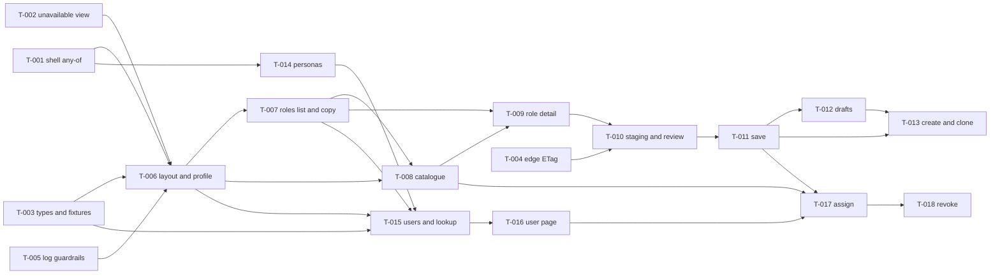

# US-020 — Task Breakdown: RBAC Access Management console

**Phase:** 4 (Task Breakdown), Gate 3

**Gate 3:** pending

**Epic:** EPIC-002 (RBAC Foundation)

**Scope of this file (recommendation): it plans the MVP (S0–S3) as 18 executable tasks, T-001 to T-018. S4 to S6 appear only as a labelled later batch with no task ids.** This follows Gate 1 Q1 and Q11, which put S4 first after the MVP and S5 and S6 later. It also follows design §1.2 and §12.13: S4 to S6 are "outlined" and get "designed in full in a delta to this document before they start". A task needs files, tests written first and a Definition of Done, and an outline cannot supply them. Writing S4 to S6 as tasks now would invent design. When the design delta passes its own Gate 2 delta review, `/breakdown US-020` is re-run to append T-019 onward.

**Why 18 tasks rather than ≤ 8:** the MVP is a whole frontend console plus its shell, edge and CI changes, estimated at about 7,600 production lines. That is roughly frontend 6,900 (S1e ≈ 2,300, S2 ≈ 2,000, S3b ≈ 1,800, shell and hardening ≈ 800), CI, nginx and smoke script ≈ 450, and backend seed and fixtures ≈ 250. 7,600 ÷ 400 ≈ 19, so the count follows from size. No slice exists only to isolate a risk.

**Inputs (all read, binding):**
- `docs/features/US-020/03-design.md`, Draft 2, approved at Gate 2 on 2026-10-23 (cited as "design §x"). The delta-review items D-1 to D-6 at its head are binding on the named slice's merge gate, and **where they conflict with the design body, threat model §12 wins** (design header).
- `docs/features/US-020/03b-threat-model.md`: §3 threats, §6 RC-68 to RC-72, §7 RC-73 to RC-77, §11 merge-blocking list, §12 delta review D-1 to D-6 (cited as "TM §x").
- `docs/features/US-020/01-requirements.md`: the §5 requirements FR-A1 to FR-X6 (51 in total), the §6 slices, and the §12a Gate 1 decisions Q1 to Q29.
- `02-impact.md` (cited as "impact §x"). ADR-0028 and ADR-0029, both Proposed, already exist in `docs/adr/`.
- Skills `angular-standards` (`nexus-frontend/ANGULAR_STANDARDS.md`), `design-system`, `spring-boot-standards` and `api-design`; `.claude/commands/breakdown.md`.
- Format precedent: `docs/features/US-019/04-tasks.md`.

**Path shorthand.**
- `FE/` = `nexus-frontend/src/app/`
- `AM/` = `nexus-frontend/src/app/features/access-management/`
- `E2E/` = `nexus-frontend/e2e/`
- `BE/` = `nexus-backend/src/main/java/com/example/nexus/`
- `BT/` = `nexus-backend/src/test/java/com/example/nexus/`
- `WF/` = `.github/workflows/`

Every path under "Files impacted" was confirmed with Glob or Grep on `feature/US-020` this session. Paths under "Files created" do not exist yet. Line citations are the design's, taken at `adda702`. Re-read the files before editing them, because T-001, T-002 and T-006 all edit `FE/app.routes.ts` and `FE/app.routes.spec.ts`.

**Per-task gate** (CLAUDE.md §4):
- **Frontend tasks** run, from `nexus-frontend/`: `npm run test:ci`, then `npm run lint && npm run format:check`, then `npm run build` (budgets) before the PR.
- **Tasks with backend code** (T-003, T-014) run `./mvnw verify -DskipITs` from `nexus-backend/`. T-014 also runs `./mvnw verify` with Docker up, for `DevPersonaSeedIT`.
- **Tasks that add Playwright specs** run `npm run e2e` locally against the compose backend. In the same commit they raise `E2E_MIN_TESTS` (`WF/e2e-full-stack.yml:27`, 31 today) by exactly the number of tests they add (design §19.3; release item §20.2 item 9).
- Each task **writes its own** unit, render and e2e tests first.

**Per-slice exit** (operating model): `/review` → `/security-review` → `/test-validate` → `/pre-pr-check` → PR. Every slice's Phase 7 re-runs `./mvnw dependency:tree` and `npm audit` (TM §11, "all slices"). The baseline is no manifest delta, a clean production npm graph, and RES-60 (toolchain `vite`) accepted.

**Feature flags:** the design adds **no backend flag**. It adds one frontend build-time switch, `AppConfig.accessConsoleEnabled`, introduced in T-001: `false` in `environment.ts` and `true` in `environment.development.ts` (design §18). It is a **release control, not authorization** (RC-76). The backend flags us012, us015 and us019 stay the off switch for the APIs.

**Cryptography:** no task in this story touches cryptography. The threat model (TM §0.4) attests that there is no key, algorithm or randomness change. The cool-down jitter is non-cryptographic by design (TM §12.4). The "Risks" line of each task says so, so that `/implement` does not escalate for crypto.

**Load test:** none. Requirements NFR-1 and FR-F8 state no RPS or p95 budget, and mark the console "admin-only, low-RPS, not a hot path [CONFIRM]". Under `breakdown.md` step 4 this is a Gate 1 gap (open item O-1), not something to invent here. FR-F8's client figures (500-role render and filter in under 200 ms; role detail interactive within 1 s on the dev stack) are measured by hand in T-007 and T-009 and recorded in the PR. They are not load tests.

**No PII.** People are referred to by role only. No persona address, credential or email appears in this file.

---

## Ambiguities resolved by judgment (read before the named task)

| # | Where | Ambiguity | Resolution |
|---|---|---|---|
| A-1 | design §1.2 S1a vs S1e; §4.4 pin spec | The nav pin spec requires the `admin/access` route to exist with `data.anyOf` in S1a. `ACCESS_MANAGEMENT_ROUTES` and the layout only arrive in S1e. | **T-001 adds the gated parent route.** Its `loadChildren` points to `AM/access-management.routes.ts`, which T-001 creates with an **empty** route array. Until T-006 merges, an entitled deep link in development falls through to the shell's Not Found, while the guards and the pin are already real. Production is unaffected, because the switch is `false`. |
| A-2 | design §1.2 graph vs S1e contents | `nx-banner` belongs to S1d, but its first consumers are S1e's read-only banner and the system-role banner. The graph has no S1d → S1e edge. | **`nx-banner` lands in T-006** (its first consumer). The S1d PR keeps the nginx, smoke, lint and logger items. |
| A-3 | TM §7 RC-73 (S1e) | `GlobalErrorHandler` is a core file outside the feature. The per-store "never reaches `ErrorHandler`" specs need the stores. | The **`GlobalErrorHandler` change lands in T-005**, with the other logging guardrails, before any console store exists. **Each store task carries its own "errors never reach `ErrorHandler`" spec** (T-006 to T-009, T-015, T-016). The S1e gate is therefore met early and stays met. |
| A-4 | design §1.2 S1e "P-27 e2e" | P-27 (a member deep link reaches `/access-denied`) proves `anyPermissionGuard`, which T-001 delivers. | **P-27 is written in T-001**, with the behaviour it proves. |
| A-5 | design §4.4, §1.2 S3a | `E2E/access-management/shell.spec.ts:29` asserts the **exact** link count per persona. Adding the nav item breaks it for existing personas in S1a. | **T-001 updates `NAV_LABELS` for the existing personas.** T-014 adds the two new sign-in personas. |
| A-6 | design §7.3 vs §1.2 | `retryOnceOnClassificationChange` serves both the PUT (S2) and assign (S3b), but §1.2 makes S3b independent of S2. | **T-011 owns the helper.** T-017 depends on T-011. The rest of S3b (T-015, T-016) still runs in parallel with S2. |
| A-7 | design §19.1 "nginx static" row | The design says the case joins "the existing `tools.selftest.mjs` run in `frontend-ci`". That run is in `WF/e2e-full-stack.yml:80`, not in `frontend-ci.yml`, which has no `node --test` step. | **T-004 adds the case to `E2E/tools/tools.selftest.mjs` and adds a `node --test e2e/tools/tools.selftest.mjs` step to `WF/frontend-ci.yml`.** That keeps the design's intent: fast, with no Docker. |
| A-8 | design §4.7, §15.3, §10 vs TM §12 | The design body still says `router.parseUrl` and a `\p{Cf}`-only set, and §10 lacks RC-74. | The **D-items win**: D-2 in T-002, D-1 in T-015, D-6 in T-012. Each task cites the D-item, not the stale body text. |
| A-9 | design §5 `util/csv-neutralise.ts` | It is listed as "kept ready for E3, not wired" (Q20), but no slice owns it. | **It is not built in the MVP.** Unwired code is speculative (CLAUDE.md §2). It goes with S6 (FR-E3) in the later batch. |
| A-10 | design §9.1 | `RbacErrorMessages` is `Record<ConsoleErrorCode, …>`, so it is exhaustive by type. | The **whole copy module** (§14.1 errors, `RBAC_001` reasons, `NotEnabledCopy`, `resolveConsoleError`, `format`) **lands in T-007**, the first page that maps errors. Later tasks add only §14.2 page strings for their own pages. Permission labels move in T-008, and propagation in T-011. |
| A-11 | design §9.3, §13 | The design puts the "TTL changed → update `propagation.ts`" line and the WCAG 2.2 manual checklist in the PR template. | These are **DoD items**: the checklist in T-006 and the TTL line in T-011, both in `.github/PULL_REQUEST_TEMPLATE.md`. They are not tasks. |
| A-12 | design §19.4, §20.2 | `DEVELOPMENT_GUIDE` "add a nav item" rule, the ADR-0028 and ADR-0029 text, and the `TOKEN_REFRESH_REUSE` runbook triage step (RC-71 item 2). | Docs: Phase 9 `/docs`, or the DoD of the task named in Traceability 1. They are not tasks. |

---

## Slice map and PR boundaries

```
US-020 MVP (S0–S3)
├─ PR S1a  shell: any-of nav, guards, kill switch, card ...... T-001                 [shared shell contract]
├─ PR S1b  unavailable view, authGuard, safeReturnUrl ........ T-002                 [shared shell contract]
├─ PR S1c  wire types + contract fixtures (both sides) ....... T-003
├─ PR S1d  edge ETag (nginx, smoke) + logging/lint guardrails  T-004 T-005           [edge; core logging]
├─ PR S1e  read console .................................... T-006 T-007 T-008 T-009
├─ PR S2   authoring ....................................... T-010 T-011 T-012 T-013 [T-012 touches AuthService]
├─ PR S3a  personas and targets ............................ T-014
└─ PR S3b  users and assignment ............................ T-015 T-016 T-017 T-018
   S0 (human: UX/PM, Ops edge, DPO, P-7, P-9, P-11) ...... no tasks (see "Release checklist and human items")
Later batch (not tasks yet): S4 rename/delete · S5 members/unused · S6 access review
```

**Totals:** S1a 1 · S1b 1 · S1c 1 · S1d 2 · S1e 4 · S2 4 · S3a 1 · S3b 4 = **18 tasks**. S1e and S3b may each be split into two PRs at the reviewer's choice (T-006 and T-007, then T-008 and T-009; T-015 and T-016, then T-017 and T-018). Their merge rules do not change.

### Tasks that touch shared shell contracts (isolated; reviewed with extra care)

| Contract | Task | Extra review |
|---|---|---|
| `NavItem` shape, `visibleNavItems`, `NAV_ITEMS_TOKEN`, nav pin spec, `shell.spec` `GATED_NAV`, e2e `NAV_LABELS` | T-001 (T-014 adds personas only) | Frontend Tech Lead. `primary-nav.ts` and `shell.ts` read `permission` today and move to `anyOf`, with no behaviour change for single-permission items |
| New guard family on the route tree: `anyPermissionGuard` (fail-closed), `canMatch` allow-list (RC-76), `admin/access` placement | T-001 | Platform Security Owner (authorization) |
| `authGuard` classification, **public-route pin 3 → 4 (exact)**, no `canActivateChild` (RC-65), `safeReturnUrl` | T-002 | Platform Security Owner (H-1 formal acceptance); the TM §4.2 conditions |
| `GlobalErrorHandler`, `LoggerService` `SENSITIVE_KEYS`, ESLint config | T-005 | Frontend Tech Lead |
| `AuthService.logout` `finalize` and session establishment (draft sweep) | T-012 | Frontend Tech Lead. The refresh path must not change (RC-65); `clearSession` must stay untouched |
| `nginx.conf` `location /api/`, a new CI job | T-004 | Ops (ADR-0029) |
| `ApiContractFixturesTest` lockstep | T-003 | Backend and frontend owners together |

These seven tasks are the only ones that edit files outside `AM/`, `shared/ui/`, `shared/pages/unavailable/`, `shared/types/api/`, the e2e folder and the dev seeders. Every other task stays inside the feature.

### Merge checklists (design §1.2 exit gates + TM §11 + TM §12.8)

- **All console PRs:** **P-11**, the full-stack e2e job green once, before the **first** console PR merges (Q13; T-001 is expected to be first). `assert-executed.mjs` already fails on any skipped test (`E2E/tools/assert-executed.mjs:26`). `E2E_MIN_TESTS` is raised in each PR that adds specs. The PII scan (`scan-pii.mjs`) runs unmodified.
- **S1a (T-001):** RC-76 contract spec green; `nav.config.spec`, `shell.spec` and `app.routes.spec` green with the any-of cases.
- **S1b (T-002):** RC-70 **with D-2**, RC-71 item 3, RC-75; the real-Router cold-start spec green (exactly one refresh per attempt; no HTTP on the view; the page injects no `HttpClient`); the public pin an **exact** set of four (TM §4.2); **H-1 recorded** (human).
- **S1c (T-003):** `./mvnw verify -DskipITs` and `npm run test:ci` in the same PR.
- **S1d (T-004, T-005):** RC-72 items 1–3 and D-3 (a)–(c) in code; the `edge-etag-smoke` job green, **including** its CI-only negative control. D-3 (d) and the H-4 identity are human.
- **S1e (T-006 to T-009):** RC-73 (T-005 merged; each store's spec in); request-budget tests for every §6.5 read row; e2e read pages with axe in both themes.
- **S2 (T-010 to T-013):** RC-74 items 1–3 **with D-6**. **No production enablement before the Ops edge confirmation** (design §1.2; release item 3).
- **S3a (T-014):** RC-77; `DevPersonaSeedIT` green with Docker.
- **S3b (T-015 to T-018):** RC-68 **with D-1**, RC-69, D-4, D-5; PII scan clean; **H-2 recorded** (either decision; human).

---

# S1a — Shell: any-of nav, guards, kill switch

### T-001 — Users holding `role:read` or `user:directory:read` see and can enter "Access management" from the nav and the dashboard, only when the console is switched on; everyone else is denied, and misconfiguration denies

**Description.**
- **(a) Any-of nav** (design §4.4).
  - `NavItem.permission` becomes `anyOf: readonly Permission[] | null`. `visibleNavItems` keeps an item when `anyOf === null || anyOf.some(...)`.
  - `export const ACCESS_CONSOLE_ANY_OF` lives in `nav.config.ts`. `NAV_ITEMS` gains the "Access management" item.
  - The `NAV_ITEMS_TOKEN` factory injects `APP_CONFIG` and drops the item when `accessConsoleEnabled` is false, so `visibleNavItems` stays pure.
  - `primary-nav.ts` and `shell.ts` are moved to `anyOf`.
- **(b) `anyPermissionGuard`** (`CanActivateFn`, design §4.3).
  - It reads `data.anyOf` and **fails closed**: a missing, empty or non-catalogue value gives a `UrlTree` to `/access-denied`, with the `any_permission_guard_misconfigured` error log (path only, query and fragment stripped).
  - Holding any member allows. Otherwise it redirects to `/access-denied` with no query parameters.
  - Contract spec: every route that uses it has a valid `data.anyOf` and an `authGuard` ancestor, and never shares a `canActivate` array with `authGuard`.
- **(c) Kill switch** (design §4.3, §18; RC-76).
  - `AppConfig.accessConsoleEnabled`: `false` in `environment.ts`, `true` in `environment.development.ts`, and set in **every** `APP_CONFIG` test stub (8 spec files).
  - `accessConsoleEnabledGuard: CanMatchFn` returns the config value only.
  - **RC-76 contract spec:** every `canMatch` on a shell descendant is in an allow-list of config-only guards, initially just this one. The guard's own spec asserts that it injects neither `AuthStore`, `AuthService` nor `HttpClient`.
- **(d) Route** (A-1).
  - `admin/access` is added under the shell with `canMatch: [accessConsoleEnabledGuard]`, `canActivate: [anyPermissionGuard]` and `data.anyOf = ACCESS_CONSOLE_ANY_OF`.
  - It uses `loadChildren` to an `AM/access-management.routes.ts` with an empty array.
  - There is no `canActivateChild` (RC-65).
- **(e) Dashboard card** (design §4.4, §12.12). `NxCard` plus an `NxButton` link, visible when the switch is on and `AuthStore` holds any of `ACCESS_CONSOLE_ANY_OF`. It keeps `data-testid="dashboard-root"` and the single `h1`.
- **(f) e2e** (A-4, A-5). `NAV_LABELS` is updated for `admin`, `admin2`, `roleManager` and `userManager` (they gain the item) and for `member` (it does not). New spec for **P-27**: `member` deep-links `/admin/access` and lands on `/access-denied`.

**ACs covered:** FR-A1 (entry gate, nav and card any-of, P-27), FR-G7, FR-F5 (typed `data.anyOf`), FR-F2, FR-F1 (card axe). Gate 1 Q7, Q9. Design decisions 2, 4, 5 and 6.

**Dependencies:** none. **First console PR**, so P-11 blocks its merge.

**Files impacted:**
- `FE/core/layout/nav.config.ts`, `nav.config.spec.ts`, `primary-nav/primary-nav.ts`, `primary-nav/primary-nav.spec.ts`, `shell/shell.ts`, `shell/shell.spec.ts`
- `FE/core/config/app-config.ts`, `app-config.spec.ts`; `nexus-frontend/src/environments/environment.ts`, `environment.development.ts`
- the APP_CONFIG stubs in `FE/core/http/api-error.interceptor.spec.ts`, `auth.interceptor.spec.ts`, `FE/core/routing/cold-start-routing.spec.ts`, `FE/shared/pages/access-denied/access-denied.component.spec.ts`, `FE/features/auth/auth.service.spec.ts`, `FE/core/logging/logger.service.spec.ts` and `FE/core/errors/global-error-handler.spec.ts` (`shell.spec.ts` is listed above)
- `FE/app.routes.ts`, `FE/app.routes.spec.ts`
- `FE/features/dashboard/dashboard.component.ts`, `dashboard.component.spec.ts`
- `E2E/access-management/shell.spec.ts`; `.github/workflows/e2e-full-stack.yml` (`E2E_MIN_TESTS`)

**Files created:**
- `FE/core/guards/any-permission.guard.ts`, `any-permission.guard.spec.ts`, `any-permission-guard-contract.spec.ts`
- `FE/core/guards/access-console-enabled.guard.ts`, `access-console-enabled.guard.spec.ts`, `FE/core/guards/can-match-contract.spec.ts`
- `AM/access-management.routes.ts` (empty array; A-1)
- `E2E/access-management/console-entry.spec.ts` (P-27)

**Complexity:** M (≈ 300 production lines plus stub churn).

**Risks:**
- **Authorization:** a new guard on the route tree. Fail-closed must hold for a missing, empty, nested or non-catalogue `anyOf`. `canMatch` runs **before** `authGuard`, so a guard there that reads auth state sees an empty session at cold start (T-E57). The kill switch must not be described or tested as an authorization control (RC-76).
- **Shared shell contract:** nav and route pins change for every persona. A single-permission item must behave exactly as today.
- Concurrency: none. Cryptography: none.

**Tests (written first):**
- `any-permission.guard.spec`: allow through the first member, allow through the second, deny through neither, and misconfigured (missing, `[]`, a non-catalogue string, a non-array) **denies** and logs once, path only.
- `any-permission-guard-contract.spec`: fixture routes, both bad and good, including nested ones.
- `can-match-contract.spec` (RC-76): the allow-list over the real tree, plus a fixture with an unlisted `canMatch` that fails. The `accessConsoleEnabledGuard` spec asserts injection of `APP_CONFIG` only.
- `nav.config.spec`: the rewritten pin (`anyOf` equals the target route's `data.anyOf` or `[data.permission]` or `null`, as a set), the four `visibleNavItems` cases, and the kill switch hiding the item.
- `shell.spec`: the any-of `GATED_NAV` fixture. `app.routes.spec`: the `admin/access` parent with `canMatch`, `canActivate` and `anyOf`, and no `canActivateChild`.
- `dashboard.component.spec`: card visible, hidden by permission, hidden by switch; unit axe on the card.
- **PII:** the misconfiguration log carries the path only. A spec asserts that no query string or fragment is logged.
- **e2e:** P-27 (`member`), plus the shell spec per existing persona.

**DoD:**
- Frontend gates green. `npm run build` shows no initial-bundle change other than the guard and config (recorded in the PR).
- Every `APP_CONFIG` stub has the new key; no spec relies on its default.
- e2e green with zero skips, and `E2E_MIN_TESTS` raised.
- `DEVELOPMENT_GUIDE` "add a nav item" rule written in the docs pass (A-12).
- S1a merge checklist met. One commit.

---

# S1b — Unavailable view and return URLs

### T-002 — When nobody authoritative answers the cold-start refresh, the user lands on a static "unavailable" page whose cooled-down Retry re-enters through the shell with exactly one refresh; return URLs can never point at `unavailable` or `auth`

**Description.**
- **(a) `authGuard`** (`auth.guard.ts:7-10, 36-43`; design §4.5). `isServiceUnavailable` becomes true for `NETWORK_ERROR`, `HTTP_ERROR` and `AUTH_005`. On that branch the guard:
  - calls `UnavailableState.record(error)`;
  - returns a `UrlTree` to `/unavailable?returnUrl=<state.url>`;
  - logs `auth_guard_unavailable` (`errorCode`, `correlationId`).

  Every backend problem document (`AUTH_004`, `RATE_001`, `INTERNAL_ERROR`, …) still goes to `/auth/login` with `returnUrl`. The guard still calls `refresh()` exactly once per activation.
- **(b) `UnavailableState`** (`FE/core/routing/unavailable-state.ts`, `@Service()`, no Material). It holds `reference`, `retryAfterSeconds` and `recordedAt` in memory only, never in storage or the URL.
- **(c) `UnavailablePage` and `UnavailableNotice`**, lazy, under `PublicLayout`, with `data: { selfManagedFocus: true }` (design §4.5, §12.11).
  - The page makes **no HTTP call** and **injects no `HttpClient`**.
  - It reads `returnUrl` once through `safeReturnUrl`.
  - It shows the reference, a Retry button with a countdown, and a "Go to sign-in" link. `supportContact` is `null`, so there is no contact link (Q23).
  - Focus goes to the `h1`. There is exactly one polite announcement, at zero.
- **(d) RC-75 cool-down.**
  - The countdown is `min(retryAfterSeconds ?? 10, 60)` plus 0–5 s of jitter from `recordedAt`.
  - With no state (a reload or a direct visit), it is 10 s from render.
  - Retry navigates to `safeReturnUrl(returnUrl)`, shows `loading`, and cannot be pressed twice. A second failure restarts the countdown from the new `recordedAt`.
  - There is no automatic retry.
- **(e) Public-route pin** (RC-63(i)). It goes from 3 to **exactly** 4 paths: `auth`, `access-denied`, `design-system`, `unavailable`.
- **(f) `safeReturnUrl`, RC-70 implemented as D-2** (supersedes design §4.7's `router.parseUrl`).
  - The function **stays pure** and parses with `new DefaultUrlSerializer().parse(raw)`.
  - It reads `tree.root.children[PRIMARY_OUTLET]?.segments[0]?.path`. If that equals `unavailable` or `auth`, the result is `/dashboard`, and the existing literal `/auth` rule moves onto this rule.
  - Any primary segment equal to `.` or `..` also gives `/dashboard`, and so does a parse failure.
  - The navigated string stays the validated string: no second decode.

**ACs covered:** FR-X3 (cold-start half), FR-A1 ("signed out → login with `returnUrl`" is unchanged and pinned), FR-G2 (focus on the view), FR-F1 (view axe in both themes). Gate 1 Q4 as amended (design §0.2), Q23. NFR-S3.

**Dependencies:** none. It runs in parallel with T-001. Merge order on `app.routes.ts` and `app.routes.spec.ts`: rebase on whichever of T-001 and T-002 merges first.

**Files impacted:**
- `FE/core/guards/auth.guard.ts`, `auth.guard.spec.ts`
- `FE/core/routing/safe-return-url.ts`, `safe-return-url.spec.ts`, `cold-start-routing.spec.ts`
- `FE/app.routes.ts`, `FE/app.routes.spec.ts`
- `E2E/access-management/cold-start.spec.ts`, `E2E/access-management/return-url.spec.ts`; `.github/workflows/e2e-full-stack.yml` (`E2E_MIN_TESTS`)

**Files created:**
- `FE/core/routing/unavailable-state.ts`, `unavailable-state.spec.ts`
- `FE/shared/pages/unavailable/unavailable.page.ts`, `unavailable.page.spec.ts`, `unavailable-notice.ts`, `unavailable-notice.spec.ts` (with `.html` and `.scss` as the pattern requires)

**Complexity:** L (≈ 350 production lines; security-reviewed routing).

**Risks:**
- **Authorization / open redirect:** `returnUrl` handling (T-T26). The check must read the same parse tree the router will use, and must navigate the validated string.
- **Session refresh concurrency:** one refresh per attempt, never two concurrent, and never a second refresh path (RC-65, SD-4). A lost refresh response followed by Retry is a refresh-token reuse that must land on login, not loop (T-R19, RC-71).
- **Shared shell contract:** the public-route pin widening needs H-1. `authGuard` and `UnavailableState` must stay Material-free (initial bundle).
- Cryptography: none (the jitter is non-cryptographic by design, TM §12.4).

**Tests (written first):**
- `auth.guard.spec`: `NETWORK_ERROR`, `HTTP_ERROR` and `AUTH_005` go to `/unavailable` with `returnUrl` and a recorded state; `AUTH_004`, `RATE_001` and `INTERNAL_ERROR` go to login; no branch returns `true` without a completed `refresh()`.
- `cold-start-routing.spec` (real Router):
  - a network error lands on `/unavailable?returnUrl=…`;
  - **exactly one** `POST /refresh` per attempt;
  - Retry produces exactly one more refresh, never two concurrent;
  - zero requests while on the view;
  - **RC-71 item 3:** the first refresh fails with `NETWORK_ERROR`, Retry's refresh returns 401 `AUTH_004`, and the user lands on `/auth/login` with the validated `returnUrl`, with no further refresh and no loop.
- `unavailable.page.spec`:
  - no `HttpClient` in the injector graph, and `HttpTestingController.verify()` shows zero requests;
  - the RC-75 countdown with seeded randomness for the formula, and 10 s with no state;
  - double press ignored;
  - one announcement at zero;
  - no `traceId` in the URL.
- `safe-return-url.spec`, the adversarial table:
  - **expected `/dashboard`:** `/unavailable`, `/unavailable?returnUrl=%2Fadmin`, `/%75navailable`, `/%61uth/login`, `/unavailable;x=1`, `/auth;x=1/login`, `/(unavailable)`, `/x/../unavailable`, `/%2e%2e/unavailable` (D-2);
  - **returned unchanged:** `/%2575navailable` (pins "no second decode") and `/admin/access/roles`;
  - plus a parse-failure case.
- `app.routes.spec`: the public children are **exactly** the four paths; `unavailable` has no guard and only `selfManagedFocus`; there is no `canActivateChild` anywhere.
- **PII:** the `auth_guard_unavailable` log has only `errorCode` and `correlationId` (spec).
- **a11y:** unit axe on `UnavailableNotice`; the e2e axe pass in light and dark.
- **e2e** (`cold-start.spec`, `admin`): `page.route` aborts `POST /api/v1/auth/refresh` once; assert the view, the countdown and one refresh per attempt (request listener); after Retry, land on the return URL.

**DoD:**
- Frontend gates green. The `npm run build` initial bundle stays free of Material (recorded).
- e2e green, and `E2E_MIN_TESTS` raised.
- ADR-0028 already records decision 7 (RC-71); the `TOKEN_REFRESH_REUSE` triage step goes in the Phase 9 runbook (A-12).
- S1b merge checklist met, including **H-1 recorded**. One commit.

---

# S1c — Wire types and contract fixtures

### T-003 — The console's wire types for permission pages, assignments, role creation and every handled error code are pinned to recorded backend responses on both sides, so a field change fails a build

**Description** (design §7.5, §19.2).
- **(a) `FE/shared/types/api/rbac.ts`.**
  - Add `PermissionPageResponse`, `RoleAssignmentResponse` (`assignedBy: string | null`), `RoleAssignmentListResponse`, `AssignRoleRequest` and `CreateRoleRequest`.
  - Widen `RbacErrorCode` to `RBAC_001` to `RBAC_012`.
  - JSDoc: `PermissionListResponse` is the `GET /roles/{id}/permissions` shape only. Reword `rbac.ts:75-78` (DQ-15: the interceptor never retries; the write client retries once).
- **(b) `FE/shared/types/api/user-directory.ts`.** Add `DirectoryErrorCode` and `UserStatus` if absent. Reword `FE/shared/types/app-error.ts:97-105` (DQ-15).
- **(c) Fixtures, in one PR on both sides** (lockstep, `ApiContractFixturesTest.java:75-82`).
  - New records: `permission-page-response`, `role-assignment-list-response` (one `assignedBy` set, one `null`), `role-assignment-response`, `assign-role-request`, `create-role-request`, `problem-rbac-002`, `problem-rbac-006`, `problem-rbac-008`, `problem-rbac-011`, `problem-precondition-failed`, `problem-precondition-required`, `problem-user-dir-001`, `problem-validation-failed` (with `details`), `problem-resource-not-found`.
  - Matching keys go in `api-contract.spec.ts`. `permission-catalogue` keeps its name.
  - Synthetic ids and `example.test` addresses only. There is no `AUTH_005` fixture (design §7.5: a hand-written filter body).
- **(d) AS-6.** The assign 201 body is recorded from the real serializer. If it is not `RoleAssignmentResponse`, the type follows the record.

**ACs covered:** prerequisite of FR-B2 (code union), FR-B1 (create body), FR-C2 and FR-C3 (assignment shapes), FR-X6. Design decision 1 (backend test code only).

**Dependencies:** none.

**Files impacted:**
- `BT/contracts/ApiContractFixturesTest.java` and its fixture resource folder *(locate with Grep at planning; the existing records name it)*
- `FE/shared/types/api/rbac.ts`, `user-directory.ts`, `api-contract.spec.ts`; `FE/shared/types/app-error.ts`

**Files created:** the 14 fixture JSON files listed above.

**Complexity:** S (≈ 120 production type lines plus fixtures).

**Risks:**
- **PII:** fixtures must use `example.test` only. The backend test asserts only that `@example.com` is absent (design §0.4 #3), so the frontend check (`api-contract.spec.ts:155-158`) is the stricter one and must stay.
- Lockstep: a JSON file without a record fails the backend build.
- Authorization, concurrency, cryptography: none.

**Tests (written first):**
- `ApiContractFixturesTest`: each new record serialises the real DTO or `ProblemDetail` to its file (this is what fails first).
- `api-contract.spec.ts`: the key set of each new fixture matches its TypeScript type, and the PII rule holds for every new file.
- A type-level spec asserting that `RbacErrorCode` contains `RBAC_001` to `RBAC_012`.

**DoD:**
- `./mvnw verify -DskipITs` and frontend gates green, in **one PR**.
- AS-6 confirmed or the type corrected, with the result stated in the PR.
- One commit.

---

# S1d — Edge ETag preservation and logging guardrails

### T-004 — A strong `ETag` and `If-Match` survive nginx: `/api/` is no longer gzipped, a static test pins it, and a non-mutating smoke job proves it against real nginx and checks that it can fail, without ever running as an administrator outside CI

**Description** (design §15.4, §19.6; ADR-0029; RC-72; D-3).
- **(a)** `nexus-frontend/nginx.conf` `location /api/` gains `gzip off;`. `/api/v1/auth/` and static assets keep gzip.
- **(b) Static test** (A-7). A `node --test` case in `E2E/tools/tools.selftest.mjs` asserts that the `location /api/` block contains `gzip off;`. `WF/frontend-ci.yml` gains a step that runs `tools.selftest.mjs`, so the check needs no Docker.
- **(c) `E2E/tools/etag-edge-smoke.mjs --base <url> [--negative-control]`.**
  - Steps 1–4 as design §19.6:
    1. log in;
    2. find the whole-catalogue system role;
    3. `GET` its set with `Accept-Encoding: gzip`, assert a strong `ETag`, and fail as "smoke not meaningful" if the body is under 1,024 bytes;
    4. `PUT` the same ids with that `If-Match` and expect **409 `RBAC_003`**.
  - Step 5 (`If-Match: W/…` expects 428) runs **only** with `--negative-control`.
  - It prints status codes and tag classes only.
  - **D-3 enforcement:**
    - (a) after login it reads `/api/v1/users/me/authorization`. Outside CI persona mode, it aborts with a non-zero exit (after logging out) if the identity is an administrator or holds anything outside `{role:read, role:write}`.
    - (b) it refuses `--negative-control` unless `CI` is set, or the base host is loopback or the compose service.
    - (c) it logs out in a `finally` on every exit path.
  - Credentials come only from `NEXUS_SMOKE_USER` and `NEXUS_SMOKE_PASSWORD`, never argv. In CI it uses the e2e administrator persona, read the way `scan-pii.mjs` reads `PERSONAS`.
- **(d) Job `edge-etag-smoke`** in `WF/e2e-full-stack.yml`. It is separate from the Playwright job: it starts `backend` and `frontend` (nginx) through compose, waits on `http://localhost:2000/api/...`, and runs the script with `--negative-control`.

**ACs covered:** FR-X1 (precondition for the editor to save behind nginx), and design decision 24. The requirements have no direct AC; this protects FR-B3 and FR-B4 in deployment.

**Dependencies:** none. **S2 (T-010 onward) depends on this task** (design §1.2).

**Files impacted:** `nexus-frontend/nginx.conf`; `E2E/tools/tools.selftest.mjs`; `WF/e2e-full-stack.yml`; `WF/frontend-ci.yml`.

**Files created:** `E2E/tools/etag-edge-smoke.mjs`, plus a pure-function selftest for its D-3 decision helpers (in `tools.selftest.mjs`).

**Complexity:** M (≈ 300 lines of script and workflow).

**Risks:**
- **Authorization and secrets:** an administrator credential in an operator's environment, or `--negative-control` against production, would train the §17 alert into noise (T-R20). D-3 (a)–(c) must be enforced in code, not prose. Credentials must never reach argv, stdout or artifacts.
- **Concurrency integrity:** the job proves the optimistic-concurrency token (ADR-0027) survives the edge. A false green, for example a body under the gzip threshold, must fail loudly.
- Cryptography: none.

**Tests (written first):**
- The static nginx case: it fails on a fixture config without `gzip off;` in `/api/`, and passes on the real file.
- `tools.selftest` cases for the script's pure helpers:
  - tag classification (strong, weak, missing);
  - the D-3 (a) identity predicate (an administrator, an extra permission and an exact `{role:read, role:write}` give abort, abort, allow);
  - the D-3 (b) negative-control gate (`CI` unset with a remote host gives a refusal);
  - "smoke not meaningful" under 1,024 bytes;
  - output that contains no credential (assert on the captured output for a fixture run).
- The CI job itself: green, including the negative control (428 observed).

**DoD:**
- `edge-etag-smoke` green in CI, and the static case green in `frontend-ci`.
- ADR-0029 decisions 4 and 5 still match the script (Phase 9 text otherwise).
- D-3 (d) and H-4 (Ops secret store, the alertable write, the per-environment identity) recorded as human items.
- One commit.

### T-005 — Console logs can never carry emails, search text, descriptions or server error text: `AppError`s reach the log only as code and ids, new redaction keys apply, and features cannot import `DomSanitizer`

**Description** (design §15.3; RC-73; A-3).
- **(a) `GlobalErrorHandler`** (`global-error-handler.ts:31, 57-66`). An `AppError`-shaped value (an object with a string `code`) is logged with context keys `code`, `correlationId` and `traceId` only, and **never** `JSON.stringify`ed into the message. Other non-`Error` objects keep today's path.
- **(b) `LoggerService.SENSITIVE_KEYS`** gains `email|query|search|description` (`logger.service.ts:25`).
- **(c) ESLint** `no-restricted-imports` bans `DomSanitizer` from `@angular/platform-browser` in `src/app/features/**`, with a `lint-rules.spec.ts` case. The existing sink bans stay.

**ACs covered:** FR-F7, FR-G9 (lint enforcement), NFR-O1. Design decision 23. SD-12.

**Dependencies:** none.

**Files impacted:** `FE/core/errors/global-error-handler.ts`, `global-error-handler.spec.ts`; `FE/core/logging/logger.service.ts`, `logger.service.spec.ts`; `nexus-frontend/eslint.config.js`; `FE/shared/testing/lint-rules.spec.ts`.

**Files created:** none.

**Complexity:** S (≈ 60 production lines).

**Risks:**
- **PII in logs** (T-I27). Redaction is key-based only, so the message path must never carry an object.
- **Shared core:** every runtime error in the app passes through this handler. Non-`AppError` behaviour must not change.
- Authorization, concurrency, cryptography: none.

**Tests (written first):**
- `global-error-handler.spec`: an `AppError` with `message`, `details` and `requiredPermission` produces a log call whose message and context contain **none** of them, and contain `code`, `correlationId` and `traceId` as keys. A plain `Error` behaves as before.
- `logger.service.spec`: one case per new key (`email`, `query`, `search`, `description`), plus case-insensitivity.
- `lint-rules.spec`: a feature file importing `DomSanitizer` fails; a `shared/` file is unaffected.

**DoD:**
- Frontend gates green.
- **RC-73's core in place before any console store exists.** The S1e tasks carry the per-store specs.
- One commit.

---

# S1e — Read console

### T-006 — Entitled users enter the console layout, which reads their live access once per entry, shows areas by permission, and turns every change off under a banner when that access cannot be confirmed

**Description** (design §4.2, §6.1–§6.3, §12.0, §12.1).
- **(a) `ACCESS_MANAGEMENT_ROUTES`.**
  - The `''` child is `AccessConsoleLayout` with route `providers` for `AuthorizationProfileStore`. `CatalogueStore` and `RolesStore` are registered by T-007 and T-008.
  - `firstAreaRedirect` sends `role:read` to `roles`, and otherwise `users`.
  - Static titles only (DQ-26).
- **(b) `AccessConsoleLayout`.**
  - Area sub-nav `NxTabs` (`ariaLabel="Access management areas"`), showing an area only when `AuthStore` holds its route permission.
  - The read-only `nx-banner` when the profile is unavailable.
  - Inline `UnavailableNotice` on 503 `AUTH_005`.
  - Explainers without a "Learn more" link (Q25).
- **(c) `AuthorizationProfileStore`** (design §6.3).
  - `load()` once per console entry, with coalescing.
  - `reload(reason)` for `own-access-change`, `denied-predicted-allowed` and `user-changed`.
  - Reset when `AuthStore.currentUser()?.userId` changes.
  - `can(p)`, and `mutationsEnabled` computed from `ready`.
  - Unknown permission names are dropped, with one warn (code only).
  - **It never calls `AuthService.refresh()`.**
- **(d) `data/console-http.ts`** (`CONSOLE_HTTP_CONTEXT` with `SKIP_ACCESS_DENIED_REDIRECT`), `data/load-state.ts`, and `RbacApi` created with `getMyAuthorization()`.
- **(e) `nx-banner`** (A-2): token-native; `variant`, `title`, `live`, `[slot=actions]`, `dismissible`/`dismissed`; `role=status` or `role=alert`; icon plus text. It has a spec, a preview card, a barrel export and a unit axe test.

**ACs covered:** FR-X4, FR-X3 (mid-session page-load half), FR-F4, FR-F6 (profile area), FR-G2 (titles, focus), FR-G6 (reload API), FR-G11 (explainers; the link is deferred by Q25), FR-A1 (child-route skeleton), FR-F1, FR-F2, FR-F8 (lazy chunk). Gate 1 Q8, Q24. Design decisions 10, 11 and 12.

**Dependencies:** T-001 (parent route), T-002 (`UnavailableNotice`), T-003 (types), T-005 (RC-73 core).

**Files impacted:** `AM/access-management.routes.ts`; `FE/shared/ui/index.ts`, `FE/shared/ui/preview/design-system.html` *(locate: the preview card file named by the `design-system` skill)*; `.github/PULL_REQUEST_TEMPLATE.md` (WCAG 2.2 manual checklist, A-11).

**Files created:**
- `AM/layout/access-console-layout.ts` (+ template, styles, spec)
- `AM/data/authorization-profile.store.ts` (+ spec), `AM/data/rbac-api.ts` (+ spec), `AM/data/console-http.ts`, `AM/data/load-state.ts`
- `AM/copy/console-copy.ts`, created with the layout strings only; T-007 fills the error map (A-10)
- `FE/shared/ui/banner/banner.ts` (+ `.scss`, `.spec.ts`)
- `E2E/access-management/console-layout.spec.ts`

**Complexity:** L (≈ 500 production lines).

**Risks:**
- **Authorization:** the affordance source of truth moves to the live profile. A failure must disable every mutation, failing closed to read-only, and must never guess.
- **Session refresh concurrency:** the store must never start a refresh (RC-65, ADR-0028). An own-access reload relies on the interceptor's single shared refresh.
- **Request coalescing:** a second load while one is in flight must join it, not duplicate it.
- Cryptography: none.

**Tests (written first):**
- `authorization-profile.store.spec`:
  - one GET per entry, and none on child navigation;
  - coalescing;
  - each reload trigger;
  - user-change reset;
  - 404 `RESOURCE_NOT_FOUND`, 5xx, `NETWORK_ERROR` and `HTTP_ERROR` give `error` with `mutationsEnabled` false;
  - `AUTH_005` gives `error` with the code;
  - an `AuthService.refresh` spy is **never** called;
  - **RC-73:** a failing load never reaches `ErrorHandler` (spy).
- **Request budget** (§6.5 "Console entry"): exactly one `GET /users/me/authorization`; zero on a warm re-render.
- `rbac-api.spec`: every request carries `SKIP_ACCESS_DENIED_REDIRECT`.
- `access-console-layout.spec`:
  - areas shown per `AuthStore` permission;
  - read-only banner and reason text;
  - inline `UnavailableNotice` on `AUTH_005`;
  - `firstAreaRedirect` both ways.
- `banner.spec`: every input and output, `role` by `live`, and unit axe (`expectNoAxeViolations`).
- **PII:** the store's logs contain codes and ids only (spec on the logger spy).
- **e2e** (`admin`, `roleManager`): enter the console, the sub-nav per persona, and axe in **light and dark**.

**DoD:**
- Frontend gates green. The console is a **lazy chunk**, and its size is recorded in the PR (DQ-24).
- The PR template gains the WCAG 2.2 AA manual checklist (2.4.11, 2.5.8, 1.4.10 at 320 px, a keyboard walkthrough, a screen-reader pass of the matrix with NVDA + Firefox and VoiceOver + Safari).
- e2e green, and `E2E_MIN_TESTS` raised.
- One commit.

### T-007 — A role reader sees every role in one searchable, filterable, paged list that survives Back and reload, and every load failure shows the right copy with a reference

**Description** (design §6.4, §9, §12.0, §12.2, §14.1).
- **(a) `RolesStore.loadAll()`.**
  - Page 0 first, then pages 1 to `min(totalPages, 20) - 1` in parallel.
  - Progress "Loading roles: {loaded} of {total}".
  - Any page failure fails the whole load (no partial list that looks complete).
  - `truncated` sets the banner.
  - `invalidate()`.
- **(b) `util/role-list-query.ts`** (pure). Literal substring search (never a regex). `filter` is `all`, `system` or `custom`. Stable partition: system roles first, server `(name, id)` order inside each group. Page size 20.
- **(c) `RolesListPage`.**
  - `nx-page-header` with "Create role" only with profile `role:write` (the link target arrives in T-013).
  - Search, filter and result count (`role=status`).
  - `nx-table` with a hidden caption.
  - Columns as design §12.2.
  - `q`, `filter` and `page` in query params.
  - Every §12.0 state.
  - Card layout at 320 px.
- **(d) Copy module, whole** (A-10): `RbacErrorMessages` over all `ConsoleErrorCode`, `Rbac001ReasonCopy`, `NotEnabledCopy`, `resolveConsoleError`, `format()`, and the `ConsoleErrorPanel` presenter.
- **(e) Presenters.** `UserText` in `text` mode (`<bdi>`, truncation with the full text in the accessible name and `title`; `email` mode lands in T-015) and `SystemRoleBadge`.

**ACs covered:** FR-A2, FR-D4 (roles paging per Q5), FR-B2 (map and exhaustiveness), FR-F6 (roles area), FR-G1 (`q`, `filter`, `page`), FR-G8, FR-G9 (render), FR-G10, FR-F7, FR-F8 (render target measured), FR-F1, FR-F2. Gate 1 Q5, Q15, Q28.

**Dependencies:** T-006.

**Files impacted:** `AM/access-management.routes.ts` (the `roles` route, `providers: [RolesStore]` on the layout route), `AM/copy/console-copy.ts`, `AM/data/rbac-api.ts` (`listRoles`).

**Files created:**
- `AM/data/roles.store.ts`, `AM/util/role-list-query.ts`, `AM/copy/resolve-console-error.ts`
- `AM/roles/roles-list.page.ts`
- `AM/ui/console-error-panel.ts`, `AM/ui/user-text.ts`, `AM/ui/system-role-badge.ts`
- each with a colocated spec
- `E2E/access-management/roles-list.spec.ts`

**Complexity:** L (≈ 650 production lines, about 300 of them copy strings).

**Risks:**
- **Stored XSS and bidi** (SD-6, SD-7): user text by interpolation only.
- **Correctness of an "all roles" view:** a partial fetch must never look complete.
- Authorization: Create is shown by profile only, and the server is final. Concurrency: parallel page fetches with all-or-nothing failure. Cryptography: none.

**Tests (written first):**
- `roles.store.spec`:
  - one page; many pages in parallel after page 0;
  - the 20-page bound and the truncation flag;
  - a mid-page failure gives `error`;
  - `invalidate`;
  - **RC-73:** a failure never reaches `ErrorHandler`.
- **Request budget** (§6.5 "Roles list"): ⌈total/100⌉ GETs, ≤ 20, and 0 when `ready`.
- `role-list-query.spec`: regex characters are literal, the partition is stable, case-folding works, and pagination is correct.
- Copy exhaustiveness: every code in requirements §3.2 and design §2.3, and every `RbacDenialReason`, has non-empty copy with no raw code in the body. **No copy contains `500`.** `AppError.message` is never used. An unknown code gives the generic copy with a reference.
- `user-text.spec`: scenario 24 at unit level: description `` plus U+202E gives `textContent` equal to the input and no `img` element.
- Page spec: every §12.0 state; the query-param round trip (FR-G1); Create hidden without profile `role:write`.
- **PII:** log context keys are ids and codes only. No search text is logged (spec).
- **e2e** (`roleManager`, `admin`): list, search, filter, Back and Forward restore, and axe in light and dark.

**DoD:**
- Frontend gates green.
- FR-F8 "500 roles render and filter in under 200 ms", measured on the dev stack and recorded in the PR (not a CI assertion; see "Load test").
- e2e green, and `E2E_MIN_TESTS` raised.
- One commit.

### T-008 — A role reader browses the whole permission catalogue grouped by resource, with readable labels, an explained Sensitive badge, and unlabelled codes flagged without breaking

**Description** (design §6.4, §9.4, §12.6).
- **(a) `CatalogueStore.load()`.**
  - `GET /permissions?page=0&size=100` once per console session, plus the remaining pages if `totalElements > 100` (logged once as a defect signal).
  - `byId`, `byName`, `groups` (fixed group order, alphabetical inside) and `total`.
  - Reset on user change.
- **(b) Labels.** `PERMISSION_LABELS` and `PERMISSION_GROUP_LABELS` **move** from `FE/shared/types/permission.ts` to `AM/copy/permission-labels.ts`. `permission.ts` keeps the union, `PERMISSIONS`, `PermissionResource` and `permissionResource`. The label assertions move from `permission-catalogue.spec.ts` to the copy module's spec; the union-to-fixture assertion stays.
- **(c) `CataloguePage`.**
  - Grouped list (`h2` per group): label, code (mono), description, and `SensitiveBadge` with the visible "What does Sensitive mean?" disclosure.
  - "Unlabelled" with one warn per code.
  - Search `q` in the URL.
  - Every §12.0 state; wraps at 320 px.

**ACs covered:** FR-A3, FR-A4 (badge plus visible definition; the D3 wording is human), FR-F5 (unlabelled), FR-F6 (permissions area), FR-D4 (catalogue paging), FR-G1 (`q`), FR-F1, FR-F2. DQ-14.

**Dependencies:** T-006. It runs in parallel with T-007, but takes `ConsoleErrorPanel` from T-007, so it merges after T-007.

**Files impacted:**
- `FE/shared/types/permission.ts`, `permission-catalogue.spec.ts`
- `AM/access-management.routes.ts` (the `permissions` route; `CatalogueStore` provider)
- `AM/data/rbac-api.ts` (`listPermissions`)

**Files created:**
- `AM/data/catalogue.store.ts`, `AM/copy/permission-labels.ts`, `AM/catalogue/catalogue.page.ts`, `AM/ui/sensitive-badge.ts`
- each with a spec
- `E2E/access-management/catalogue.spec.ts`

**Complexity:** M (≈ 400 production lines).

**Risks:** label drift. A backend catalogue change without a label must render as "Unlabelled", not break, and the compile-time-complete `Record` must still hold for known codes. Authorization, concurrency, cryptography: none.

**Tests (written first):**
- `catalogue.store.spec`:
  - one GET per session;
  - more than 100 fetches the rest and logs once;
  - group order;
  - user-change reset;
  - **RC-73:** errors never reach `ErrorHandler`.
- **Request budget:** catalogue ×1 when cold, 0 when warm.
- `permission-labels.spec`: every `Permission` has a label, and every `PermissionResource` has a group label.
- Page spec: grouping, search, the unlabelled warn logged once with the code only (**PII**: `permission` is a catalogue code), the disclosure being visible text and not a tooltip only, and every state.
- **e2e** (`roleManager`): catalogue, search, and axe in light and dark.

**DoD:**
- Frontend gates green. No code outside `AM/` reads the moved labels (Grep in the PR).
- e2e green, and `E2E_MIN_TESTS` raised.
- One commit.

### T-009 — A role reader opens a role and sees its header, counts and a read-only, accessible permission matrix, can refresh it, and is told when saving would be unsafe because the version tag was weakened

**Description** (design §4.2, §6.5, §7.2, §12.3).
- **(a) `RoleDetailStore`.**
  - `GET /roles/{id}` and `GET /roles/{id}/permissions` (`observe: 'response'`) **in parallel**.
  - Keeps `VersionedPermissionSet` with `classifyEtag`: strong only for one quoted opaque tag, `W/` weak, anything else missing.
  - Sets `saveAvailability = 'etag-unusable'` when the tag is weak or missing, with one `access_console_etag_unusable` warn.
  - Refresh re-reads both (Q24).
- **(b) `RoleDetailPage` and `RolePermissionsTab`** (child routes; the `''` child redirects to `permissions`).
  - Breadcrumb; `h1` (`UserText`); badges; description (`dir="auto"`); counts.
  - "Updated {relative}" (`util/relative-time.ts`) and Refresh.
  - "Edit permissions" (custom roles only, profile `role:write`; `aria-disabled` with the reason when the ETag is unusable) and "Clone". Their targets arrive in T-010 and T-013.
  - The **system-role banner and no edit controls** (FR-B7).
  - `ROLE_NOT_FOUND` page; zero-permissions empty state.
- **(c) `PermissionMatrix` in read mode.**
  - Native `<table>` with `<caption>`, `<th scope="col">`, and group rows with `<th scope="row" colspan>`.
  - "Granted" or "Not granted" as text plus an icon with `aria-hidden`.
  - Below 600 px, one section per resource, with no horizontal scroll.

**ACs covered:** FR-A5, FR-A6 (read mode), FR-B7, FR-G3 ("Updated" and Refresh), FR-X1 (ETag read and classification), FR-G2 (breadcrumb, `h1`), FR-F6 (entity not found), FR-F1, FR-F8 (role detail interactive within 1 s, measured).

**Dependencies:** T-007 (copy, `UserText`, `SystemRoleBadge`, error panel), T-008 (`CatalogueStore`, labels, `SensitiveBadge`).

**Files impacted:** `AM/access-management.routes.ts` (`roles/:roleId` with `providers: [RoleDetailStore]`, its children), `AM/data/rbac-api.ts` (`getRole`, `getRolePermissions`), `AM/copy/console-copy.ts`.

**Files created:**
- `AM/role-detail/role-detail.store.ts`, `role-detail.page.ts`, `role-permissions.tab.ts`
- `AM/ui/permission-matrix.ts`, `AM/data/etag.ts`, `AM/util/relative-time.ts`
- each with a spec
- `E2E/access-management/role-detail.spec.ts`

**Complexity:** L (≈ 550 production lines).

**Risks:**
- **Concurrency (optimistic locking):** ETag classification is the input to every later save. The client must never strip `W/` and must keep the value verbatim, quotes included (SD-8, ADR-0027).
- Authorization: Edit and Clone are shown by profile only. FR-B7 means no disabled look-alikes on system roles.
- Cryptography: none.

**Tests (written first):**
- `etag.spec`: strong, `W/` weak, null, unquoted, a list and empty, with the value kept verbatim.
- `role-detail.store.spec`:
  - two GETs in parallel;
  - Refresh re-reads both;
  - weak or missing gives `etag-unusable` and one warn with `roleId`, `etagKind` and `correlationId` only (**PII**);
  - `ROLE_NOT_FOUND`;
  - **RC-73:** errors never reach `ErrorHandler`.
- **Request budget** (§6.5 "Role detail"): two GETs plus the catalogue ×1 when cold, and two when warm.
- `permission-matrix.spec` (read): caption, scopes, text status, and the reflow class under 600 px.
- Page spec: system role has no edit controls in the DOM; Edit is `aria-disabled` with visible reason text and `aria-describedby` when the ETag is unusable; every state.
- **e2e** (`roleManager`, `admin`): role detail of a system role and of a custom role, Refresh, and axe in light and dark.

**DoD:**
- Frontend gates green. The FR-F8 1 s figure measured and recorded.
- e2e green, and `E2E_MIN_TESTS` raised.
- One commit.

---

# S2 — Authoring

### T-010 — A role editor stages permission changes on a custom role with every row they cannot change disabled and explained, reviews exactly what will be added and removed, and is asked before leaving with unsaved changes

**Description** (design §4.8, §8.1, §8.3, §12.4).
- **(a) Pure engine `util/diff-permissions.ts`.** `StagedIntent`, `toggle`, `toggleGroup` (enabled members only), `diffPermissions` (`addsSensitive`, `resultIsEmpty`, `resultIsWholeCatalogue`, catalogue order) and `rebase` (§8.2). Ids only.
- **(b) `util/affordances.ts` `permissionAffordance`.** Every §8.3 editor rule: system role (no controls), `profile-unavailable`, `not-held`, `admin-only-directory`, `role-exceeds-caller`, and `hint-admin-demotion` (a hint, never disabled).
- **(c) `util/admin-defining-hint.ts`.** `permissionCount === catalogue.total`. It **never reads `memberCount`**, and its comment names ADR-0021 D3.
- **(d) `PermissionMatrix` in edit mode.**
  - Per-row `nx-checkbox` labelled "{label} ({code})".
  - Group checkbox with `aria-checked="mixed"`.
  - A disabled row shows its reason as visible text with `aria-describedby`.
- **(e) `RoleEditorPage`** at `roles/:roleId/edit`, with `permissionGuard` (`role:write`) and `canDeactivate: [unsavedChangesGuard]`.
  - It reuses the detail store's set and ETag (zero requests on enter).
  - Sticky footer with counts (`role=status`) and `scroll-padding-bottom` (2.4.11).
  - Discard; "Review changes".
  - Review dialog through `NxDialog.openTemplate` with `ariaLabelledBy` and no `mat-dialog-*`: Adding and Removing with `SensitiveBadge`, "Who is affected", the empty-result warning, hints, and the confirm label "Grant sensitive access" (`danger`) when any add is sensitive.
- **(f) `unsavedChangesGuard`.** `NxDialog.open` with the leave copy. `beforeunload` is registered only while dirty.

Save itself is T-011. In this task the Review confirm is wired to the save port that T-011 implements. To keep the build green, the confirm control is rendered but the save call lands with T-011 in the same PR (S2 is one PR).

**ACs covered:** FR-B3 (staging, Review, leave prompt), FR-B6, FR-A6 (edit mode), FR-F1 (editor and Review dialog axe), FR-F2, FR-G5 (Review open is idempotent). Gate 1 Q16 (no `memberCount` predictor), Q17, Q18.

**Dependencies:** T-009, T-004 (S2 needs S1d, design §1.2).

**Files impacted:** `AM/access-management.routes.ts` (the `edit` child), `AM/ui/permission-matrix.ts`, `AM/copy/console-copy.ts` (§14.2 editor strings).

**Files created:**
- `AM/util/diff-permissions.ts`, `AM/util/affordances.ts`, `AM/util/admin-defining-hint.ts`
- `AM/role-editor/role-editor.page.ts`, `AM/role-editor/unsaved-changes.guard.ts`
- each with a spec

**Complexity:** L (≈ 600 production lines).

**Risks:**
- **Authorization (mirroring):** the affordance rules must mirror the server exactly (Q18): the grant-subset rule, the administrator-only rule for `user:directory:read`, and the role-subset spill-over. Over-blocking is the safe direction, but under-blocking misrepresents authority. The admin hint must never become a block.
- Concurrency: none in this task (save is T-011). Cryptography: none.

**Tests (written first):**
- `diff-permissions.spec`:
  - invariants (`add ∩ base = ∅`, `remove ⊆ base`, `add ∩ remove = ∅`);
  - toggling back clears the entry;
  - the group toggle skips disabled rows;
  - empty result; whole-catalogue flag; catalogue order;
  - `rebase` drops no-ops and reports upstream changes, with `oldBase` null giving no upstream.
- `affordances.spec`:
  - every §8.3 editor row, including a non-administrator who holds every permission through a union of roles (hint, not block);
  - the PII rule;
  - role-subset spill-over;
  - a system role renders nothing.
- `admin-defining-hint.spec`: the module does not read `memberCount`, asserted by a property-access spy.
- Matrix edit spec: a unique accessible name per checkbox, `mixed`, and the reason via `aria-describedby`.
- Editor spec: **request budget 0 on enter**; footer counts; Review content; the sensitive confirm variant; the empty-result warning.
- `unsaved-changes.guard.spec`: clean allows; dirty prompts and resolves to the choice; `beforeunload` only while dirty.
- **PII:** no role name or description in any log context (spec).
- e2e: none in this task (the save flow e2e is T-011).

**DoD:**
- Frontend gates green. Merged in the S2 PR together with T-011.
- One commit.

### T-011 — Saving a role's permissions is one atomic call with the strong version tag: a concurrent change is rebased and shown instead of overwritten, a reclassification race is retried once, refusals keep the user's work, and everyone is told when the change takes effect

**Description** (design §7.2, §7.3, §9.3, §11.1, §12.4).
- **(a) `RbacApi.replaceRolePermissions(id, ids, ifMatch)`.** `observe: 'response'`; `If-Match` is echoed verbatim; the 200 body and new ETag replace the detail store's state (no re-GET).
- **(b) `retryOnceOnClassificationChange<T>(send, operation)`** (A-6; reused by T-017).
  - On `RBAC_012`, exactly one immediate re-subscription with the same body and `If-Match`.
  - It never retries 403, 412, 429 or 503, nor a second `RBAC_012`.
  - It logs `access_console_retry_rbac_012`.
- **(c) Editor save flow.**
  - The confirm shows `loading`, Cancel is disabled and `disableClose` is set.
  - 200 applied: "Role updated: n added, m removed" through `NxAnnouncer`. A no-op 200 says "No changes to save."
  - **412:** one GET, `rebase`, and the conflict banner listing upstream changes and "Already in place". A new Review is needed. There is no resubmit.
  - **428:** defect copy with a reference, staged state kept, and an `access_console_precondition_required` error log.
  - **403 `RBAC_001`/`ACCESS_DENIED`:** reason copy inline, work kept, profile `reload('denied-predicted-allowed')`.
  - `RBAC_003`: banner. `ROLE_NOT_FOUND`: deleted-elsewhere banner, editing disabled.
  - **`AUTH_005`:** inline "Nothing was changed. Try again in N seconds.", re-enabled after the interval (`util/retry-after.ts`, 30 s default).
  - A save on a role in the profile's `roleIds` triggers `reload('own-access-change')` and the toast "Your own access has changed."
  - `RolesStore.invalidate()`.
- **(d) `copy/propagation.ts`.** `ACCESS_TOKEN_TTL_SECONDS` and `PERMISSION_CACHE_TTL_SECONDS` = 900, with comments naming `application.yml:269` and `:157`. `PROPAGATION_COPY` and `propagationFor`. A replace with adds and removes shows both lines.

**ACs covered:** FR-B3 (one PUT with `If-Match`), FR-B4, FR-X1 (412 and 428), FR-X6 (PUT case), FR-F3 (the constant and the replace lines), FR-G3 (412, deleted elsewhere), FR-G5, FR-G6 (save on own role), FR-G10 (failed save keeps state), FR-X3 (action `AUTH_005`), FR-B7 (unexpected `RBAC_003`), FR-F4 (no navigation on a 403). Gate 1 Q3, Q14.

**Dependencies:** T-010.

**Files impacted:** `AM/data/rbac-api.ts`, `AM/role-editor/role-editor.page.ts`, `AM/role-detail/role-detail.store.ts`, `AM/data/roles.store.ts`, `AM/copy/console-copy.ts`; `.github/PULL_REQUEST_TEMPLATE.md` (the TTL review line, A-11).

**Files created:**
- `AM/data/retry-once.ts`, `AM/copy/propagation.ts`, `AM/util/retry-after.ts`
- each with a spec
- `E2E/access-management/role-editor.spec.ts`

**Complexity:** L (≈ 450 production lines).

**Risks:**
- **Concurrency and optimistic locking (strongest model):**
  - `If-Match` must be the current strong tag, verbatim.
  - 412 must never auto-resubmit (SD-9).
  - The retry-once must be bounded to `RBAC_012` and one attempt (SD-10, RES-53).
  - A 401 replay with the same `If-Match` must be its first execution (SD-11).
  - A double submit must be impossible.
- **Authorization:** a 403 on a predicted-allow re-reads the profile. The reason copy discloses only RES-47's reasons and never renders `requiredPermission`.
- **Session refresh:** the own-access reload must not call `AuthService.refresh()` (RC-65).
- Cryptography: none.

**Tests (written first):**
- `retry-once.spec`:
  - `RBAC_012` then 200 gives one retry with an identical body and header;
  - `RBAC_012` twice surfaces the error;
  - `RBAC_012` then 403, and `RBAC_012` then 412, both surface;
  - 403, 412, 429 and 503 are never retried.
- `rbac-api.spec`: `If-Match` byte-identical to the strong value, and `SKIP_ACCESS_DENIED_REDIRECT` present.
- Editor save spec, one case per branch of the §11.1 sequence:
  - 200, no-op, `RBAC_012` retry, 412 rebase banner, 428, 403 reason with profile reload, `RBAC_003`, `ROLE_NOT_FOUND`, `AUTH_005` countdown;
  - own-role save gives reload plus toast;
  - **no `AuthService.refresh` call** (spy);
  - **RC-73:** no error reaches `ErrorHandler`.
- **Request budget** (§6.5 "Save"): PUT ×1 (+1 on `RBAC_012`); 412 gives GET ×1; 200 gives no re-GET.
- `propagation.spec`: the minutes are derived from the two constants (15 and 30), and a mixed replace gives both lines.
- **PII:** the conflict and failure logs carry `roleId`, counts and codes only.
- **e2e** (`admin`, per-worker role `e2e-w{worker}-{random}` deleted in `afterAll`):
  - edit, Review, Save;
  - no-op Save;
  - **412** provoked by an API write between load and Save (asserts the banner and the rebased intent);
  - `roleManager` on a role carrying `user:directory:read` has removals disabled with the reason, and a forced API attempt returns 403;
  - axe in light and dark on the editor and the Review dialog.

**DoD:**
- Frontend gates green.
- e2e green, and `E2E_MIN_TESTS` raised.
- The PR template gains "If either TTL changes in `application.yml` or an environment, update `propagation.ts`."
- One commit.

### T-012 — Staged changes survive a session expiry as a validated, ids-only draft that only the same user can restore onto the current version, never re-staging what they can no longer grant; drafts are swept on logout and when another user signs in to the tab

**Description** (design §10; RC-74 items 1–3; **D-6** supersedes the §10 body).
- **(a) `DraftStorage`** (`@Service()`).
  - Key `nexus.session.access-draft.v1.<userId>.<roleId>`; value `{ v: 1, add, remove, baseEtag, savedAt }`.
  - Validated on read: try/catch; `v === 1`; canonical UUIDs in the catalogue; at most 100; `savedAt` within 12 h **and not in the future** (D-6). Anything else deletes the key.
  - Every access is in try/catch, and drafts are silently off on failure, with one debug log.
- **(b) Editor wiring.** An `effect` mirrors the intent (an empty intent clears the key). The key is cleared on a successful save and on Discard.
- **(c) Restore.**
  - Offered only when the key's `userId` equals `AuthStore.currentUser()?.userId`, and only **after** one re-read of the set.
  - `rebase(intent, current, null)`.
  - `If-Match` is always the **current** ETag; `baseEtag` only drives "This role has changed since…".
  - **RC-74 item 3:** entries whose row affordance is now disabled are dropped and listed: "Not restored because you can't grant them: {labels}". A disabled row is never shown as staged. The same filter applies on a 412 rebase.
- **(d) `FE/core/storage/session-scoped-storage.ts` `clearSessionScopedStorage()`.**
  - It removes every `sessionStorage` key with the `nexus.session.` prefix.
  - `AuthService.logout()` calls it **inside its `finalize`**, so it runs even when the logout POST fails (D-6).
  - **Not** in `AuthStore.clearSession()`.
- **(e) RC-74 item 1.** When `AuthService` establishes a session (login or refresh success) for a user id that differs from the owner id in any `nexus.session.access-draft.v1.*` key, those keys are removed.

**ACs covered:** FR-G4, NFR-S5. SD-16.

**Dependencies:** T-011.

**Files impacted:**
- `FE/features/auth/auth.service.ts`, `auth.service.spec.ts` (shared auth contract)
- `AM/role-editor/role-editor.page.ts`, `AM/util/diff-permissions.ts` (affordance-aware drop), `AM/copy/console-copy.ts` (D-6 string)

**Files created:**
- `AM/drafts/draft-storage.ts` (+ spec)
- `FE/core/storage/session-scoped-storage.ts` (+ spec)

**Complexity:** M (≈ 300 production lines).

**Risks:**
- **Authorization:** another user's draft must never be restorable (SD-16). A restored add the caller can no longer grant must not appear staged (T-E56).
- **Concurrency:** a draft's `baseEtag` must never become `If-Match`.
- **Shared auth contract:** `AuthService` is edited, but the refresh path's behaviour and call count must not change (RC-65), and `clearSession` stays untouched.
- **PII:** the stored value holds ids only.
- Cryptography: none.

**Tests (written first):**
- `draft-storage.spec`:
  - ids-only shape;
  - invalid JSON, wrong `v`, a non-UUID, a non-catalogue id, more than 100, expired, and **future `savedAt`** each delete the key;
  - a user mismatch gives null;
  - storage throwing gives a silent no-op.
- `session-scoped-storage.spec`: removes only `nexus.session.` keys.
- `auth.service.spec`:
  - logout calls the sweep **when the POST fails** (D-6);
  - a session for user B removes user A's draft keys;
  - `clearSession` does **not** sweep;
  - the refresh call count is unchanged.
- Editor restore spec:
  - restore after exactly one re-read (**request budget** "Restore re-reads the set ×1");
  - `If-Match` is the current tag;
  - disabled entries dropped and listed (RC-74 item 3);
  - the 412 rebase applies the same drop;
  - "Your changes are already in place".
- **PII:** the draft value contains no name, description or label (spec reads the raw storage string).

**DoD:**
- Frontend gates green. The S2 merge checklist (RC-74, D-6) is satisfied by this task.
- One commit.

### T-013 — A role editor creates a custom role, optionally with permissions, or clones an existing one without the permissions they cannot grant; validation mirrors the server, and a half-finished create is recoverable

**Description** (design §6.6, §11.3, §12.5).
- **(a) `nx-textarea`** (CVA, `MatFormField` + `MatInput`). `label`, `hint`, `error`, `maxLength`, `rows`, `testId`. The counter "{n} of {max}" is linked through `aria-describedby` and is not live. It has a spec covering `writeValue` and `setDisabledState`, a preview card, a barrel export, a unit axe test and the 4 kB style budget.
- **(b) `role-form.ts`** (Reactive Forms factory). The validators mirror `CreateRoleRequest` exactly:
  - name required, ≤ 64, the pattern, and a case-insensitive reserved-name check (`TENANT_ADMIN`, `MEMBER`);
  - description ≤ 255, with no control characters, U+2028 or U+2029.
- **(c) `RoleCreatePage`** at `roles/new` (declared before `roles/:roleId`), with `permissionGuard` (`role:write`) and `canDeactivate`.
  - The matrix in edit mode with the same affordances.
  - An error summary with links; field errors.
  - `RBAC_006` and `RBAC_007` go on the name field; `RBAC_008` is a banner without a number; `VALIDATION_FAILED` `details[]` map by field.
- **(d) Flow.**
  - `POST /roles`, then, if permissions were chosen, `GET /roles/{id}/permissions` and `PUT` with that ETag.
  - On any failure after the 201: the partial banner with Retry (re-runs GET and PUT) and "Open role", and a **draft** for the new role with the chosen ids (T-012).
  - `RolesStore.invalidate()`.
- **(e) Clone** (`?from=<roleId>`).
  - The name is prefilled "Copy of {name}" and truncated to 64.
  - Permissions are the source set minus those `permissionAffordance` disables, listed under "Not copied" with the reason.
  - The source GET is reused if cached.

**ACs covered:** FR-B1, FR-B5, FR-B2 (field mapping), FR-F3 (create with permissions shows the grant line), FR-G5, FR-G9 (e2e scenario 24), FR-F1, FR-F2. Gate 1 Q28.

**Dependencies:** T-011 (PUT client), T-012 (draft on partial failure).

**Files impacted:** `AM/access-management.routes.ts` (`roles/new`), `AM/data/rbac-api.ts` (`createRole`), `AM/roles/roles-list.page.ts` and `AM/role-detail/role-detail.page.ts` (link targets), `AM/copy/console-copy.ts`, `FE/shared/ui/index.ts`, the design-system preview.

**Files created:**
- `FE/shared/ui/textarea/textarea.ts` (+ `.scss`, `.spec.ts`)
- `AM/role-editor/role-form.ts`, `AM/role-editor/role-create.page.ts`
- each with a spec
- `E2E/access-management/role-create.spec.ts`

**Complexity:** L (≈ 550 production lines).

**Risks:**
- **Concurrency:** a three-call sequence with `If-Match` from the new role's GET, where a partial failure must neither lose the chosen ids nor reuse a stale tag.
- **Authorization:** clone must not carry permissions the caller cannot grant (grant-subset), and the server stays final.
- **Stored XSS:** a description round-trips into the read views.
- Cryptography: none.

**Tests (written first):**
- `textarea.spec`: every input, CVA `writeValue` and `setDisabledState`, the counter not live, the error linked, and unit axe.
- `role-form.spec`: each validator at its boundary (64/65, 255/256), the pattern, reserved names in any case, U+2028, U+2029 and a control character.
- Create page spec:
  - no permissions gives exactly one POST;
  - with permissions, POST, GET and PUT (**request budget** §6.5 "Create");
  - a PUT failure gives the partial banner plus a draft written for the new role;
  - Retry;
  - `RBAC_006`/`007` on the name; `RBAC_008` as a banner with no number;
  - `details[]` mapping;
  - **RC-73:** errors never reach `ErrorHandler`.
- Clone spec: prefill and truncation; "Not copied" lists exactly the disabled ones; the source GET is not repeated when cached.
- **PII:** no name or description in any log context.
- **e2e** (`admin`, per-worker roles):
  - create with and without permissions;
  - clone;
  - **scenario 24:** a description `` set through the API renders as text on the list and detail, with no `img`;
  - axe in light and dark on the create page.

**DoD:**
- Frontend gates green. The new wrapper is within budget.
- e2e green, and `E2E_MIN_TESTS` raised.
- S2 merge checklist met. **S2 is not enabled in production before the Ops edge confirmation** (release item 3).
- One commit.

---

# S3a — Personas and targets

### T-014 — A fresh dev database seeds a role-reader user manager, an auditor and two assignment targets with exactly their designed permissions, never as administrators and never under `prod`

**Description** (design §19.4; RC-77; RC-63(g)).
- **(a) Seed, through `rbacSeeder.ensureRole` and `persona(...)`** (`DevDataInitializer.java:79-105`):
  - role-reader user manager: a custom role with `role:read`, `user:read`, `user:role:assign` and `user:directory:read`; **not an administrator**; signs in;
  - auditor: a custom role with `role:read` and `audit:read`; signs in;
  - target A: no role; ACTIVE; does not sign in;
  - target B: one seeded custom role; ACTIVE; does not sign in.

  `assigned_by` is the seeded administrator. The profile guard is unchanged (`dev & !break-glass & !prod`).
- **(b) `E2E/fixtures/personas.ts`.** Add the four to `PERSONAS`, so `scan-pii.mjs` scans their addresses. Only the two sign-in personas go into `SIGN_IN_PERSONAS`. `NAV_LABELS` gains the two sign-in personas (both see "Access management").

**ACs covered:** enabler for FR-C1 to FR-C5 end to end, and for S5 and S6. Gate 1 Q12 as amended (design §0.2). SD-23.

**Dependencies:** T-001 (nav item, for `NAV_LABELS`).

**Files impacted:**
- `BE/identity/infrastructure/seed/DevDataInitializer.java`, `DevUserSeeder.java` (and `DevRbacSeeder.java` if the role helper lives there)
- `BT/identity/infrastructure/seed/DevDataInitializerTest.java`, `DevPersonaSeedIT.java`, `DevSeedProfileGuardTest.java`
- `E2E/fixtures/personas.ts`, `E2E/access-management/shell.spec.ts`

**Files created:** none.

**Complexity:** S (≈ 120 production lines).

**Risks:**
- **Authorization:** a persona that accidentally holds the whole catalogue is an administrator. The user manager must stay non-administrator so that the self-assign and PII-rule cases are meaningful.
- **PII and exposure:** known-password personas with directory access (T-E58). They must be absent under `dev,prod`.
- Concurrency, cryptography: none.

**Tests (written first):**
- `DevDataInitializerTest`: each persona's role and permission set; targets carry no sign-in role beyond the design; idempotent re-run.
- `DevPersonaSeedIT` (Docker): each persona's effective permission set equals the design exactly; the user manager **is not** an administrator; both targets are ACTIVE; target B holds its role with `assigned_by` set to the seeded administrator.
- **RC-77:** the new personas and targets are **absent** under `dev,prod`, extending `DevSeedProfileGuardTest`'s `dev,prod` context to the new rows.
- e2e shell spec: the two new sign-in personas see the expected nav.
- **PII:** `scan-pii.mjs` sees the new addresses through `PERSONAS` (asserted by a `tools.selftest` case if one does not already cover `PERSONAS` enumeration).

**DoD:**
- `./mvnw verify` green with Docker; frontend gates and e2e green; `E2E_MIN_TESTS` raised.
- The RC-77 checklist line is in the release checklist below.
- One commit.

---

# S3b — Users and assignment

### T-015 — A directory reader lists users by status page by page, or finds one by exact email without the address ever entering the URL or logs, and any invisible or direction-changing character in an address is shown and flagged

**Description** (design §6.1, §7.1, §12.7, §15.3; RC-68 items 1 and 3; **D-1** supersedes the §15.3 character set).
- **(a) `DirectoryApi`.** `listUsers({ page, size, status })`, `getUser(id)`, `lookupUser(email)` (`POST /users/lookup`), all with the console context.
- **(b) `UsersListStore` and `UsersListPage`** at `users` (`permissionGuard`, `user:directory:read`).
  - `page`, `size` and `status` in the URL.
  - The lookup text is **in memory only** (submit-mode `nx-search-field`, "Find by email", the hint text).
  - `nx-table` with server paging. Columns: Email (`UserText` email mode), Status (`UserStatusBadge`), Verified, Joined.
  - "(you)" by **profile `userId`**.
  - Row click opens the user page (T-016).
  - States:
    - lookup miss;
    - lookup hit with the "Lookup result" caption;
    - beyond the 10,000 offset (400 gives the copy);
    - 429 `USER_DIR_001`/`USER_DIR_002` with a countdown on the lookup button, and no auto-retry;
    - flag off (users area);
    - every §12.0 state.
  - Card layout at 320 px.
- **(c) `splitHiddenCharacters(text)`** (pure). It matches `[\p{Cf}\p{Default_Ignorable_Code_Point}\p{Zs}\p{Zl}\p{Zp}]` with the `u` or `v` flag, **except U+0020** (D-1).
- **(d) `UserText` `email` mode.** Each such code point is a separate `<span>` with text `⟨U+{hex}⟩` and an accessible name "hidden character U+{hex}" bound as an attribute, all by interpolation in an `@for`. The "Contains hidden characters" badge (`nx-badge` warning, icon plus text) sits outside the truncated span. `text` mode adds the badge only.

**ACs covered:** FR-C1, FR-D4 (directory paging), FR-G1 (`page`, `status`; the lookup text never in the URL; the offset-cap error), FR-G8, FR-X2 (`USER_DIR_001`/`002`), FR-F6 (users area), FR-F7, FR-F1. NFR-S4, NFR-P1. SD-13. Gate 1 Q6.

**Dependencies:** T-006, T-007 (`UserText`, copy, error panel), T-003 (`DirectoryErrorCode`), T-014 (persona for the e2e).

**Files impacted:** `AM/access-management.routes.ts` (`users`), `AM/ui/user-text.ts`, `AM/copy/console-copy.ts`.

**Files created:**
- `AM/data/directory-api.ts`, `AM/users/users-list.store.ts`, `AM/users/users-list.page.ts`
- `AM/ui/user-status-badge.ts`, `AM/util/hidden-characters.ts`
- each with a spec
- `E2E/access-management/users.spec.ts`

**Complexity:** L (≈ 550 production lines).

**Risks:**
- **PII:** email in a URL, history, Referer, logs, toasts or Playwright artifacts (SD-13, SD-14).
- **Spoofing** (T-S15, Medium): two addresses must not render the same. The token text must never be HTML.
- Authorization: the route gate is UX only; a foreign id gives the same "not found" as a missing one (SD-20).
- Concurrency, cryptography: none.

**Tests (written first):**
- `hidden-characters.spec`, one row each: RLO (U+202E), zero-width joiner, BOM, **Hangul filler U+3164**, **NBSP U+00A0**, variation selector U+FE0F, U+2028, and a clean address. A plain space is **not** flagged. Joining the segments without tokens returns the input.
- `user-text.spec` (email mode): token spans with accessible names; badge present, and absent for a clean address; `textContent` with the tokens removed equals the input; no `innerHTML`.
- `users-list.store.spec` and page spec:
  - status, page and size round trip in the URL;
  - **after a lookup, `router.url` and `location.path()` contain no `@` and no lookup text**;
  - lookup is one POST per submit and none per keystroke;
  - the 429 countdown re-enables at zero with no auto-retry;
  - the offset-cap copy;
  - "(you)" by id, never by email;
  - **RC-73:** errors never reach `ErrorHandler`.
- **Request budget** (§6.5 "Users list"): one GET per page view; lookup one POST per submit.
- **PII:** no log context contains an email or lookup text (spec on the logger spy with a fixture address).
- **e2e** (`roleReaderUserManager`, `test.use({ trace: 'off' })`):
  - list, status filter and paging;
  - lookup through `enterAddress`;
  - rows asserted **by test id and count, never by email text**;
  - axe in light and dark.

**DoD:**
- Frontend gates green. The PII scan is clean, with **no change to `scan-pii.mjs`**.
- e2e green, and `E2E_MIN_TESTS` raised.
- The F-5 scope widened to the D-1 set is recorded in the human items.
- One commit.

### T-016 — A directory reader opens a person's page and sees who they are, their status and the roles they hold, degrading visibly where the reader lacks `user:read` or `role:read`

**Description** (design §6.5, §12.8; Q19).
- **(a) `UserDetailStore`, `UserDetailPage`** (`users/:userId`, `permissionGuard`, `user:directory:read`).
  - `GET /users/{id}`.
  - Header: `h1` email (`UserText` email mode) with "(you)" by profile `userId`; status, Verified and hidden-character badges; "Joined {date}".
  - Info `nx-banner` for LOCKED, DISABLED and PENDING.
  - `USER_NOT_FOUND` is a page, and a foreign id gives the same copy.
- **(b) `UserRolesTab`** (`users/:userId/roles`, no guard; the `''` child redirects to `roles`).
  - `GET /users/{id}/roles?page=0&size=100`, only with `user:read`.
  - The roles join from `RolesStore` (reused if `ready`), only with `role:read`.
  - Columns: Role (a link when `role:read`), Type, Assigned, and "Assigned by" (only when non-null; an id, or an email only when it is in the caller's directory page cache).
  - **Degraded:** without `user:read`, the empty state "You need permission to read users' roles to see this."; without `role:read`, the note "Role details are hidden…".
  - Assignments flag off: "Role assignment isn't enabled". Zero roles: empty state.
  - Assign and Revoke controls arrive in T-017 and T-018.
- **(c) `RbacApi.listAssignments`.**

**ACs covered:** FR-C2, FR-X5 (MVP part: ids where no email is held; "Assigned by" from the cache only), FR-D4 (assignments page), FR-F6 (assignments area), FR-G2 (child routes, titles), FR-F1. Gate 1 Q19.

**Dependencies:** T-015.

**Files impacted:** `AM/access-management.routes.ts` (`users/:userId` with `providers: [UserDetailStore]`, children), `AM/data/rbac-api.ts`, `AM/data/directory-api.ts`, `AM/copy/console-copy.ts`.

**Files created:**
- `AM/user-detail/user-detail.store.ts`, `user-detail.page.ts`, `user-roles.tab.ts`
- each with a spec
- `E2E/access-management/user-detail.spec.ts`

**Complexity:** M (≈ 450 production lines).

**Risks:**
- **Authorization (degradation):** the parts that need `user:read` or `role:read` must not be requested without them. The server is final.
- **PII:** the "Assigned by" email only from the caller's own cache, never fetched for this purpose. Missing and foreign ids look the same.
- Concurrency, cryptography: none.

**Tests (written first):**
- **Request budget** (§6.5 "User page"):
  - all permissions: user GET, assignments GET, and the roles fetch-all, with the latter **reused when `ready`**;
  - without `user:read`: no assignments GET;
  - without `role:read`: no roles GET and the note shown.
- Page spec: "(you)" by id; each status banner; `USER_NOT_FOUND`; degraded states; "Assigned by" hidden when null; **RC-73:** errors never reach `ErrorHandler`.
- **PII:** no email in logs or title (`document.title` is static, as a spec asserts).
- **e2e** (`roleReaderUserManager`, trace off): the user page of **target B** (stable read: its role, the System badge join, "Assigned by"); axe in light and dark.

**DoD:**
- Frontend gates green.
- e2e green, and `E2E_MIN_TESTS` raised.
- One commit.

### T-017 — A user manager assigns a role to a person only from roles they could legitimately grant, sees exactly who the target is, gets a deliberate warning and confirm for unverified accounts, and cannot give an administrator-looking role to one

**Description** (design §8.3 assign table, §11, §12.9; RC-68 item 2; RC-69; **D-4**; H-2 decision).
- **(a) `roleAssignAffordance(role, ctx)`.**
  - (a) already held gives disabled.
  - (b) pigeonhole pre-check (`permissionCount > held.size`) gives disabled **without a call**; after a load, any permission not held disables the confirm with the missing labels.
  - The PII rule.
  - (c) admin hint only.
  - Self-target non-administrator: "Assign role" disabled (FR-C4).
  - **PENDING** is never disabled for that reason alone.
  - **PENDING plus hinted admin-defining** gives disabled with `pending-admin-role` (H-2).
  - **D-4:** with an **unknown catalogue total**, a PENDING target treats **every** role as hinted (fail closed). The H-2 block switch is a **code constant or a pure-function parameter, set only in specs**, never read from `AppConfig`, the environment, the URL or storage.
- **(b) Assign dialog** (`openTemplate`; template in `UserRolesTab`).
  - Title "Assign a role to {email or 'this person'}".
  - **`TargetIdentity`** under the title: email (`UserText` email mode or the `{person}` fallback), status, Verified and hidden-character badges with the explanation.
  - **PENDING `nx-banner` warning, `role=alert`, with the RC-69 risk copy.**
  - Picker (search plus a radio list).
  - The selected-role panel loads `GET /roles/{id}/permissions`, cached per role id for the dialog's life.
  - Confirm: "Assign role", or **"Assign to unverified account" (`danger`) for PENDING**.
  - For a hinted admin-defining role and a PENDING target: `NxDialog.confirmTyped` with the role name (reachable only with the block switched off, i.e. after F-4; specified and unit-tested now).
- **(c) `RbacApi.assignRole`** through `retryOnceOnClassificationChange` (from T-011).
  - 201 or `RBAC_004` (convergent: "This person already had this role.") gives a toast, the grant propagation line, and a list re-read.
  - Errors stay inline with the dialog open: 403 reasons (including `SELF_ASSIGNMENT`), `RBAC_010`, the final `RBAC_012`, and 429 `RBAC_011` with a countdown and no auto-retry.
  - An assign to the caller's own id (an administrator) gives `reload('own-access-change')`.
- **(d) `AM/ui/target-identity.ts`** (also used by T-018).

**ACs covered:** FR-C3, FR-C4, FR-X6 (assign case), FR-X2 (`RBAC_011`), FR-F3 (grant line), FR-G3 (`RBAC_004` convergence), FR-G5, FR-G6 (self-assign as administrator), FR-X5 (`{person}` fallback), FR-F1. Gate 1 Q14, Q17, Q18, Q21 (with the H-2 decision).

**Dependencies:** T-016, T-011 (retry-once helper, A-6), T-008 (catalogue total).

**Files impacted:** `AM/user-detail/user-roles.tab.ts`, `AM/data/rbac-api.ts`, `AM/util/affordances.ts`, `AM/util/admin-defining-hint.ts`, `AM/copy/console-copy.ts`.

**Files created:**
- `AM/ui/target-identity.ts` (+ spec)
- `E2E/access-management/assign.spec.ts`

**Complexity:** L (≈ 500 production lines).

**Risks:**
- **Authorization (strongest model):**
  - the client mirror of the grant-subset, PII and self-assignment rules;
  - the PENDING pre-hijack risk (T-E55, Medium, RES-56 until F-4);
  - the H-2 block must fail closed when the total is unknown and must not be runtime-switchable (D-4);
  - the server's `ADMINISTRATOR_REQUIRED` stays authoritative, because administrator is per role, never the union.
- **Concurrency:** retry-once on `RBAC_012` only, once (RES-53); 401 replay of the POST is its first execution (SD-11).
- **Spoofing:** the target identity must be visible at the moment of choice (T-S15).
- Cryptography: none.

**Tests (written first):**
- `affordances.spec` (assign table):
  - every row;
  - union-of-roles non-administrator: hint, not block;
  - **RC-69:** PENDING is never disabled alone and gets the `danger` confirm; PENDING plus a hinted role is disabled `pending-admin-role`; PENDING plus a non-hinted role is allowed;
  - **D-4:** PENDING with `catalogueTotal` unknown disables every role, and the block parameter defaults to on, with no runtime input path (a spec asserts that the module imports no `APP_CONFIG`, `Router` or storage).
- Dialog spec:
  - `TargetIdentity` shows the status, Verified and hidden-character badges (RLO and Hangul-filler fixtures);
  - the PENDING warning has `role=alert` and the risk copy;
  - `confirmTyped` with the role name when the block is switched off in the spec (pins the post-F-4 path);
  - the pigeonhole pre-check makes **no request**;
  - a re-selection makes no second GET.
- **Request budget** (§6.5): dialog open 0; candidate selected ×1, cached; confirm POST ×1 (+1 on `RBAC_012`), then `GET /users/{id}/roles` ×1.
- API spec: retry-once on assign; 403, 412, 429 and 503 never retried; `RBAC_004` is convergent.
- **PII:** no email in toast text or logs; the dialog title uses `UserText` and is never put into `document.title`.
- **e2e** (`roleReaderUserManager`, `userManager`; trace off; per-worker roles only):
  - assign to **target A**;
  - C3(b) role disabled with the reason;
  - PII-rule role disabled;
  - self-assign blocked;
  - **RC-68:** a synthetic `example.test` target containing U+202E, registered through the API in `beforeAll`, found with `enterAddress`. The row badge, the token span and the dialog identity line are asserted **by test id**, never by email text;
  - axe in light and dark on the dialog.

**DoD:**
- Frontend gates green. The PII scan is clean.
- e2e green, and `E2E_MIN_TESTS` raised.
- **H-2 recorded** (human) before the S3b merge.
- One commit.

### T-018 — A user manager removes a role from a person after seeing what they will lose; removing their own administrator-looking role needs the typed role name and sends them to the dashboard; last-administrator refusals and races are explained, never predicted

**Description** (design §6.3, §11.4, §12.10; RC-68 item 2; **D-5**).
- **(a) Standard revoke dialog** (`NxDialog.openTemplate`, `danger`).
  - Title "Remove {role} from {email or 'this person'}?".
  - `TargetIdentity` under the title.
  - "They will lose: {labels}", from `GET /roles/{id}/permissions` only with `role:read`; otherwise the generic line.
  - The admin warning when the role is hinted.
  - Confirm "Remove role".
- **(b) Self-revoke variant** (`NxDialog.confirmTyped`, `expectedText` = the role name).
  - Chosen **only when the route `userId` equals the profile's `userId` and the role is hinted admin-defining; never by email comparison** (D-5).
  - No identity line.
- **(c) Outcomes** (§11.4):
  - 204: list re-read, "Role removed." and the revoke propagation line;
  - 404 `ROLE_ASSIGNMENT_NOT_FOUND`: convergent "already removed" with a list re-read;
  - **409 `RBAC_002`: inline last-administrator copy, nothing changed**;
  - 403 reasons;
  - 429 `RBAC_011` countdown.
  - There is no up-front last-administrator block, and `memberCount` is never used (Q16).
- **(d) Own access** (FR-C6 as amended, §0.2). After a self-revoke: `reload('own-access-change')`. The read 401s on the bumped epoch, the interceptor's shared refresh runs once and replays, and `AuthStore` updates nav. Then the toast "Your own access has changed." and a navigation to `/dashboard`. **The console never calls `AuthService.refresh()`.**

**ACs covered:** FR-C5, FR-C6 (as amended), FR-G6, FR-G3 (404 convergence), FR-X2 (`RBAC_011`), FR-F3 (revoke line), FR-G5, FR-F1. Gate 1 Q16. SD-18.

**Dependencies:** T-017 (`TargetIdentity`), T-016.

**Files impacted:** `AM/user-detail/user-roles.tab.ts`, `AM/data/rbac-api.ts` (`revokeRole`), `AM/copy/console-copy.ts`.

**Files created:**
- `AM/dialogs/revoke-dialogs.ts` (+ spec)
- `E2E/access-management/revoke.spec.ts`

**Complexity:** M (≈ 350 production lines).

**Risks:**
- **Authorization:** the lockout decision stays the server's (`RBAC_002`). A non-administrator on an admin-defining role gets 403 before any 409. The self-revoke variant must be chosen by id (D-5).
- **Session refresh concurrency:** the post-revoke profile read and the list re-read both 401 and must join one shared refresh (RC-65, SD-4). There is no console-initiated refresh.
- **Spoofing:** the identity line is in the standard dialog.
- Cryptography: none.

**Tests (written first):**
- Dialog spec:
  - the standard variant shows `TargetIdentity` and the loss summary;
  - the summary is generic without `role:read`, and **no GET** is made then;
  - the admin warning appears when hinted;
  - **D-5:** the self variant is chosen when the ids are equal and the role is hinted; it is **not** chosen when the emails are equal but the ids differ (fixture with the same display email and a different id); the typed confirm requires the exact role name.
- Outcome spec:
  - 204, the 404 convergence, and **409 `RBAC_002` inline (fixture `problem-rbac-002`)**;
  - 403 reasons; the 429 countdown with no auto-retry;
  - **RC-73:** errors never reach `ErrorHandler`.
- Own-access spec: after a self-revoke, one profile reload, then the toast, then a navigation to `/dashboard`; an `AuthService.refresh` spy is **never** called; with the interceptor under test, two concurrent 401s produce **one** refresh.
- **Request budget** (§6.5): revoke dialog open ×1 GET (only with `role:read`; 0 if cached); confirm DELETE ×1, then list ×1; self-revoke + profile ×1.
- **PII:** no email in the toast or logs.
- **e2e** (`roleReaderUserManager`, trace off): assign and then revoke a per-worker role on **target A**; the "already removed" convergence via an API delete before confirm; axe in light and dark on both dialogs. `RBAC_002` is **not** e2e (design §19.3: it needs a single-administrator tenant; covered by the unit test and the backend `LastAdminLockoutIT`).

**DoD:**
- Frontend gates green. The PII scan is clean.
- e2e green, and `E2E_MIN_TESTS` raised.
- S3b merge checklist met.
- One commit.

---

## Later batch (S4–S6): not tasks; planned after the design delta

These are labelled placeholders, **not executable by `/implement`**. Each gets a page spec and request budgets in a design delta (design §12.13) and a threat-model delta review, then `/breakdown US-020` appends T-019 onward.

| Slice | Content (requirements) | Expected shape | Prerequisites |
|---|---|---|---|
| **S4** rename and delete | FR-D3: PATCH name and description (last write wins, stated in the dialog); delete blocked while `memberCount > 0`; `confirmTyped`; `RBAC_009` | Probably one task (≈ 350 lines) | S2 merged; design delta |
| **S5** members and "Unused" | FR-D1 (holders, the `ids=` email batch only with the directory permission; ids-only for the auditor; FR-X5 in full), FR-D2 ("Unused" filter) | One or two tasks | S3 merged; auditor persona (T-014); design delta |
| **S6** access review | FR-E1 (Effective permissions tab), FR-E2 ("View holders"), FR-E3 (**CSV export deferred by Q20**; `csv-neutralise.ts` only if export is approved; A-9) | One task, plus E3 only after the Q20 and F-3 decisions | S5 merged; P-28; design delta |

---

## Execution order and parallelism

**Dependency graph:**



| Lane | Order | Can run in parallel with |
|---|---|---|
| Foundations | T-001 ∥ T-002 ∥ T-003 ∥ T-004 ∥ T-005 (T-001 and T-002 serialise their merges on `app.routes.*`) | Everything below waits on them |
| Read console | T-006 → T-007 → T-008 → T-009 | T-014 (backend seed) |
| Authoring | T-010 → T-011 → T-012 → T-013 | T-015 → T-016 |
| Users | T-015 → T-016 → (after T-011) T-017 → T-018 | The authoring lane until T-011 |

**Critical path:** T-001/T-002/T-003/T-005 → T-006 → T-007 → T-008 → T-009 → T-010 → T-011 → T-017 → T-018 (and T-011 → T-012 → T-013).

## Per-task model / effort guidance

| Guidance | Tasks | Why |
|---|---|---|
| **Strongest model, high effort** | T-011, T-017 | Concurrency (strong `If-Match`, 412 rebase, retry-once, 401 replay) **and** authorization mirroring. T-017 also carries the PENDING pre-hijack block (D-4) |
| **Strongest model** | T-001, T-002, T-012, T-018 | Authorization on the shared shell (fail-closed guard, `canMatch` ordering); open redirect and single refresh (RC-65, RC-70, RC-71); cross-user draft hygiene in `AuthService`; lockout and self-revoke refresh |
| Standard model | T-004, T-006, T-009, T-010, T-013, T-015, T-016 | Secrets and CI (T-004); affordance source (T-006); ETag classification (T-009); grant-rule mirroring with no I/O (T-010); the three-call create (T-013); PII and spoofing (T-015, T-016) |
| Light model (mechanical) | T-003, T-005, T-007, T-008, T-014 | Types and fixtures, logging and lint config, list and copy, catalogue and labels, seed rows. T-007 and T-014 still carry the XSS and persona-permission tests |

No task involves cryptography.

---

## Release checklist and human items (not tasks)

These come from design §20.2 and §23 and TM §9. They gate **enabling**, or a named merge, and have no code.

| Item | Owner | Blocks |
|---|---|---|
| **P-11** first green full-stack e2e run (Q13) | Ops / Tech Lead | Merge of the first console PR (T-001) |
| **H-1** formal acceptance of the public-route pin, the guard reclassification and `/unavailable` (SD-2 to SD-5) | Platform Security Owner | Merge of S1b (T-002) |
| **H-2** confirmation of the PENDING decision (keep Q21 with RC-69, plus the UI block on admin-hinted roles until F-4); TM §12.2 advisory: `confirmTyped` for sensitive roles to PENDING targets (not required) | PM + Platform Security Owner | Merge of S3b (T-017), either decision recorded |
| **H-3** backend follow-ups **F-4** (pre-hijack defence at verification) and **F-5** (reject the **D-1** character set in emails at registration and invitation; report existing rows; revisit RES-54), recorded in `14-pending-items.md` with F-1 to F-3 | Identity owner | Release item 10 |
| **H-4** production edge topology confirmed; per-environment **non-administrator smoke identity** (`role:read`, `role:write` only) in the Ops secret store, with any successful write by it alertable (**D-3 (d)**, RC-72 item 4) | Ops | Enabling in production (release item 3); S2 production enablement |
| **H-5** build-time kill switch accepted as the off path (RES-58) | Tech Lead + Ops | None for the build |
| **H-6** DPO acknowledgement for showing emails (Q22) | Legal / DPO | Enabling us019 in production |
| UX/PM approval of design §12–§14 (D2, a11y annotations, D3 deck including labels and the Sensitive definition) or explicit acceptance of the provisional copy | UX + PM | Release item 5 |
| **P-7** us012, us015 and us019 confirmed on per environment, dated (Q9) | Ops | Release item 1 |
| **P-9** full-stack e2e job (including `edge-etag-smoke`) is a required check | Ops | Release item 6 |
| **P-10** `nexus.rbac.throttle.require-shared-store` set | Ops | Release item 2 |
| `etag-edge-smoke.mjs --base <env>` green **without** `--negative-control`, as the environment's smoke identity, against staging and production edges | Ops | Release items 3 and step 3 of the rollout |
| Propagation constants equal to each environment's `access-token-ttl-seconds` and `permission-cache-ttl-seconds` (TM §4.3 condition) | Ops + Architect | Release item 8 |
| `npm audit --omit=dev` with no high or critical finding | Frontend Tech Lead | Release item 7 |
| `E2E_MIN_TESTS` equal to the final spec count | Tech Lead | Release item 9 (kept true by each task's DoD) |
| **RC-77** no environment holding real user data runs the `dev` profile; `DEV_SEED_ACTIVE` alertable there | Ops | Release item 11 |
| New alert `permission_replace{outcome="precondition_required"}` > 0 over 15 min (ticket), with the RC-72 note; dashboard row "Console outcomes" | Ops (`monitoring.md`, Phase 9) | None for the build |
| Runbook `TOKEN_REFRESH_REUSE` triage step (RC-71 item 2) | Phase 9 `/docs` + SRE | None for the build |
| Backend doc fix: the PUT's OpenAPI lists `RBAC_012`, which the code cannot return (design §0.4 #2) | Backend owner | Report only |
| Support contact on the unavailable view (Q23): `null` | PM | None |

---

## Traceability 1 — Threat-model required changes and threats → task

"Landed" means the text was folded into the design or an ADR at Gate 2. The listed task implements or proves it.

| Item | Threat | Requirement (short) | Task(s) |
|---|---|---|---|
| RC-68.1 | T-S15 | `UserText` `email` mode: tokens and badge; descriptions get the badge | T-015 (T-007 `text` mode badge path) |
| RC-68.2 | T-S15 | Status, Verified and hidden-character badges in the Assign and Revoke dialogs | T-017 (`TargetIdentity`, Assign), T-018 (standard Revoke) |
| RC-68.3 | T-S15 | Badge label and explanation copy | T-015 |
| RC-68.4 | T-S15 | Unit render tests (RLO, zero-width, clean); e2e with an API-seeded target, by test id | T-015 (unit), T-017 (e2e) |
| RC-68.5 | T-S15 | Follow-up F-5 | Human (H-3), widened by D-1 |
| RC-69.1 | T-E55 | `role=alert` PENDING risk copy | T-017 |
| RC-69.2 | T-E55 | "Assign to unverified account" `danger`; `confirmTyped` for hinted roles | T-017 |
| RC-69.3 | T-E55 | §8.3 PENDING rows | T-017 |
| RC-69.4 | T-E55 | H-2 and F-4 | Human (H-2, H-3); the UI block is implemented in T-017 |
| RC-70.1 | T-T26 | Segment-based rule on the parsed first segment | T-002 (as D-2) |
| RC-70.2 | T-T26 | Adversarial table expects `/dashboard` | T-002 |
| RC-71.1 | T-R19 | Document the lost-response reuse (§4.5, ADR-0028) | Landed (design §4.5, ADR-0028 decision 7); proven by T-002 |
| RC-71.2 | T-R19 | Runbook triage step | Phase 9 `/docs` (human items) |
| RC-71.3 | T-R19 | Spec: Retry's refresh gives 401 `AUTH_004` → login, no loop | T-002 |
| RC-72.1 | T-R20 | Negative control only with `--negative-control` | T-004 |
| RC-72.2 | T-R20 | Non-administrator identity outside CI; env-only credentials; never printed; logout | T-004 (code); identity provisioning is human (H-4) |
| RC-72.3 | T-R20 | Alert note: one 428 per CI run; CI not scraped | Landed (design §17); `monitoring.md` in Phase 9 |
| RC-72.4 | T-R20 | §20.2 item 3 references the identity and the flag | Landed (design §20.2); release checklist above |
| RC-73 | T-I27 | `GlobalErrorHandler` logs `AppError` as code and ids only; per-store specs | T-005 (handler); T-006, T-007, T-008, T-009, T-011, T-013, T-015, T-016, T-018 (per-store and per-flow specs) |
| RC-74.1 | T-I28 | Foreign-owner draft keys removed on session establishment, in `AuthService` | T-012 |
| RC-74.2 | T-I28 | Sweep in the logout `finalize`; reject a future `savedAt` | T-012 |
| RC-74.3 | T-E56 | Restore and rebase drop disabled entries and list them | T-012 |
| RC-75 | T-D31 | Countdown `min(retryAfterSeconds ?? 10, 60)` + 0–5 s; 10 s with no state | T-002 |
| RC-76 (spec) | T-E57 | `canMatch` allow-list contract; guard injects no auth or HTTP | T-001 |
| RC-76 (wording) | T-E57 | Release control, not authorization (§18, ADR-0028) | Landed (design §18, ADR-0028 decision 8); T-001 tests it as config-only |
| RC-77 (IT) | T-E58 | New personas absent under `dev,prod` | T-014 |
| RC-77 (checklist) | T-E58 | No `dev` profile where real data lives; `DEV_SEED_ACTIVE` alertable | Release checklist (human, Ops) |
| D-1 | T-S15 | Widen the hidden set to `[\p{Cf}\p{Default_Ignorable_Code_Point}\p{Zs}\p{Zl}\p{Zp}]` except U+0020; Hangul-filler and NBSP cases | T-015 (and T-017's dialog fixtures); F-5 widening is human |
| D-2 | T-T26 | Pure `safeReturnUrl` with `DefaultUrlSerializer`; reject `.` and `..`; extra table rows | T-002 |
| D-3 (a)–(c) | T-R20 | Smoke enforces identity, negative-control gate, logout in `finally` | T-004 |
| D-3 (d) | T-R20 | Credential in the Ops secret store; smoke-identity writes alertable | Human (H-4) |
| D-4 | T-E55 | H-2 block fails closed with an unknown total; switch is code or parameter only | T-017 |
| D-5 | T-S15 | Self-revoke variant chosen by `userId` equality, never email | T-018 |
| D-6 | T-I28, T-E56 | §10 rules (future `savedAt`, `finalize`) and the "Not restored…" string | T-012 |
| TM §4.2 (a) | SD-2 | Real-Router spec: one refresh per attempt; no HTTP on the view; no `HttpClient` injected | T-002 |
| TM §4.2 (b) | SD-2 | Public pin an **exact** set of four | T-002 |
| TM §11 "all slices" | — | Re-run `./mvnw dependency:tree` and `npm audit` at each Phase 7 | Per-slice exit (every task's slice) |
| US-019 RC-65 | T-S14 | No `canActivateChild`; the console never refreshes | T-001, T-002 (route specs); T-006, T-011, T-018 (refresh spies) |
| US-019 RC-63(i) | T-T25 | Pin widening reviewed | T-002 + H-1 |
| US-019 RC-63(g) | — | Seeder `!prod` | T-014 |
| US-019 RC-63(h) | — | CI artifacts gated on the PII scan | Unchanged; exercised by T-015, T-017 and T-018 e2e (trace off, scan unmodified) |
| US-019 RC-63(l) / RES-47 | — | No auto-retry of `RBAC_011`; only the accepted reasons shown | T-011 (reason copy), T-017, T-018 (countdowns) |
| RES-53 | T-D30 | Retry-once including the defensive PUT | T-011 (helper, PUT), T-017 (assign) |
| RES-54 to RES-60 | — | Residuals accepted or escalated (TM §8) | No task. RES-56 is escalated through H-2; RES-60 is re-checked at each Phase 7 |

No required mitigation is without a task or a named human owner.

## Traceability 2 — Acceptance criteria (requirements §5) → task

| AC | Task(s) |
|---|---|
| FR-A1 | T-001 (entry gate, any-of nav and card, P-27), T-002 (signed-out → login with `returnUrl` pinned), T-006 (child-route skeleton); each page task adds its `permissionGuard` route, covered by the existing contract spec |
| FR-A2 | T-007 |
| FR-A3 | T-008 |
| FR-A4 | T-008 (the D3 wording is **human**: UX/PM) |
| FR-A5 | T-009 |
| FR-A6 | T-009 (read mode), T-010 (edit mode) |
| FR-B1 | T-013 (T-003 for the request type) |
| FR-B2 | T-007 (map, resolver, exhaustiveness); consumed in T-011, T-013, T-015, T-017, T-018 |
| FR-B3 | T-010 (staging, Review, leave prompt), T-011 (one PUT with `If-Match`) |
| FR-B4 | T-011 |
| FR-B5 | T-013 |
| FR-B6 | T-010 |
| FR-B7 | T-009 (no controls on system roles), T-011 (unexpected `RBAC_003`) |
| FR-C1 | T-015 |
| FR-C2 | T-016 |
| FR-C3 | T-017 |
| FR-C4 | T-017 |
| FR-C5 | T-018 |
| FR-C6 | T-018 (as amended by design §0.2: a profile re-read, not a console refresh) |
| FR-D1 | **No MVP task.** Later batch S5; Gate 1 Q1 and Q11 put it after the MVP, and it needs the design delta (design §12.13) |
| FR-D2 | **No MVP task.** Later batch S5 (same reason) |
| FR-D3 | **No MVP task.** Later batch S4 (same reason; first follow-up per Q11) |
| FR-D4 | T-007 (roles fetch-all per Q5), T-008 (catalogue), T-015 (directory paging), T-016 (assignments page) |
| FR-E1 | **No MVP task.** Later batch S6 (same reason) |
| FR-E2 | **No MVP task.** Later batch S6 (same reason) |
| FR-E3 | **No task.** Deferred by Gate 1 Q20 (needs F-3 and a human decision); later batch S6 only if approved |
| FR-F1 | T-001, T-002, T-006 to T-018 (each UI task: Playwright axe in light **and** dark on its pages and dialogs; unit axe for `nx-banner` in T-006 and `nx-textarea` in T-013). The WCAG 2.2 AA manual checklist is in the PR template (T-006 DoD) and is run on every UI PR |
| FR-F2 | Every UI task (lint already bans Material in features); new wrappers in T-006 and T-013 |
| FR-F3 | T-011 (constant and replace), T-013 (create with permissions), T-017 (grant), T-018 (revoke) |
| FR-F4 | T-006 (console HTTP context); asserted per API method in T-007 to T-018 |
| FR-F5 | T-001 (typed `data.anyOf`), T-008 (unlabelled) |
| FR-F6 | T-006 (profile), T-007 (roles), T-008 (permissions), T-009 (entity not found), T-015 (users), T-016 (assignments) |
| FR-F7 | T-005 (handler, redaction); a log-context PII spec in every store and flow task |
| FR-F8 | T-006 (lazy chunk, size recorded), T-007 and T-009 (render targets measured on the dev stack), request-budget tests in T-006 to T-018. **No load test** (no RPS or p95 budget; open item O-1) |
| FR-G1 | T-007 (`q`, `filter`, `page`), T-008 (`q`), T-015 (`page`, `size`, `status`; lookup never in the URL; offset-cap error); tabs as child routes in T-009 and T-016 |
| FR-G2 | T-006 (titles, focus), T-009 (breadcrumb), every page task (static title, one `h1`) |
| FR-G3 | T-009 ("Updated", Refresh), T-011 (412, deleted elsewhere), T-017 (`RBAC_004`), T-018 (404 convergence) |
| FR-G4 | T-012 |
| FR-G5 | T-011, T-013, T-015 (lookup 429), T-017, T-018 |
| FR-G6 | T-006 (reload API), T-011 (save on own role), T-017 (self-assign as administrator), T-018 (self-revoke) |
| FR-G7 | T-001 |
| FR-G8 | T-007 (`UserText` truncation), T-015 (emails) |
| FR-G9 | T-005 (`DomSanitizer` ban), T-007 (unit scenario 24), T-013 (e2e scenario 24) |
| FR-G10 | T-007 (`ConsoleErrorPanel`), T-011 (failed save keeps state); every page task covers the §12.0 error state |
| FR-G11 | T-006, T-007, T-008, T-015 (one-line explainers). The "Learn more" link is **deferred by Gate 1 Q25** (no target exists); no task |
| FR-X1 | T-009 (ETag read and classification), T-011 (412, 428); T-004 keeps the tag intact through nginx |
| FR-X2 | T-015 (`USER_DIR_001`/`002`), T-017 and T-018 (`RBAC_011`) |
| FR-X3 | T-002 (cold start), T-006 (mid-session page load), T-011 (mid-session action) |
| FR-X4 | T-006 |
| FR-X5 | T-016, T-017 (MVP part: ids and the `{person}` fallback). The full holders path is later batch S5 |
| FR-X6 | T-011 (PUT), T-017 (assign) |

Every one of the 51 requirements maps to a task, or to a stated reason (post-MVP batch, Q20 deferral, Q25 deferral, or a human wording deliverable).

---

## Open items (not mappable to a task)

| # | Item | Owner |
|---|---|---|
| O-1 | No RPS, p95 or SLO is stated (NFR-1, gap G1), so no load test is added. FR-F8's client figures are measured by hand. | Story owner (Gate 1 gap) |
| O-2 | The RC-68 e2e (T-017) registers a target whose address contains U+202E. That `@Email` admits it is **[INFERENCE]** (TM §0.2). If registration rejects it, the e2e cannot be seeded. That result is evidence for F-5 and must be reported to the Platform Security Owner; it must not be silently dropped. The unit tests still stand. | Architect at `/implement` + Security |
| O-3 | A-6 makes T-017 wait for T-011. If S3b must start first, move the retry-once helper to T-017 and make T-011 depend on it. Either way, exactly one task owns it. | Tech Lead |
| O-4 | A-7 adds a `node --test` step to `frontend-ci.yml`. If the Tech Lead prefers the check to stay only in `e2e-full-stack.yml`, the "no Docker" property is lost but the check still runs. | Tech Lead |
